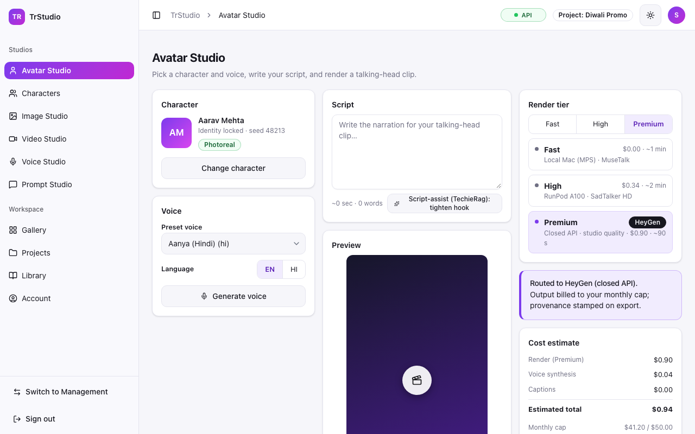
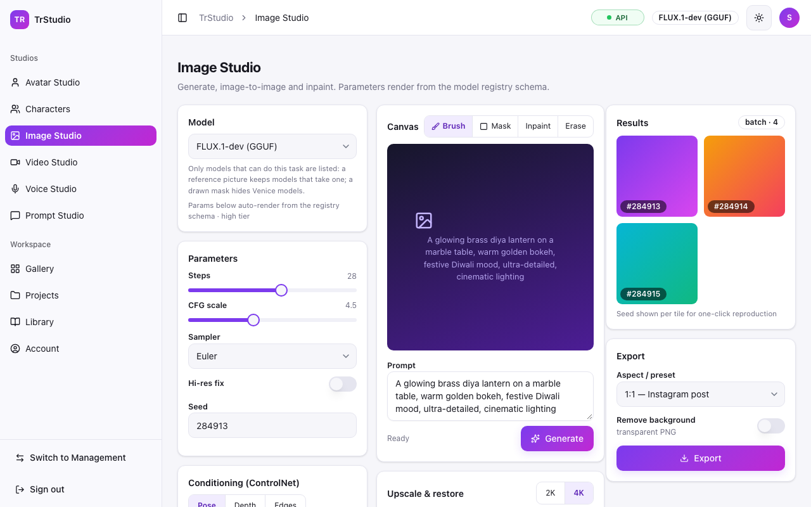
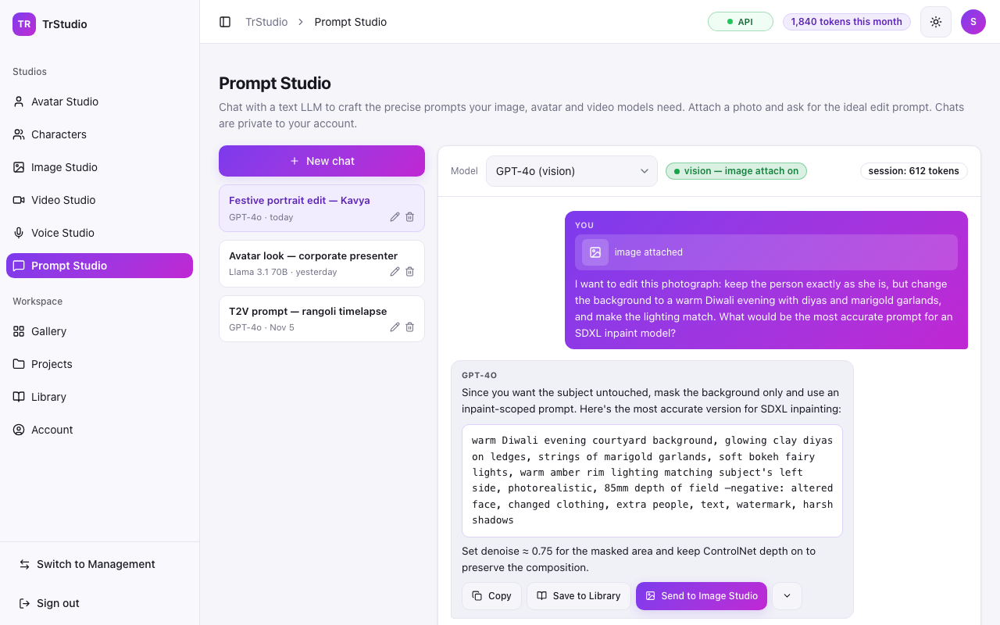
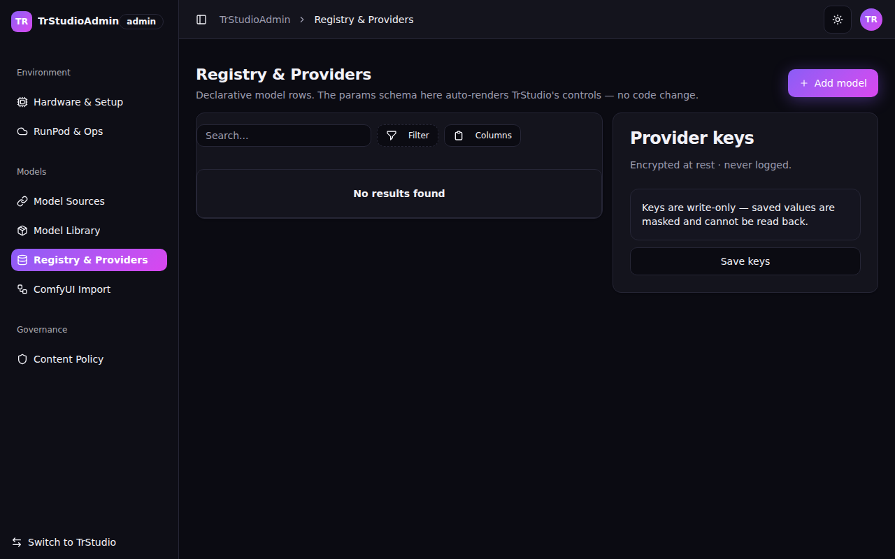

# TrStudio — Techie Rathore Studio

**An avatar-led, self-hostable AI image & video generation platform.** One clean app to produce avatar-led videos (a talking presenter that isn't you), plus the supporting images, voices and clips — **without ComfyUI graphs or Python setup for the end user** — running against models *you* control, on your own hardware or cheap on-demand GPUs, with a HeyGen-grade Premium tier on tap.

Built with **.NET 10** as **one .NET MAUI Blazor Hybrid desktop app** with the engine inside it: no API process, no web server, no database server. The first release is for **Mac**; Windows (and possibly Linux) come in a later version.



## Why it exists

Two design drivers shape everything:

1. **Economics.** A single machine with ~36 GB unified memory and a ~$100/month budget can't run heavy avatar/video generation locally or on an always-on rented GPU. So heavy work runs on **serverless, scale-to-zero GPUs** behind a three-tier quality/cost selector:
   - **Fast** — local generation (Apple Silicon / MPS, ONNX)
   - **High** — self-hosted RunPod serverless (scale-to-zero, idle auto-stop, monthly cost cap)
   - **Premium** — closed APIs (e.g. HeyGen) when quality matters most
2. **Safety & law.** Hard, non-disableable safety floors (CSAM prevention, no NCII / real-person deepfakes, consent gating, C2PA provenance, audit trail) are enforced **before any job is enqueued, on every provider, in every mode**. That is what keeps payments, app stores, hosting and a future SaaS path open.

## Feature highlights

| Area | What you get |
|------|--------------|
| 🎭 **Avatar Studio** (lead feature) | Synthetic characters with identity lock, Fast/High/Premium tier routing, lip-sync, captions/SRT, RAG-backed character bible |
| 🖼️ **Image Studio** | T2I / I2I / inpaint / ControlNet / upscale / batch, seed-reproducible, export with provenance |
| 🎬 **Video Studio** | I2V / T2V with tier routing, conditioning, edit & export pipeline |
| 🗣️ **Voice Studio** | English + Hindi TTS, consent-gated voice cloning, emotion controls, hand-off to avatar |
| 💬 **Prompt Studio** | Chat with a registry-configured text LLM (vision-capable models supported) to craft generation prompts; save to library or send straight to a studio |
| 🧩 **ComfyUI management** | Import a ComfyUI workflow, map parameters, save it as a registry model (graph hidden from creators), version-pin, sandbox-test |
| 🗂️ **Workspace** | Gallery, projects, reproduce-from-provenance, comparison, prompt library, spend dashboard |
| ⚙️ **Admin surface** | Hardware detection, guided runtime setup, model/provider registry, RunPod control, cost guardrails (monthly cap blocks new jobs), ops dashboard |
| 🔐 **Identity** | Delegated to an external AppManager service (sign-in, licensing, tiers) — TrStudio never stores passwords; optional "Remember me" for 30 days |

Adding a model is a **configuration action** (a registry row or a ComfyUI import), not a development task.

## Architecture at a glance

One unified, **role-based** app: Creators see the studios, Operators see the management surface, Owners see both. Everything runs inside one desktop process:

```
┌──────────────────────────────────────────────────────────────┐
│ TrStudio.app  (.NET MAUI Blazor Hybrid — Mac first)          │
│   TrStudioUI screens (TrBlazeUI)                             │
│   TrStudio.InProcess → TrStudio.Engine (jobs, providers,     │
│     safety floors, cost guardrails, job runner)              │
│   SQLite: TrStudio.db + TrStudio.vectors.db (user data dir)  │
└──────┬──────────────┬─────────────┬─────────────┬────────────┘
       ▼              ▼             ▼             ▼
 Local models    RunPod        Closed APIs    AppManager
 (MPS)           serverless    (HeyGen, …)    (identity)
```

| Project | What it is |
|---------|------------|
| `src/TrStudio` | The app — .NET MAUI Blazor Hybrid (`TrStudio.csproj`, app id `com.techierathore.trstudio`) |
| `src/TrStudioUI` | Razor Class Library — every screen, built on [TrBlazeUI](https://github.com/techierathore) controls |
| `src/TrStudio.InProcess` | Hosts the engine inside the app process |
| `src/TrStudio.Engine` | Engine class library — `Domain/`, `Infrastructure/`, `Providers/`, `Workers/` |
| `src/TrStudio.Models` | Shared models, interfaces and contracts |
| `src/TrStudioDb` | SQLite migrations, run by the app on first start |
| `tests/` | Unit, integration, and headless checks (`tests/TrStudio.TestHost` + Playwright specs in `tests/verify/`) |

`src/TrStudioApi` and the PostgreSQL scripts stay on disk, out of the solution build, kept for a later external REST API.

**Stack:** .NET 10 · .NET MAUI Blazor Hybrid · Dapper (parameterized SQL — no EF Core) · SQLite · Serilog · [TechieRag](https://github.com/techierathore) for text/LLM/RAG · AppManager (external) for identity and licensing.

Full details: [`docs/TrStudio-Architecture.md`](docs/TrStudio-Architecture.md) · [`docs/TrStudio-BRD.md`](docs/TrStudio-BRD.md)

## Getting started

### Prerequisites (Mac)

- **.NET 10 SDK** with the **MAUI workload** (`sudo dotnet workload install maui`) and **full Xcode** (licence accepted)
- Access to the private **TrBlazeUI/TechieRag** NuGet feed (a token with `read:packages`)
- AppManager sign-in settings for this app (address, application id, API key)
- Optional: **ffmpeg** on PATH (video export); keys for the tiers you use (RunPod, HeyGen, Venice, …), entered in the app

### 1. Settings files (before the first build)

```bash
cp nuget.config.template nuget.config                                        # fill in the feed token
cp src/TrStudio/appmanager.template.json src/TrStudio/appmanager.local.json  # AppManager address, application id, API key
```

Both files are **git-ignored**. The AppManager values are put into the build; without them the app still opens and Login says the copy was built without its sign-in settings. Keys you own (Venice, RunPod, HeyGen, closed API, text models) are entered on **Registry & providers** inside the app and kept in the local database, protected by the Mac Keychain. No setting is read from an environment variable.

### 2. Build and run on the Mac

```bash
dotnet build src/TrStudio/TrStudio.csproj -f net10.0-maccatalyst
open src/TrStudio/bin/Debug/net10.0-maccatalyst/maccatalyst-arm64/TrStudio.app
```

On first start the app creates and migrates `TrStudio.db` (and `TrStudio.vectors.db`) in your app data folder. Sign in through AppManager; tick **Remember me on this computer for 30 days** to skip the sign-in on the next opens. The whole solution builds with `dotnet build TrStudio.slnx`. See [`docs/TrStudio-BuildAndRun-Guide.md`](docs/TrStudio-BuildAndRun-Guide.md) for details.

**Windows (later version):** the Windows head stays in the project; on a Windows machine, `dotnet build src/TrStudio/TrStudio.csproj -f net10.0-windows10.0.19041.0`.

### 3. Tests

```bash
bash .tfcore/utils/tf-build.sh test       # unit + integration (about 410 unit tests)
bash .tfcore/utils/tf-verify-boot.sh start --head web --project tests/TrStudio.TestHost/TrStudio.TestHost.csproj --port 5099
npx playwright test                       # headless checks against http://localhost:5099
```

`tests/TrStudio.TestHost` is a test-only web host (never shipped) that serves the same screens and engine on a temporary SQLite folder.

## Screenshots

| Image Studio | Prompt Studio | Model Registry (admin) |
|---|---|---|
|  |  |  |

More: every screen is captured in [`docs/screenshots/TrStudio/`](docs/screenshots/TrStudio/), and mockups live in [`docs/mockups/`](docs/mockups/).

## Trust, safety & provenance

TrStudio enforces **non-disableable safety floors** regardless of any mode or configuration:

- **CSAM blocked by design** (hash + classifier, on every provider) — never toggleable
- **No sexual content of real, identifiable people** without recorded consent; **no minors in any sexual context, ever**
- **No impersonation of real public figures** without explicit rights
- **C2PA provenance / AI-disclosure metadata** stamped on every output
- **Consent gating** for voice cloning and likeness use
- **Full audit trail** of every generation

These fire *before* a job is enqueued and were verified to still fire with every optional filter lifted. Data is held in a local SQLite file in the user's own app data folder (DPDP-aligned); identity is delegated to AppManager — no local password store.

## Documentation

| Doc | Purpose |
|-----|---------|
| [`docs/TrStudio-BRD.md`](docs/TrStudio-BRD.md) | Business requirements — features, ledger (BRD-1..92), NFRs, risks |
| [`docs/TrStudio-Architecture.md`](docs/TrStudio-Architecture.md) | System architecture + ADRs |
| [`docs/TrStudio-BuildAndRun-Guide.md`](docs/TrStudio-BuildAndRun-Guide.md) | Build and run on the Mac (Windows in a later version) |
| [`docs/TrStudio-UsageGuide.md`](docs/TrStudio-UsageGuide.md) | Setup, test users & UAT test plan |
| [`docs/devguides/`](docs/devguides/) | Screen-by-screen developer guide (page → service → data access) |
| [`docs/TrStudio-Coding-Standards.md`](docs/TrStudio-Coding-Standards.md) | Coding standards for contributors |
| [`PROJECT-STATUS.md`](PROJECT-STATUS.md) | Live per-phase status & verification log |

## Status

Current status, phase by phase, is in [`PROJECT-STATUS.md`](PROJECT-STATUS.md). It lists what is verified, what is still open and the next command to run.

## License

No open-source license has been applied yet — **all rights reserved**. The UI additionally depends on the private TrBlazeUI component library, so third-party builds require feed access. Open an issue if you're interested in using or contributing to TrStudio.
