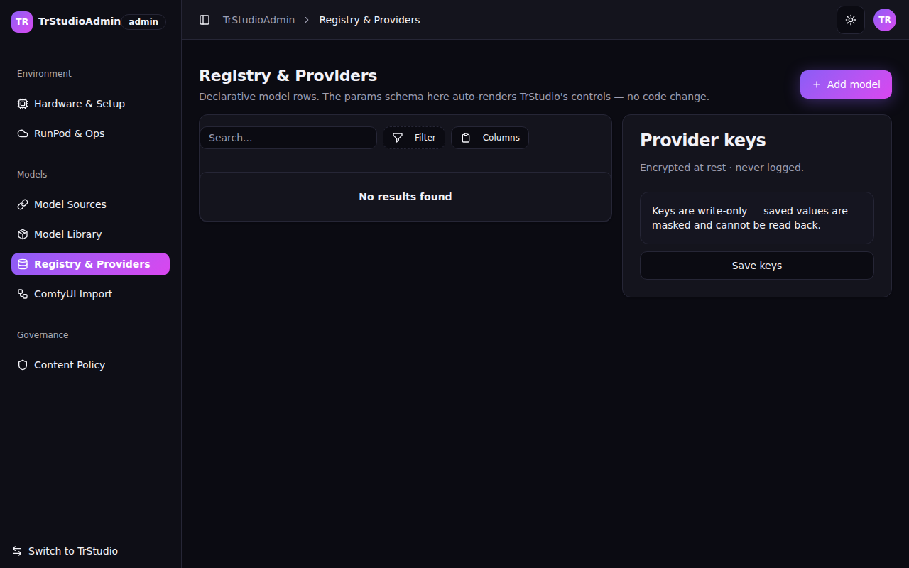

# TrStudio — Techie Rathore Studio

**An avatar-led, self-hostable AI image & video generation platform.** One clean app to produce avatar-led videos (a talking presenter that isn't you), plus the supporting images, voices and clips — **without ComfyUI graphs or Python setup for the end user** — running against models *you* control, on your own hardware or cheap on-demand GPUs, with a HeyGen-grade Premium tier on tap.

Built with **.NET 10** — Blazor Web + **.NET MAUI Blazor Hybrid** desktop heads (Windows & macOS) over a single ASP.NET Core API.


## Why it exists

Two design drivers shape everything:

1. **Economics.** A single machine with ~36 GB unified memory and a ~$100/month budget can't run heavy avatar/video generation locally or on an always-on rented GPU. So heavy work runs on **serverless, scale-to-zero GPUs** behind a three-tier quality/cost selector:
   - **Fast** — local generation (Apple Silicon / MPS, ONNX)
   - **High** — self-hosted RunPod serverless (scale-to-zero, idle auto-stop, monthly cost cap)
   - **Premium** — closed APIs (e.g. HeyGen) when quality matters most
2. **Safety & law.** Hard, non-disableable safety floors (CSAM prevention, no NCII / real-person deepfakes, consent gating, C2PA provenance, audit trail) are enforced **before any job is enqueued, on every provider, in every mode**. That is what keeps payments, app stores, hosting and a future SaaS path open.

## Feature highlights

| Area | What you get |
|------|--------------|
| 🎭 **Avatar Studio** (lead feature) | Synthetic characters with identity lock, Fast/High/Premium tier routing, lip-sync, captions/SRT, RAG-backed character bible |
| 🖼️ **Image Studio** | T2I / I2I / inpaint / ControlNet / upscale / batch, seed-reproducible, export with provenance |
| 🎬 **Video Studio** | I2V / T2V with tier routing, conditioning, edit & export pipeline |
| 🗣️ **Voice Studio** | English + Hindi TTS, consent-gated voice cloning, emotion controls, hand-off to avatar |
| 💬 **Prompt Studio** | Chat with a registry-configured text LLM (vision-capable models supported) to craft generation prompts; save to library or send straight to a studio |
| 🧩 **ComfyUI management** | Import a ComfyUI workflow, map parameters, save it as a registry model (graph hidden from creators), version-pin, sandbox-test |
| 🗂️ **Workspace** | Gallery, projects, reproduce-from-provenance, comparison, prompt library, spend dashboard |
| ⚙️ **Admin surface** | Hardware detection, guided runtime setup, model/provider registry, RunPod control, cost guardrails (monthly cap → HTTP 402), ops dashboard |
| 🔐 **Identity** | Delegated to an external AppManager service (JWT auth, licensing, tiers) — TrStudio never stores passwords |

Adding a model is a **configuration action** (a registry row or a ComfyUI import), not a development task.

## Architecture at a glance

One unified, **role-based** Blazor app: Creators see the studios, Operators see the management surface, Owners see both. It ships as two interchangeable UI heads over one backend:

```
┌─────────────────────────────┐   ┌──────────────────────────────┐
│ TrStudio (Blazor Web, :5099)│   │ TrStudio.Desktop (MAUI Blazor│
│                             │   │ Hybrid — Windows / Mac)      │
└──────────────┬──────────────┘   └──────────────┬───────────────┘
               │        shared TrStudioUI RCL (TrBlazeUI)        
               ▼                                 ▼
┌─────────────────────────────────────────────────────────────────┐
│ TrStudioApi (.NET 10, ASP.NET Core, :5102)                      │
│ async job model · provider abstraction · Hangfire queue ·       │
│ SignalR progress · OpenAPI · safety floors · cost guardrails    │
└──────┬──────────────┬─────────────┬─────────────┬───────────────┘
       ▼              ▼             ▼             ▼
 PostgreSQL      Local (ONNX/   RunPod        Closed APIs      AppManager
 + PgVector      ComfyUI MPS)   serverless    (HeyGen, …)      (identity)
```

| Project | What it is |
|---------|------------|
| `src/TrStudio.Models` | Shared models, interfaces & contracts |
| `src/TrStudio.Engine` | Engine class library — `Domain/`, `Infrastructure/`, `Providers/`, `Workers/` |
| `src/TrStudioDb` | DbUp migration runner (embedded SQL, runs on API startup) |
| `src/TrStudioApi` | ASP.NET Core backend host |
| `src/TrStudioUI` | Razor Class Library — every screen, built on [TrBlazeUI](https://github.com/techierathore) controls |
| `src/TrStudio` | Blazor Web head |
| `src/TrStudio.Desktop` | .NET MAUI Blazor Hybrid desktop head (Windows + Mac Catalyst) |
| `tests/` | Unit, integration (live API), Playwright UI and verify suites — 260 tests |

**Stack:** .NET 10 · Blazor · .NET MAUI · Dapper (parameterized SQL — no EF Core) · PostgreSQL + PgVector · Hangfire (Postgres storage) · SignalR · Serilog + OpenTelemetry · [TechieRag](https://github.com/techierathore) for text/LLM/RAG · AppManager (external) for identity & licensing.

Full details: [`docs/TrStudio-Architecture.md`](docs/TrStudio-Architecture.md) · [`docs/TrStudio-BRD.md`](docs/TrStudio-BRD.md)

## Getting started

### Prerequisites

- **.NET 10 SDK** with the **MAUI workload** (`dotnet workload install maui`) — the MAUI workload is only needed for the desktop head
- **PostgreSQL 16+** with the **PgVector** extension, plus a `trstudio` database/user
- **ffmpeg** on PATH (video export)
- Access to the private **TrBlazeUI/TechieRag** NuGet feed (GitHub Packages) — a PAT with `read:packages`
- Optional, per tier you actually use: RunPod API key (High), HeyGen key (Premium), a running AppManager instance (identity), local Python/ComfyUI env (Fast)

### 1. Configure secrets (required before first build)

```bash
# NuGet feed credentials (repo root)
cp nuget.config.template nuget.config           # then fill in your GitHub username + PAT

# API configuration
cp src/TrStudioApi/appsettings.template.json src/TrStudioApi/appsettings.json
# then set your DB connection string + AppManager keys (or supply them as env vars)
```

Both target files are **gitignored** — real credentials never enter the repository. Prefer environment variables (`AppManager__ApiKey=…`, `RunPod__ApiKey=…` style) for anything sensitive.

### 2. Run (web)

```bash
dotnet run --project src/TrStudioApi     # backend      → http://localhost:5102
dotnet run --project src/TrStudio       # web head     → http://localhost:5099
```

Database migrations run automatically on API startup (DbUp). Log in via AppManager; with setup incomplete, admins land in the guided-setup gate.

### 3. Run (native desktop, MAUI)

```powershell
# Windows — always pin the framework; the csproj also lists the Mac Catalyst TFM
dotnet build src/TrStudio.Desktop -f net10.0-windows10.0.19041.0 -c Release
```

```bash
# macOS (Mac Catalyst .app must be built ON a Mac — Xcode + MAUI workload)
dotnet build src/TrStudio.Desktop -f net10.0-maccatalyst -c Release
open src/TrStudio.Desktop/bin/Release/net10.0-maccatalyst/maccatalyst-arm64/TrStudio.app
```

The desktop head talks to the API at `http://localhost:5102` by default; override with the `TrStudioApiBaseUrl` environment variable. See [`docs/TrStudio-BuildAndRun-Guide.md`](docs/TrStudio-BuildAndRun-Guide.md) for the full build-on-Windows / run-on-Mac playbook, including self-contained `osx-arm64` publishing.

### 4. Tests

```bash
dotnet test                              # 260 unit + integration tests
npx playwright test                      # UI smoke suite (needs API + web head running)
```

## Screenshots

| Image Studio | Prompt Studio | Model Registry (admin) |
|---|---|---|
|  |  |  |

More: every screen is captured in [`docs/screenshots/TrStudio/`](docs/screenshots/TrStudio/), and mockups live in [`docs/mockups/`](docs/mockups/).

## Trust, safety & provenance

TrStudio enforces **non-disableable safety floors** regardless of any mode or configuration:

- **CSAM blocked by design** (hash + classifier, on every provider) — never toggleable
- **No sexual content of real, identifiable people** without recorded consent; **no minors in any sexual context, ever**
- **No impersonation of real public figures** without explicit rights
- **C2PA provenance / AI-disclosure metadata** stamped on every output
- **Consent gating** for voice cloning and likeness use
- **Full audit trail** of every generation

These fire *before* a job is enqueued and were verified to still fire with every optional filter lifted. Data is held in TrStudio's own PostgreSQL (DPDP-aligned); identity is delegated to AppManager — no local password store.

## Documentation

| Doc | Purpose |
|-----|---------|
| [`docs/TrStudio-BRD.md`](docs/TrStudio-BRD.md) | Business requirements — features, ledger (BRD-1..92), NFRs, risks |
| [`docs/TrStudio-Architecture.md`](docs/TrStudio-Architecture.md) | System architecture + ADRs |
| [`docs/TrStudio-BuildAndRun-Guide.md`](docs/TrStudio-BuildAndRun-Guide.md) | Build on Windows · run on the Mac (both options) |
| [`docs/TrStudio-UsageGuide.md`](docs/TrStudio-UsageGuide.md) | Setup, test users & UAT test plan |
| [`docs/devguides/`](docs/devguides/) | Screen-by-screen developer guide (page → service → data access) |
| [`docs/TrStudio-Coding-Standards.md`](docs/TrStudio-Coding-Standards.md) | Coding standards for contributors |
| [`PROJECT-STATUS.md`](PROJECT-STATUS.md) | Live per-phase status & verification log |

## Status

**Handoff / UAT.** All 10 build phases are complete: 114 tracked requirements — **82 verified live, 17 implemented** (externally gated: real models / API keys, degrade cleanly), 4 partial, 11 deferred post-MVP. 260 tests passing. The Windows desktop head is run-verified; Mac Catalyst is build-verified.

## License

No open-source license has been applied yet — **all rights reserved**. The UI additionally depends on the private TrBlazeUI component library, so third-party builds require feed access. Open an issue if you're interested in using or contributing to TrStudio.
