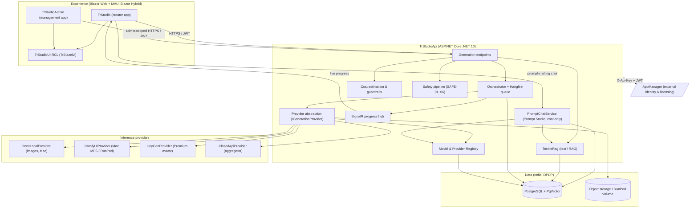
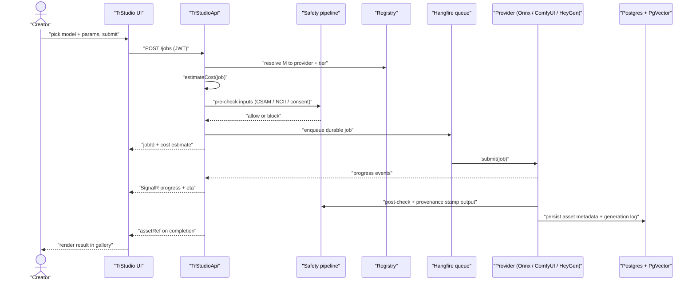
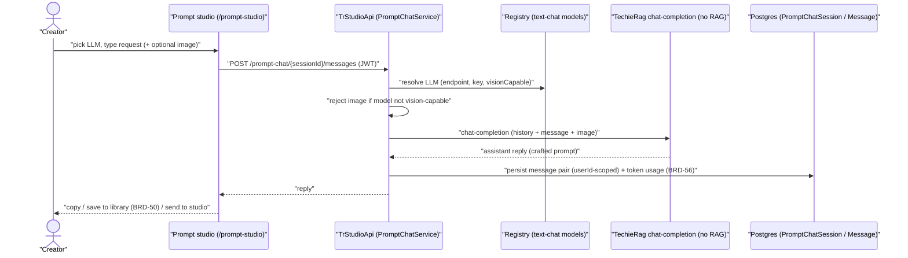
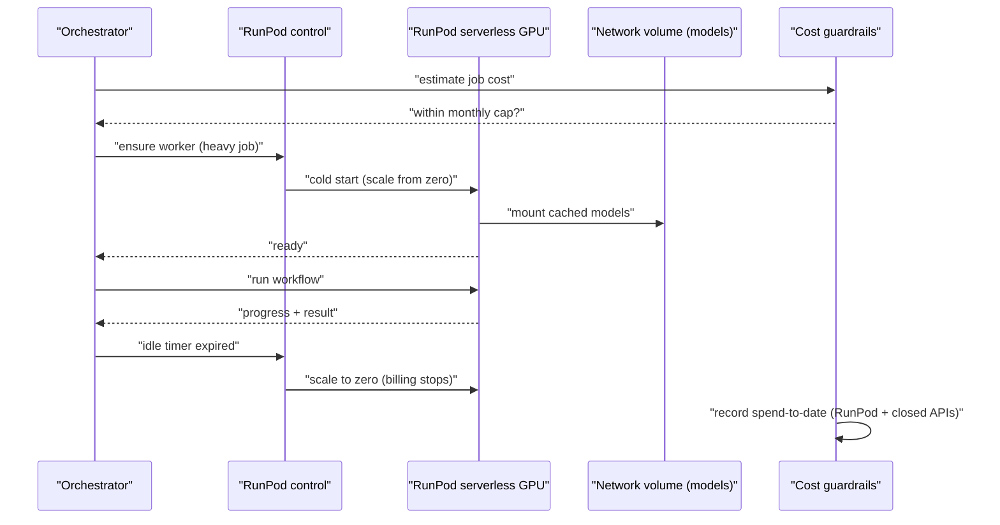
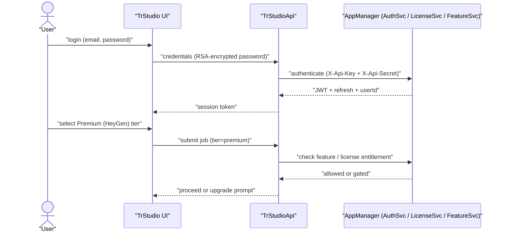
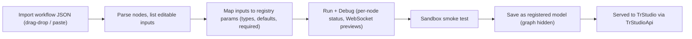
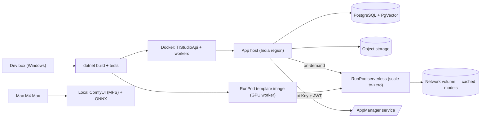
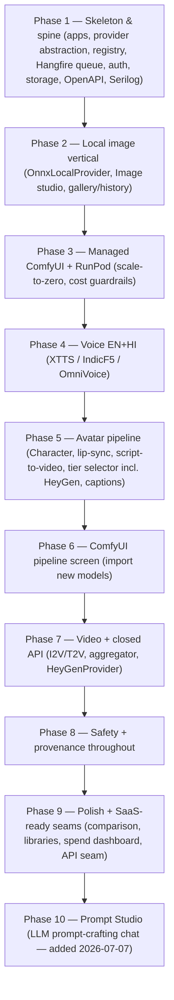

# TrStudio — Architecture

**Last updated:** 2026-07-07
**Status:** Target (greenfield) · amended 2026-07-05: consolidated to one role-based `TrStudio` app + MAUI desktop Win/Mac (ADR-012 supersedes ADR-001) · amended 2026-07-07: Prompt Studio LLM chat path added (F-PROMPT, BRD-88..92, ADR-013)

## Table of Contents

1. [Tech stack](#tech-stack)
2. [Component map](#component-map)
3. [Data flow — primary generation job path](#data-flow-primary-generation-job-path)
4. [Module responsibilities](#module-responsibilities)
5. [Provider abstraction and the three execution tiers](#provider-abstraction-and-the-three-execution-tiers)
6. [Model and provider registry](#model-and-provider-registry)
7. [Identity and licensing — AppManager integration](#identity-and-licensing-appmanager-integration)
8. [ComfyUI pipeline management](#comfyui-pipeline-management)
9. [Cross-cutting concerns](#cross-cutting-concerns)
10. [Deployment architecture](#deployment-architecture)
11. [Architectural decisions (ADR-style log)](#architectural-decisions-adr-style-log)
12. [Build roadmap (phased target)](#build-roadmap-phased-target)
13. [Open questions / risks](#open-questions-risks)

## 1. Tech stack

| Layer | Choice | Version | Notes |
|-------|--------|---------|-------|
| Runtime | .NET | 10 (LTS) | Unified Blazor render modes; released Nov 2025 |
| Creator + Management UI | `TrStudio` — **one unified Blazor app**, role-based surface (Blazor Web + MAUI Blazor Hybrid desktop) | .NET 10 | Creator/Operator/Owner see their surface by role; Win+Mac desktop **and** browser |
| ~~Management UI~~ | ~~`TrStudioAdmin`~~ — **retired 2026-07-05**, merged into `TrStudio` (ADR-012) | — | Screens moved to `TrStudioUI` RCL under role-gated routes |
| Shared UI | `TrStudioUI` — Razor Class Library on **TrBlazeUI** | .NET 10 | Components/layouts/screens shared by both apps |
| Backend / API | `TrStudioApi` — ASP.NET Core | .NET 10 | Provider abstraction, registry, orchestrator, generation endpoints, OpenAPI, SignalR |
| Background jobs | **Hangfire** (PostgreSQL storage) | — | Durable queue, retries, concurrency caps — **no Redis** |
| Cache | `IMemoryCache` (in-process) | — | No distributed cache for the MVP |
| Local image inference | **ONNX Runtime** (CoreML/CPU EP) | — | SDXL/FLUX image path; aligns with TechieRag's ONNX usage |
| Media inference | **ComfyUI** (managed, isolated Python) | — | Mac MPS (Fast tier) + RunPod serverless (High tier) |
| Premium avatar | **HeyGen API** | — | Premium tier, user-selectable per job |
| Closed image/video | Aggregator adapter (fal.ai / Replicate / WaveSpeed) | — | Vendor adapters (Veo/Kling/Seedance) later |
| Text / LLM / RAG | **TechieRag** + **TechieRag.Embedded** (NuGet, GitHub Packages) | .NET 10 | Script/caption/prompt-memory/character-bible; PgVector store + ONNX embeddings. **Text only — not the image path** |
| DB | **PostgreSQL + PgVector** | 16+ | Relational + vector in one instance; India-resident (DPDP) |
| Data access | **Dapper** | — | Micro-ORM; **no EF Core**; parameterized SQL in the engine's `Infrastructure/` folder |
| Migrations | **DbUp** (`TrStudioDb` project) | — | Embedded SQL scripts executed on `TrStudioApi` startup |
| Object storage | Object store (assets) + RunPod network volume (models) | — | Big media models on `$0.07/GB/mo` network volume |
| Auth / Identity | **AppManager** (external child-app API) | — | JWT + `X-Api-Key`/`X-Api-Secret`, RSA-encrypted passwords; **not** the app DB |
| Logging / Telemetry | **Serilog** (structured) + **OpenTelemetry** | — | Queue/memory/latency/spend metrics, traceable job IDs |
| Packaging | Docker (`TrStudioApi` + workers) + RunPod template image | — | — |

## 2. Component map



## 3. Data flow — primary generation job path

The signature flow: the creator submits *"task T, model M, params P"*; `TrStudioApi` never lets the UI know which provider runs it. Cost is estimated and safety-checked **before** the job is enqueued.



### 3.1 Prompt-crafting chat path (F-PROMPT, added 2026-07-07)

The Prompt Studio path deliberately bypasses the generation-job machinery — no Hangfire job, no provider abstraction, no safety-generation pipeline (its output is advisory text, not media). `TrStudioApi` resolves the picked LLM from the registry (`text-chat` modality) and calls **TechieRag chat-completion directly — no RAG/vector setup**. Sessions and messages persist per user (BRD-81 owner filter); token usage flows into the BRD-56 text-LLM budget.



## 4. Module responsibilities

| Module | Type | Responsibility | Depends on |
|--------|------|----------------|------------|
| `src/TrStudio` | Blazor app | **Unified app (Web + MAUI Hybrid desktop, Win/Mac)** — presents creator studios AND (role-gated) the management surface; avatar/image/video/voice studios, gallery, projects | `TrStudioUI`, `TrStudio.Models`, `TrStudioApi` (HTTP) |
| `src/TrStudioAdmin` | ~~Blazor app~~ **RETIRED 2026-07-05 (ADR-012)** — merged into `TrStudio`; management screens now live in `TrStudioUI` under role-gated routes | ~~Management app (Web + MAUI Hybrid) — hardware detection, setup, model sources, registry editing, RunPod control, ComfyUI import/debug, ops, cost, content policy~~ | `TrStudioUI`, `TrStudio.Models`, `TrStudioApi` (admin-scoped HTTP) |
| `src/TrStudioUI` | Razor Class Library | Shared layouts, screens and components on TrBlazeUI, consumed by both apps across Web + desktop. Now also hosts the (role-gated) management screens formerly in `TrStudioAdmin`. | TrBlazeUI, `TrStudio.Models` |
| `src/TrStudioApi` | ASP.NET Core host | The unified backend contract — generation endpoints, orchestrator wiring, registry endpoints, queue, cost, safety, auth integration, SignalR. Runs `TrStudioDb` (DbUp) on startup | `TrStudio.Engine`, `TrStudio.Models`, `TrStudioDb` |
| `src/TrStudio.Engine` | Class library | The engine. Folders: **`Domain/`** (entities & rules — Character, Job, Asset, registry rows, GenerationLog, Consent), **`Infrastructure/`** (Dapper data access, Hangfire wiring, object storage, encrypted key store, AppManager client), **`Providers/`** (`OnnxLocalProvider`, `ComfyUIProvider`, `HeyGenProvider`, `ClosedApiProvider`), **`Workers/`** (ComfyUI worker control local MPS + RunPod, ONNX in-process image worker) | `TrStudio.Models` |
| `src/TrStudio.Models` | Class library | Shared models/DTOs/entities, **interfaces** (`IGenerationProvider`, repository contracts), provider/registry contracts, enums — referenced by every app, the RCL, and the engine | (none) |
| `src/TrStudioDb` | Class library | **DbUp** migration runner — embedded, ordered SQL scripts (schema, PgVector, registry/jobs/characters, seed); executed on `TrStudioApi` startup | DbUp, `TrStudio.Models` (optional) |

**`TrStudio.Models` — the shared contract types.** A dependency-free class library holding everything multiple projects must agree on: entity/DTO shapes, enums (tier, task, safetyClass), and the interfaces (`IGenerationProvider`, repository contracts). Both Blazor apps, the RCL, the API host and the engine reference it, so types never get duplicated or drift.

**`TrStudio.Engine` — one engine, four folders.** The former Domain / Infrastructure / Providers / Workers projects are now folders inside a single `TrStudio.Engine` class library (fewer projects to wire, one assembly to reference). `Domain/` holds business rules; `Infrastructure/` holds the **Dapper** data-access layer (parameterized SQL, the per-user `userId` owner filter applied to every query — BRD-81), Hangfire wiring, object storage, the encrypted key store and the AppManager client; `Providers/` holds the `IGenerationProvider` implementations; `Workers/` drives the ComfyUI workers (local MPS + RunPod) and the in-process ONNX image worker.

**`TrStudioApi` — the shared contract.** This is the boundary that keeps the system sane. `TrStudioAdmin` is *only a UI*; it performs admin actions by calling admin-scoped `TrStudioApi` endpoints. Any capability `TrStudio` also needs — or that may be exposed to third parties later — is a first-class `TrStudioApi` endpoint, never buried in the admin app. The registry, job, and generation services are shared; only setup/sources, ComfyUI import/debug, content-policy and ops are admin-scoped. **On startup the API runs `TrStudioDb` (DbUp)** to create/upgrade the schema before serving traffic.

**Provider abstraction.** Each provider (in `TrStudio.Engine/Providers/`, implementing `IGenerationProvider` from `TrStudio.Models`) is routed by the orchestrator to exactly one resolved model and treated uniformly: `submit → status → result → estimateCost`. One `ComfyUIProvider` serves *all* ComfyUI-backed models (avatar, lip-sync, video) because each model is just a workflow template (§6/§8).

**Prompt Studio chat path (F-PROMPT, added 2026-07-07).** The prompt-crafting chat spans the existing modules without new projects: `TrStudioUI` gains the Prompt Studio screen (`/prompt-studio` — chat pane, registry-driven LLM picker, image attachment, session list, prompt-use actions); `TrStudioApi` exposes the `prompt-chat` endpoints; `TrStudio.Engine` gains `Domain/` entities `PromptChatSession`/`PromptChatMessage` and an `Infrastructure/` `PromptChatService` that resolves the picked model from the registry and calls **TechieRag chat-completion directly (no RAG pipeline)**, applying the BRD-81 owner filter to every session/message query and recording token usage (BRD-56); `TrStudioDb` adds the DbUp script for the two tables. Text-chat LLMs are ordinary registry rows (`text-chat` modality, §6) — no separate config store.

**Single Postgres, Dapper + DbUp.** PgVector gives vector + relational in one instance, so the registry, jobs, characters, asset metadata, generation log **and** embeddings/vectors all live in one PostgreSQL database. Data access is **Dapper** (parameterized SQL, no EF Core); schema is created/upgraded by **DbUp** scripts in `TrStudioDb`, run automatically when `TrStudioApi` starts. Durable jobs use Hangfire's Postgres storage; there is no Redis. Provider API keys are held in an encrypted key store.

## 5. Provider abstraction and the three execution tiers

`TrStudio` requests *"task T with model M and params P."* `TrStudioApi` resolves **M → a provider** and routes the job. Every provider implements:

```
IGenerationProvider
  ├─ supports(task, model) : bool
  ├─ submit(job) : jobId           // async
  ├─ status(jobId) : {state, progress, eta}
  ├─ result(jobId) : assetRef
  └─ estimateCost(job) : money
```

**Concrete providers (MVP):**
- `OnnxLocalProvider` — ONNX Runtime, CoreML/CPU EP; image + upscale (*Fast tier*).
- `ComfyUIProvider` — drives a ComfyUI instance (local MPS or RunPod) via its HTTP `/prompt` API + WebSocket progress; serves all ComfyUI-backed models (*Fast/High tiers*).
- `HeyGenProvider` — adapter for the HeyGen API (*Premium tier*, avatars).
- `ClosedApiProvider` — aggregator (fal.ai/Replicate/WaveSpeed) or direct vendor for closed image/video (*Premium tier*).

The same UI control (AV-04) lets the user pick the tier per job — **Fast (Mac local)**, **High (RunPod serverless)**, or **Premium (HeyGen API)** — and the abstraction swaps the provider underneath.

**The hard design driver — scale-to-zero.** 36 GB unified memory + a $100/mo budget means heavy avatar/video cannot live on the Mac *or* on an always-on rented GPU (a 24/7 A100 ≈ $860/mo). Heavy jobs MUST run on serverless GPUs that `TrStudioAdmin` starts on demand and that idle-stop to $0.



## 6. Model and provider registry

Every usable model is a registry row owned by `TrStudioApi`. A **declarative params schema** lets the UI render controls for any model with no code change — so "add a model" is a `TrStudioAdmin` action, not a dev task (NFR-09 extensibility).

```jsonc
{
  "id": "musetalk-v1",
  "displayName": "MuseTalk (real-time lip-sync)",
  "task": "lip-sync",
  "providerType": "comfyui",
  "tier": "fast",              // fast | high | premium
  "workflowRef": "workflows/musetalk_v1.api.json",
  "hardware": { "minVramGb": 8, "recommended": "A100", "runsOnMac": true },
  "params": [
    { "key": "sourceImage", "type": "image", "required": true },
    { "key": "audio", "type": "audio", "required": true },
    { "key": "resolution", "type": "enum", "values": ["256","512"], "default": "256" }
  ],
  "languages": ["en","hi","language-agnostic"],
  "license": "MIT",            // VERIFY per release
  "safetyClass": "avatar-synthetic-default",
  "cost": { "kind": "serverless-seconds", "estimateSecPerJob": 90 }
}
```

The registry carries each model's **license** field (used by the build-time license check, ADR-006) and **safetyClass** (`synthetic-default` | `real-person-gated`), which scopes the safety floors (§9) applied to that model's jobs.

**Text-chat LLMs are registry rows too (F-PROMPT, added 2026-07-07).** The Prompt Studio's LLM picker is driven by registry entries with `task: "text-chat"` — same admin Registry screen, same encrypted key store, no separate config table. They are not generation models: they never enter the provider abstraction/job queue; `PromptChatService` resolves them directly (§3.1).

```jsonc
{
  "id": "gpt-4o-chat",
  "displayName": "GPT-4o (prompt crafting)",
  "task": "text-chat",         // Prompt Studio picker filters on this
  "providerType": "textllm",   // routed to PromptChatService, not IGenerationProvider
  "endpoint": "https://api.openai.com/v1",
  "apiKeyRef": "encrypted-key-store",
  "visionCapable": true,       // gates image attachment in the chat UI (BRD-90)
  "cost": { "kind": "tokens", "inPer1k": 0.005, "outPer1k": 0.015 }
}
```

## 7. Identity and licensing — AppManager integration

Users, login/JWT, licenses/subscriptions, feature & tier gating, payments and support are provided by **AppManager** (`docs/AppManager-api-usage-guide.md`). `TrStudioApi` integrates as an AppManager **child application**: `X-Api-Key`/`X-Api-Secret` for the app handshake, JWT bearer for the user session, RSA-encrypted passwords. TrStudio stores only a reference to the AppManager `userId` for ownership of characters/jobs/assets — **never passwords, and AppManager is never the application database.**



In personal mode all tiers are available; when run multi-user/SaaS, which tiers a user may select is gated via AppManager FeatureSvc/LicenseSvc (e.g. Premium behind a paid license).

## 8. ComfyUI pipeline management

ComfyUI is both a media engine (Fast/High tiers) and the mechanism for adding new models. The import/debug/use screen lives in `TrStudioAdmin`; registered models it produces are served to `TrStudio` through `TrStudioApi`. ComfyUI exposes `POST /prompt` (workflow graph as API-format JSON), `GET /history/{id}`, `/view`, and a WebSocket for live progress + node-level errors. `TrStudioApi` maps a workflow's editable node fields to UI controls via the registry params schema.



## 9. Cross-cutting concerns

- **Logging** — Serilog (structured), traceable job IDs; no secrets in logs/URLs (NFR-05/08).
- **Telemetry** — OpenTelemetry metrics: queue depth, memory, latency, spend-to-date.
- **Error handling** — global middleware; `ProblemDetails`; actionable failures surfaced to the UI (e.g. "out of memory — drop to 256px or route to RunPod", ADM-09).
- **Auth** — AppManager JWT bearer for users; `X-Api-Key`/`X-Api-Secret` for the child-app handshake; admin-scoped endpoints for `TrStudioAdmin`-only operations.
- **Caching** — `IMemoryCache` in-process only (no Redis).
- **Cost control** — per-job estimate before run; RunPod idle auto-stop; monthly cap + alerts across RunPod **and** closed APIs incl. HeyGen (ADM-10 / NFR-07).
- **Safety (binding)** — a non-disableable pipeline on every provider: CSAM hash+classifier blocks, NCII/real-person-deepfake refusal, consent gating for real faces/voices, C2PA-style provenance on outputs, public-figure impersonation block, full audit trail (SAFE-01..06).
- **Privacy / Compliance** — local jobs stay local; UI flags when a job routes to a closed API; data resident in India; DPDP-aligned; configurable retention (NFR-06/10).

## 10. Deployment architecture



Mac runs the local model stack (Fast tier) and the control plane during dev; Windows is the dev/build box; the API + workers deploy to a server in India later. The single `TrStudio` app ships as a MAUI Blazor Hybrid desktop app (Win/Mac) — the primary local delivery — and as a Blazor Web app in any modern browser; both host the same `TrStudioUI` RCL and role-gate the surface by the signed-in user (ADR-012).

## 11. Architectural decisions (ADR-style log)

- **[SUPERSEDED by ADR-012, 2026-07-05]** **ADR-001 — Two Blazor apps + shared RCL on TrBlazeUI, both Web + MAUI Blazor Hybrid.** Reason: clean separation of the creator experience (`TrStudio`) from model/provider management (`TrStudioAdmin`) while sharing one component set (`TrStudioUI`); requirement §25 mandates Web + desktop for both.
- **ADR-002 — PostgreSQL + PgVector as the single datastore; no Redis.** Reason: PgVector gives vector + relational in one DB; Hangfire/Postgres gives durable jobs; `IMemoryCache` covers in-process caching — a second datastore adds ops cost for no MVP benefit (§11 of requirements).
- **ADR-003 — PgVector (via TechieRag `UsePgVector`) as the vector store.** Reason: RAG-backed character bible, prompt/script memory and embeddings live on the same Postgres instance — no separate vector DB.
- **ADR-004 — Provider abstraction with a three-tier selector (Fast/High/Premium).** Reason: HeyGen-grade realism on tap, open-model parity, and budget control all flow through one `IGenerationProvider` seam; the UI never knows the provider.
- **ADR-005 — RunPod serverless, scale-to-zero, for heavy jobs.** Reason: 36 GB + $100/mo make always-on GPUs impossible; heavy avatar/video must be bursty and idle-stop to $0 (§3, risk register).
- **ADR-006 — ONNX Runtime directly for the image path (not TensorStack).** Reason: already used by TechieRag, removes a thin third-party dependency, full control of the image path; ComfyUI covers the media models anyway (§11 of requirements).
- **ADR-007 — AppManager as external identity/licensing child-app; not the app DB.** Reason: personal-first, SaaS-ready; delegates auth/license/feature/payment/support while TrStudio keeps its own India-resident data (DPDP).
- **ADR-008 — TechieRag (NuGet) for text/LLM/RAG only.** Reason: confirmed text-only library (script/caption/prompt memory/character bible); the image diffusion path is a separate ONNX implementation.
- **ADR-009 — Hard safety floors are non-disableable; the *general* SFW filter is an owner-only toggle.** Reason: CSAM, real-person/NCII, minors and public-figure impersonation (SAFE-01/02/03/05) are illegal-harm floors that stay enforced regardless of mode and keep payments/hosting/stores viable; the general adult-content filter may be lifted by the owner in personal mode for **synthetic adult personas** (F-NSFW, BRD-79/80) and is auto-disabled in multi-user/SaaS.
- **ADR-010 — Dapper for data access + DbUp for migrations (not EF Core).** Reason: explicit, parameterized SQL gives full control over PgVector queries and the per-user owner filter; DbUp runs ordered embedded SQL scripts (`TrStudioDb`) on API startup — simple, transparent, no migration-runtime magic.
- **ADR-011 — One `TrStudio.Engine` library + a shared `TrStudio.Models` library.** Reason: Domain/Infrastructure/Providers/Workers collapse into one engine assembly (folders, not projects) to cut wiring overhead; `TrStudio.Models` holds the contract types every app/engine shares so they never drift.
- **ADR-012 — One unified `TrStudio` app with a role-based surface, shipped as Blazor Web + MAUI Blazor Hybrid desktop (Win/Mac); supersedes ADR-001.** Reason: the owner's product intent is a single, locally-run desktop app in which the creator and management experiences are the SAME application, gated by the signed-in user's role (Creator → studios; Operator/Admin → management; Owner → both). `TrStudioAdmin` is retired; its screens move into the shared `TrStudioUI` RCL under role-gated routes hosted by the one `TrStudio` app, which ships a Blazor Web head and MAUI Blazor Hybrid desktop heads (Windows + macOS). `TrStudioApi` (the backend contract, provider abstraction, registry, orchestrator) is unchanged — only the presentation layer consolidates. The previously-deferred MAUI desktop heads (NFR-03/BRD-71/§25) become the primary delivery (BRD-86/87).
- **ADR-013 — Prompt Studio uses TechieRag direct chat-completion (no RAG pipeline); text-chat LLMs are registry rows (`text-chat` modality), outside the generation-provider abstraction.** *(2026-07-07)* Reason: the feature is a conversational prompt-crafting aid (F-PROMPT, BRD-88..92) — synchronous advisory text, so the Hangfire job model, `IGenerationProvider` seam and media safety pipeline don't apply; skipping RAG/vector setup keeps it a thin chat client. Reusing the registry (with a `visionCapable` flag and the encrypted key store) keeps "add an LLM" a config action per NFR-09 and gives the picker its DB-configured list for free.

## 12. Build roadmap (phased target)

Greenfield — nothing is built yet. The §12 build order from the requirements doc is the dependency-ordered target; each phase is independently testable. (Carried into the BRD §4 status table and seeded as phase tags by `*split-brd`.)



> Safety (SAFE-01/04) is wired into every provider from Phase 2 onward; SAFE-02/03/05 are enforced before any real-person feature. Phase 8 is the consolidation/verification pass, not the first time safety appears.

## 13. Open questions / risks

- **Model licences** vary and date quickly (XTTS Coqui CPML is non-standard; Hunyuan has a MAU cap; HeyGen has its own ToS) — the registry `license` field + a build-time check must verify each before commercial use.
- **ComfyUI on Apple Silicon (MPS/GGUF)** can be flaky — default to GGUF + low-res-first, auto-fallback to RunPod on OOM.
- **HeyGen / aggregator price changes** — keep open-model parity so the Premium tier stays optional behind the selector.
- **36 GB unified memory** is marginal for local video — route heavy jobs to RunPod/HeyGen; Mac is image + light lip-sync only.
- **TechieRag / TrBlazeUI reuse assumptions** — confirm against the real packages at Phase 1 before depending on them.
- **Credentials needed at build/run** (not blocking docs): GitHub PAT (`read:packages`), HeyGen API key, AppManager API key/secret.
- **Field-prefix:** greenfield, no code to detect from — defaulted to `obj` (Coding Standards is authoritative).

## Sources harvested

- `docs/TrStudio-Requirements-v0.3.md` — §2 app surface, §3 hardware/budget, §4 architecture, §4.2 provider abstraction, §4.3 registry, §5 model stack, §6 ComfyUI, §7 TechieRag, §11 stack, §12 build order, §13 risks.
- `docs/AppManager-api-usage-guide.md` — child-app integration model (referenced; stays in `docs/` as independently authoritative).
