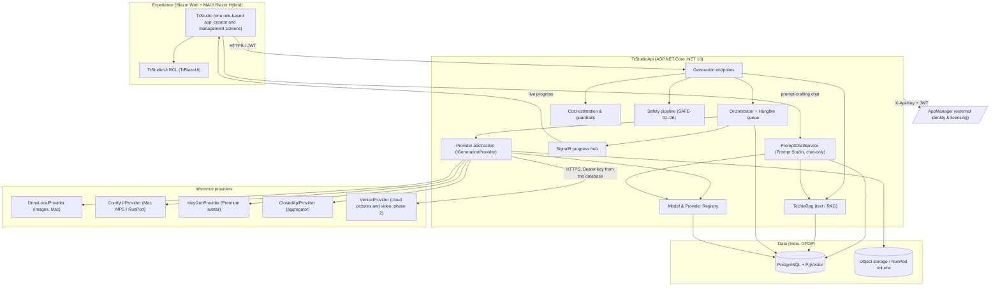
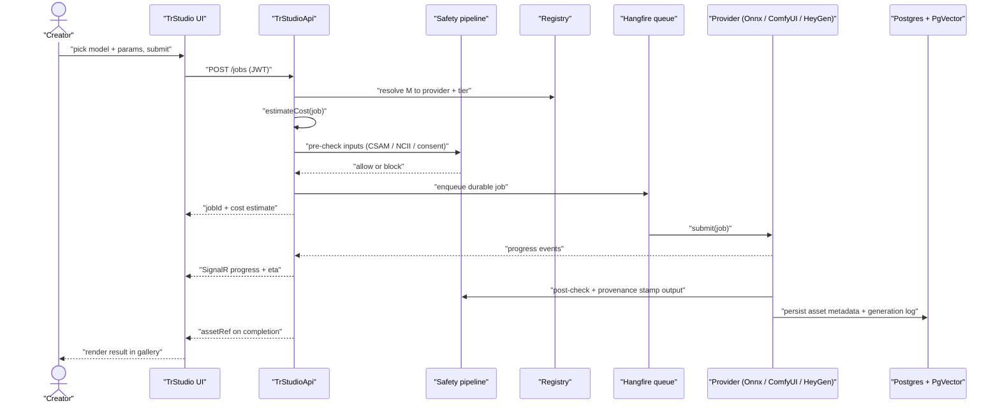
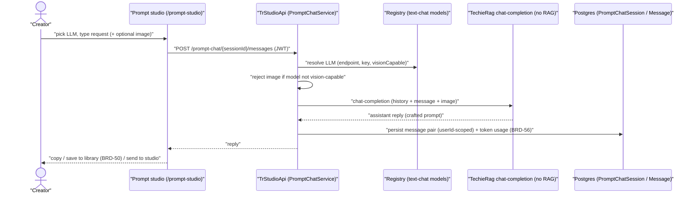
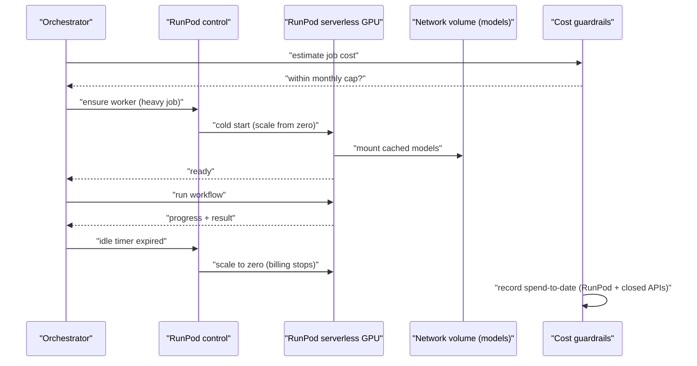
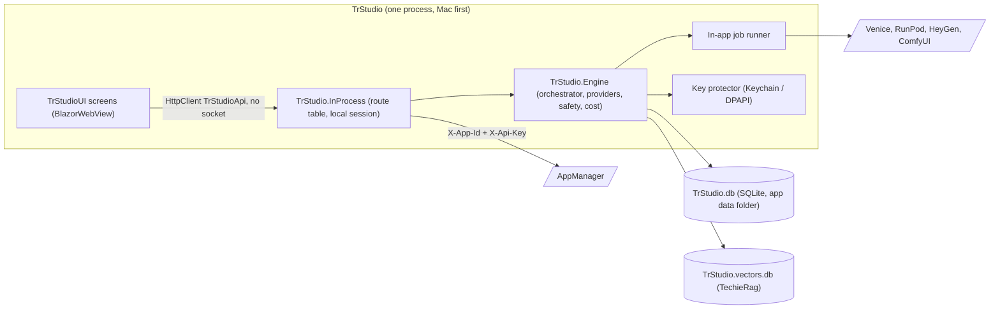
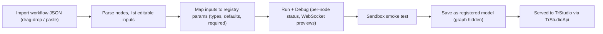
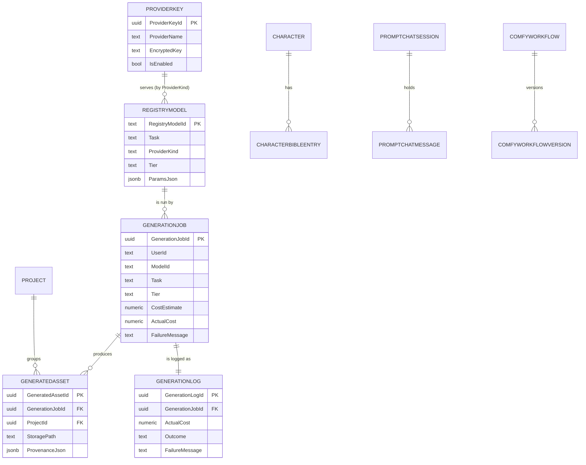
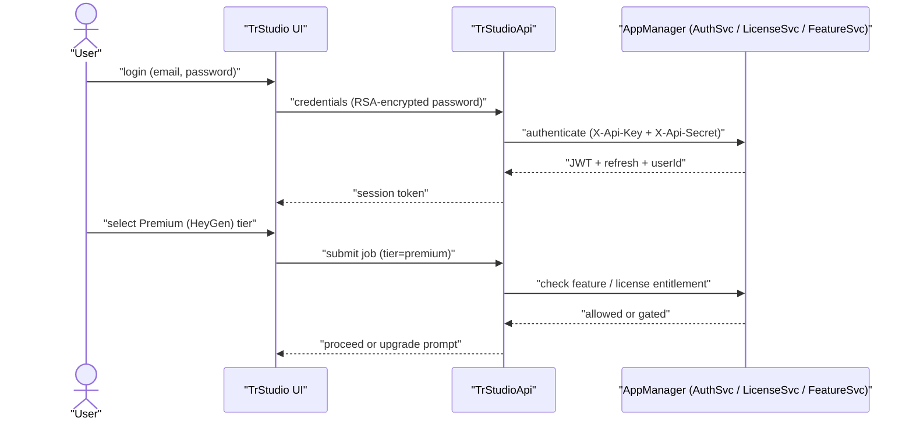
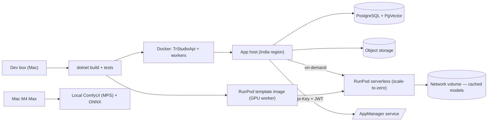

# TrStudio — Architecture

| | |
|---|---|
| App | TrStudio |
| Kind | app |
| Size | Large |
| Stack answer set | none |
| Date | 2026-11-14 |

The single `TrStudio` app has a role-based surface (ADR-012). Phase 2 adds Venice as a second cloud provider for pictures and video (ADR-014, [phase 2 BRD](TrStudio-P2-BRD.md)). Phase 3 makes TrStudio one desktop app with the engine, a local SQLite database and the job queue inside it (ADR-015 to ADR-020, [phase 3 BRD](TrStudio-P3-BRD.md)). It is Mac first, Windows later (ADR-023); "Remember me" keeps a sign-in for 30 days (ADR-021); the desktop project is `src/TrStudio` (ADR-022). The rows below say what changed.


## 1. Stack decisions

One row per stack question. The project predates the stack questions, so every answer is read from the existing code ("code").

| Q | Topic | Decision | Source |
|---|---|---|---|
| Q1 | Configuration | From phase 3 the desktop app needs no settings file a user edits: the data folder is the operating system's per-user app data folder, and the only build-time file is the git-ignored `src/TrStudio/appmanager.local.json` (AppManager address, application id, API key), embedded into the build (ADR-019). Provider addresses and keys (Venice, RunPod, HeyGen, closed API, text models) live in the local database, entered on Registry & providers. Never environment variables. The API project's `appsettings.json` stays, unused. | code |
| Q2 | Secrets in development | The AppManager id and key go in the git-ignored `appmanager.local.json` beside the desktop project. Keys a user owns are stored in the local database, encrypted by `AesGcmKeyStore` with an unlock key the operating system protects for the signed-in user: Keychain on Mac, DPAPI on Windows (ADR-020). Test secrets go in a git-ignored `testsettings.Local.json` beside the tests. Nothing secret is committed. | code |
| Q3 | Database | From phase 3: one SQLite file, `TrStudio.db`, in the signed-in user's app data folder, created and migrated by DbUp (`TrStudioDb`, `SqliteScripts/`) on every start of the app (ADR-016). If it cannot be created or migrated the app shows the folder and the reason and opens no studio. The PostgreSQL scripts and the API stay in the repository, unused. There was no real PostgreSQL data to carry over. | code |
| Q4 | Authentication | AppManager as an external child application (JWT and refresh, RSA-encrypted passwords). From phase 3 the desktop app sends `X-App-Id` and one `X-Api-Key` built in; no API secret, no signing key; the signed-in user is held in the app for the session (ADR-019). AppManager owns users, roles, licences and subscriptions; TrStudio stores only the AppManager `userId`. | code |
| Q5 | Logging | Serilog structured logging plus OpenTelemetry metrics; job ids on every line; no secrets in logs or URLs. | code |
| Q6 | Tests | xUnit with NSubstitute: `tests/unit/TrStudio.Tests.Unit` and `tests/integration/TrStudio.Tests.Integration`; Playwright browser tests in `tests/verify/`. Test settings come from `testsettings.json` (committed, empty values) overlaid by git-ignored `testsettings.Local.json` beside the tests, never from environment variables. From phase 3 the headless checks drive `tests/TrStudio.TestHost`, a test-only host of the same screens and in-process engine on SQLite; it is never shipped. | code |
| Q7 | Layout and naming | `src/` and `tests/`. From phase 3 the shipped app is `TrStudio` (`src/TrStudio/TrStudio.csproj`; the app's own project carries the app's name alone, no "Desktop" suffix); libraries `TrStudio.Engine`, `TrStudio.Models`, `TrStudioUI`, `TrStudioDb` and `TrStudio.InProcess` (the in-process routes); the test host `tests/TrStudio.TestHost`. The old web head is deleted (ADR-022); the API host `TrStudioApi` and the PostgreSQL scripts stay on disk, out of the solution build, for the set-aside external REST API row. | code |
| Q8 | User interface | TrBlazeUI on Blazor (`TrStudioUI` Razor Class Library) in the MAUI Blazor Hybrid desktop app (Mac first; the Windows head for a later version); the test host renders the same library with interactive server rendering. | code |
| Q11 | Standing rules | Log files are written under the build output folder, never at the repository root. No unnecessary folders at the repository root. No setting is read from an environment variable. Provider addresses and keys never go in appsettings or in code. | code |

Required packages: `TrBlazeUI.Components`, `TrBlazeUI.Icons.Lucide`, `TechieRag`, `Dapper`, `dbup-sqlite`, `Microsoft.Data.Sqlite`, `Serilog.Extensions.Logging`, `xunit`

### Technology choices

| Layer | Choice | Version | Notes |
|-------|--------|---------|-------|
| Runtime | .NET | 10 (LTS) | Unified Blazor render modes; released Nov 2025 |
| Creator + Management UI | `TrStudio` — **one unified Blazor app**, role-based surface (MAUI Blazor Hybrid desktop; the web head was deleted on 2026-11-14) | .NET 10 | Creator/Operator/Owner see their surface by role; Mac desktop first, Windows later |
| ~~Management UI~~ | ~~`TrStudioAdmin`~~ — **retired 2026-07-05**, merged into `TrStudio` (ADR-012) | — | Screens moved to `TrStudioUI` RCL under role-gated routes |
| Shared UI | `TrStudioUI` — Razor Class Library on **TrBlazeUI** | .NET 10 | Components/layouts/screens shared by both apps |
| Backend / API | `TrStudioApi` — ASP.NET Core; **from phase 3 set aside**: `TrStudio.InProcess` answers the same routes inside the app (ADR-015) | .NET 10 | Provider abstraction, registry, orchestrator, generation routes |
| Background jobs | ~~Hangfire (PostgreSQL storage)~~ **from phase 3: in-app job runner** over the `GenerationJob` table (ADR-018) | — | Durable queue, concurrency cap, recovery at start — no Redis, no Hangfire |
| Cache | `IMemoryCache` (in-process) | — | No distributed cache for the MVP |
| Local image inference | **ONNX Runtime** (CoreML/CPU EP) | — | SDXL/FLUX image path; aligns with TechieRag's ONNX usage |
| Media inference | **ComfyUI** (managed, isolated Python) | — | Mac MPS (Fast tier) + RunPod serverless (High tier) |
| Premium avatar | **HeyGen API** | — | Premium tier, user-selectable per job |
| Closed image/video | Aggregator adapter (fal.ai / Replicate / WaveSpeed) | — | Vendor adapters (Veo/Kling/Seedance) later |
| Text / LLM / RAG | **TechieRag** + **TechieRag.Embedded** (NuGet, GitHub Packages) | .NET 10 | Script/caption/prompt-memory/character-bible; PgVector store + ONNX embeddings. **Text only — not the image path** |
| DB | ~~PostgreSQL + PgVector~~ **from phase 3: SQLite** (`Microsoft.Data.Sqlite`), one file per user in the app data folder; vectors through TechieRag `UseSqliteVec` on the same folder (ADR-016, ADR-017) | 3.x | Local, per user; nothing leaves the machine but provider calls |
| Data access | **Dapper** | — | Micro-ORM; **no EF Core**; parameterized SQL in the engine's `Infrastructure/` folder |
| Migrations | **DbUp** (`TrStudioDb` project; `dbup-sqlite` from phase 3) | — | Embedded SQL scripts executed on every start of the app |
| Object storage | Object store (assets) + RunPod network volume (models) | — | Big media models on `$0.07/GB/mo` network volume |
| Auth / Identity | **AppManager** (external child-app API) | — | JWT, RSA-encrypted passwords; from phase 3 `X-App-Id` + `X-Api-Key` built in, no secret (ADR-019); **not** the app DB |
| Logging / Telemetry | **Serilog** (structured) + **OpenTelemetry** | — | Queue/memory/latency/spend metrics, traceable job IDs |
| Packaging | ~~Docker (`TrStudioApi` + workers)~~ **from phase 3: the desktop app installer** (Mac first; Windows in a later version) + RunPod template image | — | Docker and hosting set aside |

## 2. Solution structure

| Project | Kind | Purpose |
|---|---|---|
| `TrStudio` | desktop app (MAUI Blazor Hybrid; Mac first, Windows head for a later version) | The shipped app from phase 3: the `TrStudioUI` screens, the engine, the SQLite store and the job runner in one process. Called `TrStudio.Desktop` until 2026-11-14; the old web head that held this name was deleted (ADR-022) |
| `TrStudio.InProcess` | class library (phase 3) | The in-process route table and message handler that answer the screens' `/api/v1/...` calls without a socket; local session; start-up (migrate, recover jobs, start runner) |
| `TrStudio.TestHost` | test host (phase 3, under `tests/`) | Serves the same screens and in-process engine on SQLite for the headless checks; never shipped |
| `TrStudioUI` | Razor Class Library | Shared layouts, screens and components on TrBlazeUI, creator and management screens behind role-gated routes |
| `TrStudioApi` | API (ASP.NET Core) | Set aside from phase 3, on disk and out of the solution build, with the PostgreSQL scripts: the set-aside external REST API row would need them (owner decision 8) |
| `TrStudio.Engine` | class library | Domain rules, Dapper data access, providers (`IGenerationProvider` implementations), workers |
| `TrStudio.Models` | class library | Shared entities, DTOs, enums (`ProviderKind`, `GenerationTaskType`) and interfaces |
| `TrStudioDb` | migrations project | DbUp runner with ordered embedded SQL scripts |
| `TrStudio.Tests.Unit` | test project | xUnit unit tests by area (Comfy, Registry, Spine, Cost, …) |
| `TrStudio.Tests.Integration` | test project | Live API tests (`LiveApiFixture`, SignalR push) and, from phase 2, the Venice live tests |


## 3. Component map



**How a request travels** (one generation job; per-screen detail is in the DevGuide):
1. The creator picks a model and its parameters on a studio screen; `TrStudioUI` posts `POST /api/v1/jobs` with the AppManager JWT.
2. `TrStudioApi` resolves the registry row to one provider and tier, estimates the cost against the monthly cap, and runs the safety floors on the inputs.
3. The job is enqueued in Hangfire (Postgres storage) and the API answers with the job id and cost estimate.
4. A worker calls the provider (`submit`, then `status` until done); progress goes to the screen over SignalR.
5. The output is safety-checked and provenance-stamped, the asset and the generation-log row are written with the per-user owner filter, and the screen shows the result.

### Data flow — primary generation job path

The signature flow: the creator submits *"task T, model M, params P"*; `TrStudioApi` never lets the UI know which provider runs it. Cost is estimated and safety-checked **before** the job is enqueued.



#### 3.1 Prompt-crafting chat path (F-PROMPT, added 2026-07-07)

The Prompt Studio path deliberately bypasses the generation-job machinery — no Hangfire job, no provider abstraction, no safety-generation pipeline (its output is advisory text, not media). `TrStudioApi` resolves the picked LLM from the registry (`text-chat` modality) and calls **TechieRag chat-completion directly — no RAG/vector setup**. Sessions and messages persist per user (BRD-81 owner filter); token usage flows into the BRD-56 text-LLM budget.



### Provider abstraction and the three execution tiers

`TrStudio` requests *"task T with model M and params P."* `TrStudioApi` resolves **M → a provider** and routes the job. Every provider implements:

```
IGenerationProvider
  ├─ supports(task, model) : bool
  ├─ submit(job) : jobId           // async
  ├─ status(jobId) : {state, progress, eta}
  ├─ result(jobId) : assetRef
  └─ estimateCost(job) : money
```

**Concrete providers (MVP):**
- `OnnxLocalProvider` — ONNX Runtime, CoreML/CPU EP; image + upscale (*Fast tier*).
- `ComfyUIProvider` — drives a ComfyUI instance (local MPS or RunPod) via its HTTP `/prompt` API + WebSocket progress; serves all ComfyUI-backed models (*Fast/High tiers*).
- `HeyGenProvider` — adapter for the HeyGen API (*Premium tier*, avatars).
- `ClosedApiProvider` — aggregator (fal.ai/Replicate/WaveSpeed) or direct vendor for closed image/video (*Premium tier*).

The same UI control (AV-04) lets the user pick the tier per job — **Fast (Mac local)**, **High (RunPod serverless)**, or **Premium (HeyGen API)** — and the abstraction swaps the provider underneath.

**The hard design driver — scale-to-zero.** 36 GB unified memory + a $100/mo budget means heavy avatar/video cannot live on the Mac *or* on an always-on rented GPU (a 24/7 A100 ≈ $860/mo). Heavy jobs MUST run on serverless GPUs that `TrStudioAdmin` starts on demand and that idle-stop to $0.



### Venice cloud provider (phase 2, planned)

Venice (venice.ai) is a second cloud provider for pictures and video, behind the same seam (ADR-014, BRD-93 to BRD-123). Facts below are from Venice's API documentation read on 2026-11-12 (https://docs.venice.ai).

- **Seam.** A new `ProviderKind.Venice` and `VeniceProvider : IGenerationProvider` in `src/TrStudio.Engine/Providers`. It supports `TextToImage`, `ImageToImage`, `Upscale`, `TextToVideo` and `ImageToVideo`, and only for registry rows whose `ProviderKind` is Venice. `Inpaint`, `BackgroundRemove`, `LipSync`, `TextToSpeech` and `WorkflowRun` are never Venice: its edit endpoint has no mask, and its old `inpaint` field was disabled on 2025-05-19.
- **Configuration, only in the database.** The `ProviderKey` table gains `BaseUrl` (DbUp migration); the key is encrypted by the existing `AesGcmKeyStore` and masked on read. A named `HttpClient` takes its address and `Authorization: Bearer <key>` from the database on every call. Nothing goes in appsettings or in code. Address: `https://api.venice.ai/api/v1`.
- **Registry.** `RegistryModel` gains `ProviderModelId` (the Venice model id, so one Venice model can have one row per task), `TakesReferencePicture`, `KeepsFixedCharacter` and `MaxInputImages`. The studios filter rows by task and by these flags. The params schema carries the model's allowed durations, resolutions and aspect ratios.
- **Calls.**
  - Text to image: `POST /image/generate` (JSON; base64 `images[]` back; `style_references[]` only where the model supports it; `safe_mode`).
  - Image to image: `POST /image/edit`, or `POST /image/multi-edit` for several inputs; the image comes back as binary.
  - Upscale: `POST /image/upscale` with `scale` 2 or 4.
  - Video: `POST /video/quote` returns `{quote}` in US dollars; then `POST /video/queue` returns `queue_id`; a Hangfire job polls `POST /video/retrieve` (JSON status `PROCESSING` with `average_execution_time` and `execution_duration`, turned into SignalR progress; the mp4, or a `download_url`, when done); then `POST /video/complete` frees Venice's copy.
  - Image to video sends `image_url`; a fixed character sends the character's reference set as `reference_image_urls[]` or `elements[]` to a reference-to-video model. Local pictures are sent as base64 data URLs.
- **Price (owner decision 1A, 2026-11-12).** Venice returns no per-call cost on picture or video responses, so the stored "Venice price" is Venice's own stated price: for video the `/video/quote` answer taken just before queueing; for pictures the model's listed price from `GET /models` (`model_spec.pricing`) for the chosen resolution, read at call time. It goes in `GenerationLog.ActualCost` with a new `PriceSource` column (`venice-quote` or `venice-list`).
- **Errors.** The body is `{"error": "..."}` or `{error: {message, type}}`; codes include 401 `AUTHENTICATION_FAILED`, 402 `INSUFFICIENT_BALANCE`, 422 `CONTENT_POLICY_VIOLATION` (with `suggested_prompt`), 429 `RATE_LIMIT_EXCEEDED` and 503 `MODEL_AT_CAPACITY`. The job's `FailureMessage` stores "Venice: <its text>" word for word; a 429 honours the `x-ratelimit-*` headers.
- **Safety and spend.** `safe_mode` is true unless the owner's unrestricted mode is on. The safety floors run before enqueue, as for every provider. Venice spend counts toward the monthly cap.
- **ComfyUI unchanged.** `ComfyUiProvider`, `ComfyUiOptions` (`ComfyUI:BaseUrl`) and `tests/unit/TrStudio.Tests.Unit/Comfy/*` are not touched. The proof is those tests passing unedited, plus a new orchestrator test that a ComfyUi row still resolves to `ComfyUiProvider` when a Venice provider exists.
- **Fill from Venice (owner decision 4B).** `POST /api/v1/admin/registry/venice/fill` with a Venice model id reads Venice's public model list and returns the task, the abilities, the durations, sizes and aspect ratios for the admin to check; nothing is saved until the admin presses Save.
- **Desktop settings (owner decision 5A).** The desktop app reads its API address and its developer role and start page from `appsettings.json` beside the app (section `Desktop`), never from environment variables (BRD-123).
- **Live tests (owner decision 6A).** `tests/integration/TrStudio.Tests.Integration/Venice/` holds one test per task type, marked `Category=Live` and left out of the normal run (`dotnet test --filter Category=Live` runs them), using the cheapest models, 480p and the shortest clips. They read `testsettings.json` (committed, empty values) overlaid by the git-ignored `testsettings.Local.json` in that project folder (keys `Venice:BaseUrl`, `Venice:ApiKey`, `Venice:Models:<Task>`). Each is skipped with "Venice key not set in testsettings.Local.json" when the key is empty.

### Desktop app with the engine inside (phase 3)

From phase 3 the shipped app is `TrStudio` (`src/TrStudio`), one process holding the screens, the engine, the database and the job runner. The diagrams above still describe the routes, the providers and the safety order; only the host and the store under them change.



- **Start-up.** The app finds the per-user data folder (`FileSystem.AppDataDirectory` on Mac; `%LOCALAPPDATA%\TrStudio` in the later Windows version), runs the SQLite scripts, recovers jobs, starts the workers, then shows Login. A failure shows the folder and the reason on Setup required.
- **Routes.** Each API endpoint file has a twin in `TrStudio.InProcess/Routes` with the same path and the same answer shape. Parameters bind as before: route values, query, JSON body, the signed-in user, services. Admin routes keep the Owner or Operator check.
- **Session.** Login posts to the in-process `/api/v1/auth/login`, which calls AppManager and keeps the returned user, role and token in the local session. Every route reads the user from that session; signed out, every protected route answers 401.
- **Remember me (ADR-021).** Ticked, `RememberedSignInStore` keeps the refresh token in `remembered-sign-in.bin`, encrypted with the `IKeyProtector` key. On open, Login calls `/api/v1/auth/resume`, which renews it through `AuthSvc/refresh` and opens the session; ended or refused, it is removed; unreachable, it stays.
- **Jobs.** `JobOrchestrator` stores the job Queued and signals the runner; workers (default 2) claim the oldest Queued row with an `UPDATE … WHERE State = 'Queued'` so one row runs once. Venice video polling is a job step of its own that keeps its queue id on the row.
- **Keys.** `IKeyProtector` gives `AesGcmKeyStore` its 256-bit key. Mac: a generic-password Keychain item for the app's service name. Windows (design for the later version): a DPAPI current-user blob in the data folder. The test host uses a key file in its temporary folder, marked test-only.
- **Test host.** `tests/TrStudio.TestHost` registers the same `TrStudio.InProcess` handler and a temporary data folder, and serves the screens with interactive server rendering for Playwright. It is not referenced by the desktop project and never shipped.

### Model and provider registry

Every usable model is a registry row owned by `TrStudioApi`. A **declarative params schema** lets the UI render controls for any model with no code change — so "add a model" is a `TrStudioAdmin` action, not a dev task (NFR-09 extensibility).

```jsonc
{
  "id": "musetalk-v1",
  "displayName": "MuseTalk (real-time lip-sync)",
  "task": "lip-sync",
  "providerType": "comfyui",
  "tier": "fast",              // fast | high | premium
  "workflowRef": "workflows/musetalk_v1.api.json",
  "hardware": { "minVramGb": 8, "recommended": "A100", "runsOnMac": true },
  "params": [
    { "key": "sourceImage", "type": "image", "required": true },
    { "key": "audio", "type": "audio", "required": true },
    { "key": "resolution", "type": "enum", "values": ["256","512"], "default": "256" }
  ],
  "languages": ["en","hi","language-agnostic"],
  "license": "MIT",            // VERIFY per release
  "safetyClass": "avatar-synthetic-default",
  "cost": { "kind": "serverless-seconds", "estimateSecPerJob": 90 }
}
```

The registry carries each model's **license** field (used by the build-time license check, ADR-006) and **safetyClass** (`synthetic-default` | `real-person-gated`), which scopes the safety floors (§9) applied to that model's jobs.

**Text-chat LLMs are registry rows too (F-PROMPT, added 2026-07-07).** The Prompt Studio's LLM picker is driven by registry entries with `task: "text-chat"` — same admin Registry screen, same encrypted key store, no separate config table. They are not generation models: they never enter the provider abstraction/job queue; `PromptChatService` resolves them directly (§3.1).

```jsonc
{
  "id": "gpt-4o-chat",
  "displayName": "GPT-4o (prompt crafting)",
  "task": "text-chat",         // Prompt Studio picker filters on this
  "providerType": "textllm",   // routed to PromptChatService, not IGenerationProvider
  "endpoint": "https://api.openai.com/v1",
  "apiKeyRef": "encrypted-key-store",
  "visionCapable": true,       // gates image attachment in the chat UI (BRD-90)
  "cost": { "kind": "tokens", "inPer1k": 0.005, "outPer1k": 0.015 }
}
```

### ComfyUI pipeline management

ComfyUI is both a media engine (Fast/High tiers) and the mechanism for adding new models. The import/debug/use screen lives in `TrStudioAdmin`; registered models it produces are served to `TrStudio` through `TrStudioApi`. ComfyUI exposes `POST /prompt` (workflow graph as API-format JSON), `GET /history/{id}`, `/view`, and a WebSocket for live progress + node-level errors. `TrStudioApi` maps a workflow's editable node fields to UI controls via the registry params schema.



## 4. Data model

The main tables, from the DbUp scripts in `src/TrStudioDb/Scripts/`. Every user-owned table carries `UserId` (the AppManager user) and every query applies the owner filter (BRD-81).



| Entity | Key fields | Notes |
|---|---|---|
| GenerationJob | `GenerationJobId`, `UserId`, `ModelId`, `Task`, `State` | One submitted job; cost estimate and actual cost, failure message and remediation hint |
| GeneratedAsset | `GeneratedAssetId`, `GenerationJobId`, `ProjectId` | Output file, seed, parameters, C2PA provenance |
| GenerationLog | `GenerationLogId`, `GenerationJobId` | The auditable trail; phase 2 adds `PriceSource` |
| RegistryModel | `RegistryModelId`, `Task`, `ProviderKind` | One model and one task; params schema; text-chat columns; phase 2 adds `ProviderModelId`, `TakesReferencePicture`, `KeepsFixedCharacter`, `MaxInputImages` |
| ProviderKey | `ProviderName` (unique) | Encrypted key per provider; phase 2 adds `BaseUrl` |
| ModelSource, ModelInstall, SetupState | — | Model sources, resumable installs, guided setup |
| Character, CharacterBibleEntry | `UserId` | Characters and their bible (PgVector) |
| PromptChatSession, PromptChatMessage | `UserId` | Prompt studio history |
| Project, Preset, SpendRecord, ApiKey | `UserId` | Workspace, library presets, spend ledger, external API keys |
| VoiceClone, VoiceConsentEvidence, ConsentEvidence, PublicFigureRights | — | Consent gates |
| SafetyPolicy, SafetyAuditEntry, AbuseReport | — | Content policy and audit |
| ComfyWorkflow, ComfyWorkflowVersion | — | Imported ComfyUI workflows, pinned versions |


## 5. Cross-cutting

- **Identity:** AppManager (see the subsection below).
- **Configuration:** appsettings files per head and Visual Studio user secrets for development secrets; provider addresses and keys in the database; never environment variables.
- **Logging:** Serilog structured logging and OpenTelemetry metrics with job ids.
- **Errors:** global middleware returning `ProblemDetails`; a provider's own failure text (ComfyUI, HeyGen, Venice) is kept on the job and shown with an actionable hint.

- **Logging** — Serilog (structured), traceable job IDs; no secrets in logs/URLs (NFR-05/08).
- **Telemetry** — OpenTelemetry metrics: queue depth, memory, latency, spend-to-date.
- **Error handling** — global middleware; `ProblemDetails`; actionable failures surfaced to the UI (e.g. "out of memory — drop to 256px or route to RunPod", ADM-09).
- **Auth** — AppManager JWT bearer for users; `X-Api-Key`/`X-Api-Secret` for the child-app handshake; admin-scoped endpoints for `TrStudioAdmin`-only operations.
- **Caching** — `IMemoryCache` in-process only (no Redis).
- **Cost control** — per-job estimate before run; RunPod idle auto-stop; monthly cap + alerts across RunPod **and** closed APIs incl. HeyGen (ADM-10 / NFR-07).
- **Safety (binding)** — a non-disableable pipeline on every provider: CSAM hash+classifier blocks, NCII/real-person-deepfake refusal, consent gating for real faces/voices, C2PA-style provenance on outputs, public-figure impersonation block, full audit trail (SAFE-01..06).
- **Privacy / Compliance** — local jobs stay local; UI flags when a job routes to a closed API; data resident in India; DPDP-aligned; configurable retention (NFR-06/10).

### Identity and licensing — AppManager integration

Users, login/JWT, licenses/subscriptions, feature & tier gating, payments and support are provided by **AppManager** (`docs/AppManager-api-usage-guide.md`). `TrStudioApi` integrates as an AppManager **child application**: `X-Api-Key`/`X-Api-Secret` for the app handshake, JWT bearer for the user session, RSA-encrypted passwords. TrStudio stores only a reference to the AppManager `userId` for ownership of characters/jobs/assets — **never passwords, and AppManager is never the application database.**



**Staying signed in (ADR-021).** The guide documents a one-hour access token and a new refresh token on each refresh, but not a refresh token's lifetime, so 30 days is the app's own limit (asked in `docs/TrStudio-AppManager-Feedback.md`).

In personal mode all tiers are available; when run multi-user/SaaS, which tiers a user may select is gated via AppManager FeatureSvc/LicenseSvc (e.g. Premium behind a paid license).

## 6. Decisions log

One row per decision. Every package added to the project has a row saying why. The dates before 2026-07-05 are the day-1 date of the decision set.

| Date | Decision | Why | Status |
|---|---|---|---|
| 2026-07-03 | ADR-001: Two Blazor apps plus a shared RCL on TrBlazeUI, both web and MAUI Blazor Hybrid | Separate the creator experience (`TrStudio`) from model and provider management (`TrStudioAdmin`) while sharing one component set; requirement §25 asked for web and desktop for both | superseded by ADR-012 |
| 2026-07-03 | ADR-002: PostgreSQL with PgVector as the single datastore; no Redis | Vector and relational in one database; Hangfire on Postgres gives durable jobs; `IMemoryCache` covers in-process caching | superseded by ADR-016 and ADR-018 |
| 2026-07-03 | ADR-003: PgVector (TechieRag `UsePgVector`) as the vector store | Character bible, prompt and script memory and embeddings live on the same Postgres instance | superseded by ADR-017 |
| 2026-07-03 | ADR-004: Provider abstraction with a three-tier selector (Fast, High, Premium) | HeyGen-grade realism, open-model parity and budget control all flow through one `IGenerationProvider` seam; the UI never knows the provider | done |
| 2026-07-03 | ADR-005: RunPod serverless, scale-to-zero, for heavy jobs | 36 GB and $100 a month make always-on GPUs impossible; heavy avatar and video work must be bursty and stop when idle | done |
| 2026-07-03 | ADR-006: ONNX Runtime directly for the image path (not TensorStack) | Already used by TechieRag; removes a thin dependency; ComfyUI covers the media models | done |
| 2026-07-03 | ADR-007: AppManager as the external identity and licensing service, not the app database | Personal-first and SaaS-ready; delegates auth, licence, feature, payment and support while TrStudio keeps its own India-resident data | done |
| 2026-07-03 | ADR-008: TechieRag (NuGet) for text, LLM and RAG only | A text-only library; the image path is a separate ONNX implementation | done |
| 2026-07-03 | ADR-009: Hard safety floors cannot be switched off; the general adult-content filter is an owner-only toggle | CSAM, real-person and NCII, minors and public-figure impersonation stay enforced in every mode; the owner may lift the general filter in personal mode for synthetic adult personas (BRD-79/80); it is forced on in multi-user mode | done |
| 2026-07-03 | ADR-010: Dapper for data access and DbUp for migrations (not EF Core) | Explicit parameterized SQL for PgVector and the per-user owner filter; ordered embedded scripts run on API start | done |
| 2026-07-03 | ADR-011: One `TrStudio.Engine` library plus a shared `TrStudio.Models` library | Domain, infrastructure, providers and workers as folders in one assembly; contract types shared so they never drift | done |
| 2026-07-05 | ADR-012: One `TrStudio` app with a role-based surface, shipped as Blazor web and MAUI Blazor Hybrid desktop (Windows and Mac); supersedes ADR-001 | The owner wants one locally run desktop app where the creator and management screens are the same application, gated by role; `TrStudioAdmin` retired, its screens moved to `TrStudioUI`; `TrStudioApi` unchanged (BRD-86/87) | done; its API part (web head and desktop over `TrStudioApi`) superseded by ADR-015 |
| 2026-07-07 | ADR-013: Prompt studio uses TechieRag direct chat-completion (no RAG); text-chat models are registry rows outside the generation-provider seam | Synchronous advisory text needs no job queue, provider seam or media safety pipeline; registry reuse keeps "add a model" a configuration action (BRD-88 to BRD-92) | done |
| 2026-11-12 | ADR-014: Venice as a second cloud provider for pictures and video behind `IGenerationProvider` (`ProviderKind.Venice`), configured only in the database | A creator can generate without a local ComfyUI; per-model choice through the registry keeps the studios provider-blind; database-only configuration keeps addresses and keys out of appsettings and code (BRD-93 to BRD-123); price, fill button, desktop settings and paid tests settled by the owner's decisions 1A to 6A | planned |
| 2026-11-14 | ADR-015: The engine runs inside the desktop app. The screens keep calling `/api/v1/...` through the named `TrStudioApi` client, whose handler is `TrStudio.InProcess`: a route table that calls the engine services in the same process, with no socket and no web server. Replaces the API part of ADR-012 | One app a person downloads and opens; the 31 screens and their tests stay as they are; ASP.NET Core does not run on Mac Catalyst, so the routes are a plain library (BRD-146, BRD-147) | planned |
| 2026-11-14 | ADR-016: One SQLite file per user (`TrStudio.db` in the app data folder), Dapper unchanged, DbUp `dbup-sqlite` scripts in `TrStudioDb/SqliteScripts/` run on every start. Replaces ADR-002 | No database server to install; created and migrated by the app on first start (BRD-129 to BRD-133) | planned |
| 2026-11-14 | ADR-017: Character-bible vectors through TechieRag `UseSqliteVec` on `TrStudio.vectors.db` beside the app database; TechieRag falls back to in-process similarity when the vector extension cannot load. Replaces ADR-003 | Same local store, no PgVector; the bible rows themselves stay in `TrStudio.db` (BRD-145) | planned |
| 2026-11-14 | ADR-018: An in-app job runner replaces Hangfire. Jobs are rows of `GenerationJob`; a fixed number of workers take Queued rows; at start, Queued rows run, a Running Venice clip with its queue id resumes polling, any other Running row is failed with "TrStudio was closed while this job was running" | Background work survives a close without Hangfire or PostgreSQL storage (BRD-134 to BRD-139) | planned |
| 2026-11-14 | ADR-019: AppManager sign-in with `X-App-Id` and one `X-Api-Key`, no secret and no signing key. Address, id and key come from the git-ignored `appmanager.local.json`, embedded at build; a build without it says so on Login. The signed-in user lives in the app's memory for the session | The owner's desktop apps sign in this way; nothing a user edits (BRD-124 to BRD-128, BRD-149) | planned |
| 2026-11-14 | ADR-020: Every key a user owns (Venice, RunPod, HeyGen, closed API, text models) is a `ProviderKey` row entered on Registry & providers, encrypted by `AesGcmKeyStore`; the AES key is random per user and kept by the operating system: a Keychain item on Mac, a DPAPI current-user blob on Windows. RunPod, HeyGen and closed-API settings are read from those rows at call time | Nothing in appsettings, code or environment variables; a saved key works without a restart (BRD-140 to BRD-144, BRD-148) | planned |
| 2026-11-14 | ADR-021: "Remember me" on Login (decision 6B): ticked keeps the refresh token, encrypted with the ADR-020 key, for 30 days; each open renews it; ended or refused, it is removed with a plain message; unticked keeps nothing; sign out removes it | Stay signed in on one's own computer; 30 days because AppManager does not document a refresh token's lifetime (BRD-153 to BRD-157) | built |
| 2026-11-14 | ADR-022: The old web head is deleted (decision 8); `src/TrStudio.Desktop` becomes `src/TrStudio`, namespace and assembly `TrStudio`; title and application id unchanged. `TrStudioApi` and the PostgreSQL scripts stay on disk, out of the build | A desktop app does not carry "Desktop" in its name; the API project serves the set-aside REST API row (REQ-FN-069) | built |
| 2026-11-14 | ADR-023: Mac first: the first version is for Mac only; Windows, possibly Linux, later. The Windows head and ADR-020's Windows protection stay for that version | No first-version row waits on a Windows machine (BRD-152 amended, BRD-158 deferred) | planned |
| 2026-11-14 | Owner decisions 1 to 10 answered: A for 1 to 5, 7, 9, 10; B for 6 (ADR-021); 8 as ADR-022; 9A and 10A leave two later rows (BRD-160, BRD-159) | `docs/TrStudio-Decision-Request.md` | answered |


## 7. Module responsibilities

| Module | Type | Responsibility | Depends on |
|--------|------|----------------|------------|
| `src/TrStudio` | Blazor app | **Unified app (Web + MAUI Hybrid desktop, Win/Mac)** — presents creator studios AND (role-gated) the management surface; avatar/image/video/voice studios, gallery, projects | `TrStudioUI`, `TrStudio.Models`, `TrStudioApi` (HTTP) |
| `src/TrStudioAdmin` | ~~Blazor app~~ **RETIRED 2026-07-05 (ADR-012)** — merged into `TrStudio`; management screens now live in `TrStudioUI` under role-gated routes | ~~Management app (Web + MAUI Hybrid) — hardware detection, setup, model sources, registry editing, RunPod control, ComfyUI import/debug, ops, cost, content policy~~ | `TrStudioUI`, `TrStudio.Models`, `TrStudioApi` (admin-scoped HTTP) |
| `src/TrStudioUI` | Razor Class Library | Shared layouts, screens and components on TrBlazeUI, consumed by both apps across Web + desktop. Now also hosts the (role-gated) management screens formerly in `TrStudioAdmin`. | TrBlazeUI, `TrStudio.Models` |
| `src/TrStudio.InProcess` | Class library (phase 3) | The in-process routes, message handler, local session and start-up used by the desktop app and the test host | `TrStudio.Engine`, `TrStudio.Models`, `TrStudioDb` |
| `src/TrStudioApi` | ASP.NET Core host, **set aside from phase 3** | The unified backend contract — generation endpoints, orchestrator wiring, registry endpoints, queue, cost, safety, auth integration, SignalR. Runs `TrStudioDb` (DbUp) on startup | `TrStudio.Engine`, `TrStudio.Models`, `TrStudioDb` |
| `src/TrStudio.Engine` | Class library | The engine. Folders: **`Domain/`** (entities & rules — Character, Job, Asset, registry rows, GenerationLog, Consent), **`Infrastructure/`** (Dapper data access, Hangfire wiring, object storage, encrypted key store, AppManager client), **`Providers/`** (`OnnxLocalProvider`, `ComfyUIProvider`, `HeyGenProvider`, `ClosedApiProvider`), **`Workers/`** (ComfyUI worker control local MPS + RunPod, ONNX in-process image worker) | `TrStudio.Models` |
| `src/TrStudio.Models` | Class library | Shared models/DTOs/entities, **interfaces** (`IGenerationProvider`, repository contracts), provider/registry contracts, enums — referenced by every app, the RCL, and the engine | (none) |
| `src/TrStudioDb` | Class library | **DbUp** migration runner — embedded, ordered SQL scripts (schema, PgVector, registry/jobs/characters, seed); executed on `TrStudioApi` startup | DbUp, `TrStudio.Models` (optional) |

**`TrStudio.Models` — the shared contract types.** A dependency-free class library holding everything multiple projects must agree on: entity/DTO shapes, enums (tier, task, safetyClass), and the interfaces (`IGenerationProvider`, repository contracts). Both Blazor apps, the RCL, the API host and the engine reference it, so types never get duplicated or drift.

**`TrStudio.Engine` — one engine, four folders.** The former Domain / Infrastructure / Providers / Workers projects are now folders inside a single `TrStudio.Engine` class library (fewer projects to wire, one assembly to reference). `Domain/` holds business rules; `Infrastructure/` holds the **Dapper** data-access layer (parameterized SQL, the per-user `userId` owner filter applied to every query — BRD-81), Hangfire wiring, object storage, the encrypted key store and the AppManager client; `Providers/` holds the `IGenerationProvider` implementations; `Workers/` drives the ComfyUI workers (local MPS + RunPod) and the in-process ONNX image worker.

**`TrStudioApi` — the shared contract.** This is the boundary that keeps the system sane. The management screens are *only UI*; they perform admin actions by calling admin-scoped `TrStudioApi` endpoints. Any capability the creator screens also need — or that may be exposed to third parties later — is a first-class `TrStudioApi` endpoint, never buried in the admin app. The registry, job, and generation services are shared; only setup/sources, ComfyUI import/debug, content-policy and ops are admin-scoped. **On startup the API runs `TrStudioDb` (DbUp)** to create/upgrade the schema before serving traffic.

**Provider abstraction.** Each provider (in `TrStudio.Engine/Providers/`, implementing `IGenerationProvider` from `TrStudio.Models`) is routed by the orchestrator to exactly one resolved model and treated uniformly: `submit → status → result → estimateCost`. One `ComfyUIProvider` serves *all* ComfyUI-backed models (avatar, lip-sync, video) because each model is just a workflow template (§6/§8).

**Prompt Studio chat path (F-PROMPT, added 2026-07-07).** The prompt-crafting chat spans the existing modules without new projects: `TrStudioUI` gains the Prompt Studio screen (`/prompt-studio` — chat pane, registry-driven LLM picker, image attachment, session list, prompt-use actions); `TrStudioApi` exposes the `prompt-chat` endpoints; `TrStudio.Engine` gains `Domain/` entities `PromptChatSession`/`PromptChatMessage` and an `Infrastructure/` `PromptChatService` that resolves the picked model from the registry and calls **TechieRag chat-completion directly (no RAG pipeline)**, applying the BRD-81 owner filter to every session/message query and recording token usage (BRD-56); `TrStudioDb` adds the DbUp script for the two tables. Text-chat LLMs are ordinary registry rows (`text-chat` modality, §6) — no separate config store.

**Dapper + DbUp.** Data access is Dapper (parameterized SQL, no EF Core); DbUp scripts in `TrStudioDb` create and upgrade the schema. From phase 3 the store is one SQLite file per user (ADR-016), migrated when the app starts; the July PostgreSQL, PgVector and Hangfire setup is set aside.

### Build roadmap (phased target, July 2026)

The July build ran in ten dependency-ordered stages: the spine (apps, provider seam, registry, queue, auth, storage), the local image vertical, managed ComfyUI and RunPod, voice, the avatar pipeline, the ComfyUI pipeline screen, video and the closed API, safety and provenance, polish with the SaaS-ready seams, and Prompt Studio. Safety was wired into every provider from the image vertical onward. All ten are built (see the BRD's development status). Planning phases from November 2026 are in [TrStudio-Phases.md](TrStudio-Phases.md): phase 1 is everything above, phase 2 the Venice provider, phase 3 the desktop app with the engine inside.


## 8. Open questions

- **Model licences** vary and date quickly (XTTS Coqui CPML is non-standard; Hunyuan has a MAU cap; HeyGen has its own ToS) — the registry `license` field + a build-time check must verify each before commercial use.
- **ComfyUI on Apple Silicon (MPS/GGUF)** can be flaky — default to GGUF + low-res-first, auto-fallback to RunPod on OOM.
- **HeyGen / aggregator price changes** — keep open-model parity so the Premium tier stays optional behind the selector.
- **36 GB unified memory** is marginal for local video — route heavy jobs to RunPod/HeyGen; Mac is image + light lip-sync only.
- **Credentials at build and run:** the private-feed token (`read:packages`) and the AppManager id and key in `appmanager.local.json`; provider keys are entered in the app.
- **Deployment.** From phase 3 TrStudio ships as the desktop app, Mac first (Windows in a later version, ADR-023); the Docker image, hosting, the Hangfire dashboard and the PostgreSQL settings are set aside (checklist rows marked N/A with the reason). Signing and notarising the Mac app are decided at UAT; the Windows installer comes with the Windows version. Hosting is decided after UAT and belongs in the Deployment Checklist. The diagram below is the July hosting plan, set aside.



### Sources harvested

- `docs/TrStudio-Requirements-v0.3.md` — §2 app surface, §3 hardware/budget, §4 architecture, §4.2 provider abstraction, §4.3 registry, §5 model stack, §6 ComfyUI, §7 TechieRag, §11 stack, §12 build order, §13 risks.
- `docs/AppManager-api-usage-guide.md` — child-app integration model (referenced; stays in `docs/` as independently authoritative).
