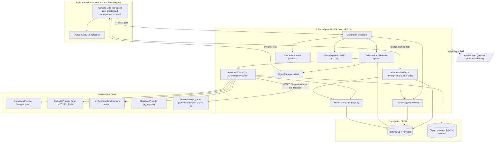
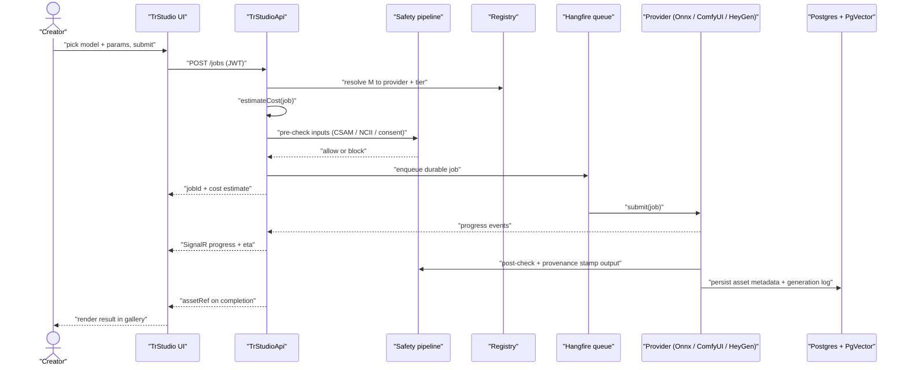
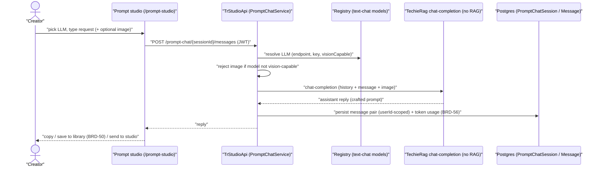
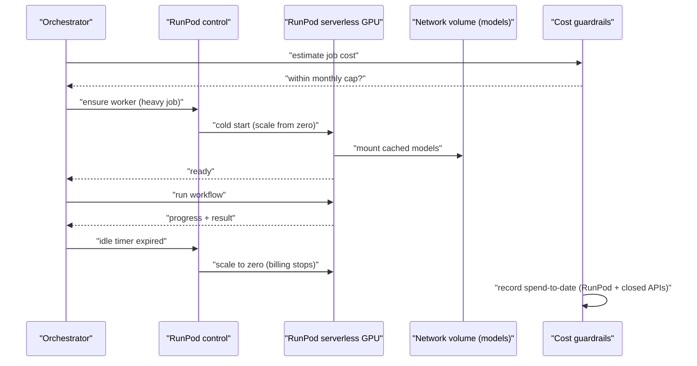
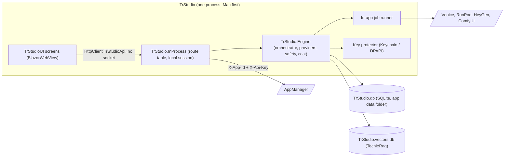
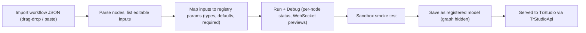
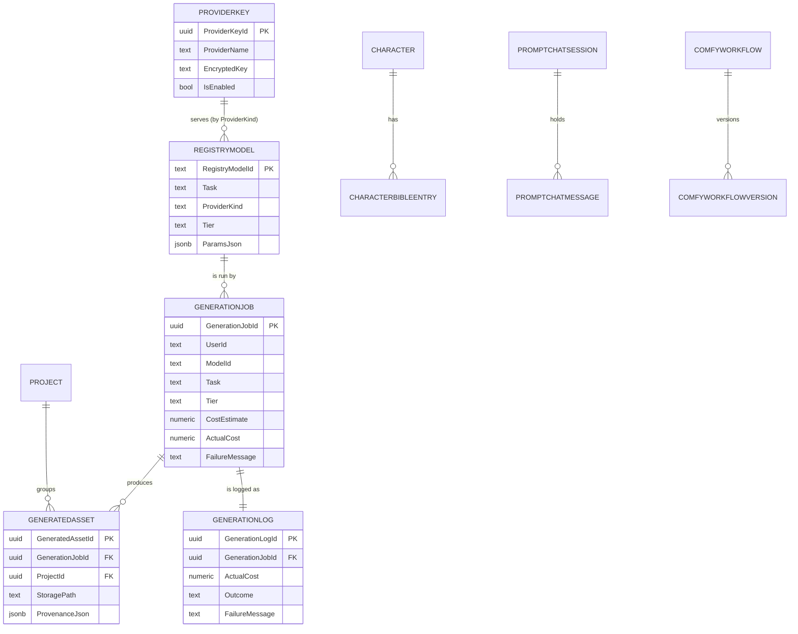
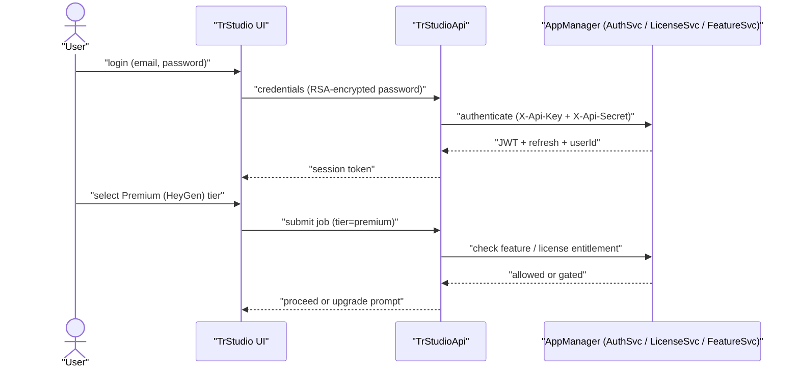
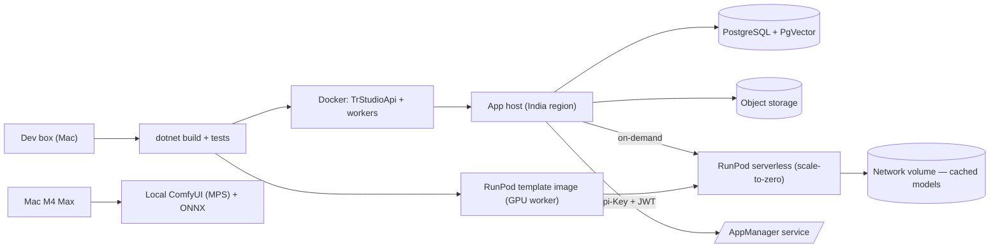

# TrStudio — Architecture

| | |
|---|---|
| App | TrStudio |
| Kind | app |
| Size | Large |
| Stack answer set | none |
| Date | 2026-11-14 |

One `TrStudio` app with a role-based surface (ADR-012). Phase 2 adds Venice as a second cloud provider for pictures and video (ADR-014, [phase 2 BRD](TrStudio-P2-BRD.md)). Phase 3 makes it one desktop app holding the engine, a local SQLite database and the job queue (ADR-015 to ADR-020, [phase 3 BRD](TrStudio-P3-BRD.md)): Mac first, Windows later (ADR-023); "Remember me" keeps a sign-in 30 days (ADR-021); the project is `src/TrStudio` (ADR-022).


## 1. Stack decisions

One row per stack question; the project predates them, so every answer is read from the code ("code").

| Q | Topic | Decision | Source |
|---|---|---|---|
| Q1 | Configuration | From phase 3 no user-edited settings file: data is in the OS per-user app data folder; the only build-time file, git-ignored `src/TrStudio/appmanager.local.json` (AppManager address, application id, API key), is embedded in the build (ADR-019). Provider addresses and keys (Venice, RunPod, HeyGen, closed API, text models) are entered on Registry & providers into the local database. Never environment variables. The API's `appsettings.json` stays, unused. | code |
| Q2 | Secrets in development | AppManager id and key: `appmanager.local.json` beside the desktop project (Q1). User keys: local database, encrypted by `AesGcmKeyStore` with an OS-protected per-user unlock key, Keychain on Mac, DPAPI on Windows (ADR-020). Test secrets: git-ignored `testsettings.Local.json`. Nothing secret is committed. | code |
| Q3 | Database | From phase 3 one SQLite file, `TrStudio.db`, in the user's app data folder, migrated by DbUp (`TrStudioDb`, `SqliteScripts/`) each start (ADR-016). On failure the app shows the folder and reason and opens no studio. PostgreSQL scripts and the API stay in the repository, unused; no real PostgreSQL data needed carrying over. | code |
| Q4 | Authentication | AppManager as an external child application (JWT and refresh, RSA-encrypted passwords). From phase 3 the app sends `X-App-Id` and one built-in `X-Api-Key`, no API secret or signing key, and holds the signed-in user for the session (ADR-019). AppManager owns users, roles, licences, subscriptions; TrStudio keeps only the `userId`. | code |
| Q5 | Logging | Serilog structured logging plus OpenTelemetry metrics; job ids on every line; no secrets in logs or URLs. | code |
| Q6 | Tests | xUnit with NSubstitute: `tests/unit/TrStudio.Tests.Unit` and `tests/integration/TrStudio.Tests.Integration`; Playwright tests in `tests/verify/`. Settings: committed `testsettings.json` (empty values) overlaid by `testsettings.Local.json`, never environment variables. From phase 3 headless checks drive `tests/TrStudio.TestHost`, a never-shipped host of the same screens and engine on SQLite. | code |
| Q7 | Layout and naming | `src/` and `tests/`. From phase 3 the app is `TrStudio` (`src/TrStudio/TrStudio.csproj`, no "Desktop" suffix); libraries `TrStudio.Engine`, `TrStudio.Models`, `TrStudioUI`, `TrStudioDb` and `TrStudio.InProcess` (in-process routes); test host `tests/TrStudio.TestHost`. Web head deleted (ADR-022); `TrStudioApi` and PostgreSQL scripts stay on disk, out of the build (§2). | code |
| Q8 | User interface | TrBlazeUI on Blazor (`TrStudioUI` Razor Class Library) in the MAUI Blazor Hybrid app (Mac first; Windows head later); the test host renders it with interactive server rendering. | code |
| Q11 | Standing rules | Log files go under the build output folder, never the repository root; no unnecessary root folders. No setting comes from an environment variable. Provider addresses and keys never go in appsettings or code. | code |

Required packages: `TrBlazeUI.Components`, `TrBlazeUI.Icons.Lucide`, `TechieRag`, `Dapper`, `dbup-sqlite`, `Microsoft.Data.Sqlite`, `Serilog.Extensions.Logging`, `xunit`

### Technology choices

| Layer | Choice | Version | Notes |
|-------|--------|---------|-------|
| Runtime | .NET | 10 (LTS) | Unified Blazor render modes; released Nov 2025 |
| Creator + Management UI | `TrStudio` — **one Blazor app**, role-based surface (MAUI Blazor Hybrid; web head deleted 2026-11-14) | .NET 10 | Creator/Operator/Owner see their surface by role; Mac first, Windows later |
| ~~Management UI~~ | ~~`TrStudioAdmin`~~ — **retired 2026-07-05**, merged into `TrStudio` (ADR-012) | — | Screens in `TrStudioUI` under role-gated routes |
| Shared UI | `TrStudioUI` — Razor Class Library on **TrBlazeUI** | .NET 10 | Shared components/layouts/screens |
| Backend / API | `TrStudioApi` — ASP.NET Core; **set aside from phase 3**: `TrStudio.InProcess` answers its routes in-app (ADR-015) | .NET 10 | Provider abstraction, registry, orchestrator, generation routes |
| Background jobs | ~~Hangfire (PostgreSQL storage)~~ **from phase 3: in-app job runner** over `GenerationJob` (ADR-018) | — | Durable queue, concurrency cap, recovery at start; no Redis or Hangfire |
| Cache | `IMemoryCache` (in-process) | — | No distributed cache (MVP) |
| Local image inference | **ONNX Runtime** (CoreML/CPU EP) | — | SDXL/FLUX image path; aligns with TechieRag's ONNX usage |
| Media inference | **ComfyUI** (managed, isolated Python) | — | Mac MPS (Fast tier) + RunPod serverless (High tier) |
| Premium avatar | **HeyGen API** | — | Premium tier, user-selectable per job |
| Closed image/video | Aggregator adapter (fal.ai / Replicate / WaveSpeed) | — | Vendor adapters (Veo/Kling/Seedance) later |
| Text / LLM / RAG | **TechieRag** + **TechieRag.Embedded** (NuGet, GitHub Packages) | .NET 10 | Script/caption/prompt-memory/character-bible; PgVector store + ONNX embeddings. **Text only** |
| DB | ~~PostgreSQL + PgVector~~ **from phase 3: SQLite** (`Microsoft.Data.Sqlite`), one file per user in the app data folder; vectors through TechieRag `UseSqliteVec` there too (ADR-016, ADR-017) | 3.x | Only provider calls leave the machine |
| Data access | **Dapper** | — | Micro-ORM; **no EF Core**; parameterized SQL in the engine's `Infrastructure/` folder |
| Migrations | **DbUp** (`TrStudioDb` project; `dbup-sqlite` from phase 3) | — | Embedded SQL scripts run on every app start |
| Object storage | Object store (assets) + RunPod network volume (models) | — | Big media models on `$0.07/GB/mo` network volume |
| Auth / Identity | **AppManager** (external child-app API) | — | JWT, RSA-encrypted passwords; from phase 3 `X-App-Id` + `X-Api-Key` built in, no secret (ADR-019); **not** the app DB |
| Logging / Telemetry | **Serilog** (structured) + **OpenTelemetry** | — | Queue/memory/latency/spend metrics, traceable job IDs |
| Packaging | ~~Docker (`TrStudioApi` + workers)~~ **from phase 3: desktop app installer** (Mac first; Windows later) + RunPod template image | — | Docker and hosting set aside |

## 2. Solution structure

| Project | Kind | Purpose |
|---|---|---|
| `TrStudio` | desktop app (MAUI Blazor Hybrid; Mac first, Windows head later) | Shipped from phase 3: `TrStudioUI` screens, engine, SQLite store, job runner in one process. Was `TrStudio.Desktop` until 2026-11-14, when the old web head of this name was deleted (ADR-022) |
| `TrStudio.InProcess` | class library (phase 3) | Route table and message handler answering the screens' `/api/v1/...` calls without a socket; local session; start-up (migrate, recover jobs, start runner) |
| `TrStudio.TestHost` | test host (phase 3, under `tests/`) | Same screens and in-process engine on SQLite for headless checks; never shipped |
| `TrStudioUI` | Razor Class Library | Shared layouts, screens and components on TrBlazeUI; creator and management screens behind role-gated routes |
| `TrStudioApi` | API (ASP.NET Core) | Set aside from phase 3, on disk and out of the build with the PostgreSQL scripts, for the set-aside external REST API row (owner decision 8) |
| `TrStudio.Engine` | class library | Domain rules, Dapper data access, providers (`IGenerationProvider` implementations), workers |
| `TrStudio.Models` | class library | Shared entities, DTOs, enums (`ProviderKind`, `GenerationTaskType`) and interfaces |
| `TrStudioDb` | migrations project | DbUp runner with ordered embedded SQL scripts |
| `TrStudio.Tests.Unit` | test project | xUnit unit tests by area (Comfy, Registry, Spine, Cost, …) |
| `TrStudio.Tests.Integration` | test project | Live API tests (`LiveApiFixture`, SignalR push) and, from phase 2, the Venice live tests |


## 3. Component map



**How a request travels** (one job; per-screen detail in the DevGuide):
1. The creator picks a model and parameters on a studio screen; `TrStudioUI` posts `POST /api/v1/jobs` with the AppManager JWT.
2. `TrStudioApi` resolves the registry row to one provider and tier, checks the cost estimate against the monthly cap and runs safety floors on the inputs.
3. The job is enqueued in Hangfire (Postgres storage); the API answers with job id and cost estimate.
4. A worker calls the provider (`submit`, then `status` until done); progress reaches the screen over SignalR.
5. The output is safety-checked and provenance-stamped; asset and generation-log rows are written with the owner filter; the screen shows the result.

### Data flow — primary generation job path

The creator submits *"task T, model M, params P"*; the UI never learns which provider runs it. Cost and safety are checked **before** enqueue.



#### 3.1 Prompt-crafting chat path (F-PROMPT, added 2026-07-07)

Prompt Studio bypasses the job queue, provider abstraction and media safety pipeline (its output is advisory text). `TrStudioApi` resolves the picked LLM from the registry (`text-chat` modality) and calls **TechieRag chat-completion directly, no RAG**. Sessions and messages persist per user (BRD-81 owner filter); token usage counts toward the BRD-56 text-LLM budget.



### Provider abstraction and the three execution tiers

`TrStudioApi` resolves **M → a provider** and routes the job. Every provider implements:

```
IGenerationProvider
  ├─ supports(task, model) : bool
  ├─ submit(job) : jobId           // async
  ├─ status(jobId) : {state, progress, eta}
  ├─ result(jobId) : assetRef
  └─ estimateCost(job) : money
```

**Concrete providers (MVP):**
- `OnnxLocalProvider` — ONNX Runtime, CoreML/CPU EP; image + upscale (*Fast tier*).
- `ComfyUIProvider` — drives ComfyUI (local MPS or RunPod) via HTTP `/prompt` + WebSocket progress; serves all ComfyUI-backed models (*Fast/High tiers*).
- `HeyGenProvider` — HeyGen API adapter (*Premium tier*, avatars).
- `ClosedApiProvider` — aggregator (fal.ai/Replicate/WaveSpeed) or direct vendor for closed image/video (*Premium tier*).

One UI control (AV-04) picks the tier per job — **Fast (Mac local)**, **High (RunPod serverless)** or **Premium (HeyGen API)** — and the abstraction swaps the provider.

**Design driver: scale-to-zero.** 36 GB unified memory and $100/mo rule out heavy avatar/video on the Mac *or* an always-on GPU (24/7 A100 ≈ $860/mo). Heavy jobs MUST run on serverless GPUs `TrStudioAdmin` starts on demand, idle-stopping to $0.



### Venice cloud provider (phase 2, planned)

Venice (venice.ai), a second cloud provider for pictures and video, sits behind the same seam (ADR-014, BRD-93 to BRD-123). Facts are from Venice's API docs, read 2026-11-12 (https://docs.venice.ai).

- **Seam.** New `ProviderKind.Venice` and `VeniceProvider : IGenerationProvider` in `src/TrStudio.Engine/Providers`: `TextToImage`, `ImageToImage`, `Upscale`, `TextToVideo` and `ImageToVideo`, only for Venice registry rows. `Inpaint`, `BackgroundRemove`, `LipSync`, `TextToSpeech` and `WorkflowRun` are never Venice: its edit endpoint has no mask, and its old `inpaint` field was disabled on 2025-05-19.
- **Configuration, database only.** `ProviderKey` gains `BaseUrl` (DbUp migration); the key is encrypted by `AesGcmKeyStore`, masked on read. A named `HttpClient` reads address and `Authorization: Bearer <key>` from the database per call. Address: `https://api.venice.ai/api/v1`.
- **Registry.** `RegistryModel` gains `ProviderModelId` (the Venice model id, allowing a row per task), `TakesReferencePicture`, `KeepsFixedCharacter` and `MaxInputImages`, which studios filter on with task. The params schema carries allowed durations, resolutions and aspect ratios.
- **Calls.**
  - Text to image: `POST /image/generate` (JSON; base64 `images[]` back; `style_references[]` where supported; `safe_mode`).
  - Image to image: `POST /image/edit`, or `POST /image/multi-edit` for several inputs; binary image back.
  - Upscale: `POST /image/upscale` with `scale` 2 or 4.
  - Video: `POST /video/quote` returns `{quote}` in US dollars; `POST /video/queue` returns `queue_id`; a Hangfire job polls `POST /video/retrieve` (`PROCESSING` with `average_execution_time` and `execution_duration`, shown as SignalR progress; then the mp4 or a `download_url`); `POST /video/complete` frees Venice's copy.
  - Image to video sends `image_url`; a fixed character sends its reference set as `reference_image_urls[]` or `elements[]` to a reference-to-video model; local pictures go as base64 data URLs.
- **Price (owner decision 1A, 2026-11-12).** Venice returns no per-call cost, so TrStudio stores Venice's stated price: for video the `/video/quote` taken just before queueing; for pictures the `GET /models` list price (`model_spec.pricing`) for the chosen resolution, read at call time. It goes in `GenerationLog.ActualCost` with a new `PriceSource` column (`venice-quote` or `venice-list`).
- **Errors.** Body `{"error": "..."}` or `{error: {message, type}}`; codes 401 `AUTHENTICATION_FAILED`, 402 `INSUFFICIENT_BALANCE`, 422 `CONTENT_POLICY_VIOLATION` (with `suggested_prompt`), 429 `RATE_LIMIT_EXCEEDED`, 503 `MODEL_AT_CAPACITY` and others. `FailureMessage` keeps "Venice: <its text>" verbatim; 429 honours `x-ratelimit-*`.
- **Safety and spend.** `safe_mode` is true unless the owner's unrestricted mode is on; safety floors run before enqueue as for every provider; Venice spend counts toward the monthly cap.
- **ComfyUI unchanged.** `ComfyUiProvider`, `ComfyUiOptions` (`ComfyUI:BaseUrl`) and `tests/unit/TrStudio.Tests.Unit/Comfy/*` are untouched: those tests pass unedited, and a new orchestrator test shows a ComfyUi row still resolves to `ComfyUiProvider` alongside Venice.
- **Fill from Venice (owner decision 4B).** `POST /api/v1/admin/registry/venice/fill` with a Venice model id returns, from Venice's public model list, task, abilities, durations, sizes and aspect ratios for the admin to check; nothing saves until Save.
- **Desktop settings (owner decision 5A).** API address, developer role and start page come from `appsettings.json` beside the app (section `Desktop`), never environment variables (BRD-123).
- **Live tests (owner decision 6A).** `tests/integration/TrStudio.Tests.Integration/Venice/`: one `Category=Live` test per task type, outside the normal run (`dotnet test --filter Category=Live`), on the cheapest models, 480p, shortest clips. Settings as in Q6, in that folder (keys `Venice:BaseUrl`, `Venice:ApiKey`, `Venice:Models:<Task>`); with no key each skips with "Venice key not set in testsettings.Local.json".

### Desktop app with the engine inside (phase 3)

From phase 3 `TrStudio` (`src/TrStudio`) is one process holding screens, engine, database and job runner. The diagrams above still hold for routes, providers and safety order; only host and store change.



- **Start-up.** Find the per-user data folder (`FileSystem.AppDataDirectory` on Mac; `%LOCALAPPDATA%\TrStudio` in the later Windows version), run the SQLite scripts, recover jobs, start workers, show Login. A failure shows the folder and reason on Setup required.
- **Routes.** Each API endpoint file has a twin in `TrStudio.InProcess/Routes` with the same path and answer shape, binding route values, query, JSON body, signed-in user and services as before. Admin routes keep the Owner or Operator check.
- **Session.** Login posts to the in-process `/api/v1/auth/login`, which calls AppManager and keeps user, role and token in the local session that every route reads; signed out, protected routes answer 401.
- **Remember me (ADR-021).** `RememberedSignInStore` keeps the refresh token in `remembered-sign-in.bin`, encrypted with the `IKeyProtector` key. On open, Login calls `/api/v1/auth/resume`, which renews it through `AuthSvc/refresh` and opens the session; ended or refused, it is removed; unreachable, it stays.
- **Jobs.** `JobOrchestrator` stores the job Queued and signals the runner; workers (default 2) claim the oldest Queued row with `UPDATE … WHERE State = 'Queued'`, so a row runs once. Venice video polling is its own job step, its queue id kept on the row.
- **Keys.** `IKeyProtector` gives `AesGcmKeyStore` its 256-bit key: Mac, a generic-password Keychain item for the app's service name; Windows (later), a DPAPI current-user blob in the data folder; test host, a test-only key file in its temporary folder.
- **Test host.** `tests/TrStudio.TestHost` registers the same `TrStudio.InProcess` handler with a temporary data folder and serves the screens with interactive server rendering for Playwright; the desktop project does not reference it.

### Model and provider registry

Every usable model is a registry row owned by `TrStudioApi`. A **declarative params schema** lets the UI render controls for any model without code, so "add a model" is a `TrStudioAdmin` action, not a dev task (NFR-09).

```jsonc
{
  "id": "musetalk-v1",
  "displayName": "MuseTalk (real-time lip-sync)",
  "task": "lip-sync",
  "providerType": "comfyui",
  "tier": "fast",              // fast | high | premium
  "workflowRef": "workflows/musetalk_v1.api.json",
  "hardware": { "minVramGb": 8, "recommended": "A100", "runsOnMac": true },
  "params": [
    { "key": "sourceImage", "type": "image", "required": true },
    { "key": "audio", "type": "audio", "required": true },
    { "key": "resolution", "type": "enum", "values": ["256","512"], "default": "256" }
  ],
  "languages": ["en","hi","language-agnostic"],
  "license": "MIT",            // VERIFY per release
  "safetyClass": "avatar-synthetic-default",
  "cost": { "kind": "serverless-seconds", "estimateSecPerJob": 90 }
}
```

Each row carries a **license** (for the build-time license check, ADR-006) and a **safetyClass** (`synthetic-default` | `real-person-gated`) that scopes the safety floors (§9) on its jobs.

**Text-chat LLMs are registry rows too (F-PROMPT, added 2026-07-07).** The Prompt Studio picker reads `task: "text-chat"` rows — same Registry screen and key store, no separate config table — which `PromptChatService` resolves directly, outside the provider abstraction and queue (§3.1).

```jsonc
{
  "id": "gpt-4o-chat",
  "displayName": "GPT-4o (prompt crafting)",
  "task": "text-chat",         // Prompt Studio picker filters on this
  "providerType": "textllm",   // routed to PromptChatService, not IGenerationProvider
  "endpoint": "https://api.openai.com/v1",
  "apiKeyRef": "encrypted-key-store",
  "visionCapable": true,       // gates image attachment in the chat UI (BRD-90)
  "cost": { "kind": "tokens", "inPer1k": 0.005, "outPer1k": 0.015 }
}
```

### ComfyUI pipeline management

ComfyUI is a media engine (Fast/High tiers) and the way new models are added. Its import/debug/use screen is in `TrStudioAdmin`; models it registers reach `TrStudio` through `TrStudioApi`. ComfyUI exposes `POST /prompt` (API-format workflow JSON), `GET /history/{id}`, `/view` and a WebSocket for live progress and node errors. `TrStudioApi` maps editable node fields to UI controls via the params schema.



## 4. Data model

Main tables, from the DbUp scripts in `src/TrStudioDb/Scripts/`. Every user-owned table carries `UserId` (the AppManager user); every query applies the owner filter (BRD-81).



| Entity | Key fields | Notes |
|---|---|---|
| GenerationJob | `GenerationJobId`, `UserId`, `ModelId`, `Task`, `State` | One submitted job; cost estimate, actual cost, failure message, remediation hint |
| GeneratedAsset | `GeneratedAssetId`, `GenerationJobId`, `ProjectId` | Output file, seed, parameters, C2PA provenance |
| GenerationLog | `GenerationLogId`, `GenerationJobId` | The auditable trail; phase 2 adds `PriceSource` |
| RegistryModel | `RegistryModelId`, `Task`, `ProviderKind` | One model and one task; params schema; text-chat columns; phase 2 adds `ProviderModelId`, `TakesReferencePicture`, `KeepsFixedCharacter`, `MaxInputImages` |
| ProviderKey | `ProviderName` (unique) | Encrypted key per provider; phase 2 adds `BaseUrl` |
| ModelSource, ModelInstall, SetupState | — | Model sources, resumable installs, guided setup |
| Character, CharacterBibleEntry | `UserId` | Characters and their bible (PgVector) |
| PromptChatSession, PromptChatMessage | `UserId` | Prompt studio history |
| Project, Preset, SpendRecord, ApiKey | `UserId` | Workspace, library presets, spend ledger, external API keys |
| VoiceClone, VoiceConsentEvidence, ConsentEvidence, PublicFigureRights | — | Consent gates |
| SafetyPolicy, SafetyAuditEntry, AbuseReport | — | Content policy and audit |
| ComfyWorkflow, ComfyWorkflowVersion | — | Imported ComfyUI workflows, pinned versions |


## 5. Cross-cutting

- **Identity:** AppManager (subsection below).
- **Configuration:** appsettings per head and Visual Studio user secrets for development secrets; provider addresses and keys in the database; never environment variables.
- **Logging:** Serilog structured logging, traceable job ids, no secrets in logs or URLs (NFR-05/08).
- **Telemetry:** OpenTelemetry metrics: queue depth, memory, latency, spend-to-date.
- **Errors:** global middleware returning `ProblemDetails`; a provider's own failure text (ComfyUI, HeyGen, Venice) is kept on the job and shown with an actionable hint (e.g. "out of memory — drop to 256px or route to RunPod", ADM-09).
- **Auth:** AppManager JWT bearer for users; `X-Api-Key`/`X-Api-Secret` for the child-app handshake; admin-scoped endpoints for `TrStudioAdmin`-only operations.
- **Caching:** `IMemoryCache` in-process only (no Redis).
- **Cost control:** per-job estimate before run; RunPod idle auto-stop; monthly cap and alerts across RunPod **and** closed APIs incl. HeyGen (ADM-10 / NFR-07).
- **Safety (binding):** a pipeline on every provider that cannot be switched off: CSAM hash+classifier blocks, NCII/real-person-deepfake refusal, consent gating for real faces/voices, C2PA-style provenance, public-figure impersonation block, full audit trail (SAFE-01..06).
- **Privacy / Compliance:** local jobs stay local; UI flags jobs routed to a closed API; data resident in India; DPDP-aligned; configurable retention (NFR-06/10).

### Identity and licensing — AppManager integration

**AppManager** (`docs/AppManager-api-usage-guide.md`) provides users, login/JWT, licenses/subscriptions, feature and tier gating, payments and support. `TrStudioApi` is an AppManager **child application**: `X-Api-Key`/`X-Api-Secret` handshake, JWT session, RSA-encrypted passwords. TrStudio stores only the AppManager `userId` as owner of characters/jobs/assets — **never passwords; AppManager is never the application database.**



**Staying signed in (ADR-021).** The guide documents a one-hour access token and a new refresh token per refresh, but no refresh-token lifetime, so 30 days is the app's own limit (asked in `docs/TrStudio-AppManager-Feedback.md`).

Personal mode offers all tiers; multi-user/SaaS gates them via AppManager FeatureSvc/LicenseSvc (e.g. Premium behind a paid license).

## 6. Decisions log

One row per decision; every added package has a row saying why. Dates before 2026-07-05 are the decision set's day-1 date.

| Date | Decision | Why | Status |
|---|---|---|---|
| 2026-07-03 | ADR-001: Two Blazor apps plus a shared RCL on TrBlazeUI, both web and MAUI Blazor Hybrid | Separate creator experience (`TrStudio`) from model and provider management (`TrStudioAdmin`) with one component set; requirement §25 asked for web and desktop for both | superseded by ADR-012 |
| 2026-07-03 | ADR-002: PostgreSQL with PgVector as the single datastore; no Redis | Vector and relational in one database; Hangfire on Postgres gives durable jobs; `IMemoryCache` for in-process caching | superseded by ADR-016 and ADR-018 |
| 2026-07-03 | ADR-003: PgVector (TechieRag `UsePgVector`) as the vector store | Character bible, prompt and script memory and embeddings on the same Postgres instance | superseded by ADR-017 |
| 2026-07-03 | ADR-004: Provider abstraction with a three-tier selector (Fast, High, Premium) | HeyGen-grade realism, open-model parity and budget control through one `IGenerationProvider` seam; the UI never knows the provider | done |
| 2026-07-03 | ADR-005: RunPod serverless, scale-to-zero, for heavy jobs | 36 GB and $100 a month rule out always-on GPUs; heavy avatar and video work must be bursty and stop when idle | done |
| 2026-07-03 | ADR-006: ONNX Runtime directly for the image path (not TensorStack) | Already used by TechieRag; removes a thin dependency; ComfyUI covers media models | done |
| 2026-07-03 | ADR-007: AppManager as the external identity and licensing service, not the app database | Personal-first, SaaS-ready; delegates auth, licence, feature, payment and support; TrStudio keeps its own India-resident data | done |
| 2026-07-03 | ADR-008: TechieRag (NuGet) for text, LLM and RAG only | A text-only library; the image path is a separate ONNX implementation | done |
| 2026-07-03 | ADR-009: Hard safety floors cannot be switched off; the general adult-content filter is an owner-only toggle | CSAM, real-person and NCII, minors and public-figure impersonation are enforced in every mode; the owner may lift the general filter in personal mode for synthetic adult personas (BRD-79/80); multi-user mode forces it on | done |
| 2026-07-03 | ADR-010: Dapper for data access and DbUp for migrations (not EF Core) | Explicit parameterized SQL for PgVector and the owner filter; ordered embedded scripts run on API start | done |
| 2026-07-03 | ADR-011: One `TrStudio.Engine` library plus a shared `TrStudio.Models` library | Domain, infrastructure, providers and workers as folders in one assembly; shared contract types never drift | done |
| 2026-07-05 | ADR-012: One `TrStudio` app with a role-based surface, shipped as Blazor web and MAUI Blazor Hybrid desktop (Windows and Mac); supersedes ADR-001 | The owner wants one local desktop app with role-gated creator and management screens; `TrStudioAdmin` retired, screens moved to `TrStudioUI`; `TrStudioApi` unchanged (BRD-86/87) | done; its API part (web head and desktop over `TrStudioApi`) superseded by ADR-015 |
| 2026-07-07 | ADR-013: Prompt studio uses TechieRag direct chat-completion (no RAG); text-chat models are registry rows outside the generation-provider seam | Synchronous advisory text needs no job queue, provider seam or media safety pipeline; reusing the registry keeps "add a model" a configuration action (BRD-88 to BRD-92) | done |
| 2026-11-12 | ADR-014: Venice as a second cloud provider for pictures and video behind `IGenerationProvider` (`ProviderKind.Venice`), configured only in the database | Generate without a local ComfyUI; per-model registry choice keeps studios provider-blind; addresses and keys stay out of appsettings and code (BRD-93 to BRD-123); price, fill button, desktop settings and paid tests settled by owner decisions 1A to 6A | planned |
| 2026-11-14 | ADR-015: The engine runs inside the desktop app. Screens keep calling `/api/v1/...` through the named `TrStudioApi` client, whose handler `TrStudio.InProcess` is a route table calling engine services in-process, with no socket or web server. Replaces the API part of ADR-012 | One app to download and open; the 31 screens and their tests stay as they are; ASP.NET Core does not run on Mac Catalyst, so routes are a plain library (BRD-146, BRD-147) | planned |
| 2026-11-14 | ADR-016: One SQLite file per user (`TrStudio.db` in the app data folder), Dapper unchanged, DbUp `dbup-sqlite` scripts in `TrStudioDb/SqliteScripts/` run on every start. Replaces ADR-002 | No database server to install; the app creates and migrates it on first start (BRD-129 to BRD-133) | planned |
| 2026-11-14 | ADR-017: Character-bible vectors through TechieRag `UseSqliteVec` on `TrStudio.vectors.db` beside the app database, falling back to in-process similarity if the vector extension cannot load. Replaces ADR-003 | Same local store, no PgVector; bible rows stay in `TrStudio.db` (BRD-145) | planned |
| 2026-11-14 | ADR-018: An in-app job runner replaces Hangfire. Jobs are `GenerationJob` rows; a fixed number of workers take Queued rows; at start Queued rows run, a Running Venice clip with its queue id resumes polling, any other Running row fails with "TrStudio was closed while this job was running" | Background work survives a close without Hangfire or PostgreSQL (BRD-134 to BRD-139) | planned |
| 2026-11-14 | ADR-019: AppManager sign-in with `X-App-Id` and one `X-Api-Key`, no secret or signing key. Address, id and key come from git-ignored `appmanager.local.json`, embedded at build; without it, Login says so. The signed-in user is held in memory for the session | The owner's desktop apps sign in this way; nothing for a user to edit (BRD-124 to BRD-128, BRD-149) | planned |
| 2026-11-14 | ADR-020: Every user-owned key (Venice, RunPod, HeyGen, closed API, text models) is a `ProviderKey` row entered on Registry & providers, encrypted by `AesGcmKeyStore` with a random per-user AES key the OS keeps (Keychain item on Mac, DPAPI current-user blob on Windows). RunPod, HeyGen and closed-API settings are read from those rows at call time | Nothing in appsettings, code or environment variables; a saved key works without a restart (BRD-140 to BRD-144, BRD-148) | planned |
| 2026-11-14 | ADR-021: "Remember me" on Login (decision 6B): ticked keeps the refresh token, encrypted with the ADR-020 key, for 30 days; each open renews it; ended or refused, it is removed with a plain message; unticked keeps nothing; sign out removes it | Stay signed in on one's own computer; 30 days as AppManager does not document a refresh token's lifetime (BRD-153 to BRD-157) | built |
| 2026-11-14 | ADR-022: Old web head deleted (decision 8); `src/TrStudio.Desktop` becomes `src/TrStudio`, namespace and assembly `TrStudio`; title and application id unchanged. `TrStudioApi` and the PostgreSQL scripts stay on disk, out of the build | A desktop app needs no "Desktop" in its name; the API project serves the set-aside REST API row (REQ-FN-069) | built |
| 2026-11-14 | ADR-023: Mac first: version one is Mac only; Windows, possibly Linux, later, keeping the Windows head and ADR-020's Windows protection for it | No first-version row waits on a Windows machine (BRD-152 amended, BRD-158 deferred) | planned |
| 2026-11-14 | Owner decisions 1 to 10 answered: A for 1 to 5, 7, 9, 10; B for 6 (ADR-021); 8 as ADR-022; 9A and 10A leave two later rows (BRD-160, BRD-159) | `docs/TrStudio-Decision-Request.md` | answered |
| 2026-11-17 | ADR-024: AppManager roles map to TrStudio's: `Admin` is Owner, `Manager` is Operator, `User` is Creator (`UserRoleMapper`); older names Owner, Operator and Creator are still read; Register provisions `User` or `Manager` | AppManager sends its own role names (user 1 `Admin`, user 2 `Manager`); TrStudio read `Admin` as Operator, so both landed as Operators (BRD-177) | built |
| 2026-11-17 | ADR-025: Digital twin on Venice Wan 3.0 reference to video (`wan-3-0-reference-to-video`): the person's pictures, one clip and the line in a Venice voice made from the sample (`tts-chatterbox-hd`, `/audio/voices`, `/audio/speech`) go as `@Image`, `@Video`, `@Audio` references. Not Seedance: its guide says its public API takes no media of a person. Off by default; the person's Face and Voice consent checked on create and each clip; a voice past Venice's 7 days is remade from the kept sample | The owner has Venice, not HeyGen; Wan's guide allows reference media of a person and voice conditioning (BRD-161 to BRD-167) | planned |
| 2026-11-17 | ADR-026: Multi-shot assembly runs shots in sequence in the app: a character's shots on Wan 3.0 image to video, each starting on the previous shot's last frame; a twin's shots are twin clips carrying that frame; finished shots are joined on this Mac | Continuity between shots without a cloud editor (BRD-168 to BRD-172) | planned |
| 2026-11-17 | ADR-027: Clip joining and frame reading go through `IClipJoiner`: Apple's AVFoundation (`AVMutableComposition`, `AVAssetExportSession`, `AVAssetImageGenerator`) in the Mac app, built into macOS and sandbox-allowed; ffmpeg on the test host and in unit tests. Extending a clip uses Wan 3.0 reference to video with the clip as `@Video1` | A sandboxed Mac app cannot rely on running ffmpeg; nothing is uploaded to join (BRD-173 to BRD-175) | planned |
| 2026-11-17 | ADR-028: The approved logo files are copied unchanged into `assets/brand/`; the Mac app's icon, splash and Login and Register logo are those bytes | Owner approved a new logo (BRD-176, BRD-178) | built |
| 2026-11-17 | Owner decisions 12A and 13A confirmed as taken; 14: B for digital twin, multi-shot and clip stitching (built now on Venice), A for webhooks and the MCP server (still deferred; their tests wait for the feature) | `docs/TrStudio-Decision-Request.md` | answered |
| 2026-11-19 | ADR-029: On Mac the App Sandbox stays (decision 17B). Guided setup downloads no Python or ComfyUI there; its ComfyUI step asks for a running ComfyUI's address (its own installer or a RunPod worker), checks it answers (`/system_stats`), and stores it as `AppSetting` row `ComfyUI:BaseUrl`, read by the ComfyUI provider at call time. The managed Python and ComfyUI download stays for Windows (later version, ADR-023) | macOS will not run a program a sandboxed app downloaded ("Operation not permitted"); leaving the sandbox moves the library and closes the Mac App Store (BRD-9, BRD-10) | planned |
| 2026-11-19 | ADR-030: Retention (decision 19A). Content policy has "Keep log rows for N days" (default 0, keep for ever). At start and daily, `GenerationLog` and `SafetyAuditEntry` rows older than N days are removed; pictures, clips and provenance never are | REQ-NFR-010 asked for a retention setting; removing outputs could lose a person's work (BRD-78) | planned |
| 2026-11-19 | Owner decisions 16 to 20 answered (18 Nov 2026, night): 16A, one Keychain unlock item stays (ADR-020 unchanged; removing a key removes its encrypted row); 17B (ADR-029); 18 C for REQ-FN-019, 020, 021 (join BRD-159, local pictures on Mac) and REQ-FN-053 (waits for a frame-interpolation model), A for the ComfyUI rows (REQ-FN-045 to 047) and the RunPod row (REQ-FN-028); 19A: REQ-NFR-003 not applicable, replaced by REQ-NFR-022, plus ADR-030; 20B, one clip on Seedance 2.0, then A if it also redraws the end: it did not (ends 10.4 of 255 from the pinned frame), so the pass mark of 40 stays and live runs use `Venice:Models:EndFrame` | `docs/OldDocs/TrStudio-Decision-Request-20261119.md` | answered |
| 2026-11-20 | Owner decision 18C extended (owner, 19 Nov 2026, night): REQ-FN-031, 037, 038 and REQ-RAG-002 need a local voice, lip-sync or Whisper model the Mac app does not ship; they join new later-version item BRD-180 (REQ-FN-117) and are not applicable in phase 1 | the same answer as decision 18 gave the other local-only rows | planned (BRD-180) |


## 7. Module responsibilities

| Module | Type | Responsibility | Depends on |
|--------|------|----------------|------------|
| `src/TrStudio` | Blazor app | **One app (Web + MAUI Hybrid desktop, Win/Mac)** — avatar/image/video/voice studios, gallery, projects AND the role-gated management surface | `TrStudioUI`, `TrStudio.Models`, `TrStudioApi` (HTTP) |
| `src/TrStudioAdmin` | ~~Blazor app~~ **RETIRED 2026-07-05 (ADR-012)** — merged into `TrStudio`; its screens are in `TrStudioUI` under role-gated routes | ~~Management app (Web + MAUI Hybrid) — hardware detection, setup, model sources, registry editing, RunPod control, ComfyUI import/debug, ops, cost, content policy~~ | `TrStudioUI`, `TrStudio.Models`, `TrStudioApi` (admin-scoped HTTP) |
| `src/TrStudioUI` | Razor Class Library | Shared TrBlazeUI layouts, screens and components for Web + desktop, incl. the role-gated management screens formerly in `TrStudioAdmin` | TrBlazeUI, `TrStudio.Models` |
| `src/TrStudio.InProcess` | Class library (phase 3) | In-process routes, message handler, local session and start-up for the desktop app and test host | `TrStudio.Engine`, `TrStudio.Models`, `TrStudioDb` |
| `src/TrStudioApi` | ASP.NET Core host, **set aside from phase 3** | Backend contract — generation, orchestrator wiring, registry, queue, cost, safety, auth, SignalR; runs `TrStudioDb` (DbUp) on startup | `TrStudio.Engine`, `TrStudio.Models`, `TrStudioDb` |
| `src/TrStudio.Engine` | Class library | **`Domain/`** (entities & rules — Character, Job, Asset, registry rows, GenerationLog, Consent), **`Infrastructure/`** (Dapper data access, Hangfire wiring, object storage, encrypted key store, AppManager client), **`Providers/`** (`OnnxLocalProvider`, `ComfyUIProvider`, `HeyGenProvider`, `ClosedApiProvider`), **`Workers/`** (ComfyUI worker control local MPS + RunPod, in-process ONNX image worker) | `TrStudio.Models` |
| `src/TrStudio.Models` | Class library | Shared models/DTOs/entities, **interfaces** (`IGenerationProvider`, repository contracts), provider/registry contracts, enums — used by every app, the RCL and the engine | (none) |
| `src/TrStudioDb` | Class library | **DbUp** runner — embedded, ordered SQL scripts (schema, PgVector, registry/jobs/characters, seed); run on `TrStudioApi` startup | DbUp, `TrStudio.Models` (optional) |

**`TrStudio.Models` — shared contract types.** Dependency-free: entity/DTO shapes, enums (tier, task, safetyClass), interfaces (`IGenerationProvider`, repository contracts). Apps, RCL, API host and engine all reference it, so types never drift.

**`TrStudio.Engine` — one engine, four folders.** The former Domain / Infrastructure / Providers / Workers projects are now folders of one assembly. `Infrastructure/` holds the **Dapper** layer (parameterized SQL, the per-user `userId` owner filter on every query — BRD-81); the other folders are as in the table.

**`TrStudioApi` — the shared contract.** Management screens are *only UI*, calling admin-scoped endpoints. Any capability creator screens or later third parties need is a first-class endpoint, never buried in the admin app. Registry, job and generation services are shared; only setup/sources, ComfyUI import/debug, content policy and ops are admin-scoped. **The API runs `TrStudioDb` (DbUp)** before serving traffic.

**Provider abstraction.** Each provider (`TrStudio.Engine/Providers/`, implementing `IGenerationProvider` from `TrStudio.Models`) gets one resolved model from the orchestrator and is treated uniformly: `submit → status → result → estimateCost`. One `ComfyUIProvider` serves *all* ComfyUI-backed models (avatar, lip-sync, video), each a workflow template (§6/§8).

**Prompt Studio chat path (F-PROMPT, added 2026-07-07).** No new projects: `TrStudioUI` adds the screen (`/prompt-studio` — chat pane, registry-driven LLM picker, image attachment, session list, prompt-use actions); `TrStudioApi` the `prompt-chat` endpoints; `TrStudio.Engine` the `Domain/` entities `PromptChatSession`/`PromptChatMessage` and the `Infrastructure/` `PromptChatService` (flow in §3.1); `TrStudioDb` the DbUp script for the two tables.

**Dapper + DbUp.** Dapper (parameterized SQL, no EF Core); `TrStudioDb` DbUp scripts create and upgrade the schema. From phase 3: one SQLite file per user (ADR-016), migrated at start; the July PostgreSQL, PgVector and Hangfire setup is set aside.

### Build roadmap (phased target, July 2026)

The July build ran in ten dependency-ordered stages: spine (apps, provider seam, registry, queue, auth, storage), local image vertical, managed ComfyUI and RunPod, voice, avatar pipeline, ComfyUI pipeline screen, video and closed API, safety and provenance, polish with SaaS-ready seams, and Prompt Studio. Safety was in every provider from the image vertical on. All ten are built (BRD development status). November 2026 phases are in [TrStudio-Phases.md](TrStudio-Phases.md): phase 1 is everything above, phase 2 Venice, phase 3 the desktop app with the engine inside.


## 8. Open questions

- **Model licences** vary and date quickly (XTTS Coqui CPML is non-standard; Hunyuan has a MAU cap; HeyGen has its own ToS) — the registry `license` field and a build-time check must verify each before commercial use.
- **ComfyUI on Apple Silicon (MPS/GGUF)** can be flaky — default to GGUF, low-res first, auto-fallback to RunPod on OOM.
- **HeyGen / aggregator price changes** — open-model parity keeps Premium optional.
- **36 GB unified memory** is marginal for local video — heavy jobs go to RunPod/HeyGen; Mac does image and light lip-sync.
- **Credentials at build and run:** the private-feed token (`read:packages`) and AppManager id and key (`appmanager.local.json`); provider keys are entered in the app.
- **Deployment.** From phase 3 TrStudio ships as the desktop app, Mac first (Windows later, ADR-023); Docker image, hosting, Hangfire dashboard and PostgreSQL settings are set aside (checklist rows N/A with the reason). Mac signing and notarising are decided at UAT; the Windows installer comes with Windows. Hosting is decided after UAT, in the Deployment Checklist. Below: the set-aside July hosting plan.



### Sources harvested

- `docs/TrStudio-Requirements-v0.3.md` — §2 app surface, §3 hardware/budget, §4 architecture, §4.2 provider abstraction, §4.3 registry, §5 model stack, §6 ComfyUI, §7 TechieRag, §11 stack, §12 build order, §13 risks.
- `docs/AppManager-api-usage-guide.md` — child-app integration model (referenced; stays in `docs/` as its own authority).
