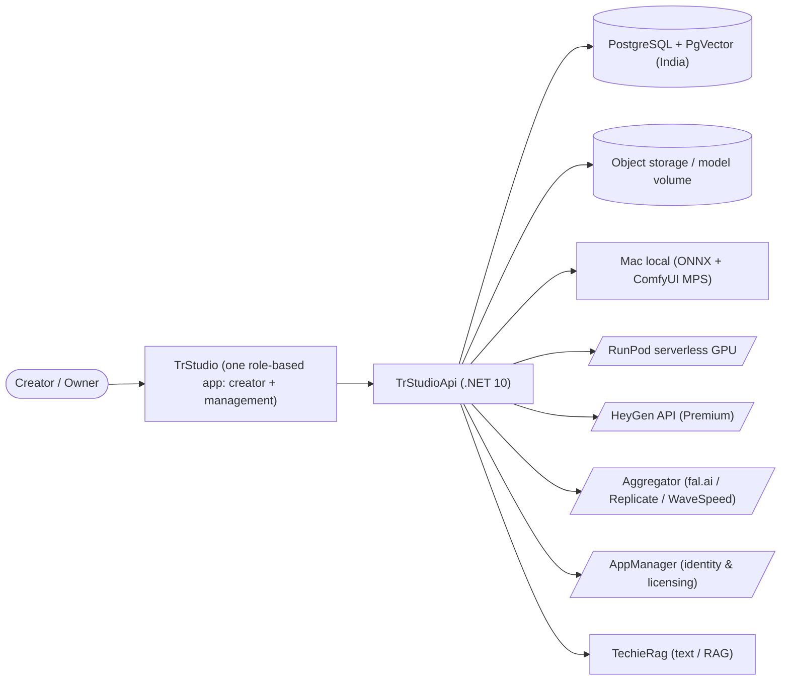
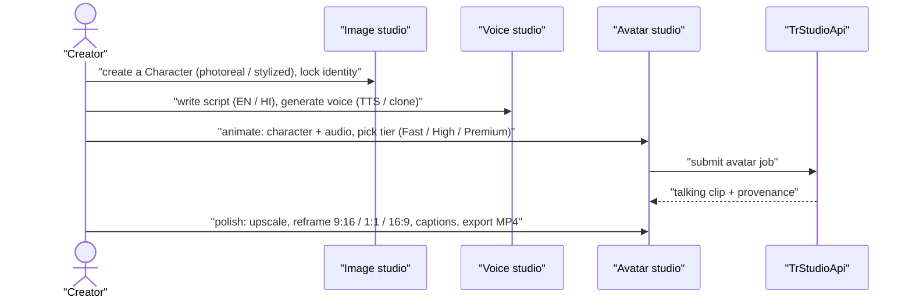
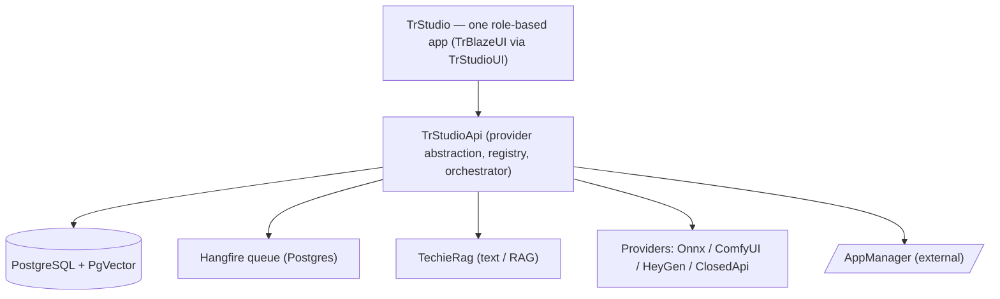
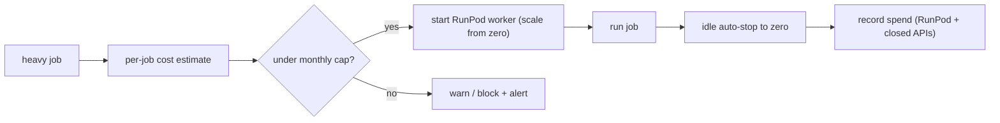
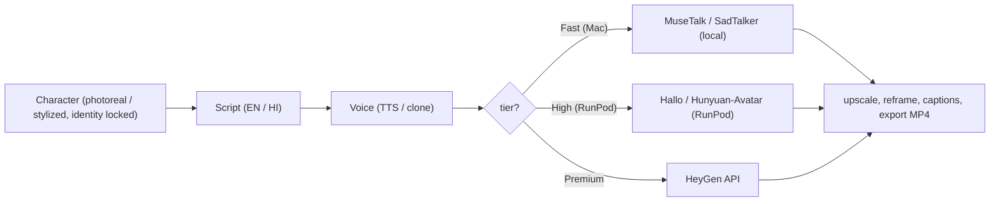
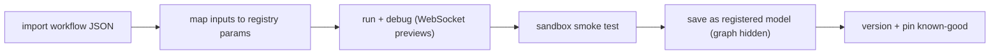
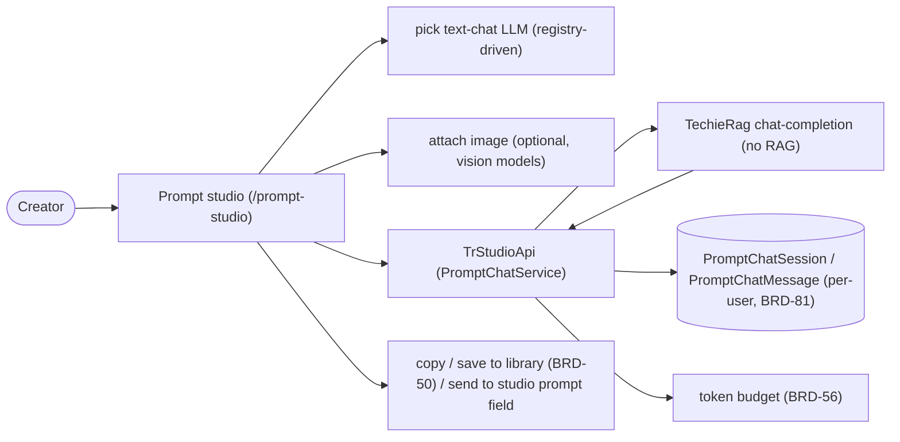
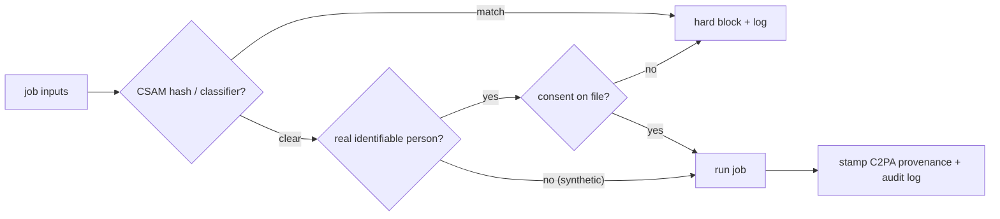
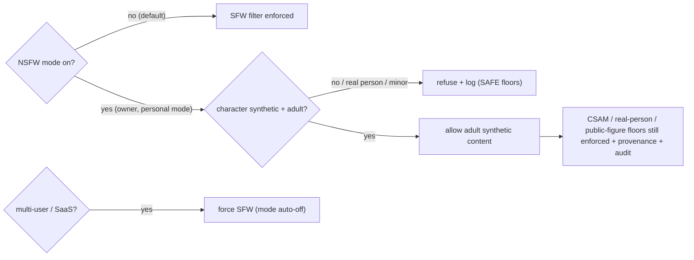

# TrStudio — Business Requirements

## Table of Contents

1. [Executive summary](#executive-summary)
2. [Business objectives](#business-objectives)
3. [Scope](#scope)
4. [Development status](#development-status)
5. [Stakeholders / users](#stakeholders-users)
6. [Context diagram](#context-diagram)
7. [User journey — primary use case](#user-journey-primary-use-case)
8. [Component sketch](#component-sketch)
9. [Feature catalog](#feature-catalog)
   - [F-PLAT: Platform spine & provider abstraction](#f-plat-platform-spine-provider-abstraction)
   - [F-PROVIDERS: Model & provider registry](#f-providers-model-provider-registry)
   - [F-ADMIN: Host setup & environment management](#f-admin-host-setup-environment-management)
   - [F-RUNPOD: RunPod serverless & cost guardrails](#f-runpod-runpod-serverless-cost-guardrails)
   - [F-OPS: Generation log, ops & observability](#f-ops-generation-log-ops-observability)
   - [F-IMAGE: Image studio](#f-image-image-studio)
   - [F-VOICE: Voice studio (English + Hindi)](#f-voice-voice-studio-english-hindi)
   - [F-AVATAR: Avatar studio (lead feature)](#f-avatar-avatar-studio-lead-feature)
   - [F-COMFY: ComfyUI pipeline management](#f-comfy-comfyui-pipeline-management)
   - [F-VIDEO: Video studio](#f-video-video-studio)
   - [F-WORKSPACE: Workspace](#f-workspace-workspace)
   - [F-TEXT: Text, script & character bible (TechieRag)](#f-text-text-script-character-bible-techierag)
   - [F-PROMPT: Prompt studio (LLM prompt-crafting chat)](#f-prompt-prompt-studio-llm-prompt-crafting-chat)
   - [F-IDENTITY: Identity & licensing (AppManager)](#f-identity-identity-licensing-appmanager)
   - [F-SAFETY: Trust, safety & provenance](#f-safety-trust-safety-provenance)
   - [F-NSFW: Unrestricted (NSFW) content mode — owner-only](#f-nsfw-unrestricted-nsfw-content-mode-owner-only)
   - [F-API: Platform API & SaaS seam](#f-api-platform-api-saas-seam)
10. [Functional requirements (BRD ledger)](#functional-requirements-brd-ledger)
11. [Non-functional requirements](#non-functional-requirements)
12. [Constraints & assumptions](#constraints-assumptions)
13. [Success metrics](#success-metrics)
14. [Risks](#risks)
15. [Glossary](#glossary)

## 1. Executive summary

TrStudio is an **avatar-led, self-hostable AI image & video generation platform** — "Techie Rathore Studio". Its purpose is one clean app to produce avatar-led videos (a talking presenter that isn't the owner), plus the supporting images, voices and clips, **without ComfyUI graphs or Python setup for the end user**, running against models the owner controls — on their own hardware or cheap on-demand GPUs — with a **HeyGen-grade Premium tier on tap** when they want it.

The product is delivered as **one unified Blazor application**, **`TrStudio`**, that presents both the creator experience (avatar/image/video/voice studios, gallery, projects) and the model/provider management experience (hardware detection, setup, registry, RunPod control, ComfyUI import/debug, cost guardrails, ops) — **which surface a signed-in user sees is decided by their role** (Creator / Operator / Owner). It ships as **both a Blazor Web app and a MAUI Blazor Hybrid desktop app (Windows + macOS)** — the local desktop app being the primary delivery — sharing the **`TrStudioUI`** Razor Class Library built on **TrBlazeUI** controls, over a single backend, **`TrStudioApi`** (.NET 10, ASP.NET Core). *(Amended 2026-07-05, BRD-86/87 — supersedes the original two-app `TrStudio` + `TrStudioAdmin` split; see Architecture ADR-012.)*

Two design drivers shape everything. First, **economics**: an M4 Max with 36 GB unified memory and a ~$100/month budget cannot run heavy avatar/video locally or on an always-on rented GPU, so heavy work runs on **serverless, scale-to-zero GPUs** behind a three-tier quality/cost selector — **Fast** (Mac local), **High** (RunPod self-hosted), **Premium** (HeyGen API). Second, **safety & law**: there is no uncensored mode; hard, non-disableable floors (CSAM/NCII prevention, consent gating, provenance, audit trail) are binding, which is also what keeps payments, app stores, hosting, and the SaaS path open. Data lives in TrStudio's own PostgreSQL + PgVector in India (DPDP-aligned); identity/licensing is delegated to **AppManager** as a child app; text/script/caption/character-bible work uses the **TechieRag** library.

## 2. Business objectives

- Produce a **full EN or Hindi talking-avatar clip from a synthetic character across all three tiers** (Fast/High/Premium) end-to-end, with the owner staying off-camera.
- Keep personal-use spend within **~$100/month** ($50 RunPod + $50 closed-API incl. HeyGen) by enforcing scale-to-zero, idle auto-stop, and a monthly cap with alerts.
- Make **adding a model a configuration action** (registry row / ComfyUI import) — not a development task.
- Keep **personal-first but SaaS-ready**: every shared capability is a first-class `TrStudioApi` endpoint; identity/licensing/tiers gate cleanly via AppManager when run multi-user.
- Ship **DPDP-aligned, provenance-stamped, auditable** output by construction.

## 3. Scope

**In scope (single combined MVP, built in the §12 dependency order):** the platform spine + provider abstraction + registry; local image vertical; managed ComfyUI + RunPod with cost guardrails; voice studio (EN+HI); the avatar pipeline (lead feature) with the Fast/High/Premium selector incl. HeyGen; the ComfyUI import/debug screen; video studio + closed-API adapters; safety & provenance throughout; workspace (gallery/projects/library/comparison/spend); the SaaS-ready API seam; **an owner-only Unrestricted (NSFW) content mode for fully-synthetic adult personas** (admin-gated, personal-mode only — see F-NSFW).

**Added 2026-07-07 (Phase 10):** a **Prompt Studio** — a chat screen where the creator converses with a registry-configured text LLM (TechieRag chat-completion, no RAG pipeline; optional image attachment for vision models) to craft the precise prompts the image/avatar/video models need (F-PROMPT, BRD-88..92).

**Owner-only Unrestricted (NSFW) content mode — in scope, but gated (F-NSFW, BRD-79/80).** The general SFW content filter is **toggleable by the owner in personal/single-user mode** so the app can generate legal adult content from **fully-synthetic, adult (18+) personas**. It is **off by default**, lives behind an admin setting, and is **automatically disabled in multi-user/SaaS mode** via AppManager feature gating (so it never reaches other users). This is the dual-use line: the *general* filter is the owner's choice; the *illegal-harm* floors below are not.

**Always-enforced safety floors (NOT disableable — even with NSFW mode ON):** these are not "censorship", they are legal hard lines that also keep payments/hosting/app-store viable (see §10):
- **CSAM is blocked by design** (hash + classifier, every provider) — never toggleable (SAFE-01 / BRD-60).
- **No sexual content of real, identifiable people** without recorded consent; **no minors in any sexual context, ever** (SAFE-02/03 / BRD-61/62). NSFW mode is scoped to characters flagged **synthetic + adult**; photoreal-of-a-real-person and real-person references are refused (BRD-80).
- **No impersonation of real public figures** without explicit rights (SAFE-05 / BRD-64).
- Provenance/AI-disclosure metadata and the full audit trail remain on every output regardless of mode (SAFE-04/06 / BRD-63/65).

**Out of scope (explicit):**
- **Uncensored mode in the SaaS / multi-user build** — the NSFW toggle is **personal-only**; the hosted/multi-user product ships SFW-locked. (Keeps Stripe/Razorpay/PayPal, the App/Play stores, and most hosting open.)
- **AppManager is not re-implemented** — identity/licensing/payments/support are consumed from it; no local password store.
- **Hindi UI** — Hindi is **voice + captions only**; the UI stays English.
- **TechieRag is not extended to image/video** — it is text/LLM/RAG only.

## 4. Development status

**Snapshot as of 2026-07-07 (Handoff) — all 10 phases (P1–P10) shipped.** P1–P9 consolidated into one role-based app + MAUI desktop heads; **Phase 10 (Prompt Studio, F-PROMPT) built + verified live 2026-07-07**. Live, per-requirement status is the **Requirements Status** table in `docs/TrStudio-Checklist.md` (114 tracked REQ rows: **82 Verified / 17 Implemented / 4 PARTIAL / 0 Blocked / 11 Not Started (deferred-Could + cross-cutting NFR) / 0 FAIL** — AppManager identity verified live 2026-07-07, clearing the last 3 Blocked) and `PROJECT-STATUS.md`. `Partial` below = the feature's core is Verified but some execution is externally gated (a real model / API key / published-app dependency), degrading cleanly until supplied — never a code defect.

| Feature (F-code) | Phase | Status | % | Notes |
|------------------|-------|--------|---|-------|
| F-PLAT: Platform spine & provider abstraction | 1 | Done | 100 | `IGenerationProvider`, async job model, Hangfire/Postgres queue, OpenAPI, SignalR — all Verified live |
| F-SHELL: Unified role-based app + desktop heads | 1 (amended 2026-07-05) | Done | 95 | ONE role-gated `TrStudio` app on the shared `TrStudioUI` RCL (BRD-86) — REQ-UI-080 + REQ-FN-072 Verified live (Creator→studios+AccessDenied on admin, Operator→management, Owner→both+in-app switch; `TrStudioAdmin` retired). MAUI Blazor Hybrid desktop heads (BRD-87) — REQ-NFR-003: Windows head run-verified (FlaUI), Mac Catalyst build-verified only (no Mac in env). Supersedes the two-app split (ADR-001→ADR-012) |
| F-PROVIDERS: Model & provider registry | 1 (closed config in 7) | Done | 100 | Registry single-source-of-truth + declarative params schema (drives UI live); encrypted provider keys masked at rest — Verified |
| F-ADMIN: Host setup & environment management | 1 / 3 | Partial | 85 | Capability detection Verified live; guided ONNX/isolated-Python/ComfyUI + resumable model install — endpoints + state machine live, real provisioning-to-completion host/GPU-gated |
| F-RUNPOD: RunPod serverless & cost guardrails | 3 | Partial | 90 | Cost estimate + monthly cap (402 over-cap) + spend-by-channel Verified; RunPod scale-to-zero built, live cold-start needs `RunPod:ApiKey` |
| F-OPS: Generation log, ops & observability | 1 / 9 | Done | 95 | Generation log + ops dashboard (live Hangfire health/queue/spend) Verified; Serilog + OpenTelemetry wired |
| F-IMAGE: Image studio | 2 | Done | 100 | T2I/I2I/inpaint/ControlNet/upscale/batch/export + seed reproducibility Verified (real pixels ONNX-model-gated; synthetic otherwise) |
| F-VOICE: Voice studio (EN+HI) | 4 | Partial | 85 | Consent-gated cloning + LLM token tracking Verified; TTS/per-language routing/emotion/avatar-handoff built, real synthesis voice-model-gated |
| F-AVATAR: Avatar studio (lead feature) | 5 | Partial | 90 | Character + identity-lock + Fast/High/Premium tier routing (3 providers) + captions/SRT + RAG bible Verified; lip-sync/HeyGen execution model/key-gated |
| F-COMFY: ComfyUI pipeline management | 6 | Partial | 90 | Import/parse/map/save-as-model (graph hidden)/version-pin/sandbox-gate Verified; live run + WS previews + auto-install ComfyUI-instance-gated |
| F-VIDEO: Video studio | 7 | Partial | 90 | Tier routing (3 providers) + conditioning + edit/export pipeline Verified; generation/interpolation/upscale model/aggregator-key-gated; real ffmpeg export host-gated |
| F-WORKSPACE: Workspace | 2 / 9 | Done | 95 | Gallery/projects/reproduce/comparison/library/export(+provenance)/spend Verified live; per-user isolation confirmed |
| F-TEXT: Text, script & character bible (TechieRag) | 4 / 5 | Partial | 90 | Token-budget tracking + RAG character bible (PgVector) Verified; script/caption generation LLM-gated (degrades to keyword) |
| F-IDENTITY: Identity & licensing (AppManager) | 1 | Done | 90 | **Verified live 2026-07-07** against real AppManager (after an AppManager `/keys` RSA-key permission fault was fixed): login + `/auth/me` + license (LicenseSvc) + register all 200 end-to-end; role mapping (Owner 0 / Creator 1) and login-driven landing confirmed (FN-012/013/015/016 Verified). Remaining: assign a **Premium license** in AppManager to exercise Premium tier-gating (FN-014, Partial) |
| F-SAFETY: Trust, safety & provenance | 8 (+ throughout) | Done | 100 | SAFE-01..06 Verified: CSAM/NCII/public-figure hard-block before enqueue, consent gate, C2PA provenance, full audit trail (real detection models pluggable/fail-closed) |
| F-NSFW: Unrestricted (NSFW) content mode — owner-only | 8 | Done | 100 | Owner-only, off-by-default, personal-mode-only (409 in multi-user); floors STILL fire with NSFW ON (minor/CSAM → 403) — Verified |
| F-API: Platform API & SaaS seam | 9 | Partial | 70 | External REST API-key seam Verified (`X-Api-Key` → job 200); webhooks (FN-070) + MCP server (FN-071) deferred (Could, behind MVP) |
| F-PROMPT: Prompt studio (LLM prompt-crafting chat) | 10 | Partial | 90 | Shipped + verified 2026-07-07 (BRD-88..92): registry-driven `text-chat` LLM picker + admin config, per-user sessions (owner-filtered, cross-user→404), vision gate, token accrual to LlmText, prompt → library/studio handoff — REQ-UI-081/082 + FN-073/074 Verified live. Chat completion via TechieRag direct chat-completion (RAG-005 Implemented) is LLM-config-gated (degrades to a synthetic best-effort reply, like F-TEXT); native vision blocked at TechieRag 1.0.5 (TR-RAG-001, HTTP fallback) |

**Legend:** Done = shipped & working · In progress = actively being built · Partial = core shipped, remainder externally gated or deferred · **Planned** = not started.

## 5. Stakeholders / users

| Role | Needs | Key screens |
|------|-------|-------------|
| **Creator / Owner** (personal-first primary user) | Produce avatar-led videos + supporting media without touching Python/ComfyUI; pick quality/cost per job; reuse characters; stay off-camera | Avatar / Image / Video / Voice studios, Gallery, Projects |
| **Operator / Admin** (same person today, separable later) | Detect hardware, set up runtimes, manage the model/provider registry, start/stop RunPod, import ComfyUI pipelines, watch spend & worker health | `TrStudio` (management surface, role-gated): Setup, Registry, RunPod, ComfyUI Import, Ops, Cost |
| **Future SaaS end-user** (later, multi-user) | Self-serve generation gated by license/tier via AppManager | Same `TrStudio` screens, tier-gated |
| **AppManager** (external system actor) | Owns users, JWT auth, licenses/subscriptions, feature/tier gating, payments, support | n/a (API integration) |

**License & tier model (from §8.2 of the requirements).** In **personal mode** all tiers (Fast / High / **Premium-HeyGen**) are available. When run **multi-user/SaaS**, which tiers a user may select is gated via AppManager **FeatureSvc / LicenseSvc** (e.g. Premium behind a paid license). TrStudio stores only the AppManager `userId` for ownership of characters/jobs/assets — never passwords.

## 6. Context diagram

## 7. User journey — primary use case

The headline workflow — a HeyGen-style talking avatar, self-hosted, with HeyGen on tap:

## 8. Component sketch

## 9. Feature catalog

### F-PLAT: Platform spine & provider abstraction

**Personas:** Creator, Operator · **Phase:** 1

The spine everything else hangs on. `TrStudio` requests *"task T with model M and params P"*; `TrStudioApi` resolves M → a provider and routes the job, so the UI never knows which provider ran it. A single async job model (submit → poll/stream → fetch) is identical across providers; a durable Hangfire/Postgres queue gives priority, concurrency caps, retries and back-pressure; SignalR streams progress and surfaces actionable failures. The whole surface is OpenAPI-described, authenticated, and versioned so it can serve `TrStudio` today and third parties later.

| Screen | Route | Description |
|--------|-------|-------------|
| (backend) Job orchestrator | `/api/jobs` | Submit/poll/stream/fetch; provider-agnostic |
| (backend) OpenAPI surface | `/swagger` | Versioned API contract |

**Workflow:** 1) UI submits a job → 2) API resolves model→provider + tier → 3) cost estimate + safety pre-check → 4) enqueue durable job → 5) provider runs, streams progress → 6) result + provenance persisted → gallery.

**Requirements:** BRD-1, BRD-2, BRD-3, BRD-4, BRD-5 (see §10)

### F-PROVIDERS: Model & provider registry

**Personas:** Operator · **Phase:** 1 (closed-provider config completed in Phase 7)

Every usable model is a registry row owned by `TrStudioApi`, with a **declarative params schema** so the UI renders controls for any model with no code change — adding a model is a `TrStudioAdmin` action, not a dev task. The registry is the single source of truth for task, provider type, tier, hardware needs, languages, license and safety class. Closed-provider adapters (HeyGen, aggregator) are configured here with **encrypted** API-key storage and enabled per model.

| Screen | Route | Description |
|--------|-------|-------------|
| Model & Provider Registry | `/admin/registry` | List/add/edit registry rows; params schema editor |
| Provider config | `/admin/providers` | Configure HeyGen / aggregator keys (encrypted), enable per model |

**Requirements:** BRD-6, BRD-7

### F-ADMIN: Host setup & environment management

**Personas:** Operator · **Phase:** 1 / 3

Gets a machine from bare to ready without the user touching a terminal: detect host capabilities (Apple Silicon GPU cores, unified memory, MPS/CoreML, disk) and show a readiness summary; guided setup installs ONNX Runtime and provisions a **managed, isolated Python env + ComfyUI** that never collides with system Python; one-click install/import of curated open models (resumable downloads) with size/VRAM/licence shown, storing big media models on a RunPod network volume.

**Model sources (BRD-82).** The model library is fed by **configurable model-repository sources** — Hugging Face, Civitai, and arbitrary custom URLs/registries — set on a dedicated **Model Sources** screen (base URL, API token where required, enabled flag). The Operator adds/edits a source there; the Model library then browses/searches and installs models from the enabled sources. This is separate from **Provider config** (which holds closed-API *generation* keys like HeyGen/aggregator) — sources are where *open model files* are discovered and pulled from.

| Screen | Route | Description |
|--------|-------|-------------|
| Hardware & readiness | `/admin/setup/hardware` | Capability detection + readiness summary |
| Guided setup | `/admin/setup` | ONNX + isolated Python/ComfyUI provisioning wizard |
| Model sources | `/admin/sources` | Configure model-repository sources (Hugging Face, Civitai, custom URL) + tokens |
| Model library | `/admin/models` | Browse/install models from enabled sources; resumable, size/VRAM/licence |

**Requirements:** BRD-8, BRD-9, BRD-10, BRD-11, BRD-82

### F-RUNPOD: RunPod serverless & cost guardrails

**Personas:** Operator · **Phase:** 3

The economic heart. RunPod serverless integration registers an endpoint/template, submits jobs, streams status, and **scales to zero** automatically (start/stop on demand). Cost guardrails give a per-job estimate before run, idle auto-stop, and a monthly spend cap with alerts across **both** RunPod and closed APIs (incl. HeyGen), defaulting to the owner's $100.

**Requirements:** BRD-12, BRD-13

### F-OPS: Generation log, ops & observability

**Personas:** Operator · **Phase:** 1 (log) / 9 (ops dashboard)

A generation log records who/model/params/cost/duration/outcome for every job — for history, one-click reproduce, and audit. The ops view shows worker health, queue depth, spend-to-date and error rates.

| Screen | Route | Description |
|--------|-------|-------------|
| Generation log | `/admin/log` | Filterable history; reproduce; audit trail |
| Ops dashboard | `/admin/ops` | Worker health, queue depth, spend, error rates |

**Requirements:** BRD-14, BRD-15

### F-IMAGE: Image studio

**Personas:** Creator · **Phase:** 2

The first end-to-end vertical and the persona/character image source. Text-to-image with a prompt composer and dynamically rendered model params (registry schema); image-to-image, inpaint/outpaint and mask editing on a canvas; reference-image/ControlNet conditioning (pose/depth/edges) with face/identity lock for characters; upscale + face restoration to 2K/4K; batch/grid variations with seed control and reproducibility; social-format export presets (1:1, 4:5, 9:16, 16:9) and background removal.

| Screen | Route | Description |
|--------|-------|-------------|
| Image studio | `/image` | Prompt composer + dynamic params; canvas for I2I/inpaint/mask |
| Batch / variations | `/image/batch` | Grid variations, seed control |

**Requirements:** BRD-16, BRD-17, BRD-18, BRD-19, BRD-20, BRD-21

### F-VOICE: Voice studio (English + Hindi)

**Personas:** Creator · **Phase:** 4

Because lip-sync models are largely audio-driven, Hindi support is mostly a TTS problem — so the voice studio is where EN/HI lands. TTS in English and Hindi (and Hinglish) with a library of preset voices; voice cloning from a short sample (**consent-gated for real people**; synthetic/preset voices need no gate); per-language model routing (IndicF5/XTTS-Hindi for HI; XTTS/OmniVoice for EN) hidden behind one "voice" control; emotion/style and speed controls where supported; automatic alignment of generated audio to the avatar pipeline (timing + lip-sync handoff).

| Screen | Route | Description |
|--------|-------|-------------|
| Voice studio | `/voice` | TTS EN/HI/Hinglish; preset voices; emotion/speed |
| Voice cloning | `/voice/clone` | Clone from sample; consent gate for real people |

**Requirements:** BRD-22, BRD-23, BRD-24, BRD-25, BRD-26

### F-AVATAR: Avatar studio (lead feature)

**Personas:** Creator · **Phase:** 5

The product's signature feature — an avatar-led video pipeline chaining **(script) → voice (TTS) → talking-face (lip-sync/avatar) → polish**. A **Character** is a first-class entity: a synthetic persona (image gen), photoreal **or** stylized, with locked identity (reference set + seed/embedding, optional LoRA), reusable everywhere; it carries a realism flag that scopes model choice and safety class. A talking avatar is produced from a character image + script/audio with lip-sync (routed to MuseTalk/LatentSync/SadTalker/LivePortrait, a RunPod heavy model, or HeyGen per the quality setting). Script→video runs end-to-end (type a script EN/HI, pick character + voice, get a narrated clip). The **quality/cost selector** (Fast Mac / High RunPod / Premium HeyGen) is the same UI control across providers. Captions/subtitles (EN/HI) burn-in or sidecar SRT. Optional digital-twin from a short base video is **consent-gated and off by default**; multi-shot assembly chains clips with a consistent character.

| Screen | Route | Description |
|--------|-------|-------------|
| Avatar studio | `/avatar` | Character picker, script, voice, tier selector, render |
| Character library | `/avatar/characters` | Create/lock/reuse photoreal or stylized personas |
| Multi-shot assembly | `/avatar/sequence` | Chain clips, consistent character |

**Workflow:** 1) create/pick Character → 2) write script (EN/HI) → TTS voice → 3) animate (pick Fast/High/Premium) → 4) polish (upscale, reframe, captions, export MP4).

**Requirements:** BRD-27, BRD-28, BRD-29, BRD-30, BRD-31, BRD-32, BRD-33

### F-COMFY: ComfyUI pipeline management

**Personas:** Operator · **Phase:** 6

How new models get added, in `TrStudioAdmin`. Import a ComfyUI workflow (drag-drop API-format JSON or paste), parse nodes and list parameterizable inputs; map workflow inputs → registry params (required, types, defaults, hide internal nodes); run against a chosen worker (local MPS or RunPod) streaming progress + previews via WebSocket; a debug view shows per-node status, errors, the exact JSON sent, and missing-model/custom-node detection with install hints; detect and (where possible) auto-install custom nodes + model files; save an imported+mapped workflow as a registered model (graph hidden from end users); version workflows and pin a known-good version; sandbox/smoke-test before going live.

| Screen | Route | Description |
|--------|-------|-------------|
| ComfyUI import | `/admin/comfy/import` | Drag-drop/paste workflow JSON; parse + map |
| ComfyUI debug | `/admin/comfy/debug` | Per-node status, errors, exact JSON, install hints |

**Requirements:** BRD-34, BRD-35, BRD-36, BRD-37, BRD-38, BRD-39, BRD-40, BRD-41

### F-VIDEO: Video studio

**Personas:** Creator · **Phase:** 7

Image-to-video and text-to-video (open model on RunPod, or closed API) with duration/motion/aspect controls; first/last-frame + reference-image conditioning for consistency; frame interpolation (RIFE/FILM) and video upscale as post-steps; trim/join/reframe, add audio (from Voice studio), export MP4 in platform formats; clip extension/stitching for longer sequences.

| Screen | Route | Description |
|--------|-------|-------------|
| Video studio | `/video` | I2V/T2V with duration/motion/aspect; conditioning |
| Video editor | `/video/edit` | Trim/join/reframe, add audio, interpolate, upscale, export |

**Requirements:** BRD-42, BRD-43, BRD-44, BRD-45, BRD-46

### F-WORKSPACE: Workspace

**Personas:** Creator · **Phase:** 2 (gallery/projects) / 9 (comparison, library, spend)

The connective tissue. An asset gallery makes every output browsable/filterable and reusable as an input; projects/folders carry full-parameter history with one-click reproduce; side-by-side comparison across models/seeds/providers; a prompt + script library with reusable style/voice presets; export/download (single + bulk) with provenance metadata; an account + usage/spend view with license/subscription & billing surfaced from AppManager.

**Per-user isolation (BRD-81).** Every character, job and asset is scoped to its owning AppManager `userId`. The gallery, projects, library and history show **only the signed-in user's own content** — there is no cross-user visibility. Isolation is enforced **server-side** in `TrStudioApi` (the owner filter is applied to every query in the engine's data-access layer), not just hidden in the UI, so it holds for the API tier and the future SaaS build too.

| Screen | Route | Description |
|--------|-------|-------------|
| Gallery | `/gallery` | Browsable/filterable assets; reuse as input |
| Projects | `/projects` | Folders, history, one-click reproduce |
| Comparison | `/compare` | Side-by-side across models/seeds/providers |
| Library | `/library` | Prompt/script library; style/voice presets |
| Account & spend | `/account` | Usage/spend; AppManager license/billing |

**Requirements:** BRD-47, BRD-48, BRD-49, BRD-50, BRD-51, BRD-52, BRD-81

### F-TEXT: Text, script & character bible (TechieRag)

**Personas:** Creator · **Phase:** 4 / 5

The text/LLM/RAG layer, provided by the **TechieRag** library (text only — not the image path). Script generation/expansion from a brief (EN/HI); caption/subtitle text from Whisper transcripts; a **RAG-backed character bible** (persona voice/wording consistency) stored in PgVector on the same Postgres instance; token-budget tracking for text-LLM spend.

| Screen | Route | Description |
|--------|-------|-------------|
| Script assistant | `/avatar` (panel) | Brief → script, expand/rewrite, EN/HI |
| Character bible | `/avatar/characters` (panel) | RAG persona voice/wording consistency |

**Requirements:** BRD-53, BRD-54, BRD-55, BRD-56

### F-PROMPT: Prompt studio (LLM prompt-crafting chat)

**Personas:** Creator · **Phase:** 10 · *Added 2026-07-07*

The image, avatar and video models all demand very peculiar, very accurate prompts — this feature gives the creator a dedicated **chat screen to craft them**. The creator picks a **text-chat LLM** from a registry-driven list (a `text-chat` modality in the model/provider registry: provider, model, endpoint, encrypted API key, vision-capable flag — admin-managed like every other model) and converses with it through **TechieRag direct chat-completion — deliberately no RAG/vector pipeline setup**. An image can be attached to a message (e.g. a photograph to be edited) so a vision-capable LLM can propose the ideal prompt for the described changes; non-vision models degrade gracefully (attachment disabled with a hint to pick a vision model). Chat sessions persist per user (list / resume / rename / delete, owner-filtered server-side per BRD-81) and token usage counts into the BRD-56 text-LLM budget. A crafted prompt is one click from use: **copy**, **save to the prompt library** (BRD-50), or **send straight into a studio's prompt field** (Image / Avatar / Video).

| Screen | Route | Description |
|--------|-------|-------------|
| Prompt studio | `/prompt-studio` | Chat UI: registry-driven LLM picker, image attachment, per-user session list, prompt-use actions (copy / save to library / send to studio) |

**Requirements:** BRD-88, BRD-89, BRD-90, BRD-91, BRD-92

### F-IDENTITY: Identity & licensing (AppManager)

**Personas:** Creator, Operator, AppManager (external) · **Phase:** 1

Identity and licensing are delegated to AppManager as a child application. User **registration** and **login** go through the AppManager API (JWT + refresh, RSA-encrypted passwords); license/subscription validation via LicenseSvc; feature/tier gating via FeatureSvc (e.g. Premium behind a paid license). No local password store. A generic AppManager superadmin (`admin@appmanager.local`) bootstraps the first session; further accounts are created through the registration screen against the AppManager API. Password reset is likewise AppManager-backed (request from the Forgot-password screen; the reset itself completes through AppManager).

**Role-based default landing (BRD-84).** After login every user is routed to a default page by role — nobody lands on a blank or arbitrary screen:

| Role | Default landing after login | When first-run setup is incomplete |
|------|----------------------------|-------------------------------------|
| Superadmin / Owner (`admin@appmanager.local`) | Avatar studio `/avatar` | Management surface — Guided setup `/admin/setup` |
| Operator / Admin | Management surface — Ops dashboard `/admin/ops` | Hardware & readiness `/admin/setup/hardware` → guided setup |
| Creator (standard or Premium-licensed) | Avatar studio `/avatar` | Setup-required screen `/setup-required` |

**First-run setup gate (BRD-85).** On every login the system checks whether initial setup is complete — **at least one enabled model source and at least one ready model in the registry**. If not: users with admin rights (Owner/Operator) are taken straight into setup (hardware readiness → guided setup → sources → model install); Creators land on a **Setup-required** screen that explains no models are configured yet and tells them to ask their admin to complete setup (or sign in with an admin account). No generation UI is offered until the gate passes.

| Screen | Route | Description |
|--------|-------|-------------|
| Register | `/register` | Create an account via the AppManager API (child-app registration) |
| Login | `/login` | AppManager-backed auth; routes to the role's default landing (BRD-84) |
| Forgot password | `/forgot-password` | Request an AppManager-backed password reset (no local store) |
| Setup required | `/setup-required` | Creator-facing first-run gate: setup incomplete → ask an admin (BRD-85) |
| Account / license | `/account` | License/subscription status (read from AppManager) |

**Requirements:** BRD-57, BRD-58, BRD-59, BRD-83, BRD-84, BRD-85

### F-SAFETY: Trust, safety & provenance

**Personas:** all (binding on the build) · **Phase:** 8 consolidation, **wired from Phase 2 onward**

Non-negotiable, non-disableable floors on every provider. Prevent CSAM by design (hash-matching + classifier on inputs/outputs, hard block + log); block sexualisation/face-swap of real identifiable people and refuse NCII/sexual deepfakes; require a recorded **consent** step (retained as evidence) for any real-person face/voice clone; embed provenance/AI-disclosure metadata (C2PA-style, non-trivial to strip; respect provider watermarks); block impersonation of real public figures by default (allow only with explicit rights); per-deployment policy config, abuse reporting, and a full generation audit trail.

**Requirements:** BRD-60, BRD-61, BRD-62, BRD-63, BRD-64, BRD-65

### F-NSFW: Unrestricted (NSFW) content mode — owner-only

**Personas:** Owner (personal mode only) · **Phase:** 8

The owner can lift the **general SFW content filter** to generate legal adult content from **fully-synthetic, adult (18+) personas**. The mode is an admin setting in `TrStudioAdmin`, **off by default**, and is **automatically disabled in multi-user/SaaS mode** via AppManager FeatureSvc — it never reaches another user. It is scoped strictly to characters flagged **synthetic + adult**: any photoreal-of-a-real-person character, real-person reference image/voice, or detected minor is refused, and the **always-on floors** (CSAM, NCII/real-person, public-figure impersonation, provenance, audit — SAFE-01/02/03/04/05/06) remain enforced regardless of the toggle. This is the deliberate dual-use boundary: the general filter is the owner's choice; illegal-harm prevention is not toggleable.

| Screen | Route | Description |
|--------|-------|-------------|
| Content policy (admin) | `/admin/policy` | Toggle Unrestricted mode (personal only); shows which floors stay locked |

**Requirements:** BRD-79, BRD-80

### F-API: Platform API & SaaS seam

**Personas:** Future SaaS / third-party · **Phase:** 9

The SaaS-ready abstraction. `TrStudioApi` is designed to also serve as an external REST API (API-key auth) later; webhooks fire on completion/failure; an MCP server exposes generation as agent tools (matching competitor MCP offerings). (The async job model itself is BRD-2 under F-PLAT.)

**Requirements:** BRD-66, BRD-67, BRD-68

## 10. Functional requirements (BRD ledger)

> Machine-traceable ledger consumed by `*split-brd`. One line per discrete capability. Original requirement IDs from `TrStudio-Requirements-v0.3.md` are preserved in parentheses; `<!-- from -->` marks source-doc origin.

**Phase 1 — Platform spine, registry, identity**

- **BRD-1** — System shall expose a provider abstraction (`IGenerationProvider`: supports/submit/status/result/estimateCost) so any model resolves to one provider. *(F-PLAT, ADM-05 §4.2)* <!-- from: TrStudio-Requirements-v0.3.md -->
- **BRD-2** — System shall offer an async job model (submit → poll/stream → fetch) identical across providers. *(F-PLAT, API-02)* <!-- from: TrStudio-Requirements-v0.3.md -->
- **BRD-3** — System shall run a durable job queue (Hangfire/Postgres) with priority, concurrency caps, retries, durable jobs and back-pressure. *(F-PLAT, ADM-08)* <!-- from: TrStudio-Requirements-v0.3.md -->
- **BRD-4** — System shall expose the unified `TrStudioApi` surface (OpenAPI, auth, versioned) consumed by `TrStudio` and serveable to third parties. *(F-PLAT, ADM-13)* <!-- from: TrStudio-Requirements-v0.3.md -->
- **BRD-5** — System shall stream job progress (SignalR) and surface actionable failures (e.g. "out of memory — drop to 256px or route to RunPod"). *(F-PLAT, ADM-09)* <!-- from: TrStudio-Requirements-v0.3.md -->
- **BRD-6** — Operator can maintain the Model & Provider Registry as the single source of truth, with a declarative params schema that auto-renders UI controls. *(F-PROVIDERS, ADM-05)* <!-- from: TrStudio-Requirements-v0.3.md -->
- **BRD-7** — Operator can configure closed-provider adapters (HeyGen, aggregator) with encrypted API-key storage, enabled per model. *(F-PROVIDERS, ADM-07)* <!-- from: TrStudio-Requirements-v0.3.md -->
- **BRD-8** — Operator can detect host capabilities (Apple Silicon GPU cores, unified memory, MPS/CoreML, disk) and see a readiness summary. *(F-ADMIN, ADM-01)* <!-- from: TrStudio-Requirements-v0.3.md -->
- **BRD-9** — Operator can run guided setup that installs ONNX Runtime and provisions a managed, isolated Python env + ComfyUI without using a terminal. *(F-ADMIN, ADM-02)* <!-- from: TrStudio-Requirements-v0.3.md -->
- **BRD-10** — System shall manage the isolated Python/ComfyUI environment so it never collides with system Python. *(F-ADMIN, ADM-03)* <!-- from: TrStudio-Requirements-v0.3.md -->
- **BRD-11** — Operator can one-click install/import curated open models (resumable downloads) with size/VRAM/licence shown, storing big media models on a RunPod network volume. *(F-ADMIN, ADM-06)* <!-- from: TrStudio-Requirements-v0.3.md -->
- **BRD-57** — User can register/log in via AppManager (JWT + refresh, RSA-encrypted passwords); no local password store. *(F-IDENTITY)* <!-- from: TrStudio-Requirements-v0.3.md -->
- **BRD-58** — System shall validate license/subscription via AppManager LicenseSvc. *(F-IDENTITY)* <!-- from: TrStudio-Requirements-v0.3.md -->
- **BRD-59** — System shall gate features/tiers via AppManager FeatureSvc (e.g. Premium behind a paid license in multi-user mode). *(F-IDENTITY, §8.2)* <!-- from: TrStudio-Requirements-v0.3.md -->
- **BRD-83** — User can register an account via the AppManager API (child-app registration); a generic superadmin (`admin@appmanager.local`) bootstraps the first session. *(F-IDENTITY)*
- **BRD-84** — System shall route each user to a role-based default landing page after login (Owner/Creator → Avatar studio `/avatar`; Operator/Admin → admin dashboard `/admin/ops`) per the landing table in §9 F-IDENTITY. *(F-IDENTITY)* <!-- from: owner review 2026-07-02 -->
- **BRD-85** — System shall check on login whether initial setup is complete (≥1 enabled model source AND ≥1 ready registry model); if not, admins are routed into guided setup and Creators land on a Setup-required screen (`/setup-required`) directing them to their admin — no generation offered until the gate passes. *(F-IDENTITY, F-ADMIN)* <!-- from: owner review 2026-07-02 -->
- **BRD-14** — System shall record a generation log (who/model/params/cost/duration/outcome) for history, reproduce and audit. *(F-OPS, ADM-11)* <!-- from: TrStudio-Requirements-v0.3.md -->

**Phase 2 — Local image vertical + workspace foundation**

- **BRD-16** — Creator can generate text-to-image with a prompt composer + dynamically rendered model params (registry schema). *(F-IMAGE, IMG-01)* <!-- from: TrStudio-Requirements-v0.3.md -->
- **BRD-17** — Creator can do image-to-image, inpaint/outpaint and mask editing on a canvas. *(F-IMAGE, IMG-02)* <!-- from: TrStudio-Requirements-v0.3.md -->
- **BRD-18** — Creator can apply reference-image / ControlNet conditioning (pose/depth/edges) and face/identity lock for characters. *(F-IMAGE, IMG-03)* <!-- from: TrStudio-Requirements-v0.3.md -->
- **BRD-19** — Creator can upscale + face-restore to 2K/4K. *(F-IMAGE, IMG-04)* <!-- from: TrStudio-Requirements-v0.3.md -->
- **BRD-20** — Creator can run batch/grid variations with seed control + reproducibility. *(F-IMAGE, IMG-05)* <!-- from: TrStudio-Requirements-v0.3.md -->
- **BRD-21** — Creator can export in social-format presets (1:1, 4:5, 9:16, 16:9) with background removal. *(F-IMAGE, IMG-06)* <!-- from: TrStudio-Requirements-v0.3.md -->
- **BRD-47** — Creator can browse/filter every output in an asset gallery and reuse it as an input. *(F-WORKSPACE, WS-01)* <!-- from: TrStudio-Requirements-v0.3.md -->
- **BRD-48** — Creator can organize projects/folders with full-parameter history and one-click reproduce. *(F-WORKSPACE, WS-02)* <!-- from: TrStudio-Requirements-v0.3.md -->
- **BRD-81** — System shall scope every character/job/asset to its owning AppManager `userId` and enforce per-user isolation server-side (no cross-user visibility in gallery/projects/library/history or the API). *(F-WORKSPACE)*

**Phase 3 — Managed ComfyUI + RunPod**

- **BRD-12** — Operator can integrate RunPod serverless (register endpoint/template, submit jobs, stream status) and have it scale to zero automatically (start/stop on demand). *(F-RUNPOD, ADM-04)* <!-- from: TrStudio-Requirements-v0.3.md -->
- **BRD-13** — System shall enforce cost guardrails: per-job estimate before run, RunPod idle auto-stop, and a monthly spend cap with alerts across RunPod and closed APIs (default $100). *(F-RUNPOD, ADM-10)* <!-- from: TrStudio-Requirements-v0.3.md -->
- **BRD-82** — Operator can configure model-repository sources (Hugging Face, Civitai, custom URL/registry) with base URL + optional token, from which the model library browses/installs open models. *(F-ADMIN / F-PROVIDERS)*

**Phase 4 — Voice (EN + HI) + text**

- **BRD-22** — Creator can synthesize speech in English and Hindi (and Hinglish) with a library of preset voices. *(F-VOICE, VOX-01)* <!-- from: TrStudio-Requirements-v0.3.md -->
- **BRD-23** — Creator can clone a voice from a short sample, consent-gated for real people (synthetic/preset voices need no gate). *(F-VOICE, VOX-02)* <!-- from: TrStudio-Requirements-v0.3.md -->
- **BRD-24** — System shall route per-language voice models (IndicF5/XTTS-Hindi for HI; XTTS/OmniVoice for EN) behind one "voice" control. *(F-VOICE, VOX-03)* <!-- from: TrStudio-Requirements-v0.3.md -->
- **BRD-25** — Creator can set emotion/style and speed where the model supports them. *(F-VOICE, VOX-04)* <!-- from: TrStudio-Requirements-v0.3.md -->
- **BRD-26** — System shall align generated audio to the avatar pipeline automatically (timing + lip-sync handoff). *(F-VOICE, VOX-05)* <!-- from: TrStudio-Requirements-v0.3.md -->
- **BRD-53** — Creator can generate/expand a script from a brief (EN/HI) via TechieRag. *(F-TEXT, §7)* <!-- from: TrStudio-Requirements-v0.3.md -->
- **BRD-54** — System shall produce caption/subtitle text from Whisper transcripts via TechieRag. *(F-TEXT, §7)* <!-- from: TrStudio-Requirements-v0.3.md -->
- **BRD-56** — System shall track token-budget for text-LLM spend. *(F-TEXT, §7)* <!-- from: TrStudio-Requirements-v0.3.md -->

**Phase 5 — Avatar pipeline (lead feature)**

- **BRD-27** — Creator can create a Character (synthetic persona, photoreal or stylized) and lock identity (reference set + seed/embedding, optional LoRA), reusable everywhere. *(F-AVATAR, AV-01)* <!-- from: TrStudio-Requirements-v0.3.md -->
- **BRD-28** — Creator can produce a talking avatar from a character image + script/audio with lip-sync (routed to MuseTalk/LatentSync/SadTalker/LivePortrait, a RunPod heavy model, or HeyGen per quality). *(F-AVATAR, AV-02)* <!-- from: TrStudio-Requirements-v0.3.md -->
- **BRD-29** — Creator can run script→video end-to-end (type a script EN/HI, pick character + voice, get a narrated clip). *(F-AVATAR, AV-03)* <!-- from: TrStudio-Requirements-v0.3.md -->
- **BRD-30** — Creator can select quality/cost per job: Fast (Mac local) vs High (RunPod) vs Premium (HeyGen API) on one UI control. *(F-AVATAR, AV-04)* <!-- from: TrStudio-Requirements-v0.3.md -->
- **BRD-31** — Creator can generate captions/subtitles (from the script or Whisper) in EN/HI, burn-in or sidecar SRT. *(F-AVATAR, AV-05)* <!-- from: TrStudio-Requirements-v0.3.md -->
- **BRD-32** — Creator can optionally create a digital-twin from a short base video, consent-gated (SAFE-03), off by default. *(F-AVATAR, AV-06)* <!-- from: TrStudio-Requirements-v0.3.md -->
- **BRD-33** — Creator can assemble multiple avatar clips into one sequence with a consistent character. *(F-AVATAR, AV-07)* <!-- from: TrStudio-Requirements-v0.3.md -->
- **BRD-55** — System shall maintain a RAG-backed character bible (persona voice/wording consistency) in PgVector. *(F-TEXT, §7)* <!-- from: TrStudio-Requirements-v0.3.md -->

**Phase 6 — ComfyUI pipeline screen**

- **BRD-34** — Operator can import a ComfyUI workflow (drag-drop API-format JSON or paste), parse nodes and list parameterizable inputs. *(F-COMFY, CFY-01)* <!-- from: TrStudio-Requirements-v0.3.md -->
- **BRD-35** — Operator can map workflow inputs → registry params (required, types/defaults, hide internal nodes) for auto-rendered controls. *(F-COMFY, CFY-02)* <!-- from: TrStudio-Requirements-v0.3.md -->
- **BRD-36** — Operator can run an imported workflow against a chosen worker (local MPS or RunPod) and stream progress + previews via WebSocket. *(F-COMFY, CFY-03)* <!-- from: TrStudio-Requirements-v0.3.md -->
- **BRD-37** — Operator can use a debug view: per-node status, error messages, the exact JSON sent, missing-model/custom-node detection with install hints. *(F-COMFY, CFY-04)* <!-- from: TrStudio-Requirements-v0.3.md -->
- **BRD-38** — System shall detect and (where possible) auto-install required custom nodes and model files for an imported workflow. *(F-COMFY, CFY-05)* <!-- from: TrStudio-Requirements-v0.3.md -->
- **BRD-39** — Operator can save an imported+mapped workflow as a registered model usable from `TrStudio` (graph hidden from end users). *(F-COMFY, CFY-06)* <!-- from: TrStudio-Requirements-v0.3.md -->
- **BRD-40** — Operator can version workflows and pin a known-good version per registered model. *(F-COMFY, CFY-07)* <!-- from: TrStudio-Requirements-v0.3.md -->
- **BRD-41** — Operator can sandbox/validate a workflow with a smoke test before it goes live. *(F-COMFY, CFY-08)* <!-- from: TrStudio-Requirements-v0.3.md -->

**Phase 7 — Video + closed API**

- **BRD-42** — Creator can generate image-to-video and text-to-video (open model on RunPod, or closed API) with duration/motion/aspect controls. *(F-VIDEO, VID-01)* <!-- from: TrStudio-Requirements-v0.3.md -->
- **BRD-43** — Creator can apply first/last-frame + reference-image conditioning for consistency. *(F-VIDEO, VID-02)* <!-- from: TrStudio-Requirements-v0.3.md -->
- **BRD-44** — Creator can apply frame interpolation (RIFE/FILM) and video upscale as post-steps. *(F-VIDEO, VID-03)* <!-- from: TrStudio-Requirements-v0.3.md -->
- **BRD-45** — Creator can trim/join/reframe, add audio (from Voice studio) and export MP4 in platform formats. *(F-VIDEO, VID-04)* <!-- from: TrStudio-Requirements-v0.3.md -->
- **BRD-46** — Creator can extend/stitch clips for longer sequences. *(F-VIDEO, VID-05)* <!-- from: TrStudio-Requirements-v0.3.md -->

**Phase 8 — Safety + provenance (wired from Phase 2 onward)**

- **BRD-60** — System shall prevent CSAM by design (hash-matching + classifier on inputs/outputs, hard block + log) on every provider; not user-disableable. *(F-SAFETY, SAFE-01)* <!-- from: TrStudio-Requirements-v0.3.md -->
- **BRD-61** — System shall block sexualisation/face-swap of real, identifiable people and refuse NCII/sexual deepfakes. *(F-SAFETY, SAFE-02)* <!-- from: TrStudio-Requirements-v0.3.md -->
- **BRD-62** — System shall require a recorded consent step (retained as evidence) for any real-person face or voice clone. *(F-SAFETY, SAFE-03)* <!-- from: TrStudio-Requirements-v0.3.md -->
- **BRD-63** — System shall embed provenance/AI-disclosure metadata (C2PA-style; respect provider watermarks) on outputs, non-trivial to strip. *(F-SAFETY, SAFE-04)* <!-- from: TrStudio-Requirements-v0.3.md -->
- **BRD-64** — System shall block impersonation of real public figures by default (allow only with explicit rights). *(F-SAFETY, SAFE-05)* <!-- from: TrStudio-Requirements-v0.3.md -->
- **BRD-65** — System shall support per-deployment policy config, abuse reporting and a full generation audit trail. *(F-SAFETY, SAFE-06)* <!-- from: TrStudio-Requirements-v0.3.md -->
- **BRD-79** — Owner can enable an Unrestricted (NSFW) content mode in personal/single-user mode that lifts the general SFW filter for fully-synthetic adult (18+) personas; off by default, admin-gated, and auto-disabled in multi-user/SaaS via AppManager FeatureSvc. *(F-NSFW)*
- **BRD-80** — System shall constrain NSFW mode to characters flagged synthetic + adult, refusing photoreal-of-real-person/real-person references/minors, and shall keep SAFE-01/02/03/04/05/06 (CSAM, real-person, consent, provenance, public-figure, audit) enforced regardless of the toggle. *(F-NSFW)*

**Phase 9 — Polish + SaaS-ready seams**

- **BRD-15** — Operator can view ops: worker health, queue depth, spend-to-date, error rates. *(F-OPS, ADM-12)* <!-- from: TrStudio-Requirements-v0.3.md -->
- **BRD-49** — Creator can compare outputs side-by-side across models/seeds/providers. *(F-WORKSPACE, WS-03)* <!-- from: TrStudio-Requirements-v0.3.md -->
- **BRD-50** — Creator can use a prompt + script library and reusable style/voice presets. *(F-WORKSPACE, WS-04)* <!-- from: TrStudio-Requirements-v0.3.md -->
- **BRD-51** — Creator can export/download (single + bulk) with provenance metadata. *(F-WORKSPACE, WS-05)* <!-- from: TrStudio-Requirements-v0.3.md -->
- **BRD-52** — Creator can view account + usage/spend, with license/subscription & billing surfaced from AppManager. *(F-WORKSPACE, WS-06)* <!-- from: TrStudio-Requirements-v0.3.md -->
- **BRD-66** — System shall be designed so `TrStudioApi` can also serve as an external REST API (API-key auth) later. *(F-API, API-01)* <!-- from: TrStudio-Requirements-v0.3.md -->
- **BRD-67** — System shall fire webhooks on completion/failure. *(F-API, API-03)* <!-- from: TrStudio-Requirements-v0.3.md -->
- **BRD-68** — System shall expose an MCP server presenting generation as agent tools. *(F-API, API-04)* <!-- from: TrStudio-Requirements-v0.3.md -->

**Phase 10 — Prompt Studio (LLM prompt-crafting chat)** *(added 2026-07-07)*

- **BRD-88** — Creator can use a dedicated Prompt Studio chat screen (`/prompt-studio`) — a conversational UI backed by a selected text LLM via TechieRag direct chat-completion (no RAG pipeline) — to craft/refine accurate prompts for avatar, image-edit/swap, text-to-image and video generation. *(F-PROMPT)* <!-- from: owner review 2026-07-07 -->
- **BRD-89** — Creator can select the LLM from a DB-configured list of text-chat LLMs; entries (provider, model, endpoint, encrypted key, vision-capable flag) are managed in the model/provider registry under a `text-chat` modality, so the picker is registry-driven. *(F-PROMPT / F-PROVIDERS)* <!-- from: owner review 2026-07-07 -->
- **BRD-90** — Creator can attach an image to a chat message and ask for the ideal prompt to achieve the described changes; vision-capable LLMs receive the image, non-vision LLMs degrade gracefully (attachment disabled with a hint to pick a vision model). *(F-PROMPT)* <!-- from: owner review 2026-07-07 -->
- **BRD-91** — System shall persist Prompt Studio chat sessions per user (list/resume/rename/delete), owner-filtered server-side (BRD-81), and count their token usage into the text-LLM token budget (BRD-56). *(F-PROMPT)* <!-- from: owner review 2026-07-07 -->
- **BRD-92** — Creator can copy a crafted prompt, save it into the prompt library (BRD-50), or send it directly into a studio's prompt field (Image / Avatar / Video). *(F-PROMPT / F-WORKSPACE)* <!-- from: owner review 2026-07-07 -->

## 11. Non-functional requirements

| Concern | Target |
|---------|--------|
| Performance | UI responsive during long jobs; progress streamed; first local image (warm) in seconds |
| Reliability | Durable jobs survive worker crash → retry or graceful fail without losing the queue |
| Cost | Per-job estimate before run; RunPod idle auto-stop; monthly cap honored across RunPod + closed APIs |
| Portability | API/workers on macOS (Apple Silicon) + Linux (RunPod); UIs as Blazor Web + MAUI Hybrid (Win/Mac) |

- **BRD-69** — Performance: UI stays responsive during long jobs; progress is streamed; first warm local image returns in seconds. *(NFR-01)* <!-- from: TrStudio-Requirements-v0.3.md -->
- **BRD-70** — Scalability: the orchestrator scales by adding workers and never assumes a single GPU. *(NFR-02)* <!-- from: TrStudio-Requirements-v0.3.md -->
- **BRD-71** — Portability: `TrStudioApi`/workers run on macOS + Linux; the single **`TrStudio`** app runs as **Blazor Web *and* MAUI Blazor Hybrid desktop (Win/Mac)**, presenting creator/management surfaces by role. *(NFR-03)* <!-- from: TrStudio-Requirements-v0.3.md; amended 2026-07-05 (BRD-86/87) -->
- **BRD-86** — System shall be delivered as **one unified `TrStudio` application** presenting the creator experience and the model/provider management experience in a single app, with the surface a user sees gated by their **role** (Creator → creator studios; Operator/Admin → management; Owner → both, switchable in-app). The separate `TrStudioAdmin` app is retired; its screens move into the shared `TrStudioUI` RCL under role-gated routes. `TrStudioApi` is unchanged. *(F-SHELL — supersedes the two-app split / ADR-001)* <!-- from: owner review 2026-07-05 -->
- **BRD-87** — System shall ship `TrStudio` as a **MAUI Blazor Hybrid desktop application for Windows and macOS** (the primary local delivery) alongside the Blazor Web head, both hosting the same `TrStudioUI` RCL against `TrStudioApi`. (Fulfils the desktop-app intent of NFR-03/BRD-71/§25, previously deferred.) *(F-SHELL / NFR-03)* <!-- from: owner review 2026-07-05 -->
- **BRD-72** — Reliability: durable jobs (Hangfire/Postgres); worker crash → retry or graceful fail without losing the queue. *(NFR-04)* <!-- from: TrStudio-Requirements-v0.3.md -->
- **BRD-73** — Security: API auth; encrypted provider-key store; no secrets in logs/URLs; least-privilege workers. *(NFR-05)* <!-- from: TrStudio-Requirements-v0.3.md -->
- **BRD-74** — Privacy: local jobs stay on the machine; the UI clearly flags when a job is routed to a closed API (HeyGen/aggregator). *(NFR-06)* <!-- from: TrStudio-Requirements-v0.3.md -->
- **BRD-75** — Cost control: per-job estimates; RunPod idle auto-stop; monthly cap + alerts across RunPod and closed APIs. *(NFR-07)* <!-- from: TrStudio-Requirements-v0.3.md -->
- **BRD-76** — Observability: Serilog structured logging + OpenTelemetry metrics (queue, memory, latency, spend), traceable job IDs. *(NFR-08)* <!-- from: TrStudio-Requirements-v0.3.md -->
- **BRD-77** — Extensibility: registry-driven UI; a new model = config + (for ComfyUI) a workflow import. *(NFR-09)* <!-- from: TrStudio-Requirements-v0.3.md -->
- **BRD-78** — Compliance: provenance metadata on outputs; auditable generation log; configurable retention; DPDP-aligned (data in India). *(NFR-10)* <!-- from: TrStudio-Requirements-v0.3.md -->

## 12. Constraints & assumptions

- **Hardware:** M4 Max, 14-core CPU / 32-core GPU, 36 GB unified memory (~34 GB usable), ~400 GB free for models. Memory bandwidth ~546 GB/s (≈3–4× slower than a 4090) — fine for iteration, painful for production video. Mac = image + light lip-sync only; heavy avatar/video = RunPod/HeyGen.
- **Budget:** ~$100/month total (~$50 RunPod serverless + ~$50 closed-API incl. HeyGen pay-as-you-go). Only viable with scale-to-zero + idle auto-stop + monthly cap.
- **Builder:** Claude Code builds it end-to-end; the owner does manual verification, deployment, testing — so requirements are explicit and testable.
- **"No Python" is not a constraint** — managed/hidden Python workers (isolated env) are fine; the *end user* never touches a terminal.
- **Credentials needed at build/run** (not blocking docs): GitHub PAT (`read:packages`) for TechieRag NuGet; HeyGen API key; AppManager API key/secret.
- **Confirm reuse libraries** (TechieRag, TrBlazeUI) against their real packages at Phase 1 before depending on them.

## 13. Success metrics

- A complete **EN and HI talking-avatar clip** from a synthetic character generated across **all three tiers** (Fast/High/Premium).
- A stub job flows `TrStudio` → `TrStudioApi` → worker → gallery at Phase 1 (spine verified).
- An image generated **and reproduced** locally (Phase 2).
- One ComfyUI job runs locally **and** on RunPod, idle-stops, with cost shown (Phase 3).
- Monthly spend stays **≤ $100** under normal personal use.
- A new lip-sync workflow imported in `TrStudioAdmin` becomes usable from `TrStudio` with no code change (Phase 6).
- Safety blocks fire and provenance is present on every export (Phase 8).

## 14. Risks

| Risk | Likelihood | Impact | Mitigation |
|------|-----------|--------|------------|
| 36 GB too small for heavy local video/avatar | High | High | Route heavy jobs to RunPod/HeyGen; Mac for image + light lip-sync only |
| Budget blown by an always-on GPU | High | High | Serverless scale-to-zero only; idle auto-stop; monthly cap across RunPod + closed APIs (BRD-13) |
| Closed-model/aggregator/HeyGen price changes | Med | Med | Keep open-model parity; closed API + HeyGen optional behind the tier selector |
| Model licence breach in SaaS | Med | High | Licence field + build-time check; prefer Apache-2.0; legal review pre-launch |
| Safety/abuse (CSAM, NCII, deepfakes) | Med | **Critical** | SAFE-01..06 (BRD-60..65) as hard, non-disableable floors; no uncensored mode |
| ComfyUI on Apple Silicon flakiness (MPS/GGUF) | Med | Med | GGUF + low-res-first defaults; auto-fallback to RunPod on OOM |
| "Everything in MVP" → unverifiable blob | Med | Med | §12 build order keeps each phase independently testable |
| TechieRag / TrBlazeUI reuse assumptions wrong | Med | Low | Confirm against the real packages at Phase 1 |

## 15. Glossary

- **TrStudio / TrStudioAdmin / TrStudioApi / TrStudioUI** — creator app / management app / backend / shared RCL.
- **TrBlazeUI** — .NET 10 Blazor component library (Tailwind v4 + shadcn/ui); `TrStudioUI` builds on it.
- **TechieRag** — .NET 10 RAG + LLM NuGet library (PgVector store, ONNX embeddings, LLM/tool-calling); text only.
- **AppManager** — external identity/licensing/feature/payment/support service; child-app integration; **not** the app DB.
- **Tiers** — Fast (Mac local) / High (RunPod serverless) / Premium (HeyGen API).
- **MPS / CoreML EP / GGUF** — Apple GPU backend / ONNX Apple execution provider / quantized model format.
- **Scale-to-zero** — GPU billed per second only while running; idle = free.
- **Lip-sync vs talking-head** — edits mouth on existing footage vs animates a still image from audio.
- **PgVector** — PostgreSQL extension for vector similarity (relational + vector in one DB).
- **C2PA / NCII / DPDP** — content-provenance standard / non-consensual intimate imagery / India's Digital Personal Data Protection Act 2023.
- **REQ-UI-* / REQ-FN-* / REQ-RAG-* / REQ-NFR-*** — checklist prefixes produced by `*split-brd` (UI / backend / AI-RAG / non-functional).

---
Last updated: 2026-07-02
Highest BRD ID: BRD-92
Last amended: 2026-07-07 — Prompt Studio LLM prompt-crafting chat added (F-PROMPT, BRD-88..92, Phase 10): registry-driven text-chat LLM picker, TechieRag chat-completion (no RAG), image attachment for vision models, per-user sessions, prompt → library/studio handoff.
Previously amended: 2026-07-05 — consolidated to one role-based `TrStudio` app (BRD-86); MAUI desktop Win+Mac un-deferred (BRD-87); supersedes the two-app split (ADR-001 → ADR-012).
Sources harvested: docs/TrStudio-Requirements-v0.3.md
Custom instructions applied: owner revision — NSFW/unrestricted mode moved IN-scope as an owner-only, admin-gated, personal-mode capability for synthetic adult personas (BRD-79/80); per-user data isolation (BRD-81); model-repository sources (BRD-82); registration screen (BRD-83). Illegal-harm floors (CSAM/real-person/minors/public-figure) remain non-disableable. Owner review 2026-07-02 — role-based default landing pages (BRD-84) and the first-run setup gate with the Setup-required screen (BRD-85); Forgot-password screen added under BRD-57.
First-pass draft from concept — review and edit. New BRDs may be added (append-only); do not renumber existing IDs.
