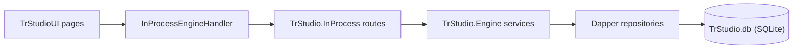
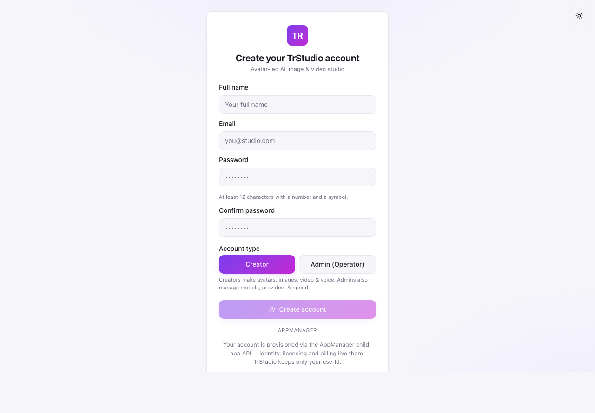
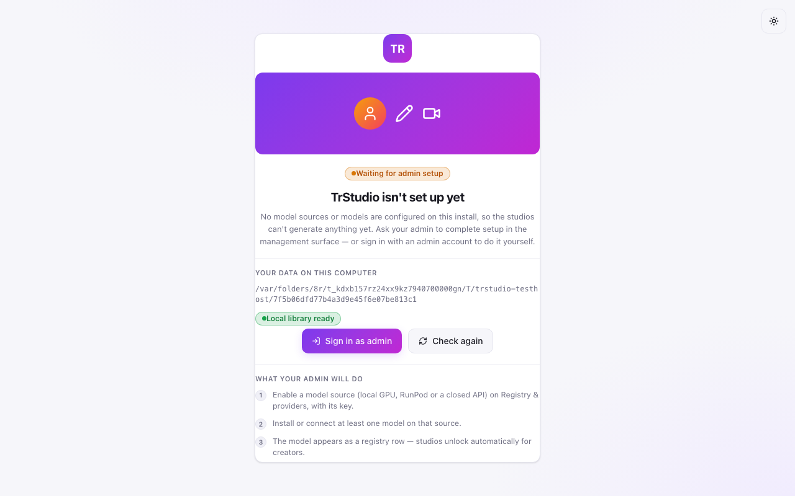
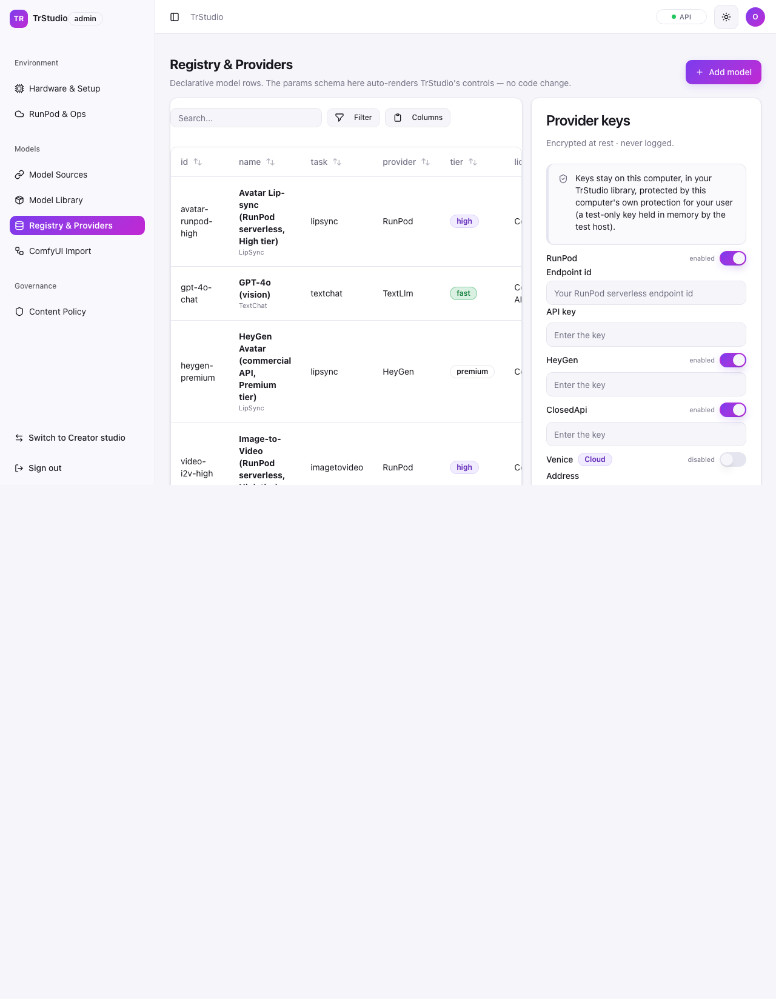

# TrStudio — Developer Guide, phase 3

| | |
|---|---|
| App | TrStudio |
| Kind | app |
| Size | Medium |
| Phase | 3 of 3 |
| Verified on | 2026-11-15 |
| Date | 2026-11-15 |

## Architecture cheat-sheet

Phase 3 makes TrStudio one desktop app (ADR-015 to ADR-023). The screens still call `/api/v1/...` through the named `TrStudioApi` client, but its handler answers in the same process: no web server, no socket.

| Layer | Project or folder | What lives here |
|---|---|---|
| App | `src/TrStudio` | MAUI Blazor Hybrid app (Mac first): `MauiProgram.cs`, `Auth/`, `Engine/` (sign-in settings, key protection) |
| UI | `src/TrStudioUI/Pages`, `Layout` | All screens, unchanged in shape |
| Routes and host | `src/TrStudio.InProcess` | `EngineHost.cs`, `InProcessEngineHandler.cs`, `Hosting/`, `Routes/` |
| Services | `src/TrStudio.Engine/Domain` | Setup gate, ops dashboard, identity |
| Data access | `src/TrStudio.Engine/Infrastructure` | Repositories, `InAppJobRunner`, `AesGcmKeyStore` |
| Database | `src/TrStudioDb/SqliteScripts` | DbUp scripts run on every start |
| Test host | `tests/TrStudio.TestHost` | Never shipped; same screens and engine, served headless; stand-in AppManager in `FakeAppManager.cs` |

## Roles and menu map

| Role | Test user | Menu items and the screen each opens |
|---|---|---|
| Anyone (signed out) | none | Login (`/login`), Register (`/register`), Setup required (`/setup-required`) |
| Owner | test host `POST /test/session?role=Owner` (`tests/TrStudio.TestHost/Program.cs:72`) | Creator surface, then sidebar footer switch → Registry & providers (`/admin/registry`), RunPod & ops (`/admin/ops`); Sign out in the sidebar footer |
| Operator | test host `POST /test/session?role=Operator` | Lands on RunPod & ops (`/admin/ops`); Registry & providers (`/admin/registry`) |
| Creator | test host `POST /test/session?role=Creator` | Studios only; `/admin/*` routes answer 403 (`InProcessEngineHandler.cs:81`) |

## Screen-by-screen code map

### Login (`/login`)

 · [390 wide](screenshots/TrStudio/anyone-login-mobile.png) · [sign in again notice](screenshots/TrStudio/anyone-login-sign-in-again.png)

Renders (test host, headless) at 1280 and 390 wide, light and dark. The "Remember me" box is `Login.razor:109`; the plain notices are the missing-settings (`:28`), unreachable (`:40`) and kept-sign-in-ended (`:52`) alerts.

**Call chain:** `Login.razor:HandleSignInAsync` → `POST /api/v1/auth/login` (`IdentityEndpoints.LoginAsync`) → `AppManagerClient.LoginAsync` + `SetupGateService.EvaluateAsync` → `ModelSourceRepository.ListAsync`, `RegistryRepository.ListAsync` → `ModelSource`, `RegistryModel`

| File and line | Function | Watch | Expected value |
|---|---|---|---|
| `src/TrStudioUI/Pages/Auth/Login.razor:168` | `OnInitializedAsync` | `vSettings.Configured` | true in a build with `appmanager.local.json`; false shows the missing-settings notice |
| `src/TrStudioUI/Pages/Auth/Login.razor:255` | `HandleSignInAsync` | `vRequest.RememberMe` | the box's state |
| `src/TrStudio.InProcess/Routes/IdentityEndpoints.cs:62` | `LoginAsync` | `aSignIn.IsConfigured` | true |
| `src/TrStudio.Engine/Infrastructure/Identity/AppManagerClient.cs:59` | `LoginAsync` | `vEnvelope.Data` | AppManager's token pair; never print it |
| `src/TrStudio.InProcess/Routes/IdentityEndpoints.cs:75` | `LoginAsync` | `vSession.Role` | Owner, Operator or Creator |
| `src/TrStudio.Engine/Domain/SetupGate/SetupGateService.cs:42` | `EvaluateAsync` | `vIsComplete` | true once a source is enabled and a model is ready |
| `src/TrStudioUI/Pages/Auth/Login.razor:267` | `HandleSignInAsync` | `ResolveLanding(vSession)` | the gate's landing, else `/admin/ops` or `/avatar` |

**Calculations on this screen:** `IsEmailValid` (`Login.razor:228`) checks for an `@` and a later dot; `ResolveLanding` (`:296`).

#### Kept sign-in resume after the first live render

| File and line | Function | Watch | Expected value |
|---|---|---|---|
| `src/TrStudioUI/Pages/Auth/Login.razor:187` | `OnAfterRenderAsync` | `aFirstRender` | true; a pre-render pass returns without calling resume |
| `src/TrStudioUI/Pages/Auth/Login.razor:195` | `OnAfterRenderAsync` | `vResume.StatusCode` | 204 nothing kept, 200 resumed, 401 ended, 503 unreachable |
| `src/TrStudio.InProcess/Routes/IdentityEndpoints.cs:194` | `ResumeAsync` | `vKept.KeptUntil` | 30 days after the ticked sign-in |
| `src/TrStudio.InProcess/Routes/IdentityEndpoints.cs:208` | `ResumeAsync` | `vRenewed` | a renewed session; refused goes to `:230` and forgets the file |
| `src/TrStudioUI/Pages/Auth/Login.razor:211` | `OnAfterRenderAsync` | `objKeptEnded` | the plain "Please sign in again" words |

### Register (`/register`)

 · [390 wide](screenshots/TrStudio/anyone-register-mobile.png)

Renders (test host, headless) at 1280 and 390 wide, light and dark. Some of its mockup's control names are missing (owner decision 11, a dedicated run). Register has no "Remember me" box: a new account keeps nothing.

**Call chain:** `Register.razor:HandleCreateAsync` → `POST /api/v1/auth/register` (`IdentityEndpoints.RegisterAsync`) → `AppManagerClient.RegisterAsync` + `SetupGateService.EvaluateAsync` → `ModelSourceRepository.ListAsync`, `RegistryRepository.ListAsync` → `ModelSource`, `RegistryModel`

| File and line | Function | Watch | Expected value |
|---|---|---|---|
| `src/TrStudioUI/Pages/Auth/Register.razor:179` | `HandleCreateAsync` | `vRequest.AccountType` | `Creator`, or `AdminOperator` when the admin box is ticked |
| `src/TrStudio.InProcess/Routes/IdentityEndpoints.cs:117` | `RegisterAsync` | `aSignIn.IsConfigured` | true; false answers 503 `SIGN_IN_NOT_CONFIGURED` |
| `src/TrStudio.Engine/Infrastructure/Identity/AppManagerClient.cs:84` | `RegisterAsync` | `vEnvelope.Data` | the new account's session |
| `src/TrStudio.InProcess/Hosting/LocalSessionStore.cs:37` | `SignIn` | `objSessions.Count` | one more than before |
| `src/TrStudioUI/Pages/Auth/Register.razor:224` | `ReadErrorAsync` | `vProblem.Title` | `EMAIL_EXISTS` for a used email |
| `src/TrStudioUI/Pages/Auth/Register.razor:192` | `HandleCreateAsync` | `ResolveLanding(vSession)` | the gate's landing, else `/admin/setup/hardware` or `/avatar` |

**Calculations on this screen:** `IsPasswordValid` (`Register.razor:151`): at least 12 characters with a digit and a symbol.

### Setup required (`/setup-required`)

 · [390 wide](screenshots/TrStudio/anyone-setup-required-mobile.png)

Renders (test host, headless) at 1280 and 390 wide, light and dark. Phase 3 adds the "Your data on this computer" card: the data folder, or why the local store is not ready.

**Call chain:** `SetupRequired.razor:OnInitializedAsync` → `GET /api/v1/local-store` (`DesktopSessionEndpoints`) → `EngineHost.StartupProblem` → `SqliteDatabaseMigrator.MigrateDatabase`; `CheckAgainAsync` → `GET /api/v1/setup-gate` (`IdentityEndpoints.GetSetupGateAsync`) → `SetupGateService.EvaluateAsync` → `ModelSource`, `RegistryModel`

| File and line | Function | Watch | Expected value |
|---|---|---|---|
| `src/TrStudio.InProcess/EngineHost.cs:176` | `StartAsync` | `AppliedScripts` | new script names on a first start, empty after |
| `src/TrStudio.InProcess/EngineHost.cs:180` | `StartAsync` | `StartupProblem` | null when the store is ready; the folder and reason when not |
| `src/TrStudio.InProcess/InProcessEngineHandler.cs:45` | `AnswerAsync` | `vProblem` | null; otherwise every route answers 503 `LOCAL_STORE_UNAVAILABLE` |
| `src/TrStudio.InProcess/Routes/DesktopSessionEndpoints.cs:65` | `MapDesktopSessionEndpoints` | `dataFolder` | the user's app data folder plus `TrStudio` |
| `src/TrStudioUI/Pages/Auth/SetupRequired.razor:113` | `OnInitializedAsync` | `objDataFolder` | the same folder; `objStoreProblem` (`:118`) null |
| `src/TrStudioUI/Pages/Auth/SetupRequired.razor:144` | `CheckAgainAsync` | `vResponse.StatusCode` | 200 when signed in, 401 when not |
| `src/TrStudio.Engine/Domain/SetupGate/SetupGateService.cs:49` | `EvaluateAsync` | `RedirectPath` | the role's landing for a complete or incomplete setup |

**Calculations on this screen:** none.

### Admin — Model & Provider Registry (`/admin/registry`)

 · [390 wide](screenshots/TrStudio/owner-admin-registry-mobile.png)

Renders (test host, headless) at 1280 and 390 wide, light and dark, signed in as Owner. Some mockup control names are missing (decision 11). Phase 3 adds the keys note (`AdminRegistry.razor:90`) and always lists RunPod, HeyGen and ClosedApi (`:525`).

**Call chain:** `AdminRegistry.razor:SaveKeysAsync` → `PUT /api/v1/admin/providers/keys` (`RegistryEndpoints.UpsertProviderKeyAsync`) → `AesGcmKeyStore.StoreAsync`, `DesktopProviderSettings.RefreshAsync` → `ProviderKeyRepository.UpsertAsync` → `ProviderKey`

| File and line | Function | Watch | Expected value |
|---|---|---|---|
| `src/TrStudioUI/Pages/Admin/AdminRegistry.razor:503` | `TryLoadRegistryAsync` | `vKeys.StatusCode` | 200 for Owner or Operator |
| `src/TrStudioUI/Pages/Admin/AdminRegistry.razor:537` | `TryLoadRegistryAsync` | `objKeyNote` | "Keys stay on this computer … (the macOS Keychain)." |
| `src/TrStudio.InProcess/Routes/DesktopProviderEndpoints.cs:24` | `MapDesktopProviderEndpoints` | `aProtector.Description` | `the macOS Keychain` on Mac; the test host's in-memory key on the test host |
| `src/TrStudioUI/Pages/Admin/AdminRegistry.razor:789` | `SaveKeysAsync` | `vKey.ProviderName` | the row being saved; check `vKey.Value` is non-empty, never print it |
| `src/TrStudio.InProcess/Routes/RegistryEndpoints.cs:182` | `UpsertProviderKeyAsync` | `aRequest.ProviderName` | the same name |
| `src/TrStudio.Engine/Infrastructure/Security/AesGcmKeyStore.cs:146` | `DeriveKey` | `objKeyProtector` | not null, so no configuration key is read |
| `src/TrStudio.Engine/Infrastructure/Data/ProviderKeyRepository.cs:39` | `UpsertAsync` | `aIsEnabled` | the row's switch |
| `src/TrStudio.Engine/Infrastructure/Security/DesktopProviderSettings.cs:84` | `RefreshAsync` | `objRunPod.ApiKey.Length` | above zero after a RunPod key is saved |

**Calculations on this screen:** `AesGcmKeyStore.Mask` (`AesGcmKeyStore.cs:97`) shows the last four characters only.

### Admin — RunPod & ops (`/admin/ops`)

 · [390 wide](screenshots/TrStudio/owner-admin-ops-mobile.png)

Renders (test host, headless) at 1280 and 390 wide, light and dark, signed in as Owner. Some mockup control names are missing (decision 11). Phase 3 reads queue depth from the local database instead of Hangfire.

**Call chain:** `AdminOps.razor:LoadAsync` → `GET /api/v1/admin/ops` (`Phase9Endpoints.GetOpsDashboardAsync`) → `OpsDashboardService.GetDashboardAsync` → `LocalJobQueueMonitor.GetSnapshot` → `JobQueueStore.CountQueuedAndRunning` → `GenerationJob`

| File and line | Function | Watch | Expected value |
|---|---|---|---|
| `src/TrStudioUI/Pages/Admin/AdminOps.razor:324` | `LoadAsync` | `vOps.StatusCode` | 200 for Owner or Operator; 403 for Creator |
| `src/TrStudio.InProcess/InProcessEngineHandler.cs:78` | `AnswerAsync` | `vResult.Succeeded` | true for the admin policy |
| `src/TrStudio.Engine/Domain/Ops/OpsDashboardService.cs:44` | `GetDashboardAsync` | `vSnapshot.Servers.Count` | 1 once the runner started, else 0 |
| `src/TrStudio.Engine/Infrastructure/Ops/LocalJobQueueMonitor.cs:37` | `GetSnapshot` | `vQueued`, `vRunning` | the `GenerationJob` counts |
| `src/TrStudio.Engine/Infrastructure/Jobs/JobQueueStore.cs:108` | `CountQueuedAndRunning` | `vCounts` | Queued plus Pending, and Running |
| `src/TrStudio.Engine/Domain/Ops/OpsDashboardService.cs:66` | `GetDashboardAsync` | `TotalEnqueued` | the same queued count |
| `src/TrStudioUI/Pages/Admin/AdminOps.razor:326` | `LoadAsync` | `objOps.Queue.TotalEnqueued` | the number in the "Queue depth" badge (`:199`) |

**Calculations on this screen:** `TotalEnqueued` and `TotalProcessing` (`OpsDashboardService.cs:66`) sum the per-queue counts; healthy means a heartbeat within 60 seconds (`:60`).

### App frame and sign out (`MainLayout`, `AppSidebar`)

 · [390 wide](screenshots/TrStudio/owner-admin-ops-mobile.png)

Renders (test host, headless) around every signed-in screen, at 1280 and 390 wide, light and dark. Sign out is in the sidebar footer (`AppSidebar.razor:66`) and on the user chip (`MainLayout.razor:45`).

**Call chain:** `AppSidebar.razor:SignOutAsync` → `POST /api/v1/auth/logout` (`DesktopSessionEndpoints`) → `RememberedSignInStore.Forget`, `LocalSessionStore.SignOut` → `remembered-sign-in.bin` removed

| File and line | Function | Watch | Expected value |
|---|---|---|---|
| `src/TrStudioUI/Layout/MainLayout.razor:106` | `OnAfterRenderAsync` | `vState.UserId` | the AppManager user id; null redirects to `/login` (`:149`) |
| `src/TrStudioUI/Layout/AppSidebar.razor:119` | `SignOutAsync` | the logout response | 204 |
| `src/TrStudio.InProcess/Routes/DesktopSessionEndpoints.cs:52` | `MapDesktopSessionEndpoints` | `aRemembered.HasKept` | false after this line |
| `src/TrStudio.InProcess/Hosting/LocalSessionStore.cs:43` | `SignOut` | return value | true |
| `src/TrStudio/Auth/MauiAuthSession.cs:58` | `ClearAsync` | `objState` | null after `:60` |
| `src/TrStudio.InProcess/InProcessEngineHandler.cs:67` | `AnswerAsync` | `vUser.Identity.IsAuthenticated` | false on the next protected call, which answers 401 |

**Calculations on this screen:** the user chip initial (`MainLayout.razor:115`) is the email's first letter.

## Cross-cutting flows

Only the flows phase 3 changed are here. For the rest (the role-gated shell, the creator studios, provider routing) see [docs/devguides/TrStudio-DevGuide.md](devguides/TrStudio-DevGuide.md).

### Start-up and the local store

**Call chain:** `MauiProgram.CreateMauiApp` → `EngineHost.Create` → `EngineHost.StartAsync` → `SqliteDatabaseMigrator.MigrateDatabase` → `TrStudio.db`

| File and line | Function | Watch | Expected value |
|---|---|---|---|
| `src/TrStudio/MauiProgram.cs:48` | `CreateMauiApp` | `vDataFolder` | app data folder plus `TrStudio` |
| `src/TrStudio.InProcess/EngineHost.cs:77` | `Create` | `vDatabasePath` | the data folder plus `TrStudio.db` |
| `src/TrStudio.InProcess/EngineHost.cs:159` | `Create` | `vRoutes` | every route mapped by `RouteMap.MapAll` |
| `src/TrStudio.InProcess/EngineHost.cs:176` | `StartAsync` | `AppliedScripts` | new scripts only |
| `src/TrStudio.InProcess/EngineHost.cs:185` | `StartAsync` | provider settings | loaded from `ProviderKey` |

### In-process route handler

**Call chain:** named `TrStudioApi` client (`MauiProgram.cs:67`) → `MauiAuthTokenHandler.SendAsync` → `InProcessEngineHandler.AnswerAsync` → `RouteTable.Find` → `RouteInvoker.InvokeAsync`

| File and line | Function | Watch | Expected value |
|---|---|---|---|
| `src/TrStudio/Auth/MauiAuthTokenHandler.cs:36` | `SendAsync` | `aRequest.Headers.Authorization.Scheme` | `Bearer` when signed in |
| `src/TrStudio.InProcess/InProcessEngineHandler.cs:50` | `AnswerAsync` | `vRoute.Template` | the route asked for; null answers 404 or 405 |
| `src/TrStudio.InProcess/InProcessEngineHandler.cs:64` | `AnswerAsync` | `vUser` | the signed-in user's claims |
| `src/TrStudio.InProcess/InProcessEngineHandler.cs:103` | `AnswerAsync` | `vResult` | the route's result; an exception answers 500 `ENGINE_ERROR` (`:123`) |
| `src/TrStudio.InProcess/Hosting/RouteTable.cs:260` | `Find` | `aPathExists` | true for a known path |

### Sign-in with the built-in application id and key

**Call chain:** `AppManagerBuildSettings.Load` → `EngineHost.Create` → `IdentityModule` client headers → `AppManagerClient.LoginAsync`

| File and line | Function | Watch | Expected value |
|---|---|---|---|
| `src/TrStudio/Engine/AppManagerBuildSettings.cs:27` | `Load` | `IsConfigured` of the result | true when `appmanager.local.json` was embedded |
| `src/TrStudio.InProcess/EngineHostOptions.cs:18` | `IsConfigured` | `ApplicationId` | above zero, with an address and a key |
| `src/TrStudio.InProcess/EngineHost.cs:96` | `Create` | `vApplicationId` | the build's id |
| `src/TrStudio.Engine/DependencyInjection/IdentityModule.cs:49` | `AddIdentityModule` | header names | `X-Api-Key` present; never print its value |
| `src/TrStudio.Engine/Infrastructure/Identity/AppManagerClient.cs:57` | `LoginAsync` | `vBody` keys | `email`, `encryptedPassword`, `applicationId` |

### "Remember me"

**Call chain:** `Login.razor:HandleSignInAsync` → `IdentityEndpoints.LoginAsync` → `RememberedSignInStore.Remember` → `remembered-sign-in.bin`; on open `Login.razor:OnAfterRenderAsync` → `IdentityEndpoints.ResumeAsync` → `AppManagerClient.RefreshAsync`

| File and line | Function | Watch | Expected value |
|---|---|---|---|
| `src/TrStudio.InProcess/Routes/IdentityEndpoints.cs:79` | `LoginAsync` | `aRequest.RememberMe` | true keeps, false forgets (`:85`) |
| `src/TrStudio.InProcess/Hosting/RememberedSignInStore.cs:53` | `Remember` | `KeptUntil` | now plus 30 days |
| `src/TrStudio.InProcess/Hosting/RememberedSignInStore.cs:118` | `Write` | file bytes | AES-GCM ciphertext, not readable text |
| `src/TrStudio.InProcess/Routes/IdentityEndpoints.cs:200` | `ResumeAsync` | `HasEnded(vKept)` | false within 30 days |
| `src/TrStudio.InProcess/Routes/IdentityEndpoints.cs:210` | `ResumeAsync` | `vRenewed.RefreshToken` | replaced in the file, end date kept |

On the test host, `/test/sign-in-mode?mode=fake` sends AppManager calls to `FakeAppManager.AnswerAsync` (`tests/TrStudio.TestHost/FakeAppManager.cs:36`).

### Sign out

See the app frame entry: `DesktopSessionEndpoints.cs:49` ends the session and always removes the kept sign-in; `MauiAuthSession.ClearAsync` (`MauiAuthSession.cs:51`) does the same in the app.

### In-app job runner and recovery

**Call chain:** `EngineHost.StartWorkersAsync` → `InAppJobRunner.RecoverAsync` → `JobQueueStore.ListUnfinishedAsync`, `FailClosedMidJobAsync` → `GenerationJob`

| File and line | Function | Watch | Expected value |
|---|---|---|---|
| `src/TrStudio.InProcess/EngineHost.cs:207` | `StartWorkersAsync` | `vRecovered` | queued, resumed and failed counts |
| `src/TrStudio.Engine/Infrastructure/Jobs/InAppJobRunner.cs:110` | `RecoverAsync` | `vTicket.State` | Queued rows run again |
| `src/TrStudio.Engine/Infrastructure/Jobs/InAppJobRunner.cs:117` | `RecoverAsync` | `vTicket.ProviderRef` | set for a resumable Venice clip |
| `src/TrStudio.Engine/Infrastructure/Jobs/InAppJobRunner.cs:124` | `RecoverAsync` | `vTicket.JobId` | a Running row that cannot resume, failed as closed mid-job |
| `src/TrStudio.Engine/Infrastructure/Jobs/InAppJobRunner.cs:86` | `Start` | `StartedUtc` | set once |

### Key protection

**Call chain:** `AesGcmKeyStore.DeriveKey` → `IKeyProtector.GetOrCreateDataKey` → `SecureStorageKeyProtector` → Keychain (Mac) or DPAPI (Windows)

| File and line | Function | Watch | Expected value |
|---|---|---|---|
| `src/TrStudio/MauiProgram.cs:57` | `CreateMauiApp` | `KeyProtector` | a `SecureStorageKeyProtector` |
| `src/TrStudio/Engine/SecureStorageKeyProtector.cs:36` | `GetOrCreateDataKey` | `vStored` | empty only on the first run; never print it |
| `src/TrStudio/Engine/SecureStorageKeyProtector.cs:42` | `GetOrCreateDataKey` | `vKey.Length` | 32 |
| `src/TrStudio.InProcess/Hosting/RememberedSignInStore.cs:128` | `Encrypt` | the protector | the same key as the provider keys |

The test host uses `TestKeyProtector` (`tests/TrStudio.TestHost/TestKeyProtector.cs:19`), an in-memory key.

### Zoom in the Mac app (REQ-FN-104)

**Call chain:** `MainPage` `BlazorWebViewInitialized` → `BlazorZoom.Attach` → `WKUserScript` at document start + `BlazorZoom.Apply` → CSS `zoom` and `--tr-zoom` on `<html>`

| File and line | Function | Watch | Expected value |
|---|---|---|---|
| `src/TrStudio/BlazorZoom.cs:64` | `Attach` | the user script text | the saved level (`tf.zoom`, default 1.6 on a 4K panel) |
| `src/TrStudio/BlazorZoom.cs:122` | `Apply` | `Level` | 0.5 to 3.0 in 0.1 steps |
| `src/TrStudio/BlazorZoom.cs:131` | `Apply` | `PageZoom` | always 1: `WKWebView.PageZoom` magnifies without laying the page out again, which put the Login card right of centre |
| `src/TrStudio/BlazorZoom.cs:140` | `ApplyScript` | `--tr-zoom` | equal to `zoom`; `.auth-shell` divides `100vh` by it |

### Job result and the provider of each picture (REQ-UI-086)

`GET /api/v1/jobs/{id}/result` (`src/TrStudio.InProcess/Routes/SpineEndpoints.cs:175`) adds the run details from the generation log through `WorkspaceEndpoints.WithRunInfoAsync`, as the gallery and history calls do; Image studio badges a tile "Venice" from `AssetResponse.ProviderKind`.

### Venice's own reason on a refused call (REQ-UI-095)

`VeniceApiException.FromResponse` keeps Venice's `details` on a 400 word for word (`src/TrStudio.Engine/Domain/Venice/VeniceApiException.cs:98`) and reads a rate-limit reset given in seconds, as a Unix time in seconds, or in milliseconds (`:152`), never below zero.

### Sample data for the screen checks (decision 11)

Each screen's mockup data is put into the test host by `tests/verify/seed/<mockup name>.sh`, which calls a TEST ONLY `POST /test/seed/<mockup name>` in `tests/TrStudio.TestHost/Program.cs` (18 endpoints from line 120) for the stand-in AppManager's user 4242. `tf-verify-list.sh` finds each script and `tf-verify-screens.sh` runs it before the screen. Never shipped.

### Configuration, logging, errors

- Configuration: `DesktopSettings.Load` (`src/TrStudio/MauiProgram.cs:44`); engine settings in memory (`EngineHost.cs:78`). No environment variables.
- Logging: daily files under the data folder's `logs` (`MauiProgram.cs:110`); no key is logged.
- Errors: 503 `LOCAL_STORE_UNAVAILABLE` (`InProcessEngineHandler.cs:47`), 400 `INVALID_REQUEST` (`:114`), 500 `ENGINE_ERROR` (`:123`).

## Known issues

- Login, Register and Setup required still differ from their mockups in the structure comparison (a link box on Login, the chosen account-type colour on Register, a badge colour, an icon and a border on Setup required): REQ-UI-001, REQ-UI-002, REQ-UI-004, REQ-FN-015 and REQ-FN-016 are red on the mockup check only.
- The real Mac app cannot be driven by the framework's checker until Automation Mode is allowed without a password (`sudo automationmodetool enable-automationmode-without-authentication`, owner only). On 15 Nov 2026 it was checked by screenshots instead.
- AppManager does not document a refresh token's lifetime, so 30 days is the app's own limit (`docs/TrStudio-AppManager-Feedback.md`, AM-001).
- ComfyUI import: Run falls back to made-up per-node results when the debug route cannot be reached (`src/TrStudioUI/Pages/Admin/AdminComfy.razor`).
- Libraries: TrBlazeUI 2.2.5 and TechieRag 1.1.5 from nuget.org (15 Nov 2026); open TechieRag entries TR-RAG-002 to TR-RAG-006, none blocking.
