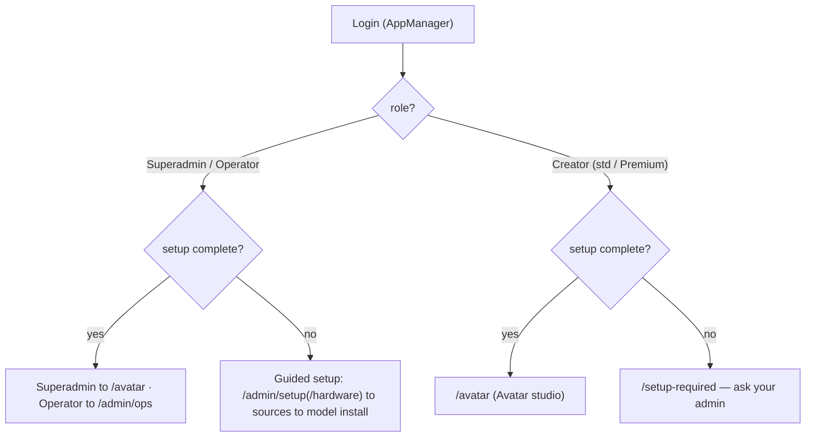

# TrStudio — Usage Guide (Test Users · Test Plan · Setup)

> The single source for **how to test and run** this app. Every agent (flow-master self-smoke, the verifier) **and** the human UAT use the SAME test users and the SAME walkthrough listed here (enforced by `.tfcore/tasks/_smoke-test-policy.md`). All 9 build phases (P1–P9) are shipped; the screen-by-screen plan below is the UAT script for the running app.

## Test users (canonical — use THESE for all smoke / verify / UAT)

> Identity is delegated to **AppManager** (child-app integration). TrStudio stores only the AppManager `userId`; no passwords are ever stored locally.
> **✅ AppManager auth path RESOLVED + VERIFIED LIVE 2026-07-07.** The earlier blocker (AppManager `/AuthSvc/*` → HTTP 500, root-caused to `System.UnauthorizedAccessException: Access to the path '/keys/rsa-private.pem' is denied` — its `RsaEncryptionService` couldn't write its RSA key) was **fixed by the owner** (made `/keys` writable + restarted the `appmanager-api` container). Re-verified end-to-end: real login `admin@appmanager.local`/`Admin@123!` → **200 + JWT** (Owner, role 0); `/auth/me` → 200 (AppManager `/AuthSvc/validate`); `/license` → 200 (AppManager `/LicenseSvc/validate`); `/register` created `creator@trstudio.test` → 200 (Creator, role 1) and login as that new account → 200. **REQ-FN-012/013/015 now Verified; FN-016 login-driven landing Verified.** Real AppManager login is the primary UAT path; the `/dev/session` seam remains available for role-switching smokes. Remaining external item: assign a **Premium license** in AppManager to fully exercise Premium tier-gating (FN-014).

| # | Username / Email | Password | Role / Permission | Created? | Notes |
|---|------------------|----------|-------------------|----------|-------|
| 1 | admin@appmanager.local | `Admin@123!` | Superadmin (Owner — Creator + Operator, all tiers) | ✅ (pre-existing in AppManager) | Generic AppManager superadmin shared across the owner's apps; already exists — do NOT create. Credential provided by owner 2026-07-07. ⚠ Real TrStudio login via this account is currently **blocked by an AppManager-side fault** (its `/AuthSvc/*` → HTTP 500; see UAT-blocker note) — not a credential problem. Use `/dev/session` until AppManager is fixed |
| 2 | creator@trstudio.test | `TrStudio!Creator1` | Standard creator (Fast + High tiers) | ✅ Created 2026-07-07 (AppManager userId 13, role Creator) | Registered live via `/register` once AppManager was fixed (FN-015 Verified). Real login works; lands on `/avatar` |
| 3 | admin@trstudio.test | TrStudio!Admin1 | Operator / Admin | ⬜ Not yet created | Create in AppManager with the admin/operator role (AppManager auth works now) to exercise the management surface via real login |
| 4 | premium@trstudio.test | TrStudio!Premium1 | Premium-licensed creator | ⬜ Not yet created | Register via `/register`, then assign a Premium license in AppManager, to exercise Premium tier-gating (FN-014) |

- **Created?** — ✅ = exists now. ⬜ Not yet created = the AppManager auth path works (2026-07-07); these just haven't been created yet (owner can create them now — no longer blocked).
- **User 1** is the pre-existing generic superadmin (`admin@appmanager.local`, password `Admin@123!`) — never create or overwrite it.
- **Real AppManager login works (2026-07-07):** users 1 and 2 log in through AppManager end-to-end. The **dev-session seam** (`AllowDevSymmetricTokens=true` + `/dev/session`) still works as an alternative for role-switching smokes.

## Who lands where — default pages, first-run gate & screen flow

> Per **BRD-84** (role-based landing) and **BRD-85** (first-run setup gate).

### Default landing page by role

| Role (test user) | Default landing after login | When first-run setup is incomplete |
|------------------|----------------------------|-------------------------------------|
| **Superadmin / Owner** (user 1) | Avatar studio `/avatar` — full Creator surface, all tiers; switches to TrStudioAdmin via the sidebar footer link | TrStudioAdmin **Guided setup** `/admin/setup` (bootstrap account completes first-run) |
| **Operator / Admin** (user 3) | TrStudioAdmin **Ops dashboard** `/admin/ops` | **Hardware & readiness** `/admin/setup/hardware`, then the guided-setup wizard |
| **Standard creator** (user 2) | Avatar studio `/avatar` | **Setup required** `/setup-required` — "no models configured; ask your admin" |
| **Premium creator** (user 4) | Avatar studio `/avatar` (Premium tier selectable per license) | **Setup required** `/setup-required` |

### First-run setup gate (BRD-85)

On every login the app checks: is there **≥1 enabled model source** **and ≥1 ready registry model**? Until both are true the app is un-set-up.



- The **superadmin** (user 1) experiences the very first run: fresh install → login → guided setup → hardware check → runtime provisioning → add a model source → install a model → registry row ready → gate passes → next login lands on `/avatar`.
- A **creator** logging in before setup completes only ever sees the Setup-required screen.

### Screen flow by role

- **Creator (users 2/4) — TrStudio app**: land on **Avatar studio** → sidebar: Characters (`/avatar/characters`) · Image studio (`/image`) · Video studio (`/video`) · Voice studio (`/voice`) → Workspace: Gallery (`/gallery`) · Projects (`/projects`) · Account (`/account`). Comparison (`/compare`) and Library (`/library`) open from the Gallery toolbar.
- **Operator / Admin (user 3) — TrStudioAdmin app**: land on **Ops dashboard** → sidebar: Hardware & Setup (`/admin/setup/hardware`, `/admin/setup`) · RunPod & Ops (`/admin/ops`) → Models: Model Sources (`/admin/sources`) · Model Library (`/admin/models`) · Registry & Providers (`/admin/registry`, `/admin/providers`) · ComfyUI Import (`/admin/comfy/import`, `/admin/comfy/debug`) → Governance: Content Policy (`/admin/policy`).
- **Superadmin / Owner (user 1)**: both surfaces — lands in TrStudio (`/avatar`), switches to TrStudioAdmin via the sidebar footer link. Exercises the owner-only NSFW toggle and all-tier avatar rendering.

## How to test — screen by screen / menu by menu

One subsection per screen, in navigation order. Each names the test user, the steps, the expected result, and the BRD-N it covers. Screens are shipped; where a capability is model/service-gated it degrades cleanly (noted).

### Register (`/register`, AppManager-backed)
- **Log in as:** n/a (creates user 2)
- **Steps:** 1) open `/register` → 2) enter name/email/password + confirm → 3) submit
- **Expected:** account created via the AppManager API; no local password store; redirect to login/home. ⚠ Blocked until app 4 published (FN-015) — UI + validation shipped
- **Covers:** BRD-83

### Login (`/login`, AppManager-backed)
- **Log in as:** user 1, then users 2–4
- **Steps:** 1) open `/login` → 2) enter credentials → 3) submit → 4) note the landing page → 5) repeat per role
- **Expected:** JWT session via AppManager; each role lands per the table above; first run routes to the setup gate. ⚠ Real AppManager login Blocked until app 4 published; use `/dev/session` meanwhile
- **Covers:** BRD-57, BRD-84

### Forgot password (`/forgot-password`)
- **Log in as:** n/a (Login screen link)
- **Steps:** 1) open `/forgot-password` → 2) enter the account email → 3) submit
- **Expected:** enumeration-safe confirmation; reset handed to AppManager; back-to-login works
- **Covers:** BRD-57

### First-run setup gate & Setup-required (`/setup-required`)
- **Log in as:** user 2 (fresh install), then user 1
- **Steps:** 1) as user 2 log in before setup → confirm `/setup-required` (no studio nav) → 2) log in as user 1 → confirm redirect into guided setup → 3) enable a source + install a model → 4) log in as user 2 again
- **Expected:** creator sees Setup-required until ≥1 enabled source AND ≥1 ready model; after setup user 2 lands on `/avatar`
- **Covers:** BRD-85

### Admin — Hardware & readiness (`/admin/setup/hardware`)
- **Log in as:** user 3
- **Steps:** open the readiness summary; read detected GPU/CPU cores, memory, MPS-CoreML, disk
- **Expected:** accurate host capability summary with a readiness verdict (live `/api/v1/admin/capabilities`)
- **Covers:** BRD-8

### Admin — Guided setup (`/admin/setup`)
- **Log in as:** user 3
- **Steps:** run the wizard → install ONNX Runtime → provision isolated Python + ComfyUI
- **Expected:** endpoints + state machine drive the steps (400 unknown / 409 running). ⚠ real ONNX/Python provisioning-to-completion needs a host GPU/env (PARTIAL)
- **Covers:** BRD-9, BRD-10

### Admin — Model sources (`/admin/sources`)
- **Log in as:** user 3
- **Steps:** add a Hugging Face source (base URL + token) → Test connection → enable; add Civitai; add a custom URL source
- **Expected:** sources saved with tokens encrypted (absent from responses/logs); Test shows reachable; Model library lists models from enabled sources
- **Covers:** BRD-82

### Admin — Model library (`/admin/models`)
- **Log in as:** user 3
- **Steps:** browse models from enabled sources → one-click install (resumable) → confirm size/VRAM/licence shown
- **Expected:** install lists/starts/pauses/resumes/cancels (validation paths live). ⚠ real resumable download needs a reachable model/network (PARTIAL)
- **Covers:** BRD-11

### Admin — Model & Provider Registry (`/admin/registry`)
- **Log in as:** user 3
- **Steps:** add a registry row → define its params schema → save
- **Expected:** the model is usable from TrStudio with UI controls **auto-rendered from the schema** (no code change) — proven live in Image studio
- **Covers:** BRD-6, BRD-77

### Admin — Provider config (`/admin/providers`)
- **Log in as:** user 3
- **Steps:** add HeyGen + aggregator API keys → enable per model
- **Expected:** keys stored encrypted (never shown in logs/URLs, masked `****2345` on read); providers selectable per model
- **Covers:** BRD-7, BRD-73

### Admin — RunPod & cost guardrails (`/admin/ops`)
- **Log in as:** user 3
- **Steps:** register a RunPod endpoint → submit a heavy job → confirm scale-to-zero after idle → check spend-to-date vs the monthly cap
- **Expected:** spend tracked across RunPod + closed APIs; over-cap → HTTP 402; near-cap alert; non-admin 403. ⚠ live cold-start needs `RunPod:ApiKey` (Implemented)
- **Covers:** BRD-12, BRD-13, BRD-15, BRD-75

### Admin — ComfyUI import & debug (`/admin/comfy/import`, `/admin/comfy/debug`)
- **Log in as:** user 3
- **Steps:** drop an API-format workflow JSON → map inputs to registry params → run/debug → save as a registered model → version + pin
- **Expected:** invalid JSON → 400; save-as-model **hides the graph** (opaque version GUID); sandbox go-live before a passing smoke → 409, then 200; version-pin serves the pinned version. ⚠ live run/WS-previews need a reachable ComfyUI (`ComfyUI:BaseUrl`)
- **Covers:** BRD-34..41

### Admin — Content policy / NSFW mode (`/admin/policy`)
- **Log in as:** user 1 (owner, personal mode)
- **Steps:** open content policy → toggle Unrestricted (NSFW) behind the confirmation gate → generate adult content from a **synthetic** adult character → attempt the same with a real-person reference
- **Expected:** synthetic-adult allowed; real-person / photoreal-of-real refused; CSAM + public-figure + minor floors STILL fire (403); toggle forced-off in multi-user/SaaS
- **Covers:** BRD-79, BRD-80

### Image studio (`/image`, `/image/batch`)
- **Log in as:** user 2
- **Steps:** compose a prompt → generate → I2I/inpaint with a mask → ControlNet conditioning → upscale to 2K → seed grid → export 9:16 with background removed
- **Expected:** params render dynamically from the registry schema; same seed/params **reproduces byte-identical**; exports in the chosen social format. ⚠ real pixels need an installed ONNX model (synthetic seed-driven render otherwise)
- **Covers:** BRD-16..21

### Voice studio (`/voice`, `/voice/clone`)
- **Log in as:** user 2
- **Steps:** type EN and HI text → pick a preset voice → generate → clone a synthetic voice (ungated) → attempt a real-person clone → confirm the consent gate blocks until consent recorded
- **Expected:** per-language routing behind one control; **consent gate enforced for real people** (403 until consent, owner-scoped). ⚠ real synthesis needs a voice model (`synthetic-dev` otherwise)
- **Covers:** BRD-22..26, BRD-62

### Avatar studio (`/avatar`, `/avatar/characters`)
- **Log in as:** user 1 (all tiers)
- **Steps:** create a photoreal Character, lock identity → write a script (EN then HI) → generate voice → animate at **Fast → High → Premium** → add captions → reframe + export MP4
- **Expected:** one tier control resolves to **3 distinct providers**; captions produce valid SRT; provenance on export; **realism flag feeds the safety floor** (photoreal-of-real → 403). ⚠ live lip-sync/HeyGen execution needs models / HeyGen key
- **Covers:** BRD-27..31, BRD-33, BRD-53, BRD-55, BRD-63

### Video studio (`/video`, `/video/edit`)
- **Log in as:** user 2
- **Steps:** generate I2V/T2V with duration/motion/aspect → first/last-frame conditioning → interpolate + upscale → trim/join + audio from Voice studio → export MP4
- **Expected:** tier routing → 3 providers with spend accrual + safety on every job; conditioning validated owner-scoped (foreign asset → 400); edit pipeline exports MP4 at 16:9/9:16/1:1/4:5. ⚠ generation needs a video model / aggregator key; real ffmpeg export needs ffmpeg on host (clean degrade otherwise)
- **Covers:** BRD-42..46

### Prompt studio (`/prompt-studio`) — *Phase 10, shipped 2026-07-07*
- **Log in as:** user 1
- **Steps:** open Prompt Studio from the Studios nav → pick a text-chat LLM from the picker (admin configures the list as `text-chat` rows on `/admin/registry`) → ask for an ideal prompt for a planned generation → attach a photo and ask for the ideal edit prompt → Copy / Save to Library / Send to Image Studio → reload and resume the session
- **Expected:** picker lists only registry `text-chat` LLMs (dev-seed ships GPT-4o vision + Llama-3-70B text-only); image attach is enabled only for vision-capable models (text-only model → attach disabled + hint, image on a non-vision row → 400); replies arrive via TechieRag chat-completion (no RAG setup) with the crafted prompt in a copyable block; Save-to-Library lands a `prompt` preset in `/library`; Send-to-Studio pre-fills the studio composer; sessions persist per user (other users' sessions invisible, cross-user GET → 404, BRD-81); token usage shows in `/api/v1/rag/usage` + spend rollup (`SpendChannel.LlmText`). ⚠ needs at least one text-chat LLM configured (endpoint + key); with none it degrades cleanly to a `[DEV SYNTHETIC PROMPT-CHAT]` best-effort reply + a "Degraded" toast (RAG-005). Native vision through TechieRag is blocked at 1.0.5 (TR-RAG-001) — vision uses a best-effort OpenAI-compatible HTTP fallback.
- **Covers:** BRD-88..92 (REQ-UI-081/082, FN-073/074 Verified; RAG-005 Implemented)

### Workspace — Gallery, Projects, Comparison, Library, Account (`/gallery`, `/projects`, `/compare`, `/library`, `/account`)
- **Log in as:** user 2 (and user 4 for spend/license)
- **Steps:** browse/filter gallery, reuse an asset → open a project, one-click reproduce → compare two seeds/providers → save a preset to the library → bulk-export with provenance → (user 4) view usage/spend + license
- **Expected:** assets reusable; reproduce works; comparison param-diff renders; presets saved; exports carry `X-Provenance-Count`; spend by channel + license (degrades gracefully when AppManager unreachable)
- **Covers:** BRD-47..52, BRD-58

### Safety floors (must always fire)
- **Log in as:** user 1
- **Steps:** attempt a blocked-class input → attempt a real public-figure likeness → check the audit log
- **Expected:** CSAM/NCII hard-blocked **before enqueue** (403) + logged; public-figure impersonation blocked by default; every job (allowed + blocked) in the audit trail
- **Covers:** BRD-60, BRD-61, BRD-64, BRD-65

### Per-user isolation (gallery/projects)
- **Log in as:** user 2, then user 4
- **Steps:** as user 2 generate an asset → sign in as user 4 → open Gallery/Projects
- **Expected:** user 4 sees only their own content; user 2's asset is not visible and not reachable via the API (server-side `userId` filter; cross-user GET → 404)
- **Covers:** BRD-81

## Prerequisites

- .NET 10 SDK (+ the **.NET MAUI workload** if you run the desktop head — `dotnet workload list` should show `maui`)
- **A container runtime running** (Docker Desktop on Windows; Docker Desktop or OrbStack on the Mac), with the two dependency containers up (see the platform run sections below) — PostgreSQL + PgVector **and** AppManager both run as containers in dev. **If they are not running, the app cannot reach its database or identity service and startup/login will fail** (this is the usual cause of "can't connect" / "Docker" errors during UAT).
- **The two gitignored secrets files** — these do **NOT** travel with a copy of the source tree; recreate them on every new machine (this bit the 2026-07-12 Windows→Mac move):
  - `nuget.config` (repo root) ← copy `nuget.config.template` and fill in your GitHub username + PAT (`read:packages`) for the private TrBlazeUI/TechieRag feed. Without it `dotnet restore` fails with `NU1101: Unable to find package TechieRag`.
  - `src/TrStudioApi/appsettings.json` ← copy `src/TrStudioApi/appsettings.template.json` and fill in the DB connection string + the `AppManager` block (ApplicationId 4, ApiKey / ApiSecret / JwtSigningKey). Without it the API can't reach Postgres or AppManager.

## Which projects to run (this is a multi-project solution)

`TrStudio.slnx` now has **7 projects** (the retired `TrStudioAdmin` was removed from the solution on 2026-07-05, ADR-012). Running the **web** app means starting **`TrStudioApi` + `TrStudio` together** (API first) — everything else is a class library or the desktop head, which must **not** be set to start alongside the web app:

| Project | Role | Start it? | URL |
|---------|------|-----------|-----|
| **`src/TrStudioApi`** | ASP.NET Core Web API (backend spine, DbUp migrations, Hangfire) — **must start first** | ✅ **Startup** | http://localhost:5102 (`/swagger`, `/health`) |
| **`src/TrStudio`** | Blazor Web app — **the ONE unified app**: creator studios + (role-gated) management surface (Creator→studios, Operator→management, Owner→both with an in-app switch) | ✅ **Startup** | http://localhost:5099 |
| **`src/TrStudio.Desktop`** | MAUI Blazor Hybrid **desktop** head (Windows + macOS), hosts the same unified app | ✅ **Startup — for the DESKTOP app** (start it **instead of** `src/TrStudio`, with `TrStudioApi`) | (desktop window — no URL) |
| `src/TrStudioAdmin` | **RETIRED — merged into `TrStudio` on 2026-07-05 (ADR-012).** No longer in `TrStudio.slnx`, not a startup project; its old :5098 host is gone | ❌ retired | — |
| `src/TrStudio.Engine` | Domain/providers/workers class library | ❌ library | — |
| `src/TrStudio.Models` | Shared models/contracts class library | ❌ library | — |
| `src/TrStudioUI` | Razor Class Library (RCL) — now hosts **all** screens: creator screens + the relocated management screens under `Pages/Admin/` | ❌ library | — |
| `src/TrStudioDb` | DbUp migration runner (invoked by the API) | ❌ library | — |

> **Web vs. desktop delivery.** The **web** delivery is **`TrStudio`** (Blazor Web, `net10.0`, http://localhost:5099). The **desktop** delivery is **`TrStudio.Desktop`** (MAUI Blazor Hybrid, Windows + macOS — TFMs `net10.0-windows10.0.19041.0` / `net10.0-maccatalyst`), hosting the same unified app. **Start `TrStudioApi` first either way** — it must be listening before the app makes its first call.

## How to run — Windows · Visual Studio (recommended for UAT on Windows)

1. **Start the dependency containers** (Docker Desktop must be running), then confirm both are up:
   ```powershell
   docker start WinPgVectorDb appmanager-api
   docker ps        # expect WinPgVectorDb (0.0.0.0:5432) and appmanager-api (…:5101) both "Up"
   ```
2. Open `TrStudio.slnx`. Right-click the **solution** → **Configure Startup Projects…** → **Multiple startup projects** and set **Action = Start** for **`TrStudioApi` + `TrStudio`** (leave every other project = **None**). Move **`TrStudioApi` to the top** of the list so it launches first. Click OK.
   - For the **DESKTOP** app, set startup = **`TrStudioApi` + `TrStudio.Desktop`** instead (Windows head runs here; the Mac head needs a Mac).
3. Press **F5** (or Ctrl+F5). Two console/app windows come up; wait for the API console to log `Now listening on: http://localhost:5102` and `Application started`.
4. Open **http://localhost:5099** — the ONE unified app (creator studios + role-gated management surface). Log in as a Test user, or use the **`/dev/session`** seam (`http://localhost:5099/dev/session`) until AppManager app 4 is published.

## How to run — Windows · command line (alternative)

```powershell
docker start WinPgVectorDb appmanager-api        # 1. dependencies up first
dotnet restore                                    # needs the GitHub Packages PAT for TechieRag
dotnet build
# open two terminals — API FIRST, wait for "Application started", then the unified web app:
dotnet run --project src/TrStudioApi   --urls http://localhost:5102
dotnet run --project src/TrStudio      --urls http://localhost:5099
# optional — DESKTOP head instead of the web app (Windows; MAUI workloads required):
dotnet build src/TrStudio.Desktop -f net10.0-windows10.0.19041.0   # then run the produced app
```
Then open `http://localhost:5099` (or `/dev/session`).

## How to run — macOS (Apple Silicon) — *added 2026-07-12 after the code moved to the Mac*

> **Mac environment check, 2026-07-12:** .NET SDK 10.0.301 ✅ · MAUI workload 10.0.20 ✅ · TrBlazeUI 1.0.7 present in the `~/LocalNuGet` folder feed ✅ · Homebrew ✅. **Missing at that check:** the two gitignored secrets files (they stayed on the Windows machine — see Prerequisites), any container runtime (no `docker` CLI → no PgVector / AppManager containers), and full Xcode (only Command Line Tools). Work through the one-time setup below in order; afterwards the run steps are two commands.

### One-time setup (new Mac)

1. **Secrets** (gitignored — recreate; see Prerequisites):
   ```bash
   cp nuget.config.template nuget.config
   cp src/TrStudioApi/appsettings.template.json src/TrStudioApi/appsettings.json
   ```
   Fill both in with the real values from the Windows machine's copies of the same two files (or mint fresh ones: a GitHub PAT with `read:packages`; the AppManager application-4 ApiKey/ApiSecret/JwtSigningKey from the AppManager admin).
2. **Container runtime** — install Docker Desktop for Mac or OrbStack (`brew install --cask docker` or `brew install --cask orbstack`), and start it.
3. **PostgreSQL + PgVector container** (the Mac twin of Windows' `WinPgVectorDb`):
   ```bash
   docker run -d --name MacPgVectorDb -p 5432:5432 \
     -e POSTGRES_USER=<user> -e POSTGRES_PASSWORD=<password> -e POSTGRES_DB=trstudio \
     -v macpgvector-data:/var/lib/postgresql/data \
     pgvector/pgvector:pg16
   ```
   `<user>`/`<password>` must match `ConnectionStrings:Default` in the `appsettings.json` you created in step 1. DbUp creates the schema on first API start.
4. **AppManager container** — the image is the owner's own build; bring it over from the Windows box (`docker save`/`docker load`, or pull from your registry) and run it as `appmanager-api` on **:5101** — **with its `/keys` volume writable** (the 2026-07-07 incident: an unwritable `/keys` → `RsaEncryptionService` can't persist its RSA key → every login is HTTP 500).
5. **(Desktop head only) Full Xcode** — the MAUI Mac Catalyst build needs Xcode.app; the Command Line Tools alone are **not** enough (`xcode-select -p` must point at `/Applications/Xcode.app/Contents/Developer`, not `/Library/Developer/CommandLineTools`). Install Xcode from the App Store, then `sudo xcode-select -s /Applications/Xcode.app/Contents/Developer` and accept the licence.

> There is no Visual Studio on the Mac (VS for Mac is retired) — use the CLI below, VS Code, or Rider.

### Run the web app (Mac CLI — the working UAT path on the Mac)

```bash
docker start MacPgVectorDb appmanager-api                      # 1. dependencies up first
dotnet restore TrStudio.slnx -p:EnableWindowsTargeting=true    # flag needed: the Desktop head also targets Windows
# two terminals — API FIRST, wait for "Application started", then the unified web app:
dotnet run --project src/TrStudioApi   --urls http://localhost:5102
dotnet run --project src/TrStudio      --urls http://localhost:5099
```
Then open `http://localhost:5099` (or `/dev/session` for role-switching smokes). Everything above this section — test users, landings, the screen-by-screen plan, ports — is platform-independent and applies unchanged.

### Run the MAUI desktop head (Mac Catalyst)

> ⚠ **Currently blocked by TrBlazeUI 1.0.7 — TR-011 (logged 2026-07-12).** All three TrBlazeUI packages ship a `Microsoft.AspNetCore.App` FrameworkReference, and no ASP.NET Core runtime pack exists for `maccatalyst-arm64`, so the Catalyst build fails with `NETSDK1082` on any Mac — regardless of Xcode or workloads. (The Windows desktop head and the web head are unaffected.) The fix belongs in TrBlazeUI (swap the FrameworkReference for a `Microsoft.AspNetCore.Components.Web` PackageReference and re-pack); see `docs/TrStudio-TrBlazeUI-Feedback.md` TR-011. Until then, use the web app above — it is feature-identical (same `TrStudioUI` RCL).

Once TR-011 is fixed (and one-time setup steps 2–5 are done):

```bash
# the desktop head does NOT reference TechieRag, so it builds even without the PAT —
# but the API it talks to does need the PAT + secrets, so finish one-time setup first
dotnet build src/TrStudio.Desktop -f net10.0-maccatalyst -c Release -p:EnableWindowsTargeting=true
open src/TrStudio.Desktop/bin/Release/net10.0-maccatalyst/maccatalyst-arm64/TrStudio.app
```

Start `TrStudioApi` first (the desktop head defaults to `http://localhost:5102`); point it elsewhere with `TrStudioApiBaseUrl=http://<host>:5102`. Ad-hoc signing is fine for personal use — allow the unsigned app once via System Settings → Privacy & Security if Gatekeeper complains.

### Mac troubleshooting

- **`error NETSDK1100: To build a project targeting Windows…`** on any solution-level `dotnet` command → add `-p:EnableWindowsTargeting=true` (the Desktop csproj lists its Windows TFM unconditionally; the flag lets macOS restore it without building it).
- **`error NU1101: Unable to find package TechieRag`** → `nuget.config` is missing or its PAT is invalid (one-time setup step 1). TrBlazeUI resolves from `~/LocalNuGet` even without it; TechieRag does not.
- **`error NETSDK1082: no runtime pack for Microsoft.AspNetCore.App … maccatalyst-arm64`** → that's TR-011 (library defect, see above), **not** a problem with your Mac, Xcode, or workloads.
- **`xcodebuild … requires Xcode`** / Catalyst build can't find Apple SDKs → full Xcode isn't installed or `xcode-select` still points at the Command Line Tools (one-time setup step 5).
- **Login returns HTTP 500 / `UPSTREAM_ERROR`** → same as the Windows note in Troubleshooting startup: check the AppManager container's `/keys` volume is writable.

## Troubleshooting startup

- **"Docker is not running" / "can't connect" / DB or login errors on launch** → a dependency container is down (or you started only one project). Run `docker ps` and confirm **both** `WinPgVectorDb` and `appmanager-api` are **Up**, then confirm you set **both web projects (TrStudioApi + TrStudio)** as startup (with the API first). The API logs a clear `Verify PostgreSQL is running…` fatal if it can't reach Postgres.
- **Web app loads but every action errors / data won't save** → the API isn't running or isn't on `:5102`. Check the API console is listening and hit `http://localhost:5102/health` (expect `{"status":"ok"}`).
- **Login returns `UPSTREAM_ERROR` / HTTP 500 ("AppManager returned an unreadable response")** → AppManager's `/AuthSvc/*` is erroring. Historically this was a `/keys/rsa-private.pem` permission fault (resolved 2026-07-07 by making the container's `/keys` writable + restart). If it recurs, check AppManager's container log for the `RsaEncryptionService` write path and the `/keys` volume permissions; `/dev/session` is the fallback meanwhile.

## Test (automated)

```bash
dotnet test
```

260 tests (259 unit + 1 SignalR integration). Headless Playwright verify specs live under `tests/verify/` (render + visual-truth sweep, incl. `prompt-studio.spec.ts`) — run them with `npx playwright test` against a running app (API :5102 + web :5099).

## Smoke checklist (quick capability pass)

- [ ] Log in (or `/dev/session`) and confirm each role lands on its default page (BRD-84); fresh install routes to setup / Setup-required (BRD-85)
- [ ] Admin: hardware readiness summary renders from live host capabilities
- [ ] Creator: generate + reproduce one image (byte-identical from the same seed)
- [ ] Creator: generate EN and HI speech; real-person voice clone is consent-gated
- [ ] Owner: one talking-avatar spec routes across Fast / High / Premium
- [ ] Admin: import a ComfyUI workflow, save-as-model (graph hidden), sandbox gate blocks go-live before smoke
- [ ] A safety block fires (CSAM/NCII → 403 before enqueue) and every job is in the audit trail; provenance present on an export
- [ ] Prompt Studio: pick a text-chat LLM, get a crafted prompt back, Copy / Save-to-Library / Send-to-Studio work; attaching an image to a text-only model is blocked
- [ ] Per-user isolation: a second user cannot see or fetch the first user's assets

## Known limitations

- **AppManager auth — RESOLVED 2026-07-07** (was: `/AuthSvc/*` HTTP 500 from a `/keys/rsa-private.pem` permission fault). Fixed by making the container's `/keys` writable + restart. Real login/register/license verified live (REQ-FN-012/013/015 Verified). Remaining external item: assign a **Premium license** in AppManager to fully exercise Premium tier-gating (FN-014); create test users 3 (operator) and 4 (premium) when needed.
- **Model/service-gated execution (Implemented/PARTIAL, degrade cleanly):** real ONNX image pixels + guided-setup provisioning (FN-009/010/011/019/021); voice synthesis (FN-031/033/034/035); lip-sync/HeyGen (FN-037/038); ComfyUI live run + WS previews (FN-045/046/047); video generation/interpolation/upscale (FN-051/053); real ffmpeg export (FN-054); RunPod cold-start (FN-028); TechieRag LLM for script/captions (RAG-001/002) and Prompt Studio chat completion (RAG-005 — set `TechieRag:Llm:Source` + endpoint/key, or add a real key to a `/admin/registry` text-chat row). Each needs its model/key/service supplied — no rebuild.
- **DPDP residency + retention config** (NFR-010) are deployment config, not code.
- **Deferred (Could, behind MVP):** digital-twin (FN-041), multi-shot (FN-042), clip extension (FN-055), webhooks (FN-070), MCP server (FN-071).
- **Library gaps:** TrBlazeUI TR-001..011 (**1 blocker — TR-011, Mac Catalyst head unbuildable**, 3 major, 6 minor, 1 nice-to-have — see `docs/TrStudio-TrBlazeUI-Feedback.md`); TechieRag 1 major + 3 minor — TR-RAG-001 = no native image/multimodal seam at 1.0.5, blocks the Prompt Studio vision path through the library (see `docs/TrStudio-TechieRag-Feedback.md`). All worked around except TR-011.
- **MAUI desktop head** — `src/TrStudio.Desktop` (MAUI Blazor Hybrid, Windows + macOS) hosts the unified app as a desktop delivery. Windows head run-verified. **Mac Catalyst head: the first build attempt on a real Mac (2026-07-12) failed with `NETSDK1082` — TrBlazeUI 1.0.7's `Microsoft.AspNetCore.App` FrameworkReference has no maccatalyst runtime pack (TR-011); the earlier from-Windows "build-verified" claim never reached runtime-pack resolution and is withdrawn.** The web delivery (`src/TrStudio`, Blazor Web, `net10.0`) runs fine on the Mac and is feature-identical.
