> ✅ **Runtime-verified 2026-07-05** — exercised as Creator/Owner via the `/dev/session` seam in the ONE unified role-based `TrStudio` app (BRD-86, ADR-012 supersedes ADR-001; the separate `TrStudioAdmin` host is retired). Fresh per-role live smoke (Playwright headless, `.smoke/results.json`) confirms the Creator lands on the studios shell with **no management nav** (`hasStudios:true`, `hasMgmtNav:false`) and is bounced to `<AccessDenied>` on `/admin/*` (`deniedVisible:true`, registry table not shown, admin API → **403**); the Owner sees both surfaces with an in-app "Switch to Management" control. All 15 Creator screens were booted and observed at runtime, and a screenshot of each is embedded below (`docs/screenshots/TrStudio/`). All screens VISUAL-OK. **Prompt Studio (`/prompt-studio`, Phase 10 — the 16th Creator screen) added + runtime-verified 2026-07-07** (live web :5099 + API :5102 via `/dev/session`: render gate — picker→2 registry rows, reactive vision badge, all 3 prompt-use actions; §4b VISUAL-OK @1280/390; degrades cleanly to a synthetic reply when no LLM is configured — RAG-005). NOTE: the FE↔API route defects logged to the checklist (UI-010/030/040/053/011) did **not** surface as render-empty because they're swallowed by try/catch — they were **functional** (the backend call never landed), not visual — **all fixed + re-verified live 2026-07-04** (`*fix-issues`): voice → `/voice/synthesize`+`/preset-voices`, avatar script-assist → `/rag/script`, video → `/video/edit`, library preset vocab (201), character-bible GET now called. The Known-issues bullets on each screen below describe what WAS caught; the checklist rows are now `Verified`.
>
> **Purpose:** screen-by-screen code map for the **Creator role** of the unified `TrStudio` app — every Creator-facing screen with its Razor file, controls, data lineage (control → client → API → engine → table) and known gotchas. The Creator surface is **role-gated**: studios only, no management nav, and any `/admin/*` route renders `<AccessDenied>` in-app (see §Role-based shell & access control).

## §1 pointer
Creator-role screens of the ONE unified role-based `TrStudio` app (BRD-86, ADR-012 supersedes ADR-001 — the former `TrStudioAdmin` host is retired). After login the surface is role-gated: a Creator sees the studios only; `/admin/*` renders `<AccessDenied>`. Index + architecture cheat-sheet: [TrStudio-DevGuide.md](./TrStudio-DevGuide.md).

## Creator — menu structure

The sidebar is data-driven: `AppSidebar.razor` renders `Shell.Current.Groups` for the **active surface** from DI (`AppSidebar.razor:29-50`). The active surface is chosen by the signed-in role via `AppShellNavigation` (`src/TrStudioUI/Navigation/AppShellNavigation.cs:59-60`) — for a Creator that surface is `TrStudioNavSets.CreateCreatorNavigation` (`src/TrStudioUI/Navigation/TrStudioNavSets.cs:20-42`), two groups (Studios + Workspace) and **no management nav**. The sidebar-footer "Switch to Management" control renders only when `Shell.CanSwitchSurface` is true — i.e. **Owner only** (`AppSidebar.razor:52-61`, `AppShellNavigation.cs:55-56,69-70`); a Creator never sees it. See §Role-based shell & access control for how the surface + `/admin/*` gate are resolved.

| Group | Item | Icon | Route | Razor file | Nav source (file:line) |
|---|---|---|---|---|---|
| Studios | Avatar Studio | `user` | `/avatar` | `Pages/Avatar/AvatarStudio.razor` | `TrStudioNavSets.cs:26` |
| Studios | Characters | `users` | `/avatar/characters` | `Pages/Avatar/CharacterLibrary.razor` | `TrStudioNavSets.cs:27` |
| Studios | Image Studio | `image` | `/image` | `Pages/Image/ImageStudio.razor` | `TrStudioNavSets.cs:28` |
| Studios | Video Studio | `video` | `/video` | `Pages/Video/VideoStudio.razor` | `TrStudioNavSets.cs:29` |
| Studios | Voice Studio | `mic` | `/voice` | `Pages/Voice/VoiceStudio.razor` | `TrStudioNavSets.cs:30` |
| Studios | Prompt Studio | `message-square` | `/prompt-studio` | `Pages/PromptStudio/PromptStudio.razor` | `TrStudioNavSets.cs:31` |
| Workspace | Gallery | `layout-grid` | `/gallery` | `Pages/Gallery/Gallery.razor` | `TrStudioNavSets.cs:34` |
| Workspace | Projects | `folder` | `/projects` | `Pages/Projects/Projects.razor` | `TrStudioNavSets.cs:35` |
| Workspace | Library | `book-open` | `/library` | `Pages/Library/Library.razor` | `TrStudioNavSets.cs:36` |
| Workspace | Account | `circle-user` | `/account` | `Pages/Account/Account.razor` | `TrStudioNavSets.cs:37` |

The auth screens (`/login`, `/register`, `/forgot-password`, `/setup-required`, plus dev `/dev/session`) are NOT in the sidebar — they render on the bare `EmptyLayout` (`@layout TrStudioUI.Layout.EmptyLayout` at the top of each). Home (`/`) is a shared stub that lists the same nav groups as launch cards (`Home.razor:22-43`).

**Landing-truth (where a Creator lands after login) — re-read 2026-07-05.** On successful `POST /api/v1/auth/login`, `Login.razor` persists the session via `AuthSession.SetAsync` then calls `Navigation.NavigateTo(ResolveLanding(vSession))` (`Login.razor:133,136`). `ResolveLanding` returns `aSession.DefaultLandingPath` when set, else `Operator → /admin/ops`, else **`/avatar`** for a Creator (`Login.razor:153-166`). `DefaultLandingPath` is stamped server-side by the setup gate: `IdentityEndpoints.ApplySetupGateAsync` sets it from `ISetupGateService.EvaluateAsync(...).RedirectPath` (`IdentityEndpoints.cs:313-322`, called from `LoginAsync` `IdentityEndpoints.cs:60-61`). So a Creator on a fully-set-up install lands on **`/avatar`** (live smoke `landUrl: …/avatar`, `.smoke/results.json`); on an un-set-up install the gate redirect sends them to `/setup-required`. The **dev-session seam** persists the pasted token, resolves the AUTHORITATIVE role/landing from `GET /api/v1/auth/me` (so the one seam can drive Creator/Operator/Owner), and for a Creator falls back to **`/projects`** (`DevSession.razor:75,80`). An **Owner** shares the Creator landing (`/avatar`) but additionally gets the sidebar-footer switch: `AppSidebar.SwitchSurface` toggles the surface and navigates to `Shell.CurrentLandingPath` (`AppSidebar.razor:85-89`) — `/admin/ops` on switch-in, back to `/avatar` on switch-out (`AppShellNavigation.cs:63-66`, live smoke `afterUrl: …/admin/ops`, `backUrl: …/avatar`).

## Role-based shell & access control

One app, one shell, one RCL — the surface a signed-in user sees is chosen from their `UserRole` at runtime; there is no longer a separate `TrStudioAdmin` host. This is what changed for the Creator role under the consolidation (BRD-86, ADR-012 supersedes ADR-001).

**Shell resolution.** `AppShellNavigation` is the circuit-scoped shell state (`src/TrStudioUI/Navigation/AppShellNavigation.cs:19`). It holds BOTH nav surfaces (creator + management), reads the role from `IAuthSession` on `InitializeAsync` (`AppShellNavigation.cs:81-93`), and exposes the active surface's `AppNavigationConfig` via `Current` (`AppShellNavigation.cs:59-60`). For a Creator, `Role == Creator` → `CanAccessCreator` true / `CanAccessManagement` false (`AppShellNavigation.cs:50,53`), so `Current` is the creator studios and `CanSwitchSurface` is false (`AppShellNavigation.cs:55-56`) — no in-app switch is rendered. `MainLayout.razor` (`:3`) and `AppSidebar.razor` (`:2`) both `@inject AppShellNavigation Shell` and initialise it on first interactive render (`MainLayout.razor:90`, `AppSidebar.razor:80`).

**`/admin/*` gate → AccessDenied.** When a Creator navigates to any management route, `MainLayout` asks `Shell.IsRouteAllowed(path)` (`MainLayout.razor:135`); for an `admin/*` path with a non-management role it returns false (`AppShellNavigation.cs:131-141`, `IsManagementPath` `:146-157`), so the shell renders `<AccessDenied />` **in place of** the page body — the page component never mounts and its admin API call is never issued from the client (`MainLayout.razor:43-46`; `AccessDenied.razor:10-25`, "Back to my studios" → `CreatorLandingPath`). The client gate never weakens the server: the admin API still returns **403** for a Creator token (live smoke `creatorAdminApiStatus: 403`, `.smoke/results.json`).

**Screenshot — Creator studios shell (no management nav)**

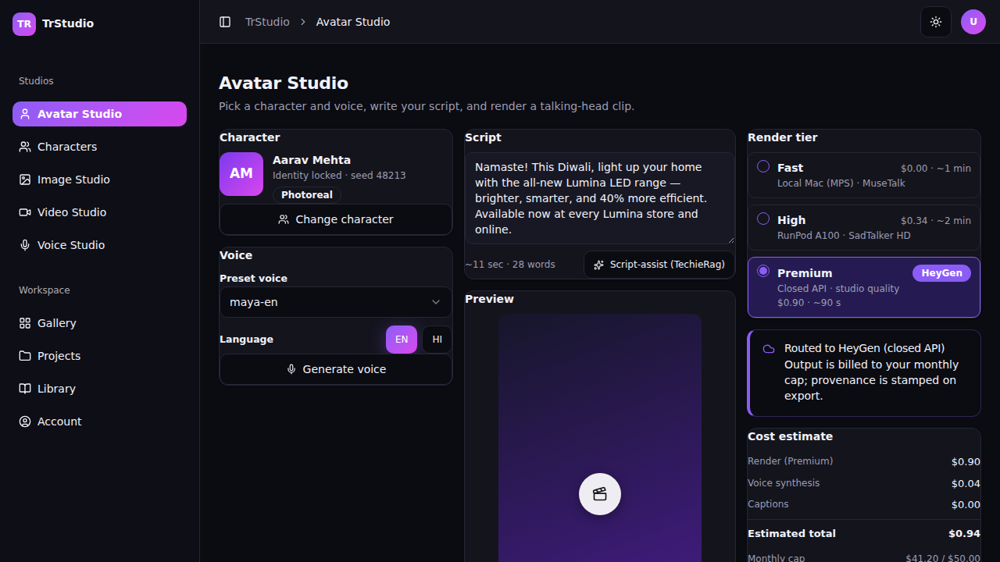

**Screenshot — Creator hitting `/admin/*` → AccessDenied**

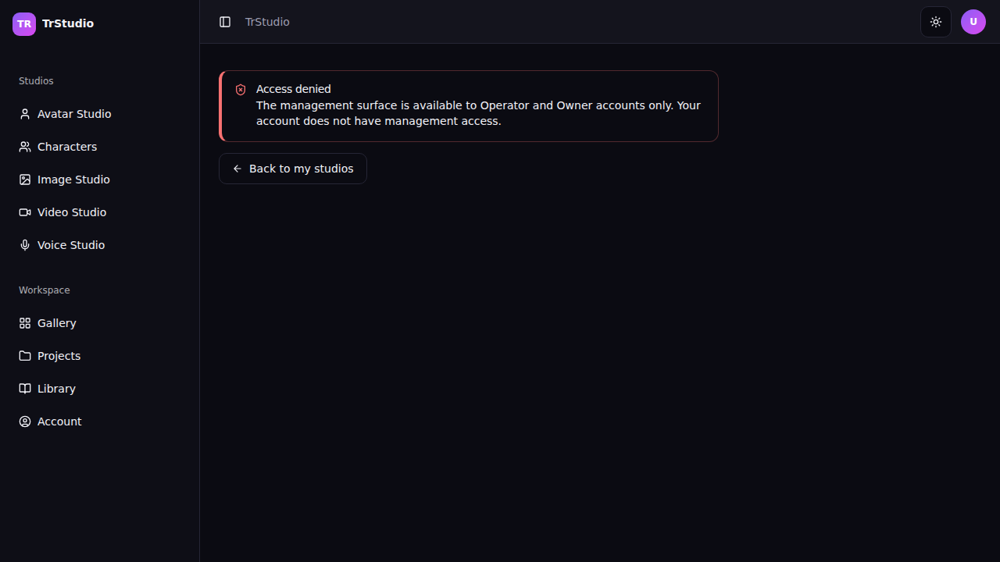

The desktop head (MAUI Blazor Hybrid) shows the same in-window denial (`docs/screenshots/TrStudio/creator-desktop-denied.png`, from `.smoke/desktop/shots/creator-denied.png`).

**Auth wiring after the consolidation (path citations).** The auth contracts stay in the shared RCL — `IAuthSession` (`src/TrStudioUI/Auth/IAuthSession.cs`) + `AuthSessionState` (`src/TrStudioUI/Auth/AuthSessionState.cs`) — but the Blazor-Server auth **implementations** moved OUT of the RCL into the web host: `AuthSession`, `AuthTokenHandler`, `CircuitServicesAccessor`, `ServicesAccessorCircuitHandler`, `AuthServiceCollectionExtensions` now live under `src/TrStudio/Auth/` (e.g. `src/TrStudio/Auth/AuthSession.cs:13`, namespace still `TrStudioUI.Auth`). The desktop head supplies its own SecureStorage-backed implementation `src/TrStudio.Desktop/Auth/MauiAuthSession.cs` + `MauiAuthTokenHandler.cs`. So every Creator screen's `IAuthSession.*` call binds to the RCL contract, resolved at runtime to the web `AuthSession` or the desktop `MauiAuthSession` depending on the head (REQ-NFR-003).

## Screen-by-screen code map

### Creator · Sign in
- **Route:** `/login`
- **Razor file:** `src/TrStudioUI/Pages/Auth/Login.razor` (single-file, `@code` inline)
- **Reached via:** app entry / auth redirect; not in sidebar. **Log in as:** n/a (this IS the login)
- **What this screen does:** Email/password sign-in on the bare EmptyLayout; posts to the AppManager-backed auth API and routes to the setup-gate-aware role landing.
- **Visual status:** ✅ VISUAL-OK (runtime-confirmed 2026-07-04)

**Screenshot**

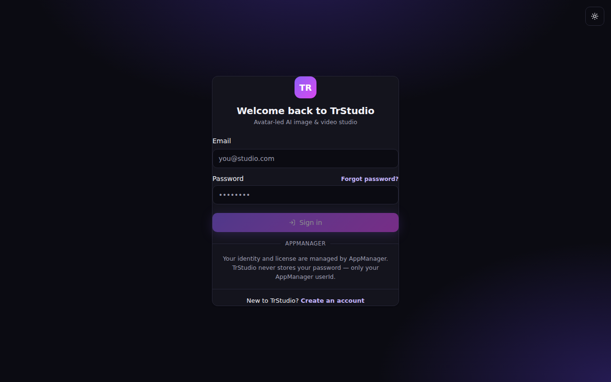

**Screen flowchart**
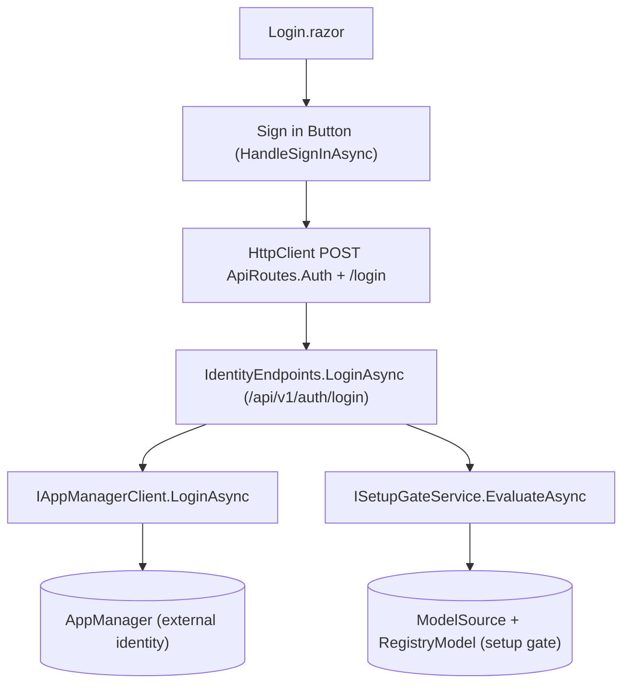
(Mermaid rules: quote EVERY label; never use `end` as a node id.)

**Controls on this screen**
| Control | Type | Purpose | Populated / calculated by |
|---|---|---|---|
| Email input | `Input` | Capture email | Two-way bind `objEmail`; `IsEmailValid` (`Login.razor:99-102`) |
| Password input | `Input` | Capture password | Bind `objPassword`; `IsPasswordValid` (`Login.razor:105`) |
| Sign in button | `Button` | Submit login | `HandleSignInAsync`; disabled until `IsFormValid` (`Login.razor:68-69,108`) |
| Error alert | `Alert` | Show auth failure | `objError` from `ReadErrorAsync` (`Login.razor:25-33,169`) |
| Forgot-password link | `<a>` | Nav to `/forgot-password` | Static href (`Login.razor:55`) |
| Create-account link | `<a>` | Nav to `/register` | Static href (`Login.razor:88`) |

**Data lineage**
| Control / Action | Razor (file:line) | Client/Service method (file) | API endpoint (file) | Engine service → repository (file) | Table / SQL query | Render status | Notes |
|---|---|---|---|---|---|---|---|
| Sign in | `Login.razor:111-150` | `HttpClientFactory` client "TrStudioApi" `PostAsJsonAsync(ApiRoutes.Auth + "/login")` (`Login.razor:123-125`) | `IdentityEndpoints.LoginAsync` `POST /api/v1/auth/login` `AllowAnonymous` (`IdentityEndpoints.cs:31,47`) | `IAppManagerClient.LoginAsync` + `ISetupGateService.EvaluateAsync` (`IdentityEndpoints.cs:60-61`) | External AppManager; setup gate reads `"ModelSource"` + `"RegistryModel"` | renders | Real login is Blocked externally (AppManager app 4 not published) — smokes use `/dev/session` seam |
| Landing redirect | `Login.razor:136,153-166` | `NavigateTo(ResolveLanding)` | — | `LoginResponse.DefaultLandingPath` set by `ApplySetupGateAsync` (`IdentityEndpoints.cs:313-322`) | — | renders | Creator → `/avatar` fallback; gate may send `/setup-required` |

**Business rules / calculations**
- Submit stays disabled until `IsFormValid` (valid email syntax + non-empty password) (`Login.razor:107-108`).
- Session persisted via `IAuthSession.SetAsync` BEFORE navigation so the next circuit carries the bearer token (`Login.razor:132-134`).
- 401 → "Invalid email or password."; other → generic; ProblemDetails `Detail` used when present (`Login.razor:184-186`).

**Known issues / gotchas**
- Real AppManager login is externally Blocked (AppManager app 4 not published) — this is an external dependency, not a screen defect. Use `/dev/session` for end-to-end smokes.

---

### Creator · Create account
- **Route:** `/register`
- **Razor file:** `src/TrStudioUI/Pages/Auth/Register.razor`
- **Reached via:** "Create an account" link on `/login`; not in sidebar. **Log in as:** n/a (provisions the account)
- **What this screen does:** Name/email/password/confirm + Creator-vs-Admin account-type selector; provisions via AppManager and routes by account type.
- **Visual status:** ✅ VISUAL-OK (runtime-confirmed 2026-07-04)

**Screenshot**

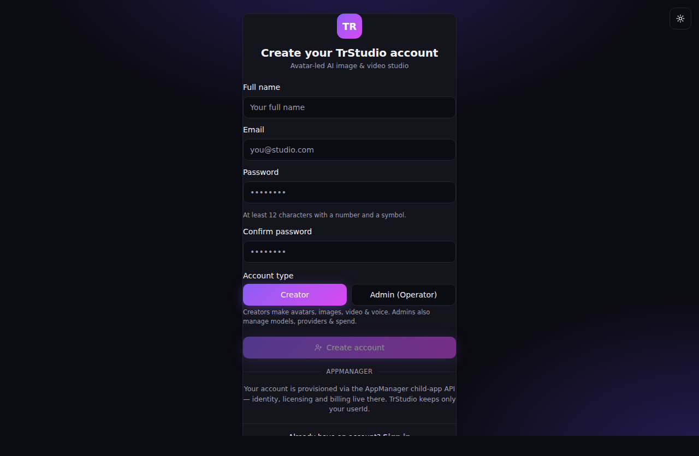

**Screen flowchart**
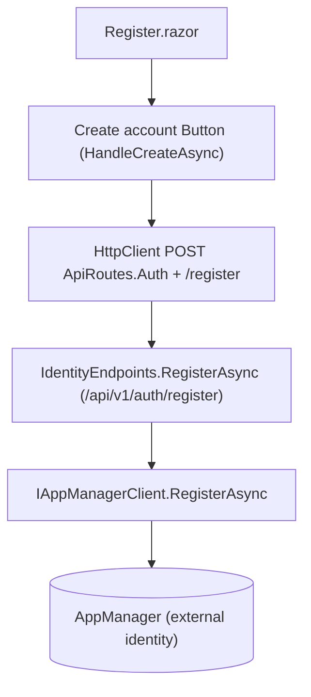

**Controls on this screen**
| Control | Type | Purpose | Populated / calculated by |
|---|---|---|---|
| Name / Email / Password / Confirm | `Input` | Capture fields | Binds `objName/objEmail/objPassword/objConfirm`; validators `Register.razor:139-152` |
| Account type toggle | two `Button`s | Creator vs Admin | `objIsAdmin` (`Register.razor:95-100`) |
| Create account button | `Button` | Submit | `HandleCreateAsync`; disabled until `IsFormValid` (`Register.razor:106-107,154`) |
| Error alert | `Alert` | Duplicate/other errors | `objError`; `EMAIL_EXISTS` special-cased (`Register.razor:220-223`) |

**Data lineage**
| Control / Action | Razor (file:line) | Client/Service method (file) | API endpoint (file) | Engine service → repository (file) | Table / SQL query | Render status | Notes |
|---|---|---|---|---|---|---|---|
| Create account | `Register.razor:157-202` | `PostAsJsonAsync(ApiRoutes.Auth + "/register")` (`Register.razor:177`) | `IdentityEndpoints.RegisterAsync` `POST /api/v1/auth/register` `AllowAnonymous` (`IdentityEndpoints.cs:32,77`) | `IAppManagerClient.RegisterAsync` (`IdentityEndpoints.cs:90`) | External AppManager; no local password store (BRD-57) | renders | AccountType `"Creator"`/`"AdminOperator"` (`Register.razor:175`) |

**Business rules / calculations**
- Password strength: ≥12 chars with a digit and a non-alphanumeric symbol (`Register.razor:147-150`).
- Confirm must equal password (`Register.razor:152`).
- Landing: `DefaultLandingPath` if set, else Admin → `/admin/setup/hardware`, Creator → `/avatar` (`Register.razor:205-213`).

**Known issues / gotchas**
- External AppManager provisioning Blocked (app 4 not published) — external, not a screen defect.

---

### Creator · Reset password
- **Route:** `/forgot-password`
- **Razor file:** `src/TrStudioUI/Pages/Auth/ForgotPassword.razor`
- **Reached via:** "Forgot password?" link on `/login`; not in sidebar. **Log in as:** n/a
- **What this screen does:** Email + "Send reset link"; enumeration-safe — always shows the same generic success.
- **Visual status:** ✅ VISUAL-OK (runtime-confirmed 2026-07-04)

**Screenshot**

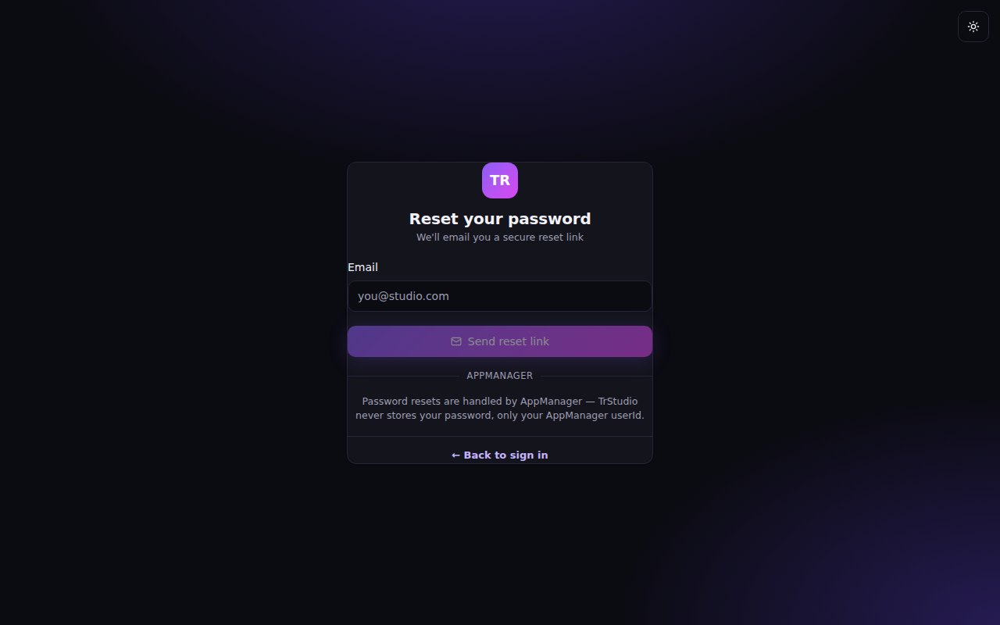

**Screen flowchart**
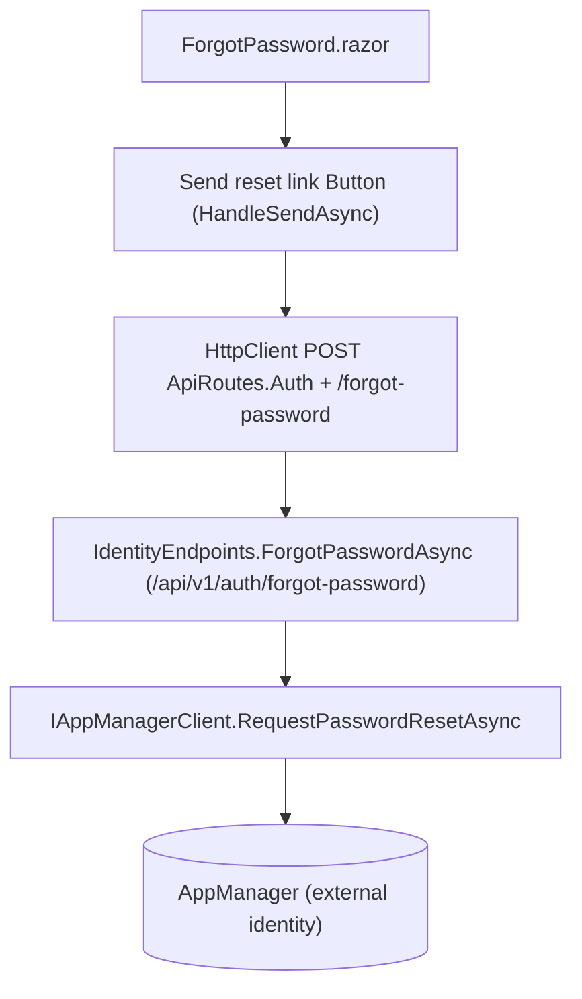

**Controls on this screen**
| Control | Type | Purpose | Populated / calculated by |
|---|---|---|---|
| Email input | `Input` | Capture email | Bind `objEmail`; `IsEmailValid` (`ForgotPassword.razor:77-80`) |
| Send button | `Button` | Request reset | `HandleSendAsync`; disabled until valid email (`ForgotPassword.razor:35-36`) |
| Success alert | `Alert` | Generic confirmation | `objSent` — always shown on completion (`ForgotPassword.razor:49-60,105`) |

**Data lineage**
| Control / Action | Razor (file:line) | Client/Service method (file) | API endpoint (file) | Engine service → repository (file) | Table / SQL query | Render status | Notes |
|---|---|---|---|---|---|---|---|
| Send reset link | `ForgotPassword.razor:83-107` | `PostAsJsonAsync(ApiRoutes.Auth + "/forgot-password")` (`ForgotPassword.razor:96`) | `IdentityEndpoints.ForgotPasswordAsync` `POST /api/v1/auth/forgot-password` `AllowAnonymous` (`IdentityEndpoints.cs:34,134`) | `IAppManagerClient.RequestPasswordResetAsync` (`IdentityEndpoints.cs:146`) | External AppManager | renders | All transport/account errors swallowed to prevent enumeration (`ForgotPassword.razor:98-101`) |

**Business rules / calculations**
- `objSent` is set in `finally` regardless of outcome — the success alert is enumeration-safe (`ForgotPassword.razor:103-106`).

**Known issues / gotchas**
- None confirmed.

---

### Creator · Setup required
- **Route:** `/setup-required`
- **Razor file:** `src/TrStudioUI/Pages/Auth/SetupRequired.razor`
- **Reached via:** setup-gate redirect after login when no model/source is ready (BRD-85); not in sidebar. **Log in as:** user 2 (creator@trstudio.test)
- **What this screen does:** First-run gate shown to creators when the install has no ready model; "Check again" re-evaluates the gate and forwards to the studio when setup completes.
- **Visual status:** ✅ VISUAL-OK (runtime-confirmed 2026-07-04)

**Screenshot**

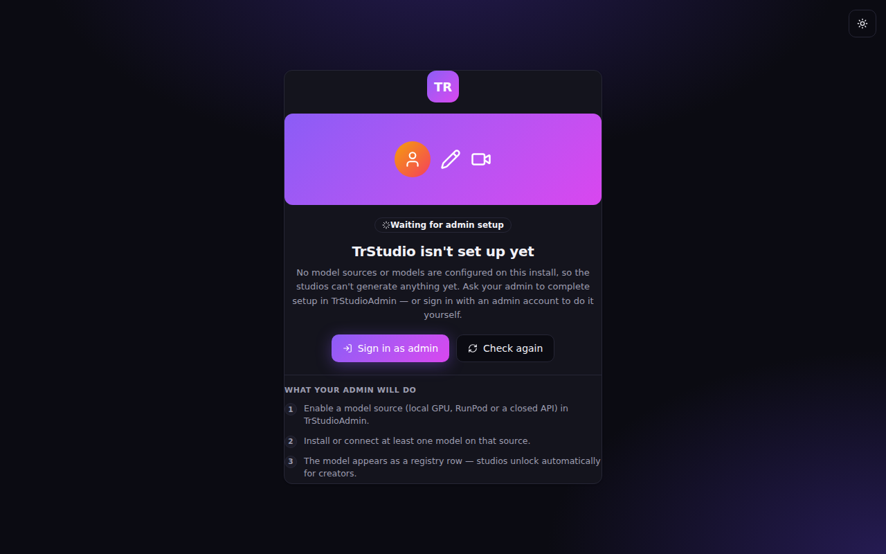

**Screen flowchart**
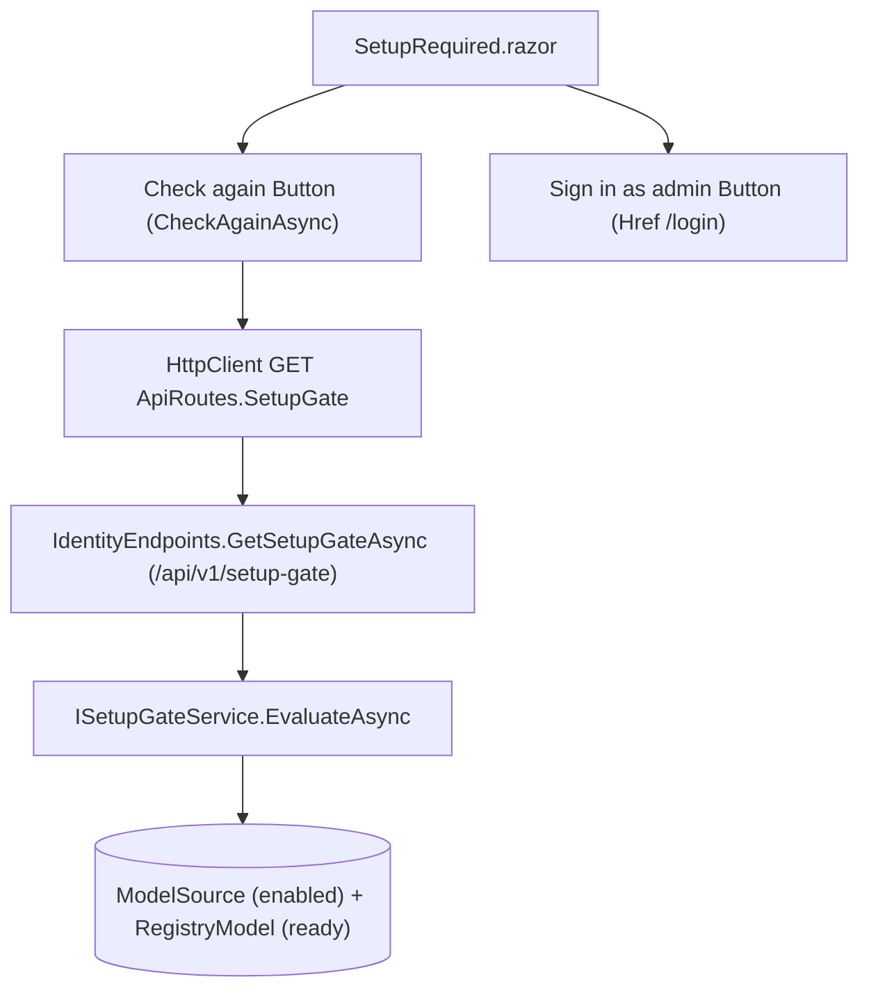

**Controls on this screen**
| Control | Type | Purpose | Populated / calculated by |
|---|---|---|---|
| Sign in as admin | `Button Href="/login"` | Route to login | Static href (`SetupRequired.razor:37`) |
| Check again | `Button` | Re-evaluate gate | `CheckAgainAsync` (`SetupRequired.razor:41-53,77`) |
| Waiting badge / steps | `Badge`/static | Explain gate | Static markup (`SetupRequired.razor:25-70`) |

**Data lineage**
| Control / Action | Razor (file:line) | Client/Service method (file) | API endpoint (file) | Engine service → repository (file) | Table / SQL query | Render status | Notes |
|---|---|---|---|---|---|---|---|
| Check again | `SetupRequired.razor:77-105` | `GetAsync(ApiRoutes.SetupGate)` (`SetupRequired.razor:83`) | `IdentityEndpoints.GetSetupGateAsync` `GET /api/v1/setup-gate` `RequireAuthorization` (`IdentityEndpoints.cs:38,194`) | `ISetupGateService.EvaluateAsync` (`IdentityEndpoints.cs:203`) | Reads `"ModelSource"` (enabled) + `"RegistryModel"` (ready); defined `0301_ModelSource.sql`, `0200_RegistryTables.sql` | renders | On `SetupComplete` navigates to `RedirectPath` (`forceLoad:true`), else toast (`SetupRequired.razor:87-95`) |

**Business rules / calculations**
- Gate complete ⇔ ≥1 enabled model source AND ≥1 ready registry model (`IdentityEndpoints.cs:191-193` remark).

**Known issues / gotchas**
- None confirmed. "Check again" requires an authenticated session (endpoint is `RequireAuthorization`).

---

### Creator · Home
- **Route:** `/` (Home)
- **Razor file:** `src/TrStudioUI/Pages/Home.razor`
- **Reached via:** app shell root; renders inside sidebar layout. **Log in as:** user 2 (creator@trstudio.test)
- **What this screen does:** Shared landing stub — a primary CTA plus launch cards for every nav group/item.
- **Visual status:** ✅ VISUAL-OK (runtime-confirmed 2026-07-04)

**Screenshot**

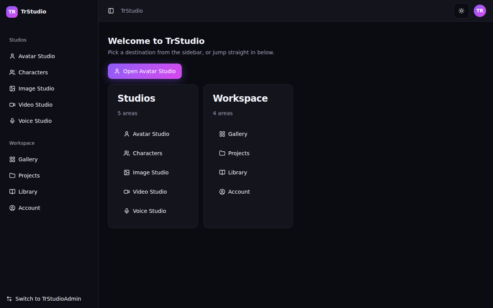

**Screen flowchart**
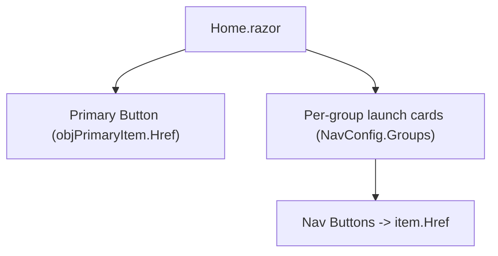

**Controls on this screen**
| Control | Type | Purpose | Populated / calculated by |
|---|---|---|---|
| Primary launch button | `Button` | Jump to first nav item | `objPrimaryItem` = first group's first item (`Home.razor:14-20,49-52`) |
| Group cards | `Card` grid | List nav items | `NavConfig.Groups` (DI-injected) (`Home.razor:22-43`) |

**Data lineage**
| Control / Action | Razor (file:line) | Client/Service method (file) | API endpoint (file) | Engine service → repository (file) | Table / SQL query | Render status | Notes |
|---|---|---|---|---|---|---|---|
| Nav cards | `Home.razor:23-42` | `AppNavigationConfig` (DI, in-proc) | — | `TrStudioNavSets.CreateCreatorNavigation` (`TrStudioNavSets.cs:15`) | none (in-memory nav) | renders | Pure client render; no API/DB |

**Business rules / calculations**
- `objPrimaryItem` = `NavConfig.Groups.FirstOrDefault()?.Items.FirstOrDefault()` → Avatar Studio for Creator (`Home.razor:51`).

**Known issues / gotchas**
- None. Static shell; no data hop.

---

### Creator · Avatar Studio (flagship)
- **Route:** `/avatar`
- **Razor file:** `src/TrStudioUI/Pages/Avatar/AvatarStudio.razor`
- **Reached via:** Studios → Avatar Studio; also the Creator post-login landing. **Log in as:** user 2 (creator@trstudio.test)
- **What this screen does:** Three-column talking-head studio: character picker (enrich-or-seed), preset-voice + EN/HI toggle, script editor with TechieRag assist, Fast/High/Premium tier with cost/cap estimate + safety alerts, captions + aspect + Export MP4. Render rides the shared job spine.
- **Visual status:** ✅ VISUAL-OK (runtime-confirmed 2026-07-04)

**Screenshot**

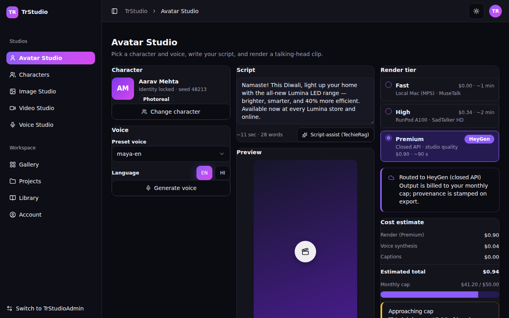

**Screen flowchart**
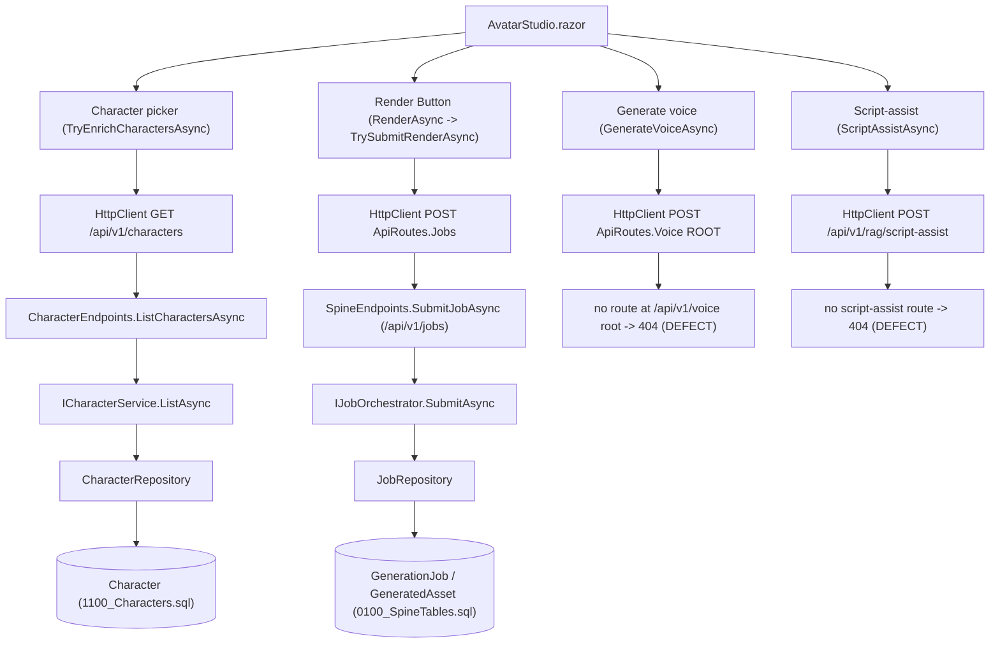

**Controls on this screen**
| Control | Type | Purpose | Populated / calculated by |
|---|---|---|---|
| Character card | seed/enrich | Show identity-locked character | `objCharacters` seed (`AvatarStudio.razor:559`), enriched from `/api/v1/characters` (`AvatarStudio.razor:390-414`) |
| Change / New character | `Button` | Nav to `/avatar/characters` | `GoToCharacters` (`AvatarStudio.razor:417`) |
| Voice select | `Select` | Pick preset voice | Hardcoded `objVoices` dict (`AvatarStudio.razor:291-297`) — NOT API-loaded |
| Language toggle | `Button`s | EN/HI | `objLanguage` (`AvatarStudio.razor:300-301`) |
| Generate voice | `Button` | Voice preview | `GenerateVoiceAsync` (`AvatarStudio.razor:420-433`) — see defect |
| Script textarea | `Textarea` | Narration text | Bind `objScript`; `WordCount`/`EstimatedSeconds` computed (`AvatarStudio.razor:344-348`) |
| Script-assist | `Button` | TechieRag tighten hook | `ScriptAssistAsync` (`AvatarStudio.razor:436-449`) — see defect |
| Render tier | `RadioGroup` | Fast/High/Premium | `objTiers` seed (`AvatarStudio.razor:311-316`); HeyGen badge/routing alert computed |
| Cost estimate | computed | Render+voice vs cap | `EstimatedTotal`, `OverCap`, `NearCap`, `CapPercent` (`AvatarStudio.razor:350-363`) |
| Render | `Button` | Submit lip-sync job | `RenderAsync` → `TrySubmitRenderAsync` (`AvatarStudio.razor:456-545`) |
| Safety alert | `Alert` | SAFE-01..06 block | `objSafetyBlocked` set when job returns `Blocked` (`AvatarStudio.razor:482-485,531`) |
| Captions switch / Aspect / Export | `Switch`/`Select`/`Button` | Export options | `objCaptions`,`objAspect`; `ExportAsync` toast only (`AvatarStudio.razor:548-554`) |

**Data lineage**
| Control / Action | Razor (file:line) | Client/Service method (file) | API endpoint (file) | Engine service → repository (file) | Table / SQL query | Render status | Notes |
|---|---|---|---|---|---|---|---|
| Character list | `AvatarStudio.razor:390-414` | `GetFromJsonAsync<List<CharacterSummary>>("/api/v1/characters")` | `CharacterEndpoints.ListCharactersAsync` `GET /api/v1/characters` (`CharacterEndpoints.cs:25,62`) | `ICharacterService.ListAsync` → `CharacterRepository` | `"Character"` (`1100_Characters.sql`) | renders (seed; live enrich when session+rows) | Enrich-or-seed; seed always shows |
| Render job | `AvatarStudio.razor:494-545` | `PostAsJsonAsync(ApiRoutes.Jobs)` then poll `GET /api/v1/jobs/{id}` | `SpineEndpoints.SubmitJobAsync` `POST /api/v1/jobs` (`SpineEndpoints.cs:44,65`) | `IJobOrchestrator.SubmitAsync` → `JobRepository`; safety/cost pre-checks (`SpineEndpoints.cs:79,82,96`) | `"GenerationJob"`/`"GeneratedAsset"` (`0100_SpineTables.sql`) | renders (progress animates; live submit best-effort) | Blocked → 403 SAFETY_BLOCKED surfaces safety alert |
| Generate voice | `AvatarStudio.razor:420-433` | `PostAsJsonAsync(ApiRoutes.Voice, …)` → `/api/v1/voice` (root) | **no POST at `/api/v1/voice` root** — synth is `/api/v1/voice/synthesize` (`VoiceEndpoints.cs:28`) | — | — | renders-empty (suspected defect — wrong route, always 404, swallowed) | Toast still fires; real synth never runs. **DEFECT** |
| Script-assist | `AvatarStudio.razor:436-449` | `PostAsJsonAsync("/api/v1/rag/script-assist", …)` | **no `script-assist` route** — RAG maps `script`/`captions`/`usage` (`RagEndpoints.cs:25-27`) | — | — | renders-empty (suspected defect — 404, swallowed) | Toast still fires. **DEFECT** |

**Business rules / calculations**
- `EstimatedTotal = SelectedTier.Cost + VoiceCost` (captions free) (`AvatarStudio.razor:351`).
- `OverCap` disables Render; `NearCap` warns under $10 headroom (`AvatarStudio.razor:357-360,242`).
- Job `ModelId` chosen by tier: `heygen-avatar` vs `musetalk-local` (`AvatarStudio.razor:501`); `Task=LipSync`.

**Known issues / gotchas**
- Voice-preview and script-assist calls hit non-existent routes (see lineage) — both are swallowed try/catch, so the studio still demos via toasts, but the backend is never exercised. REQ-UI-010 / REQ-FN-031 / RAG-001 wiring.
- Voice `Select` in this studio is a hardcoded 4-item dict, never enriched from the voice catalog (by design seed, but note it will not reflect installed voices).
- Provider/tier costs are seed constants, not the live registry — model-gated by design.

---

### Creator · Character Library
- **Route:** `/avatar/characters`
- **Razor file:** `src/TrStudioUI/Pages/Avatar/CharacterLibrary.razor`
- **Reached via:** Studios → Characters (or Avatar Studio "Change/New character"). **Log in as:** user 2 (creator@trstudio.test)
- **What this screen does:** Grid of identity-locked characters (enrich-or-seed) with search, a create/edit Dialog (prompt + realism + seed/LoRA lock), and a per-character bible Sheet.
- **Visual status:** ✅ VISUAL-OK (runtime-confirmed 2026-07-04)

**Screenshot**

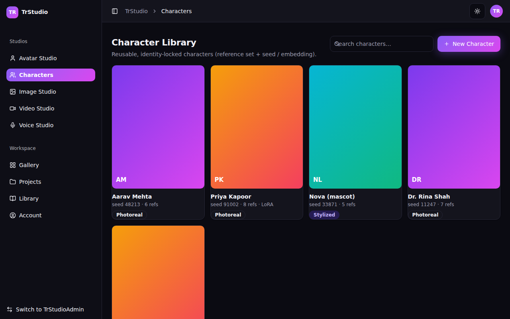

**Screen flowchart**
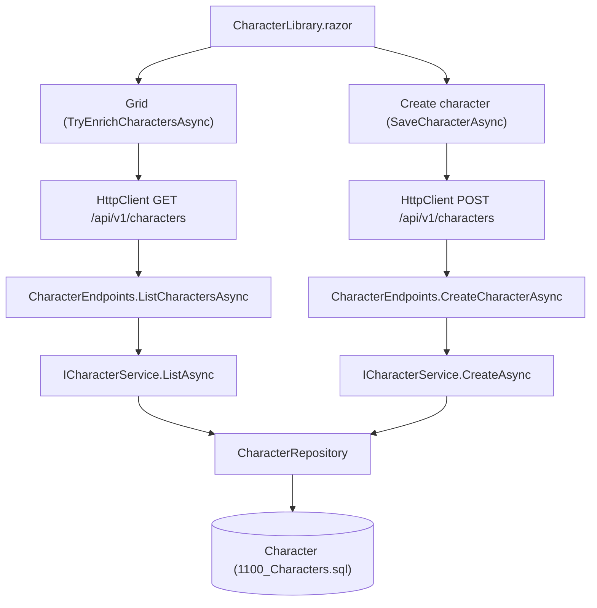

**Controls on this screen**
| Control | Type | Purpose | Populated / calculated by |
|---|---|---|---|
| Search box | `Input` | Filter grid | `objSearch` → `FilteredCharacters` (`CharacterLibrary.razor:207-212`) |
| Character card | `Card` | Show character | `objCharacters` seed/enriched (`CharacterLibrary.razor:337,235-255`) |
| New Character dialog | `Dialog` | Create form | `objDraftPrompt/Realism/Seed/Lora` (`CharacterLibrary.razor:201-204`) |
| Create button | `Button` | Persist character | `SaveCharacterAsync` (`CharacterLibrary.razor:280-325`) |
| Bible sheet | `Sheet` | Persona notes | `objBibleChar` (static persona copy) (`CharacterLibrary.razor:149-185`) |

**Data lineage**
| Control / Action | Razor (file:line) | Client/Service method (file) | API endpoint (file) | Engine service → repository (file) | Table / SQL query | Render status | Notes |
|---|---|---|---|---|---|---|---|
| Load grid | `CharacterLibrary.razor:235-255` | `GetFromJsonAsync<List<CharacterCard>>("/api/v1/characters")` | `CharacterEndpoints.ListCharactersAsync` (`CharacterEndpoints.cs:62`) | `ICharacterService.ListAsync` → `CharacterRepository` | `"Character"` (`1100_Characters.sql`) | renders (seed + live enrich) | 5-item seed always shows |
| Create character | `CharacterLibrary.razor:280-325` | `PostAsJsonAsync("/api/v1/characters", { name, description, realism, seed, loraRef, isAdult })` (`CharacterLibrary.razor:307-315`) | `CharacterEndpoints.CreateCharacterAsync` `POST /api/v1/characters` (`CharacterEndpoints.cs:24,38`) | `ICharacterService.CreateAsync` → `CharacterRepository` | `"Character"` | renders (optimistic prepend; live POST best-effort) | Body maps to `CharacterUpsertRequest`; `realism` numeric enum |
| Bible sheet | `CharacterLibrary.razor:155-177` | none (static copy) | (`CharacterEndpoints` has `/{id}/bible` but the sheet does not call it) | — | — | renders-empty (static; no bible fetch) | Sheet shows canned persona text, not `ListBibleEntriesAsync` data — cosmetic, not wired |

**Business rules / calculations**
- Seed parsed from field or randomized 10000–99999 (`CharacterLibrary.razor:288`); `HasLora` when LoRA ≠ "None".
- Name derived from first 3 prompt words (`CharacterLibrary.razor:329-334`).

**Known issues / gotchas**
- The bible Sheet renders static persona copy and never calls `GET /api/v1/characters/{id}/bible` (`CharacterEndpoints.cs:31`). Not a broken route — the feature is simply not wired to the API. REQ-UI-011 / RAG-004.

---

### Creator · Image Studio
- **Route:** `/image`
- **Razor file:** `src/TrStudioUI/Pages/Image/ImageStudio.razor`
- **Reached via:** Studios → Image Studio. **Log in as:** user 2 (creator@trstudio.test)
- **What this screen does:** Registry-schema-driven param panel (controls render from the selected model's `Params` schema), canvas + prompt, ControlNet tabs + upload, results strip with per-seed badges, upscale + export. Generation rides the shared spine.
- **Visual status:** ✅ VISUAL-OK (runtime-confirmed 2026-07-04)

**Screenshot**

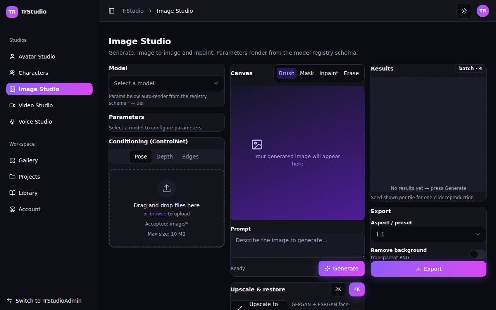

**Screen flowchart**
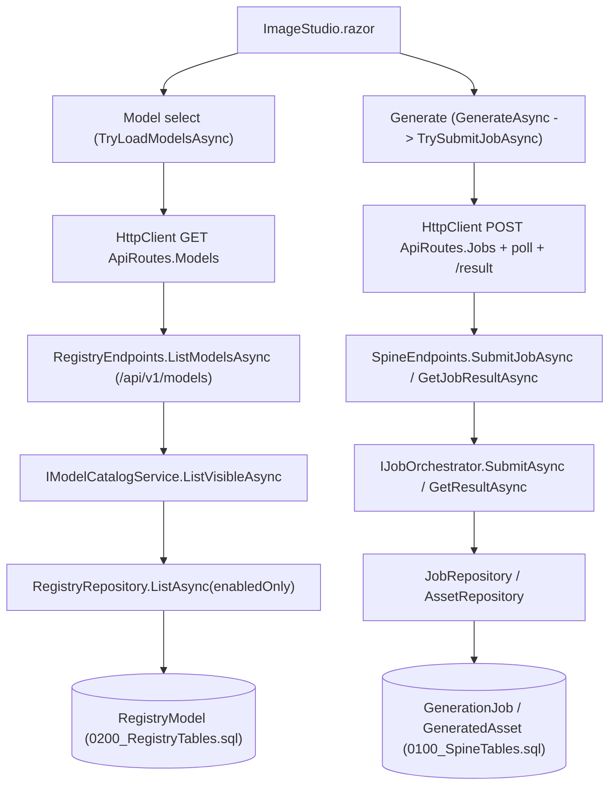

**Controls on this screen**
| Control | Type | Purpose | Populated / calculated by |
|---|---|---|---|
| Model select | `Select` | Choose registry model | `objModels` from `/api/v1/models` (`ImageStudio.razor:337-364`) |
| Dynamic params | `Slider`/`Switch`/`Select`/`Input` | Render from schema | `SelectedModel.Params` switch on `Type` (`ImageStudio.razor:53-98`); values in `objNumeric/objText/objBool` |
| ControlNet tabs + upload | `Tabs`/`FileUpload` | Conditioning | `objControlTabs` (`ImageStudio.razor:104-115`) |
| Prompt | `Textarea` | Prompt text | `PromptText` mirrors `objText["prompt"]` (`ImageStudio.razor:303-307`) |
| Generate | `Button` | Submit job | `GenerateAsync` (`ImageStudio.razor:411-446`) |
| Results strip | tiles | Per-seed results | `objResults` from assets or representative seeds (`ImageStudio.razor:433-441`) |
| Upscale / Export | `Button` | Post-steps | `UpscaleAsync`/`ExportAsync` toast only (`ImageStudio.razor:525-537`) |

**Data lineage**
| Control / Action | Razor (file:line) | Client/Service method (file) | API endpoint (file) | Engine service → repository (file) | Table / SQL query | Render status | Notes |
|---|---|---|---|---|---|---|---|
| Model catalog | `ImageStudio.razor:337-364` | `GetFromJsonAsync<List<RegistryModel>>(ApiRoutes.Models)` | `RegistryEndpoints.ListModelsAsync` `GET /api/v1/models` (`RegistryEndpoints.cs:32,62`) | `IModelCatalogService.ListVisibleAsync` → `RegistryRepository.ListAsync` (`ModelCatalogService.cs:28`, `RegistryRepository.cs:46`) | `SELECT … FROM "RegistryModel"` (`RegistryRepository.cs:48`; `0200_RegistryTables.sql`) | renders (empty when no session; fallback catalog only when authed+zero rows) | Param panel is fully schema-driven — no per-model code |
| Generate | `ImageStudio.razor:449-501` | `PostAsJsonAsync(ApiRoutes.Jobs)`, poll `GET /api/v1/jobs/{id}`, `GET /api/v1/jobs/{id}/result` | `SpineEndpoints.SubmitJobAsync`/`GetJobResultAsync` (`SpineEndpoints.cs:44,47`) | `IJobOrchestrator.SubmitAsync`/`GetResultAsync` → `JobRepository`/`AssetRepository` | `"GenerationJob"`/`"GeneratedAsset"` (`0100_SpineTables.sql`) | renders (representative seeds when offline) | `Task`/`Tier` taken from selected model |

**Business rules / calculations**
- `IsSidePanelParam` hides `prompt`, `image`/`mask`, `controlType` from the left panel (`ImageStudio.razor:405-408`).
- `RebuildParamValues` seeds each control from schema `DefaultValue`/`Min` (`ImageStudio.razor:376-402`).
- `BuildParamsJson` serializes all dynamic values into the job (`ImageStudio.razor:504-523`).

**Known issues / gotchas**
- With no session the catalog is intentionally empty (no fallback flash); the representative fallback only appears on an authenticated call that returns zero models (`ImageStudio.razor:337-364`). Correct-by-design, model-gated.

---

### Creator · Voice Studio
- **Route:** `/voice`
- **Razor file:** `src/TrStudioUI/Pages/Voice/VoiceStudio.razor`
- **Reached via:** Studios → Voice Studio. **Log in as:** user 2 (creator@trstudio.test)
- **What this screen does:** Narration composer — language + preset-voice combobox (routing hidden), emotion/speed gates by voice capability, waveform player, consent-gated clone dialog (SAFE-02/03). Enrich-or-seed preset list.
- **Visual status:** ✅ VISUAL-OK (runtime-confirmed 2026-07-04)

**Screenshot**

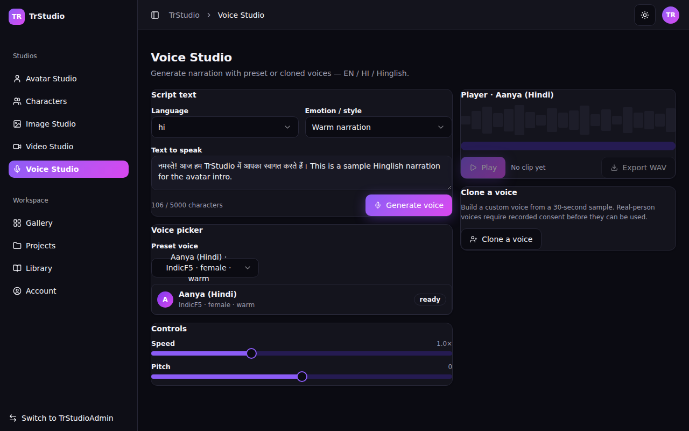

**Screen flowchart**
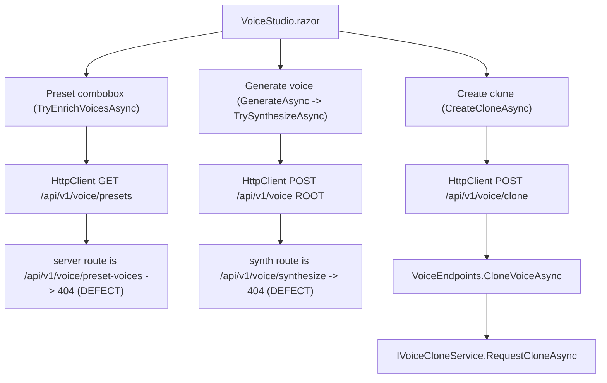

**Controls on this screen**
| Control | Type | Purpose | Populated / calculated by |
|---|---|---|---|
| Language select | `Select` | EN/HI/Hinglish | `objLanguages` (`VoiceStudio.razor:277-282`) |
| Emotion select | `Select` | Style | `objEmotions`; disabled when `!EmotionSupported` (`VoiceStudio.razor:318`) |
| Script textarea | `Textarea` | Text to speak | Bind `objScript`, 5000-char counter |
| Preset voice combobox | `Combobox` | Pick voice | `objVoices` seed, enriched (`VoiceStudio.razor:350-374`) |
| Speed/Pitch sliders | `Slider` | Controls | `objSpeed` gated by `SpeedSupported`; `objPitch` (`VoiceStudio.razor:321`) |
| Generate voice | `Button` | Synthesize | `GenerateAsync` → `TrySynthesizeAsync` (`VoiceStudio.razor:393-458`) — see defect |
| Player / model-missing alert | waveform/`Alert` | Playback / gate | `objHasAudio`; `ModelInstalled` gate (`VoiceStudio.razor:156-191`) |
| Clone dialog + consent gate | `Dialog`/`AlertDialog` | Consent-gated clone | `objCloneSynthetic`, `objConsentOpen` (`VoiceStudio.razor:474-497`) |

**Data lineage**
| Control / Action | Razor (file:line) | Client/Service method (file) | API endpoint (file) | Engine service → repository (file) | Table / SQL query | Render status | Notes |
|---|---|---|---|---|---|---|---|
| Preset list | `VoiceStudio.razor:350-374` | `GetFromJsonAsync<List<PresetVoice>>("/api/v1/voice/presets")` (`VoiceStudio.razor:360`) | **route is `/api/v1/voice/preset-voices`** (`VoiceEndpoints.cs:27`) — `/presets` 404s | `IPresetVoiceCatalog.GetAll` (`VoiceEndpoints.cs:41`) never reached | in-memory catalog | renders-empty (suspected defect — wrong path, always seed) | Also DTO shape differs (`Id/Name` vs `VoiceId/DisplayName`). **DEFECT** |
| Generate voice | `VoiceStudio.razor:437-458` | `PostAsJsonAsync(VoiceApiRoute, …)` → `/api/v1/voice` root (`VoiceStudio.razor:452`) | **synth route is `/api/v1/voice/synthesize`** (`VoiceEndpoints.cs:28`) — root 404s | `IVoiceSynthesizer.SynthesizeAsync` never reached | — | renders-empty (suspected defect — swallowed 404) | Placeholder waveform stands in. **DEFECT** |
| Create clone | `VoiceStudio.razor:500-526` | `PostAsJsonAsync("/api/v1/voice/clone", …)` (`VoiceStudio.razor:512`) | `VoiceEndpoints.CloneVoiceAsync` `POST /api/v1/voice/clone` (`VoiceEndpoints.cs:30,86`) | `IVoiceCloneService.RequestCloneAsync` (`VoiceEndpoints.cs:98`) | consent tables (`0900_Safety.sql`/`0800_Voice.sql`) | renders (route correct; best-effort) | Real-person path gated by consent AlertDialog first (client-side SAFE-02/03) |

**Business rules / calculations**
- `EmotionSupported`/`SpeedSupported` gate the emotion select + speed slider by the voice's capability flags (`VoiceStudio.razor:318-321`).
- Clone: synthetic proceeds immediately; real-person routed through the consent AlertDialog before `CreateCloneAsync` (`VoiceStudio.razor:474-497`).
- Generate blocks up front when `!ModelInstalled` (`VoiceStudio.razor:402-406`).

**Known issues / gotchas**
- **Preset-voice list route mismatch** (`/presets` vs `/preset-voices`) and **synthesize route mismatch** (root vs `/synthesize`) — both swallowed, so the studio demos on the seed voices and placeholder audio, but no live voice call ever lands. REQ-UI-030 / REQ-FN-031/033.

---

### Creator · Video Studio
- **Route:** `/video`
- **Razor file:** `src/TrStudioUI/Pages/Video/VideoStudio.razor`
- **Reached via:** Studios → Video Studio. **Log in as:** user 2 (creator@trstudio.test)
- **What this screen does:** I2V/T2V mode tabs swap conditioning; duration/motion/aspect controls; Fast/High/Premium tier; timeline/editor with a trim/join/reframe/add-audio/split toolbar; post-processing + export. Generation rides the spine.
- **Visual status:** ✅ VISUAL-OK (runtime-confirmed 2026-07-04)

**Screenshot**

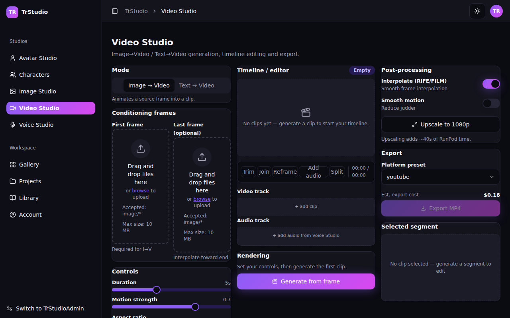

**Screen flowchart**
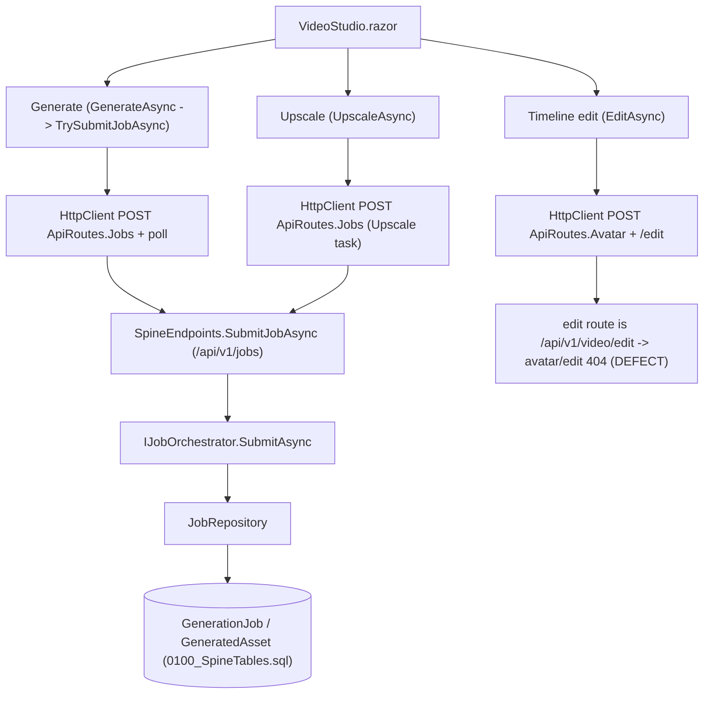

**Controls on this screen**
| Control | Type | Purpose | Populated / calculated by |
|---|---|---|---|
| Mode tabs | `Tabs` | I2V / T2V | `objMode`; `IsImageToVideo` (`VideoStudio.razor:36-41,378`) |
| Frame uploads / prompt | `FileUpload`/`Textarea` | Conditioning | `objFirstFrame`/`objLastFrame` or `objPrompt` (`VideoStudio.razor:46-75`) |
| Duration/Motion/Aspect | `Slider`/`Select` | Controls | `objDuration`,`objMotion`,`objAspect` |
| Quality tier | `RadioGroup` | Fast/High/Premium | `objTiers` seed (`VideoStudio.razor:346-352`); routing alert computed |
| Generate | `Button` | Submit job | `GenerateAsync` (`VideoStudio.razor:433-465`) |
| Timeline toolbar | `Toolbar` | Trim/Join/… | `EditAsync` per tool (`VideoStudio.razor:525-543`) — see defect |
| Post-processing / export | `Switch`/`Button` | Interp/upscale/export | `UpscaleAsync`/`ExportAsync` (`VideoStudio.razor:546-573`) |

**Data lineage**
| Control / Action | Razor (file:line) | Client/Service method (file) | API endpoint (file) | Engine service → repository (file) | Table / SQL query | Render status | Notes |
|---|---|---|---|---|---|---|---|
| Generate clip | `VideoStudio.razor:468-521` | `PostAsJsonAsync(ApiRoutes.Jobs)` + poll (`VideoStudio.razor:492`) | `SpineEndpoints.SubmitJobAsync` `POST /api/v1/jobs` (`SpineEndpoints.cs:44,65`) | `IJobOrchestrator.SubmitAsync` → `JobRepository` | `"GenerationJob"`/`"GeneratedAsset"` (`0100_SpineTables.sql`) | renders (representative clip when offline) | `Task=ImageToVideo`/`TextToVideo`; Blocked → safety toast |
| Upscale | `VideoStudio.razor:546-565` | `PostAsJsonAsync(ApiRoutes.Jobs, Task=Upscale)` | `SpineEndpoints.SubmitJobAsync` | `IJobOrchestrator.SubmitAsync` → `JobRepository` | `"GenerationJob"` | renders (toast) | Correct route |
| Timeline edit | `VideoStudio.razor:525-543` | `PostAsJsonAsync($"{ApiRoutes.Avatar}/edit", …)` → `/api/v1/avatar/edit` (`VideoStudio.razor:535`) | **edit endpoint is `/api/v1/video/edit`** (`VideoEndpoints.cs:29`); Avatar group has no `/edit` (`AvatarEndpoints.cs:26-28`) | `VideoEndpoints.EditAsync` never reached | — | renders-empty (suspected defect — wrong prefix, 404, swallowed) | Should be `ApiRoutes.Video`. **DEFECT** |

**Business rules / calculations**
- `ModelId` chosen by tier/mode: `heygen-video`/`wan-video`/`svd-local` (`VideoStudio.razor:475`).
- `TimelineDuration` sums clip seconds (`VideoStudio.razor:385-392`); "Add audio" flips `objHasAudio`.

**Known issues / gotchas**
- **Timeline edit route mismatch** — posts to `/api/v1/avatar/edit` instead of `/api/v1/video/edit`; swallowed, so the editor toast fires but no server edit runs. REQ-UI-040 / REQ-FN-053.
- First-frame required for I2V is only a caption hint — not enforced before Generate (`VideoStudio.razor:56`).

---

### Creator · Prompt Studio
- **Route:** `/prompt-studio`
- **Razor file:** `src/TrStudioUI/Pages/PromptStudio/PromptStudio.razor`
- **Reached via:** Studios → Prompt Studio. **Log in as:** user 1 (owner) / user 2 (creator@trstudio.test)
- **What this screen does:** A chat screen that crafts generation prompts via a registry-configured **text-chat LLM** (Phase 10, F-PROMPT). Two-column split: a per-user **session rail** (new/resume/rename/delete) + a chat card with a registry-driven LLM picker, a reactive **vision badge** that gates image attach, a message thread, and per-reply prompt-use actions (**Copy / Save to Library / Send to Studio**). Chat runs through TechieRag **direct chat-completion — no RAG/vector** (ADR-013); degrades cleanly to a synthetic best-effort reply when no LLM is configured.
- **Visual status:** ✅ VISUAL-OK (runtime-confirmed 2026-07-07) — §4b no-overlap @1280, single-column collapse @390 (`scrollWidth==390`, no overflow)

**Screenshot**

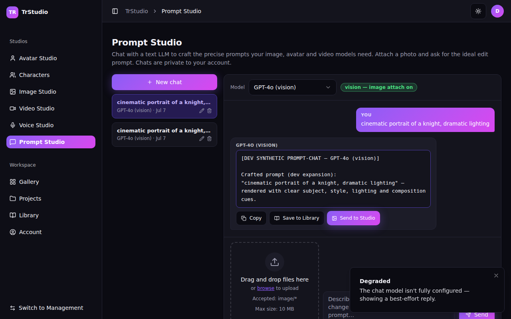

**Screen flowchart**
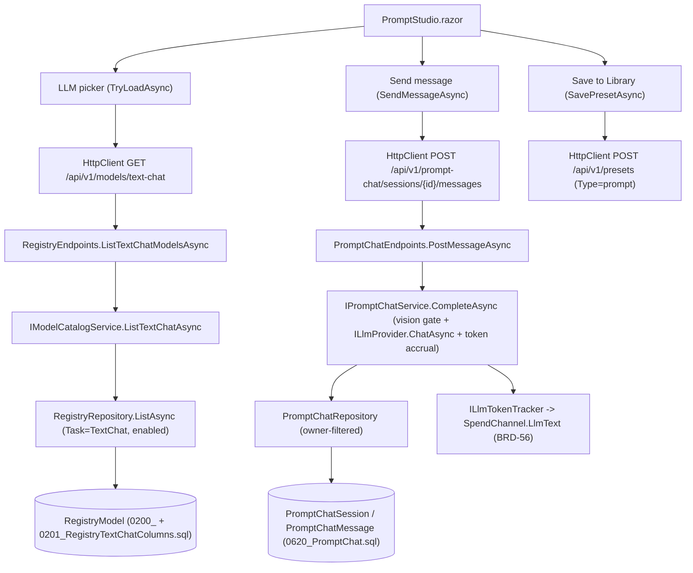

**Controls on this screen**
| Control | Type | Purpose | Populated / calculated by |
|---|---|---|---|
| New chat | `Button` | Start a session | `StartNewChat` (`PromptStudio.razor:30,617`) |
| Session rail | list + rename/delete | Per-user sessions | `objSessions` from `/api/v1/prompt-chat/sessions` (`PromptStudio.razor:44-56,516,592`) |
| LLM picker | `Select` | Choose text-chat model | `objModels` from `/api/v1/models/text-chat` (`PromptStudio.razor:69-78,513,585`) |
| Vision badge | `Badge` | Reflects `VisionCapable` of picked row | `VisionOn => SelectedModel?.VisionCapable` (`PromptStudio.razor:80-89,544-547`) |
| Attach image | `FileUpload` | Vision-only image attach | `Disabled=@(!VisionOn)`, `FilesChanged=OnImageSelectedAsync` (`PromptStudio.razor:185-187`) |
| Composer + Send | `Textarea`/`Button` | Send a turn | `objComposerText` → `SendMessageAsync` (`PromptStudio.razor:189-191,658`) |
| Prompt block + actions | copy/save/send-to-studio | Reply + prompt-use | `CopyPromptAsync` / `OpenSaveToLibrary`→`SavePresetAsync` / `SendToStudio` (`PromptStudio.razor:122-150,853,876,912`) |

**Data lineage**
| Control / Action | Razor (file:line) | Client/Service method | API endpoint (file) | Engine service → repository (file) | Table / SQL query | Render status | Notes |
|---|---|---|---|---|---|---|---|
| LLM picker | `PromptStudio.razor:571-586` | `GetFromJsonAsync<List<RegistryModel>>("/api/v1/models/text-chat")` | `RegistryEndpoints.ListTextChatModelsAsync` `GET /api/v1/models/text-chat` (`RegistryEndpoints.cs:38,76`) | `IModelCatalogService.ListTextChatAsync` → `RegistryRepository.ListAsync` (`ModelCatalogService.cs:55`) | `"RegistryModel"` Task=TextChat (`0201_RegistryTextChatColumns.sql`) | ✓ renders (2 dev-seed rows: gpt-4o-chat vision, llama-3-70b-chat text-only) | `/api/v1/models` **excludes** these (FN-074) |
| Sessions | `PromptStudio.razor:588-593` | `GET/POST/PUT/DELETE /api/v1/prompt-chat/sessions[/{id}]` | `PromptChatEndpoints` (`PromptChatEndpoints.cs:33-38`) | `PromptChatRepository` (`PromptChatRepository.cs:16-52`) | `"PromptChatSession"` (`0620_PromptChat.sql`), `"UserId"=@aUserId` on every stmt | ✓ renders (owner-scoped; cross-user GET → 404) | BRD-81 owner filter server-side |
| Send message | `PromptStudio.razor:658` | `POST /api/v1/prompt-chat/sessions/{id}/messages` | `PromptChatEndpoints.PostMessageAsync` (`PromptChatEndpoints.cs:38,172`) | `IPromptChatService.CompleteAsync` (`PromptChatService.cs:79`) → `ILlmProvider.ChatAsync` | `"PromptChatMessage"` (`0620_PromptChat.sql`) | ✓ renders (degrades to `[DEV SYNTHETIC]` when no LLM configured) | Vision gate: image on non-vision row → 400 (`PromptChatService.cs:95-96`); tokens → `SpendChannel.LlmText` |
| Save to Library | `PromptStudio.razor:876` | `POST /api/v1/presets` Type=`prompt` | `PresetEndpoints` (FN-066, Verified) | `IPresetService` → `PresetRepository` | `"Preset"` | ✓ renders | Send-to-Studio routes `/image`\|`/avatar`\|`/video` with `?prompt=` (`PromptStudio.razor:912`) |

**Business rules / calculations**
- `VisionOn` is derived from the selected row's `VisionCapable`; on model change, `OnModelChangedAsync` clears any staged image when the new row is text-only (`PromptStudio.razor:604-615`).
- The picker is fed from **enabled `text-chat` registry rows only** and is disjoint from the generation model catalog — a text-chat model submitted to `/api/v1/jobs` is rejected with HTTP 400 (`JobOrchestrator`, FN-074).
- Post-auth-hydration load happens in `OnAfterRenderAsync` → `TryLoadAsync`; an API-down path renders a clean `Alert` (`PromptStudio.razor:95,556-571`).

**Known issues / gotchas**
- **RAG-005 real-LLM completion is config-gated** — with no `TechieRag:Llm:Source`/no key on the picked row, the reply degrades to a `[DEV SYNTHETIC PROMPT-CHAT]` best-effort prompt + a "Degraded" toast (expected, like RAG-001/002). Supply an endpoint+key on a `/admin/registry` text-chat row to light up the live path.
- **Native vision through TechieRag is blocked at 1.0.5 (TR-RAG-001)** — `ChatMessage.Content` is a plain string with no image seam; the vision path uses a best-effort OpenAI-compatible multimodal HTTP POST, and non-OpenAI-compatible families degrade cleanly. Non-vision rows reject an attached image up front (BRD-90).

---

### Creator · Gallery ("My Library")
- **Route:** `/gallery`
- **Razor file:** `src/TrStudioUI/Pages/Gallery/Gallery.razor`
- **Reached via:** Workspace → Gallery. **Log in as:** user 2 (creator@trstudio.test)
- **What this screen does:** Per-user asset grid (server owner-filters), search + type/model/project filters, multi-select bulk export/compare/reproduce toolbar, detail Sheet with one-click reproduce.
- **Visual status:** ✅ VISUAL-OK (runtime-confirmed 2026-07-04)

**Screenshot**

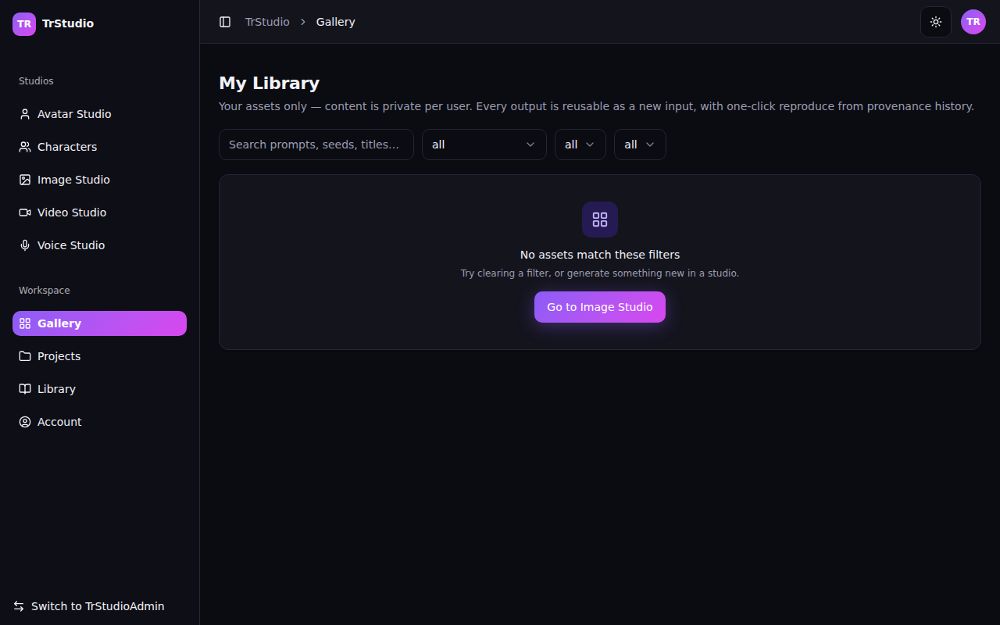

**Screen flowchart**
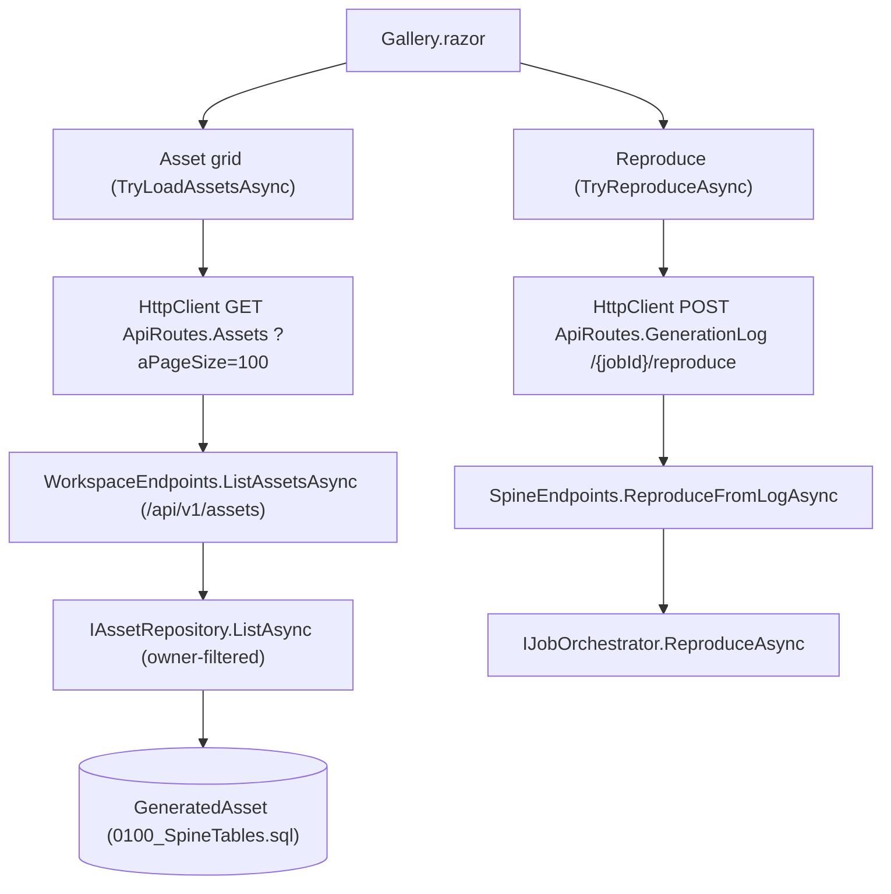

**Controls on this screen**
| Control | Type | Purpose | Populated / calculated by |
|---|---|---|---|
| Filter bar | `Input`/`Select`×3 | Search + type/model/project | `objSearch`,`objTypeFilter`,`ModelOptions`,`ProjectOptions` (`Gallery.razor:181-190`) |
| Asset cards | `Card` grid | Owner assets | `objAssets` from `/api/v1/assets` (`Gallery.razor:218-252`); `Filtered` (`Gallery.razor:190`) |
| Select + export bar | `Button`s | Bulk actions | `objSelected` set; count `Gallery.razor:56-74` |
| Detail sheet | `Sheet` | Full params + reproduce | `objDetail` (`Gallery.razor:128-157`) |
| Reproduce | `Button` | One-click reproduce | `ReproduceOne` → `TryReproduceAsync` (`Gallery.razor:306-339`) |

**Data lineage**
| Control / Action | Razor (file:line) | Client/Service method (file) | API endpoint (file) | Engine service → repository (file) | Table / SQL query | Render status | Notes |
|---|---|---|---|---|---|---|---|
| Load assets | `Gallery.razor:218-252` | `GetFromJsonAsync<PagedResult<AssetResponse>>($"{ApiRoutes.Assets}?aPageSize=100")` (`Gallery.razor:228`) | `WorkspaceEndpoints.ListAssetsAsync` `GET /api/v1/assets` (`WorkspaceEndpoints.cs:31,47`) | `IAssetRepository.ListAsync(filter, userId)` (`WorkspaceEndpoints.cs:74`) | `SELECT … FROM "GeneratedAsset" … WHERE "UserId"=@aUserId` (`AssetRepository.cs:99`; `0100_SpineTables.sql`) | renders (empty w/o session; representative seed only on authed+zero rows) | Owner-scoped (BRD-81) |
| Reproduce | `Gallery.razor:327-339` | `PostAsync($"{ApiRoutes.GenerationLog}/{jobId}/reproduce")` (`Gallery.razor:333`) | `SpineEndpoints.ReproduceFromLogAsync` `POST /api/v1/generation-log/{id}/reproduce` (`SpineEndpoints.cs:52,214`) | `IJobOrchestrator.ReproduceAsync` (`SpineEndpoints.cs:228`) | `"GenerationLog"`/`"GenerationJob"` (`0100_SpineTables.sql`) | renders (toast; best-effort) | Passes `aAsset.JobId` |
| Compare hand-off | `Gallery.razor:316-322` | `NavigateTo("/compare")` | — | — | — | renders | Selection carried via `/compare` |

**Business rules / calculations**
- `Matches` applies type/model/project + free-text search over title/model/seed/provenance (`Gallery.razor:254-282`).
- `SeedRepresentative` illustrates the empty state only when authenticated with zero rows (`Gallery.razor:341-355`).

**Known issues / gotchas**
- Query param `aPageSize` matches the endpoint's parameter name (`WorkspaceEndpoints.cs:56`) — correct.
- Bulk Export/Reproduce buttons on the export bar are toast-only (`Gallery.razor:313,324`); the single-asset Reproduce is the wired path. FN-067 bulk export endpoint exists (`Phase9Endpoints.cs:56`) but is not called from the bar.

---

### Creator · Projects
- **Route:** `/projects`
- **Razor file:** `src/TrStudioUI/Pages/Projects/Projects.razor`
- **Reached via:** Workspace → Projects (dev seam also lands here). **Log in as:** user 2 (creator@trstudio.test)
- **What this screen does:** Searchable project list + detail with a generation-history DataTable (All/Images/Video/Voice), per-row reproduce, and a run-parameters card.
- **Visual status:** ✅ VISUAL-OK (runtime-confirmed 2026-07-04)

**Screenshot**

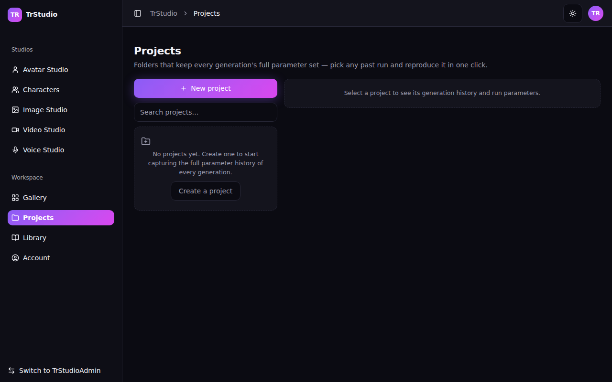

**Screen flowchart**
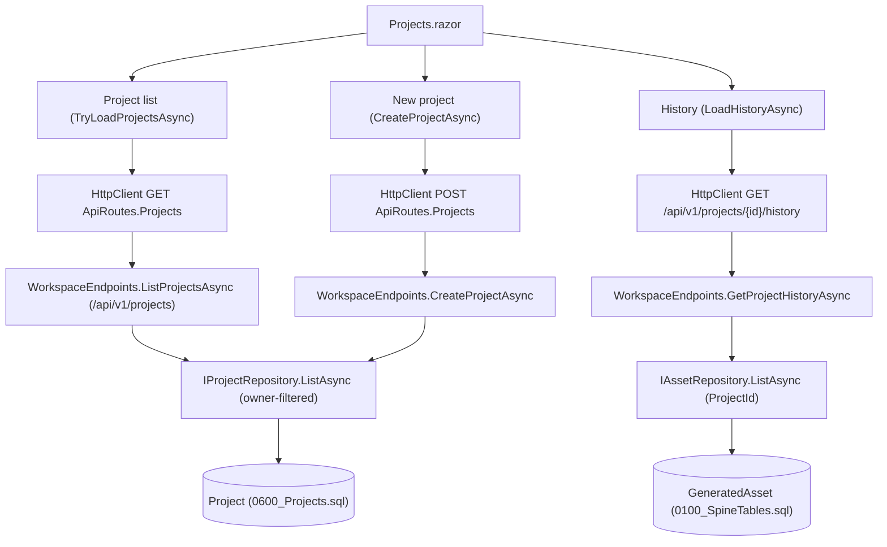

**Controls on this screen**
| Control | Type | Purpose | Populated / calculated by |
|---|---|---|---|
| Project list | `Card`s | Owner projects | `objProjects` (`Projects.razor:235-263`); `FilteredProjects` (`Projects.razor:188-191`) |
| New project | `Button` | Create | `CreateProjectAsync` (`Projects.razor:312-340`) |
| History DataTable | `DataTable` | Per-project runs | `objHistory` (`Projects.razor:279-310`); `FilteredHistory` by tab (`Projects.razor:194-200`) |
| Run parameters card | `kv` rows | Full stored params | `objRun` (selected history row) (`Projects.razor:136-166`) |
| Reproduce | `Button` | One-click reproduce | `ReproduceRowAsync` (`Projects.razor:370-384`) |
| Archive | `Button` | Delete project | `ArchiveProjectAsync` → `DELETE` (`Projects.razor:348-366`) |

**Data lineage**
| Control / Action | Razor (file:line) | Client/Service method (file) | API endpoint (file) | Engine service → repository (file) | Table / SQL query | Render status | Notes |
|---|---|---|---|---|---|---|---|
| List projects | `Projects.razor:235-263` | `GetFromJsonAsync<List<ProjectResponse>>(ApiRoutes.Projects)` | `WorkspaceEndpoints.ListProjectsAsync` `GET /api/v1/projects` (`WorkspaceEndpoints.cs:35,102`) | `IProjectRepository.ListAsync(userId)` (`WorkspaceEndpoints.cs:114`) | `SELECT … FROM "Project" WHERE "UserId"=@aUserId` (`ProjectRepository.cs:24`; `0600_Projects.sql`) | renders (seed on authed+zero rows) | Owner-scoped |
| Project history | `Projects.razor:279-310` | `GetFromJsonAsync<PagedResult<AssetResponse>>($"{ApiRoutes.Projects}/{id}/history")` | `WorkspaceEndpoints.GetProjectHistoryAsync` (`WorkspaceEndpoints.cs:40,223`) | `IAssetRepository.ListAsync(ProjectId filter)` (`WorkspaceEndpoints.cs:248`) | `SELECT … FROM "GeneratedAsset" …` (`AssetRepository.cs:99`) | renders (seed history when zero rows) | History = project's assets |
| Create project | `Projects.razor:312-340` | `PostAsJsonAsync(ApiRoutes.Projects, ProjectCreateRequest)` (`Projects.razor:319`) | `WorkspaceEndpoints.CreateProjectAsync` `POST /api/v1/projects` (`WorkspaceEndpoints.cs:36,118`) | `IProjectRepository.InsertAsync` (`WorkspaceEndpoints.cs:147`) | `INSERT … "Project"` (`ProjectRepository.cs:54`) | renders (optimistic add) | — |
| Archive | `Projects.razor:348-366` | `DeleteAsync($"{ApiRoutes.Projects}/{id}")` | `WorkspaceEndpoints.ArchiveProjectAsync` `DELETE` (`WorkspaceEndpoints.cs:39,201`) | `IProjectRepository.ArchiveAsync` (`WorkspaceEndpoints.cs:219`) | `UPDATE "Project" … IsArchived` (`ProjectRepository.cs:102`) | renders (toast) | — |
| Reproduce row | `Projects.razor:370-384` | `PostAsync($"{ApiRoutes.GenerationLog}/{jobId}/reproduce")` | `SpineEndpoints.ReproduceFromLogAsync` (`SpineEndpoints.cs:214`) | `IJobOrchestrator.ReproduceAsync` | `"GenerationLog"` | renders (toast; best-effort) | — |

**Business rules / calculations**
- History tab filter maps Images/Video/Voice → asset `Kind` image/video/audio (`Projects.razor:194-200`).
- `Rename` is a toast placeholder only (`Projects.razor:342-346`).

**Known issues / gotchas**
- `RenameProjectAsync` is a no-op toast ("Rename dialog would open here") — deliberate stub, `PUT /api/v1/projects/{id}` (`WorkspaceEndpoints.cs:38`) exists but is not called from Rename. REQ-UI-051.
- Reproduce/CopyParamsJson use client-side stored rows; `CopyParamsJson` is toast-only (`Projects.razor:386-387`).

---

### Creator · Compare
- **Route:** `/compare`
- **Razor file:** `src/TrStudioUI/Pages/Compare/Compare.razor`
- **Reached via:** Gallery "Compare" action (breadcrumb Gallery / Compare), carrying `?assetIds=`. **Log in as:** user 2 (creator@trstudio.test)
- **What this screen does:** Side-by-side A/B(/C) panes across models/seeds/providers with a highlighted parameter diff. Owner-filtered server-side.
- **Visual status:** ✅ VISUAL-OK (runtime-confirmed 2026-07-04)

**Screenshot**

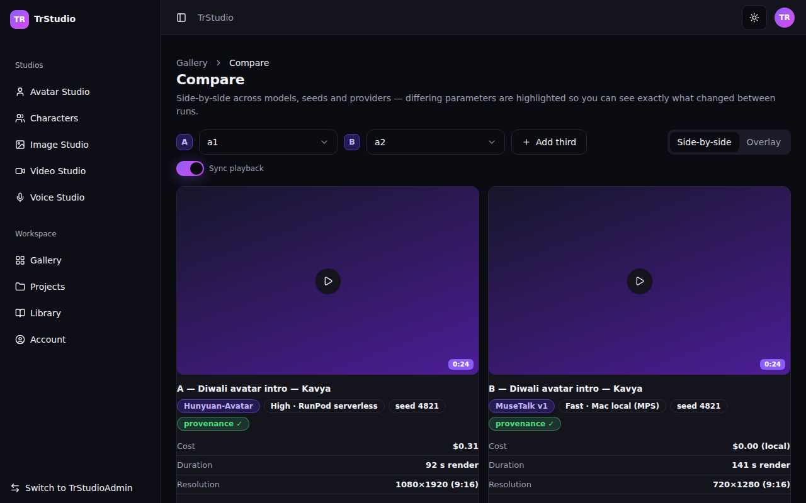

**Screen flowchart**
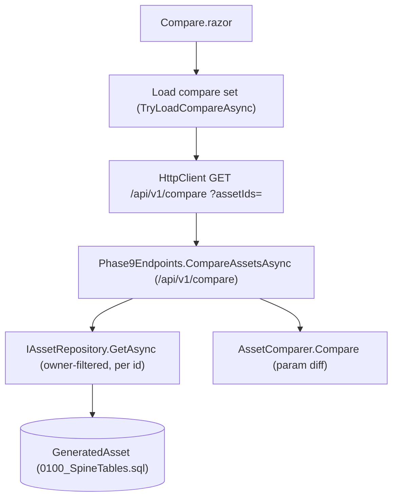

**Controls on this screen**
| Control | Type | Purpose | Populated / calculated by |
|---|---|---|---|
| Slot toolbar A/B/C | `Select`s/`Button` | Pick assets | `objSlots`, `AddThird` (`Compare.razor:47-67,292-303`) |
| View mode / sync | `Tabs`/`Switch` | Side/overlay + sync | `objViewMode`,`objSyncPlayback` |
| Result panes | `Card`s | Per-asset detail | `Panes` (`Compare.razor:183-187`) |
| Parameter diff table | `DataTable` | Highlight differences | `DiffRows`/`VisibleDiffRows`/`DiffCount` (`Compare.razor:196-203`) |

**Data lineage**
| Control / Action | Razor (file:line) | Client/Service method (file) | API endpoint (file) | Engine service → repository (file) | Table / SQL query | Render status | Notes |
|---|---|---|---|---|---|---|---|
| Load compare set | `Compare.razor:232-259` | `GetFromJsonAsync<List<CompareAsset>>($"{CompareRoute}?assetIds=…")` (`Compare.razor:242`) | `Phase9Endpoints.CompareAssetsAsync` `GET /api/v1/compare` (`Phase9Endpoints.cs:42,80`) | `IAssetRepository.GetAsync(id, userId)` per id + `AssetComparer.Compare` (`Phase9Endpoints.cs:102,114`) | `SELECT … FROM "GeneratedAsset" WHERE "GeneratedAssetId"=@aAssetId AND "UserId"=@aUserId` (`AssetRepository.cs:64`) | renders (seed always fills when session absent/empty) | Needs ≥2 owned assets else 400; page falls to seed |
| Reproduce/Export panes | `Compare.razor:305-309` | none (toast) | — | — | — | renders-empty (toast-only) | Pane reproduce/export are demo toasts |

**Business rules / calculations**
- Client `BuildDiff` compares model/provider·tier/resolution/cost/character/voice/script/seed/captions (`Compare.razor:312-323`); server also computes a diff via `AssetComparer` (`Phase9Endpoints.cs:114`).
- `DiffRow.Of` flags a row differing when the two values are unequal (`Compare.razor:374-375`).

**Known issues / gotchas**
- Endpoint lacks a declarative `.RequireAuthorization()` on the map (`Phase9Endpoints.cs:42`); auth is enforced in-handler via `ResolveUserId` → `Unauthorized` (`Phase9Endpoints.cs:86-90`), plus the app's fallback auth policy. Not a confirmed hole, but noted.
- Pane Reproduce/Export are toast-only (`Compare.razor:305-309`).

---

### Creator · Library
- **Route:** `/library`
- **Razor file:** `src/TrStudioUI/Pages/Library/Library.razor`
- **Reached via:** Workspace → Library. **Log in as:** user 2 (creator@trstudio.test)
- **What this screen does:** Reusable prompts/scripts/style/voice presets — search + type tabs, card grid with "Use in {Studio}", and a New/Edit Sheet. Owner-filtered server-side.
- **Visual status:** ✅ VISUAL-OK (runtime-confirmed 2026-07-04)

**Screenshot**

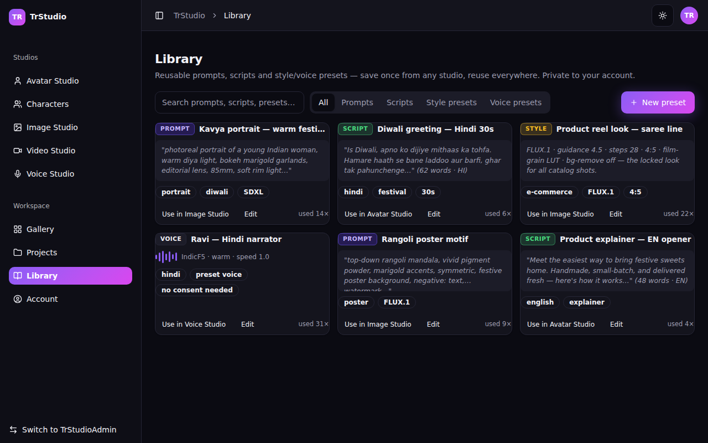

**Screen flowchart**
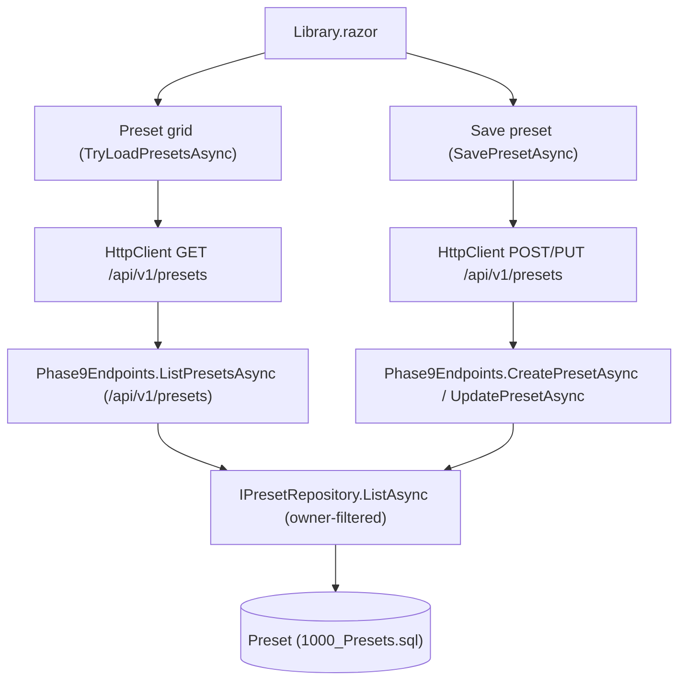

**Controls on this screen**
| Control | Type | Purpose | Populated / calculated by |
|---|---|---|---|
| Search + type tabs | `Input`/`Tabs` | Filter | `objSearch`,`objTypeTab` → `Filtered` (`Library.razor:179,231-248`) |
| Preset cards | `Card` grid | Presets | `objPresets` (`Library.razor:207-229`) |
| Use in {Studio} | `Button` | Route with preset | `UsePreset` → `/avatar`\|`/voice`\|`/image` (`Library.razor:251-255,343-356`) |
| New/Edit sheet | `Sheet` form | Create/edit | `objForm*` fields; `SavePresetAsync` (`Library.razor:267-308`) |

**Data lineage**
| Control / Action | Razor (file:line) | Client/Service method (file) | API endpoint (file) | Engine service → repository (file) | Table / SQL query | Render status | Notes |
|---|---|---|---|---|---|---|---|
| Load presets | `Library.razor:207-229` | `GetFromJsonAsync<List<PresetView>>("/api/v1/presets")` (`Library.razor:214`) | `Phase9Endpoints.ListPresetsAsync` `GET /api/v1/presets` (`Phase9Endpoints.cs:46,119`) | `IPresetRepository.ListAsync(userId, type)` (`Phase9Endpoints.cs:131`) | `SELECT … FROM "Preset" WHERE "UserId"=@aUserId` (`PresetRepository.cs:31`; `1000_Presets.sql`) | renders (seed when no session/empty) | Owner-scoped |
| Save preset | `Library.razor:267-308` | `PostAsJsonAsync`/`PutAsJsonAsync("/api/v1/presets"[/{id}])` (`Library.razor:284,288`) | `Phase9Endpoints.CreatePresetAsync`/`UpdatePresetAsync` (`Phase9Endpoints.cs:47,49`) | `IPresetRepository.InsertAsync`/`UpdateAsync` (`Phase9Endpoints.cs:172,221`) | `INSERT`/`UPDATE "Preset"` (`PresetRepository.cs:61,96`) | renders (optimistic upsert) | — |

**Business rules / calculations**
- `StudioName`/`StudioRoute` map preset type → target studio: script→Avatar, voice→Voice, else Image (`Library.razor:343-356`).
- Note the client `PresetView` type values are `prompt/script/style/voice`, while the server validates `prompt/script/style-preset/voice-preset` (`Phase9Endpoints.cs:26`) — see gotcha.

**Known issues / gotchas**
- **Preset-type vocabulary mismatch:** the Library form/tabs use `style`/`voice` but the API's `PresetTypes` requires `style-preset`/`voice-preset` (`Phase9Endpoints.cs:26,152-155`). A create/update of a style or voice preset would 400 server-side; swallowed by the client's try/catch so the card still saves locally. `prompt`/`script` match and persist. Confirmed contract mismatch. REQ-UI-053 / FN-066.

---

### Creator · Account & spend
- **Route:** `/account`
- **Razor file:** `src/TrStudioUI/Pages/Account/Account.razor`
- **Reached via:** Workspace → Account. **Log in as:** user 2 (creator@trstudio.test)
- **What this screen does:** Read-only AppManager profile + license/tier, three spend KPI cards vs monthly cap, and a recent-jobs DataTable. Owner-scoped server-side.
- **Visual status:** ✅ VISUAL-OK (runtime-confirmed 2026-07-04)

**Screenshot**

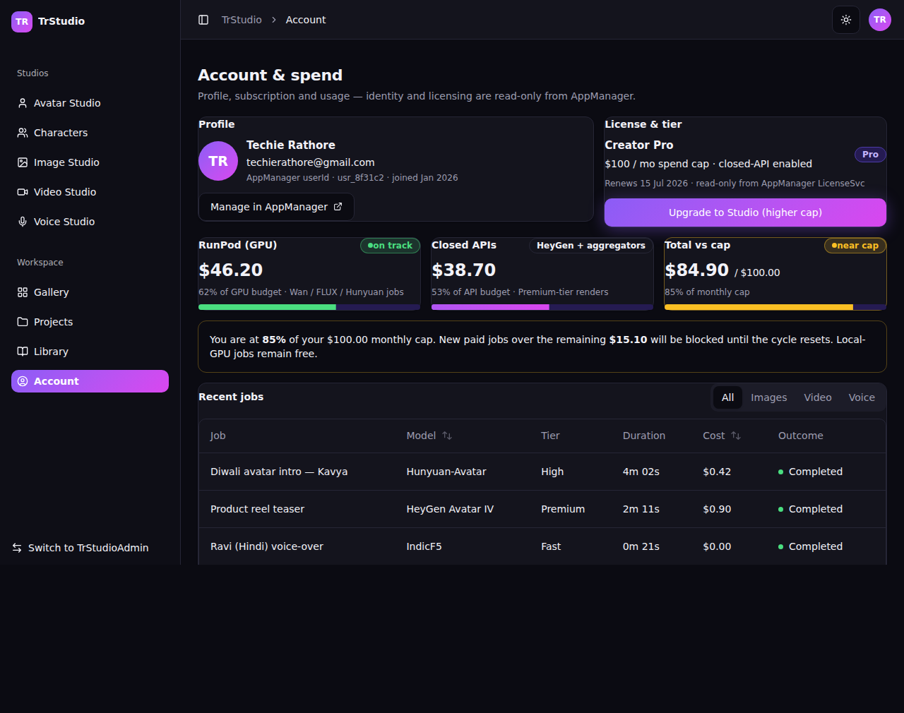

**Screen flowchart**
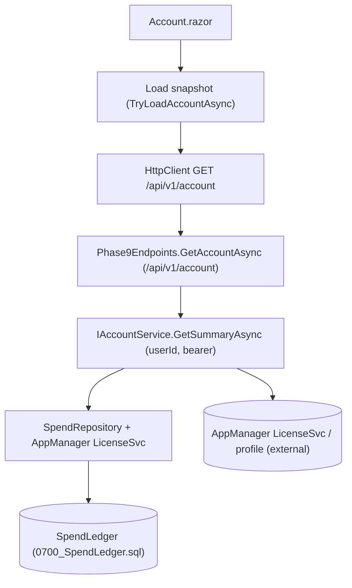

**Controls on this screen**
| Control | Type | Purpose | Populated / calculated by |
|---|---|---|---|
| Profile card | `Card` | AppManager identity | `objProfile` (`Account.razor:311-334`) |
| License/tier card | `Card` | License + upgrade CTA | `objLicense`; degrades to "unavailable" (`Account.razor:336-355`) |
| Spend KPI cards ×3 | `Card`+`Progress` | RunPod/Closed-API/total-vs-cap | `objSpend`; `Pct`/`PctValue` (`Account.razor:288-292`) |
| Cap alert | `Alert` | Near/over cap | `objSpend.NearCap`/`OverCap` (`Account.razor:147-164`) |
| Recent jobs table | `DataTable` | Billed jobs | `objJobs`; `FilteredJobs` by tab (`Account.razor:214-220`) |

**Data lineage**
| Control / Action | Razor (file:line) | Client/Service method (file) | API endpoint (file) | Engine service → repository (file) | Table / SQL query | Render status | Notes |
|---|---|---|---|---|---|---|---|
| Load account snapshot | `Account.razor:249-277` | `GetFromJsonAsync<AccountResponse>("/api/v1/account")` (`Account.razor:256`) | `Phase9Endpoints.GetAccountAsync` `GET /api/v1/account` (`Phase9Endpoints.cs:60,306`) | `IAccountService.GetSummaryAsync(userId, bearer)` (`Phase9Endpoints.cs:319`) | Spend from `"SpendLedger"` (`0700_SpendLedger.sql`); license/profile from external AppManager LicenseSvc | renders (seed when no session/empty jobs) | DTOs are intentionally loose — unmatched shapes → seed (`Account.razor:390-397`) |
| Manage/Upgrade | `Account.razor:279-283` | none (toast) | — | — (AppManager is the system of record) | — | renders-empty (toast-only) | Identity/licensing live in AppManager |

**Business rules / calculations**
- `Pct`/`PctValue` compute percentage-of-cap for the progress bars (`Account.razor:288-292`).
- GPU/API budgets derived as 75% of the monthly cap in `SpendView.FromResponse` (`Account.razor:373-374`).
- License unavailable → warning card with limited-features message (`Account.razor:59-67,344-349`).

**Known issues / gotchas**
- Manage-in-AppManager and Upgrade are toast-only by design — AppManager is the external system of record for identity/licensing. Not a defect.
- Account endpoint has no declarative `.RequireAuthorization()` on the map (`Phase9Endpoints.cs:60`); enforced in-handler + fallback policy.

---

## DEFECTS FOUND

1. **Voice Studio — preset-voice list route mismatch.** Client calls `GET /api/v1/voice/presets`; server route is `/api/v1/voice/preset-voices`. Always 404 (swallowed) → the studio only ever shows seed voices. `VoiceStudio.razor:360` vs `VoiceEndpoints.cs:27`. Owning REQ: **REQ-UI-030 / REQ-FN-031**. (Secondary: returned DTO shape also differs — `Id/Name` vs `VoiceId/DisplayName`.)
2. **Voice Studio — synthesize route mismatch.** Client posts `POST /api/v1/voice` (group root); synthesize endpoint is `/api/v1/voice/synthesize`. Always 404 (swallowed) → no live TTS. `VoiceStudio.razor:452` vs `VoiceEndpoints.cs:28`. Owning REQ: **REQ-UI-030 / REQ-FN-033**.
3. **Avatar Studio — voice-preview route mismatch.** `GenerateVoiceAsync` posts `POST /api/v1/voice` (root); no route there (synth is `/synthesize`). Always 404 (swallowed). `AvatarStudio.razor:425` vs `VoiceEndpoints.cs:28`. Owning REQ: **REQ-UI-010 / REQ-FN-031**.
4. **Avatar Studio — script-assist route does not exist.** `ScriptAssistAsync` posts `POST /api/v1/rag/script-assist`; RAG only maps `script`/`captions`/`usage`. Always 404 (swallowed). `AvatarStudio.razor:441` vs `RagEndpoints.cs:25-27`. Owning REQ: **REQ-UI-010 / RAG-001**.
5. **Video Studio — timeline-edit route mismatch (wrong prefix).** `EditAsync` posts `POST /api/v1/avatar/edit`; the edit endpoint is `/api/v1/video/edit` (Avatar group has no `/edit`). Always 404 (swallowed) → toolbar edits never reach the server. `VideoStudio.razor:535` vs `VideoEndpoints.cs:29` / `AvatarEndpoints.cs:26-28`. Owning REQ: **REQ-UI-040 / REQ-FN-053**.
6. **Library — preset-type vocabulary mismatch.** Form/tabs emit `style`/`voice`; API `PresetTypes` requires `style-preset`/`voice-preset`, so creating/updating a style or voice preset 400s server-side (swallowed; card still saves locally). `prompt`/`script` are unaffected. `Library.razor:126-127,343-356` vs `Phase9Endpoints.cs:26,152-155`. Owning REQ: **REQ-UI-053 / FN-066**.

Non-defect notes (not logged): Character-bible Sheet renders static copy and never calls `GET /api/v1/characters/{id}/bible` (feature not wired, not a broken route); Projects "Rename", Compare/Gallery-bar bulk actions, and Account Manage/Upgrade are intentional toast stubs; Compare/Presets/Account/Assets/Projects/Jobs endpoints rely on in-handler `ResolveUserId` + the app's fallback auth policy rather than a declarative `.RequireAuthorization()` — auth is still enforced.
