> ✅ **Runtime-verified 2026-07-05** — exercised as Operator/Owner via `/dev/session` (unified role-based app; management surface role-gated). Post-consolidation (BRD-86 / ADR-012 supersedes ADR-001): the two apps are now ONE `TrStudio` app and the 7 management screens moved from the retired `TrStudioAdmin` project into `src/TrStudioUI/Pages/Admin/` — their `/admin/*` routes and API client calls are unchanged; only the Razor file path and the access model changed (now role-gated within the one app, not a separate binary). Fresh per-role live smoke (`.smoke/results.json`, `.smoke/shots/`) confirms: Operator lands on `/admin/ops`, `hasMgmtNav` true, all 7 screens render their correct `h1` with none denied, and admin API calls return 200; a Creator reaching `/admin/*` is bounced to `AccessDenied` (client) and the API returns 403 (server). Screenshots below are the 2026-07-05 Operator shots (`docs/screenshots/TrStudio/operator-*.png`).

## §1 pointer

Management-surface screens of the **one unified `TrStudio` app** (role-gated to Operator/Owner; formerly the separate `TrStudioAdmin` app, now retired). Index: [TrStudio-DevGuide.md](./TrStudio-DevGuide.md).

## Operator — the management surface of one app (role-gated)

Post-consolidation (BRD-86, ADR-012 supersedes ADR-001) there is **one `TrStudio` app** with two navigation surfaces — the *creator studios* and the *management surface* — and `AppShellNavigation` picks the active one from the signed-in user's role (`src/TrStudioUI/Navigation/AppShellNavigation.cs:19-60`). The 7 management screens live under the role-gated `/admin/*` routes and their Razor files now sit in `src/TrStudioUI/Pages/Admin/` (the `TrStudioAdmin` project is deleted). Access is **Operator or Owner only** (`CanAccessManagement => Role is UserRole.Owner or UserRole.Operator`, `AppShellNavigation.cs:53`); a Creator is bounced in-app to `src/TrStudioUI/Layout/AccessDenied.razor`.

The management sidebar is built by `TrStudioNavSets.CreateManagementNavigation(...)` (`src/TrStudioUI/Navigation/TrStudioNavSets.cs:49-72`) and selected by role in the shared shell (`MainLayout.razor` → `AppShellNavigation`, no separate admin host). Three groups:

| Group | Sidebar item | Route | Razor file | Cite |
|---|---|---|---|---|
| Environment | Hardware & Setup | `/admin/setup/hardware` (+ active alias `/admin/setup`) | `src/TrStudioUI/Pages/Admin/AdminHardware.razor` | `TrStudioNavSets.cs:55` |
| Environment | RunPod & Ops | `/admin/ops` | `src/TrStudioUI/Pages/Admin/AdminOps.razor` | `TrStudioNavSets.cs:56` |
| Models | Model Sources | `/admin/sources` | `src/TrStudioUI/Pages/Admin/AdminSources.razor` | `TrStudioNavSets.cs:60` |
| Models | Model Library | `/admin/models` | `src/TrStudioUI/Pages/Admin/AdminModels.razor` | `TrStudioNavSets.cs:61` |
| Models | Registry & Providers | `/admin/registry` | `src/TrStudioUI/Pages/Admin/AdminRegistry.razor` | `TrStudioNavSets.cs:62` |
| Models | ComfyUI Import | `/admin/comfy/import` (+ second `@page /admin/comfy/debug`) | `src/TrStudioUI/Pages/Admin/AdminComfy.razor` | `TrStudioNavSets.cs:63` |
| Governance | Content Policy | `/admin/policy` | `src/TrStudioUI/Pages/Admin/AdminPolicy.razor` | `TrStudioNavSets.cs:67` |

Owner (the only role with both surfaces) gets an in-app **"Switch to Management" / "Switch to Creator studio"** control (`AppShellNavigation.SwitchSurface`, `:69-70,112-121`; sidebar button `AppSidebar.razor:88`) instead of a cross-app link.

**Landing-truth (re-read from routing code — CORRECTED).** In the unified app the Operator **does land on `/admin/ops`** — the old "not code-backed" note is now stale. `AppShellNavigation.ResolveDefaultSurface` selects the Management surface for an Operator (`Role == UserRole.Operator ? AppSurface.Management : AppSurface.Creator`, `AppShellNavigation.cs:98-106`), and the management surface's default landing route is `/admin/ops` (`TrStudioNavSets.ManagementLandingPath = "/admin/ops"`, `TrStudioNavSets.cs:14`; surfaced via `AppShellNavigation.CurrentLandingPath`, `:62-66`). The post-login redirect itself resolves the same way: `Login.razor:165` returns `aSession.Role == UserRole.Operator ? "/admin/ops" : "/avatar"` (dev seam identical, `DevSession.razor:117-118`). The Phase-1 live smoke confirms it: `results.json` shows Operator `landUrl: http://…/admin/ops`. So the corrected statement is: **an Operator signing into the unified app lands on the Ops dashboard `/admin/ops`** (Owner lands on `/avatar` and switches into management in-app; `results.json` Owner `landUrl: /avatar`, `afterUrl: /admin/ops`).

**Authorization posture (read from code) — now a two-layer gate.** The management screens are gated **both client-side (new) and server-side (unchanged)**:
- **Client (in-app bounce, REQ-FN-072):** `MainLayout` evaluates `AppShellNavigation.IsRouteAllowed(path)` on every navigation (`MainLayout.razor:133-136`); for an `/admin/*` route it denies unless the resolved role is management-entitled (`AppShellNavigation.cs:131-141`, `IsManagementPath` `:146-157`) and renders `AccessDenied.razor` in place of the page (`MainLayout.razor:43-45`) so the page component never mounts and its admin API call is never issued. A Creator sees "The management surface is available to Operator and Owner accounts only." (`AccessDenied.razor:14-17`).
- **Server (API authority, unchanged):** every admin endpoint is guarded by `SpineModule.AdminOnlyPolicy` (`= "AdminOnly"`, `src/TrStudio.Engine/DependencyInjection/SpineModule.cs:31`), which requires a `role` claim of **Owner or Operator** (`SpineModule.cs:67-70`); a Creator's call gets 403. Smoke `results.json` confirms both layers: Creator `deniedVisible: true` + `creatorAdminApiStatus: 403`; Operator `operatorAdminApiStatus: 200`, all 7 screens `denied: false`.

Each page still hydrates its bearer token via `IAuthSession` in `OnAfterRenderAsync` and falls back to an empty/representative state when unauthenticated. This gating applies to all 7 screens below (Content Policy's write is additionally owner-intent-gated in the UI). Per-screen authorization notes below list each screen's admin endpoints; those API guards are UNCHANGED by the consolidation.

## Screen-by-screen code map

---

### Operator · Hardware & Setup (Hardware & readiness + Guided setup wizard)
- **Route:** `/admin/setup/hardware` and `/admin/setup` (one component, two `@page` directives — `AdminHardware.razor:1-2`)
- **Razor file:** `src/TrStudioUI/Pages/Admin/AdminHardware.razor`
- **Reached via:** Environment → Hardware & Setup; **Log in as:** Operator (or Owner via surface-switch) — a Creator is bounced to `AccessDenied` (client) and the API 403s (server)
- **What this screen does:** Shows live host readiness cards (GPU / unified memory / MPS-CoreML / disk) from the authenticated capability report, plus a static guided-setup stepper (ONNX, MuseTalk, isolated Python + ComfyUI, network volume) and a low-disk alert linking to the Model Library.
- **Authorization:** client `/admin/*` gate (Operator/Owner only, else `AccessDenied.razor`); server capability data via `ApiRoutes.Capabilities` group `.RequireAuthorization(SpineModule.AdminOnlyPolicy)` (`SetupEndpoints.cs:33-35`) — policy UNCHANGED by the consolidation
- **Visual status:** ✅ VISUAL-OK (runtime-confirmed 2026-07-05 as Operator, unified role-gated app; desktop)

**Screenshot**

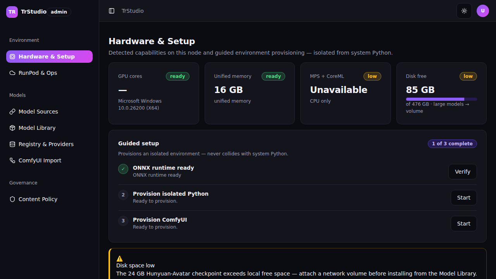

**Screen flowchart**
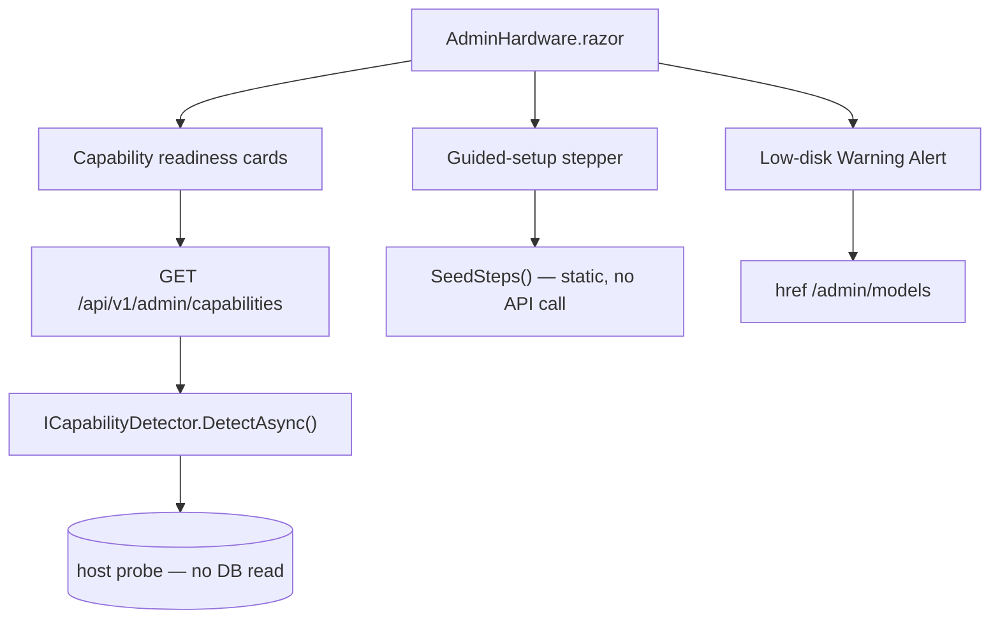

**Controls on this screen**
| Control | Type | Purpose | Populated / calculated by |
|---|---|---|---|
| Capability cards (×4) | Card + Badge + Progress | GPU / unified memory / MPS-CoreML / disk readiness | live `HostCapabilityReport` → `ApplyReport()` |
| Capabilities-unavailable note | Card | Shown when no session / endpoint unreachable (no sample hardware) | `objCapabilityCards.Count == 0` guard |
| Guided-setup stepper | Steps + Progress + Button | ONNX / MuseTalk / Python+ComfyUI / volume | `SeedSteps()` static seed |
| "N of M complete" badge | Badge | Step completion count | `objCompletedSteps` computed getter |
| Low-disk alert | Alert | Links to Model Library | static markup |

**Data lineage**
| Control / Action | Razor (file:line) | Client/Service method (file) | API endpoint (file) | Engine service → repository (file) | Table / SQL query | Render status | Notes |
|---|---|---|---|---|---|---|---|
| Capability cards | `AdminHardware.razor:44-62` | `HttpClientFactory("TrStudioApi").GetAsync(ApiRoutes.Capabilities)` (`:178-189`) | `GET /api/v1/admin/capabilities` → `GetCapabilitiesAsync` (`SetupEndpoints.cs:36,67`) | `ICapabilityDetector.DetectAsync` (`Infrastructure/Capability/`) | host probe — **no DB read** | renders (auth-gated; else "unavailable" note) | cards seed empty; hydrate after first render only with a session |
| Guided-setup stepper | `AdminHardware.razor:91-113` | none — `SeedSteps()` (`:216-225`) | — | — | — | renders (static) | `RunStepAsync` (`:228`) is toast-only; real run "wires to /installs" per comment |
| Low-disk alert | `AdminHardware.razor:117-126` | — | — | — | — | renders (static) | link → `/admin/models` |

**Business rules / calculations**
- Cards hydrate only in `OnAfterRenderAsync` after `AuthSession.EnsureLoadedAsync()` — never during prerender — so an anonymous 401 never flashes a sample Mac profile (`:151-196`).
- Disk-used % and low-disk flag: `vLowDisk = FreeDiskGb < TotalDiskGb * 0.25` (`:201-204`).
- `objCompletedSteps` counts steps whose `DotClass == "done"` (`:134`).

**Known issues / gotchas**
- Guided-setup stepper is static scaffolding; `RunStepAsync` only toasts — it does not call the real setup endpoints (`ApiRoutes.Setup` `run`/`poll` exist at `SetupEndpoints.cs:42-44` but the page does not invoke them). Not a defect (comment marks it as pending wiring), but the step "Start/Logs/Verify" buttons do not drive `POST /api/v1/admin/setup/steps/{key}/run`.
- Capability cards require a live host + admin session; on WSL/CI they render the "unavailable" note by design.

---

### Operator · Model Sources
- **Route:** `/admin/sources`
- **Razor file:** `src/TrStudioUI/Pages/Admin/AdminSources.razor`
- **Reached via:** Models → Model Sources; **Log in as:** Operator (or Owner via surface-switch) — Creator bounced to `AccessDenied` (client) + API 403 (server)
- **What this screen does:** Lists configured open-model sources (name, type, base URL, status, enabled Switch), with header search and an add/edit Sheet (name, type, base URL, write-only token, enabled) plus a Test-connection probe. An info Alert separates open-file Sources from closed generation Providers.
- **Authorization:** client `/admin/*` gate (Operator/Owner only); server `ApiRoutes.Sources` groups `.RequireAuthorization(SpineModule.AdminOnlyPolicy)` (list at `SetupEndpoints.cs:55-57`; CRUD + test at `Phase3Endpoints.cs:33-40`) — policy UNCHANGED
- **Visual status:** ✅ VISUAL-OK (runtime-confirmed 2026-07-05 as Operator, unified role-gated app; desktop)

**Screenshot**

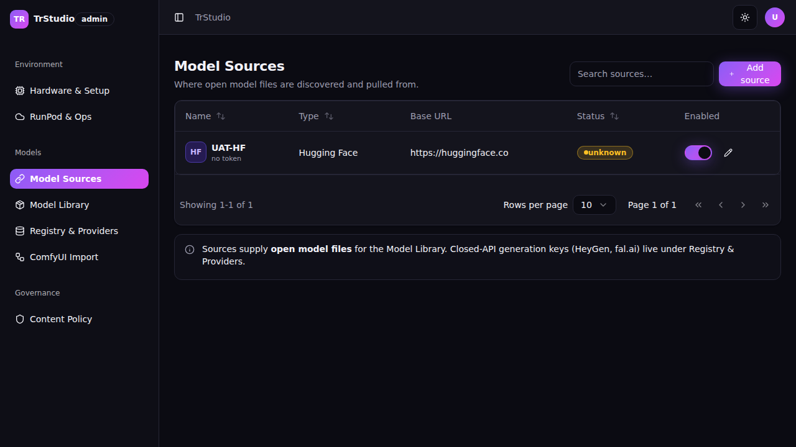

**Screen flowchart**
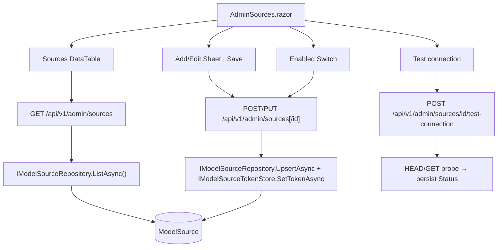

**Controls on this screen**
| Control | Type | Purpose | Populated / calculated by |
|---|---|---|---|
| Sources table | DataTable | name/type/base-URL/status/enabled | live `List<ModelSource>` → `MapRow` |
| Header search | Input | filter by name or base URL | `FilteredSources` getter |
| Add/Edit Sheet | Sheet + Fields | upsert a source | `SaveSourceAsync` |
| API token field | Password Input | write-only token | never read back (`HasToken` only) |
| Test connection | Button | reachability → ok Badge / fail Alert | `TestConnectionAsync` |
| Enabled Switch | Switch | flip source on/off | `ToggleEnabledAsync` (PUT) |

**Data lineage**
| Control / Action | Razor (file:line) | Client/Service method (file) | API endpoint (file) | Engine service → repository (file) | Table / SQL query | Render status | Notes |
|---|---|---|---|---|---|---|---|
| Sources table | `AdminSources.razor:54-93` | `GetAsync(ApiRoutes.Sources)` (`:245`) | `GET /api/v1/admin/sources` → `ListSourcesAsync` (`SetupEndpoints.cs:58,253`) | `IModelSourceRepository.ListAsync` (`Infrastructure/ModelSources/ModelSourceRepository.cs`) | `FROM "ModelSource"` | renders | tokens never listed; representative sample only on authed zero-row (`:474`) |
| Save (add/edit) | `AdminSources.razor:287-322` | `PostAsJsonAsync`/`PutAsJsonAsync(ApiRoutes.Sources[/id])` (`:302-304`) | `POST/PUT /api/v1/admin/sources[/{id}]` → `CreateSourceAsync`/`UpdateSourceAsync` (`Phase3Endpoints.cs:37-38,76,112`) | `UpsertAsync` + `IModelSourceTokenStore.SetTokenAsync` | `INTO "ModelSource"` | renders (wired) | optimistic local fallback if endpoint unreachable |
| Enabled toggle | `AdminSources.razor:325-349` | `PutAsJsonAsync(.../{id})` (`:341`) | `PUT /api/v1/admin/sources/{id}` (`Phase3Endpoints.cs:38`) | `UpsertAsync` | `"ModelSource"` | renders (wired) | optimistic flip on failure |
| Test connection | `AdminSources.razor:352-382` | `PostAsync(.../{id}/test-connection)` (`:366`) | `POST /api/v1/admin/sources/{id}/test-connection` → `TestSourceConnectionAsync` (`Phase3Endpoints.cs:40,170`) | HEAD/GET probe, persists `Status` | `"ModelSource"` | renders (wired) | "save the source first" guard when unsaved (`:356`) |

**Business rules / calculations**
- Status tone/label derived by `ResolveStatus` (disabled/connected/unauthorized/unreachable/pending) (`:446-461`).
- API token is write-only: `ApiToken = null` on toggle so a flip never resends a token (`:334`); a stored token renders only as `token: ••••••••••` (`:426`).

**Known issues / gotchas**
- All CRUD + test verbs ARE wired server-side (`Phase3Endpoints`), so this screen is fully live with an admin session; the razor's "while the write endpoint is wiring" comments are stale but harmless.

---

### Operator · Model Library
- **Route:** `/admin/models`
- **Razor file:** `src/TrStudioUI/Pages/Admin/AdminModels.razor`
- **Reached via:** Models → Model Library; **Log in as:** Operator (or Owner via surface-switch) — Creator bounced to `AccessDenied` (client) + API 403 (server)
- **What this screen does:** Browses installable open models (search + task Tabs + source Select) over a paged table, with one-click Install, a live resumable install queue (Progress + Pause/Resume/Cancel), a destination card and over-disk/registry hand-off Alerts. Browses ENABLED sources only.
- **Authorization:** client `/admin/*` gate (Operator/Owner only); server enabled-source list via `ApiRoutes.Sources` (admin, `SetupEndpoints.cs:55`); install queue via `ApiRoutes.Installs` group `.RequireAuthorization(SpineModule.AdminOnlyPolicy)` (`SetupEndpoints.cs:47-49`) — policy UNCHANGED
- **Visual status:** ✅ VISUAL-OK (runtime-confirmed 2026-07-05 as Operator, unified role-gated app; desktop)

**Screenshot**

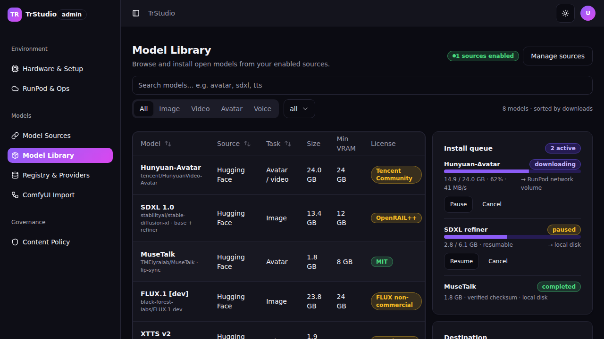

**Screen flowchart**
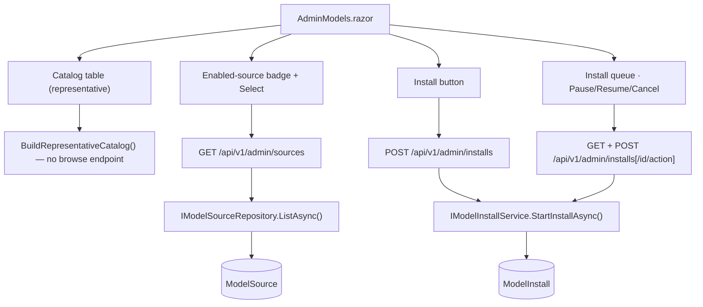

**Controls on this screen**
| Control | Type | Purpose | Populated / calculated by |
|---|---|---|---|
| Catalog table | DataTable + custom pager | name/source/task/size/VRAM/license/action | `BuildRepresentativeCatalog()` (no live browse endpoint) |
| Search / task Tabs / source Select | Input/Tabs/Select | filter catalog | `FilteredCatalog` getter |
| Install button | Button | queue a resumable install | `InstallAsync` (POST installs) |
| Install queue | Card + Progress | live download progress + controls | live `List<ModelInstallItem>` → `MapQueue` |
| Pause/Resume/Cancel | Button | control an install | `ControlInstallAsync` |
| Destination + over-disk alert | Card + Alert | disk/volume guidance | static markup |

**Data lineage**
| Control / Action | Razor (file:line) | Client/Service method (file) | API endpoint (file) | Engine service → repository (file) | Table / SQL query | Render status | Notes |
|---|---|---|---|---|---|---|---|
| Catalog rows | `AdminModels.razor:84-142` | `BuildRepresentativeCatalog()` (`:290,486`) | — (no source-browse endpoint) | — | — | renders-representative (no live catalog source) | comment confirms "browsable catalog is representative" (`:276-281`) |
| Enabled-source list/badge | `AdminModels.razor:26-27,71-74` | `GetAsync(ApiRoutes.Sources)` (`:317`) | `GET /api/v1/admin/sources` (`SetupEndpoints.cs:58`) | `IModelSourceRepository.ListAsync` | `FROM "ModelSource"` | renders | zero enabled → no-sources empty state (`:324,33`) |
| Install | `AdminModels.razor:105,368-415` | `PostAsJsonAsync(ApiRoutes.Installs)` (`:380`) | `POST /api/v1/admin/installs` → `StartInstallAsync` (`SetupEndpoints.cs:51,164`) | `IModelInstallService.StartInstallAsync` (`Domain/Install/`) → `ModelInstallRepository` | `INTO "ModelInstall"` | renders (wired) | optimistic queue entry on failure |
| Install queue | `AdminModels.razor:145-194,340-347` | `GetAsync(ApiRoutes.Installs)` (`:340`) | `GET /api/v1/admin/installs` → `ListInstallsAsync` (`SetupEndpoints.cs:50,152`) | `IModelInstallService.ListAsync` → `ModelInstallRepository` | `FROM "ModelInstall"` | renders (live-or-representative) | representative queue kept if endpoint unreachable |
| Pause/Resume/Cancel | `AdminModels.razor:180-188,418-448` | `PostAsync(.../{id}/{action})` (`:423`) | `POST /api/v1/admin/installs/{id}/{action}` → `ControlInstallAsync` (`SetupEndpoints.cs:52,200`) | `Pause/Resume/CancelAsync` → `ModelInstallRepository` | `UPDATE "ModelInstall"` | renders (wired) | optimistic state change on failure |

**Business rules / calculations**
- `Reference` for install parsed from the subtitle's first token (`:521`); page size 8, client-side pagination (`:244,256-258`).
- Install destination heuristic: models > 10 GB → RunPod network volume (destination card copy, `:196-206`).

**Known issues / gotchas**
- No live source-browse endpoint exists; the catalog table is always a representative sample. Install / queue / controls are live against `ModelInstall`. Not a defect (feature gap by design comment).

---

### Operator · Registry & Providers
- **Route:** `/admin/registry`
- **Razor file:** `src/TrStudioUI/Pages/Admin/AdminRegistry.razor`
- **Reached via:** Models → Registry & Providers; **Log in as:** Operator (or Owner via surface-switch) — Creator bounced to `AccessDenied` (client) + API 403 (server)
- **What this screen does:** A filter/sortable registry DataTable (id, name, task, provider, tier, license, safety), an add/edit Sheet with the **declarative params-schema editor** (key/type/required/default rows with bool-default validation), and a Provider-keys panel of **masked, write-only** Password inputs with an enabled Switch.
- **Authorization:** client `/admin/*` gate (Operator/Owner only); server `ApiRoutes.Registry` and `ApiRoutes.Providers` groups `.RequireAuthorization(SpineModule.AdminOnlyPolicy)` (`RegistryEndpoints.cs:34-35,47-49`) — policy UNCHANGED
- **Visual status:** ✅ VISUAL-OK (runtime-confirmed 2026-07-05 as Operator, unified role-gated app; desktop)

**Screenshot**

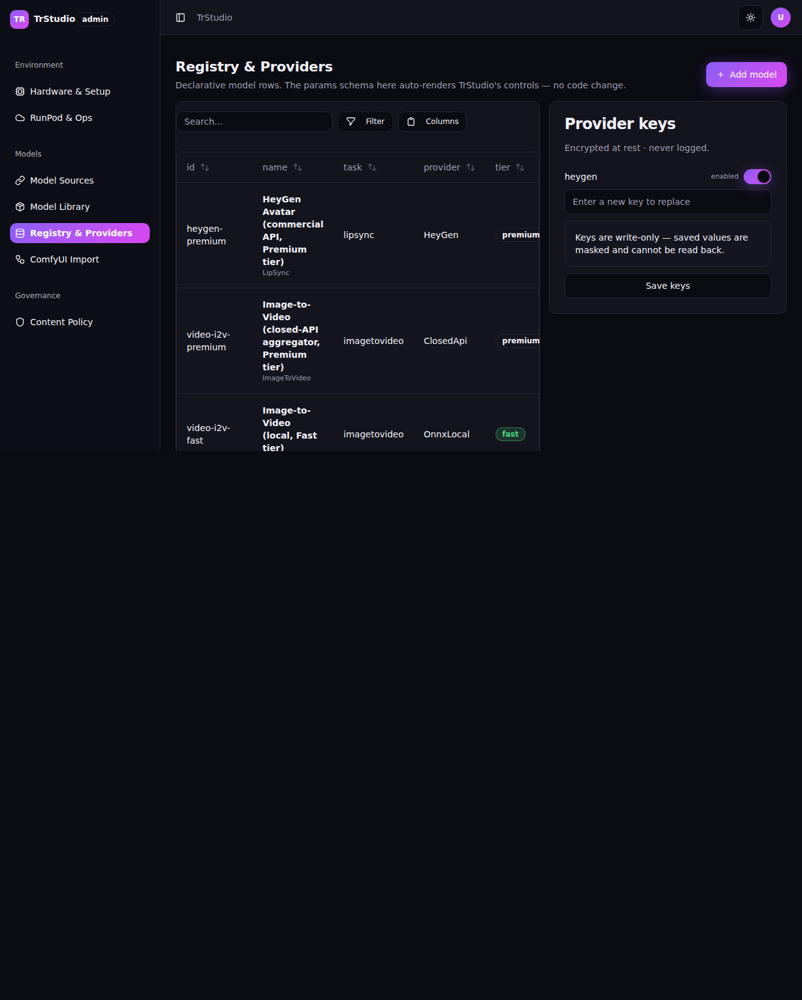

**Screen flowchart**
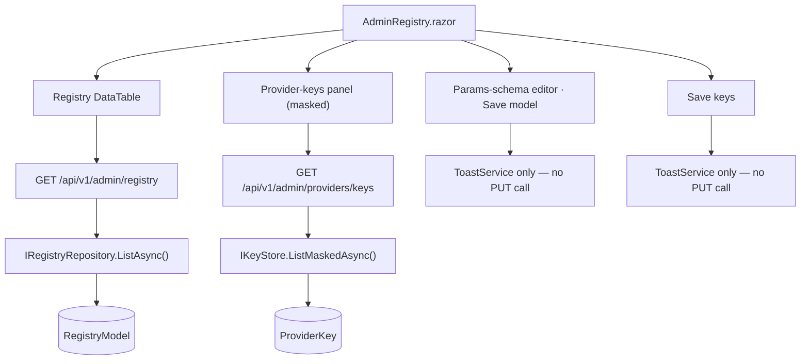

**Controls on this screen**
| Control | Type | Purpose | Populated / calculated by |
|---|---|---|---|
| Registry table | DataTable (filter/sort) | model rows w/ tier + safety badges | live `List<RegistryModel>` → `MapRow` |
| Add/Edit model Sheet | Sheet | edit display name / task / tier | `OpenAddSheet` / `OpenEditSheet` |
| Params-schema editor | key/type/req/default grid | declarative param rows | `objParams` + `AddParamRow`/`RemoveParamRow` |
| Schema validation | inline error | bool params need a default | `objSchemaError` computed getter |
| Provider keys | masked Password + Switch | write-only key + enabled | live `List<ProviderKeyInfo>` → `ProviderKeyRow` |
| Save model / Save keys | Button | persist | `SaveModelAsync` / `SaveKeysAsync` — **toast only** |

**Data lineage**
| Control / Action | Razor (file:line) | Client/Service method (file) | API endpoint (file) | Engine service → repository (file) | Table / SQL query | Render status | Notes |
|---|---|---|---|---|---|---|---|
| Registry table | `AdminRegistry.razor:34-63` | `GetAsync(ApiRoutes.Registry)` (`:256`) | `GET /api/v1/admin/registry` → `ListRegistryAsync` (`RegistryEndpoints.cs:38,68`) | `IRegistryRepository.ListAsync` (`Infrastructure/Data/RegistryRepository.cs`) | `FROM "RegistryModel"` | renders | representative sample only on authed zero-row (`:300`) |
| Provider keys | `AdminRegistry.razor:72-93` | `GetAsync(ApiRoutes.Providers + "/keys")` (`:263`) | `GET /api/v1/admin/providers/keys` → `ListProviderKeysAsync` (`RegistryEndpoints.cs:51,129`) | `IKeyStore.ListMaskedAsync` → `ProviderKeyRepository` | `FROM "ProviderKey"` (masked) | renders (live-only; never seeded) | keys empty if none stored — by design (`:238-242`) |
| Save model | `AdminRegistry.razor:187,346-356` | **none** — `ToastService.Success` only | *(unused)* `PUT /api/v1/admin/registry/{id}` exists (`RegistryEndpoints.cs:40,80`) | `IRegistryRepository.UpsertAsync` | `INTO "RegistryModel"` | **renders-empty (suspected defect)** — shows success toast, never persists | see DEFECTS |
| Save keys | `AdminRegistry.razor:92,358-362` | **none** — `ToastService.Success` only | *(unused)* `PUT /api/v1/admin/providers/keys` exists (`RegistryEndpoints.cs:52,135`) | `IKeyStore.StoreAsync` | `INTO "ProviderKey"` | **renders-empty (suspected defect)** — shows success toast, never persists | see DEFECTS |

**Business rules / calculations**
- Params-schema editor is the declarative contract that "auto-renders TrStudio's controls — no code change" (page sub, `:20-23`). Type options: file/string/int/float/bool/enum/image/audio/mask (`:205`).
- Schema validation: a `bool` param with a blank default blocks Save (`objSchemaError`, `:208-216`; Save disabled at `:187`).
- Tier tone: fast=ok, high=brand, premium=neutral; safety: `RealPersonGated` → "gated"/warn (`:282-290`).
- Provider keys are write-only: placeholder "Enter a new key to replace"; masked values cannot be read back (`:83-90`).

**Known issues / gotchas**
- Save model / Save keys are toast-only despite the backing PUT endpoints existing — confirmed defect (below). Editing a param row or a key and clicking Save gives a false success with no persistence.

---

### Operator · RunPod & Ops
- **Route:** `/admin/ops` — **the Operator's post-login landing** (`TrStudioNavSets.ManagementLandingPath`, `TrStudioNavSets.cs:14`; `Login.razor:165`)
- **Razor file:** `src/TrStudioUI/Pages/Admin/AdminOps.razor`
- **Reached via:** default Operator landing, or Environment → RunPod & Ops; **Log in as:** Operator (or Owner via surface-switch) — Creator bounced to `AccessDenied` (client) + API 403 (server)
- **What this screen does:** Spend guardrail cards (RunPod GPU, closed APIs, total vs monthly cap) with a near-cap Alert, a RunPod control card (start/stop, auto-idle-stop Switch, cold-start Badge, clean "not configured" state), worker-health/queue-depth cards, and a filterable generation-log DataTable with one-click Reproduce.
- **Authorization:** client `/admin/*` gate (Operator/Owner only); server spend `ApiRoutes.Spend` + runpod `ApiRoutes.RunPod` groups `.RequireAuthorization(SpineModule.AdminOnlyPolicy)` (`Phase3Endpoints.cs:43-52`); generation log via `ApiRoutes.GenerationLog` (`SpineEndpoints.cs:50`) — policies UNCHANGED
- **Visual status:** ✅ VISUAL-OK (runtime-confirmed 2026-07-05 as Operator landing, unified role-gated app; desktop). Historical: the prior 2026-07-04 @390px overflow (823px) was fixed by `.ops-page > * { min-width:0 }` + a ≤430px single-column rule so the generation-log DataTable scrolls inside its own container.

**Screenshot** (Operator landing shot — this is where an Operator arrives at sign-in)

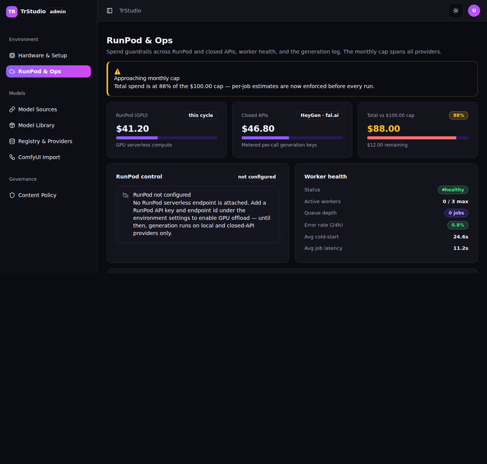

**Screen flowchart**
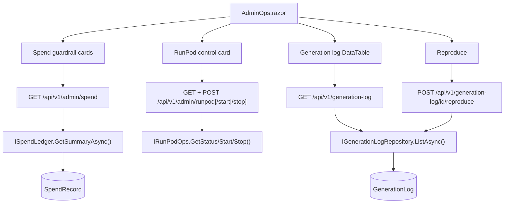

**Controls on this screen**
| Control | Type | Purpose | Populated / calculated by |
|---|---|---|---|
| Spend cards (×3) | Card + Progress + Badge | RunPod / closed-API / total vs cap | live `SpendSummary` (or representative) |
| Near-cap alert | Alert | shown at ≥80% (danger ≥95%) | `objSpend.CapPct` |
| RunPod control | Card + Switch + Buttons | start/stop, auto-idle, cold-start, unconfigured | live `RunPodView` (or representative) |
| Worker health | Card | status/workers/queue/latency | `objWorkerActive/Max/QueueDepth` + static |
| Generation log | DataTable | user/model/params/cost/duration/outcome | live `PagedResult<GenerationLogEntry>` → `MapLog` |
| Reproduce | Button | re-queue from log | `ReproduceAsync` |

**Data lineage**
| Control / Action | Razor (file:line) | Client/Service method (file) | API endpoint (file) | Engine service → repository (file) | Table / SQL query | Render status | Notes |
|---|---|---|---|---|---|---|---|
| Spend cards | `AdminOps.razor:57-93` | `GetAsync("/api/v1/admin/spend")` (`:291`) | `GET /api/v1/admin/spend` → `GetSpendAsync` (`Phase3Endpoints.cs:46,229`) | `ISpendLedger.GetSummaryAsync` (`Domain/Cost/`) → `SpendRepository` | `FROM "SpendRecord"` | renders (live-or-representative) | representative kept if cap ≤ 0 / unreachable (`:295,409`) |
| RunPod control | `AdminOps.razor:97-161,385-407` | `GetAsync/PostAsync("/api/v1/admin/runpod[/action]")` (`:308,394`) | `GET/POST /api/v1/admin/runpod[/start|/stop]` → `GetRunPodStatus/Start/Stop` (`Phase3Endpoints.cs:52-54,238`) | `IRunPodOps` (`Domain/RunPod/`) | RunPod API — no DB read | renders (live-or-representative) | "not configured" state when no key (`:143,418`) |
| Worker health | `AdminOps.razor:164-192` | enriched from `/api/v1/admin/runpod` view | (same as above) | `IRunPodOps.GetStatusAsync` | — | renders (partly static) | error-rate/cold-start/latency rows are static copy |
| Generation log | `AdminOps.razor:195-223,329-348` | `GetAsync("{GenerationLog}?aPage=1&aPageSize=25")` (`:331`) | `GET /api/v1/generation-log` → `ListGenerationLogAsync` (`SpineEndpoints.cs:51,197`) | `IGenerationLogRepository.ListAsync` (`Infrastructure/Data/GenerationLogRepository.cs`) | `FROM "GenerationLog"` | renders (live-or-representative) | representative sample on zero rows / error (`:335-346`) |
| Reproduce | `AdminOps.razor:215,365-383` | `PostAsync("{GenerationLog}/{id}/reproduce")` (`:370`) | `POST /api/v1/generation-log/{id}/reproduce` → `ReproduceFromLogAsync` (`SpineEndpoints.cs:52`) | `IGenerationLogRepository` | `"GenerationLog"` | renders (wired) | toast fallback if unreachable |

**Business rules / calculations**
- `CapPct = TotalSpend / MonthlyCap * 100` (`:490`); near-cap alert at ≥80%, danger styling ≥95% (`:25-28,88-89`).
- Log params summarized to ≤40 chars, user id shortened to 12 chars (`:448-460`).
- Monthly cap "spans all providers" (RunPod + closed APIs) — a single deployment-wide cap.

**Known issues / gotchas**
- RunPod cold-start / start-endpoint needs a configured RunPod API key + endpoint id; without it the card renders the "not configured" state — model/service-gated, NOT a defect.
- Worker-health error-rate/cold-start/latency values are static illustration, not live metrics.

---

### Operator · ComfyUI Import & Debug
- **Route:** `/admin/comfy/import` and `/admin/comfy/debug` (two `@page` directives, one component — `AdminComfy.razor:1-2`)
- **Razor file:** `src/TrStudioUI/Pages/Admin/AdminComfy.razor`
- **Reached via:** Models → ComfyUI Import; **Log in as:** Operator (or Owner via surface-switch) — Creator bounced to `AccessDenied` (client) + API 403 (server)
- **What this screen does:** Import an API-format workflow (drop-zone or paste), parse it client-side into a nodes table, map each literal node input to a declarative registry param, smoke-test with a per-node run/debug panel (status list + WebSocket-preview placeholder + Progress + the exact `/prompt` JSON), surface a missing custom-node dependency with an Install action, then save the known-good graph as a registry model with a pinned version.
- **Authorization:** client `/admin/*` gate (Operator/Owner only); server `ApiRoutes.Comfy` (`/api/v1/admin/comfy`) group `.RequireAuthorization(SpineModule.AdminOnlyPolicy)` (`ComfyEndpoints.cs:31-33`) — policy UNCHANGED
- **Visual status:** ✅ VISUAL-OK (runtime-confirmed 2026-07-05 as Operator, unified role-gated app; desktop)

**Screenshot**

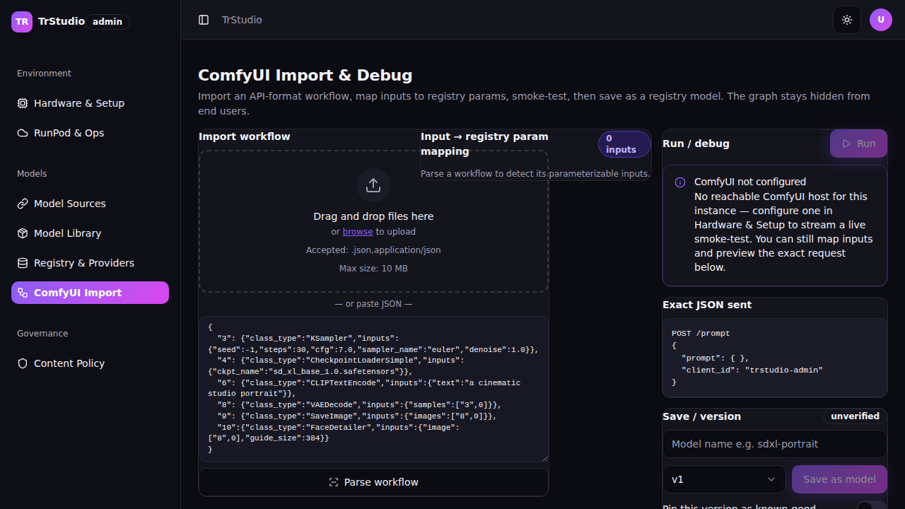

**Screen flowchart**
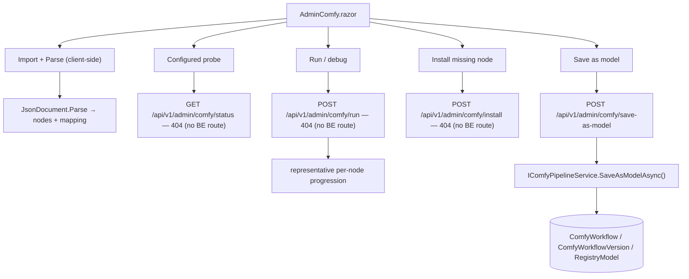

**Controls on this screen**
| Control | Type | Purpose | Populated / calculated by |
|---|---|---|---|
| FileUpload drop-zone | FileUpload | load workflow_api.json | `OnFilesChangedAsync` → `ParseWorkflow` |
| Paste Textarea + Parse | Textarea + Button | parse pasted JSON | `ParseWorkflow` (client-side) |
| Parsed nodes table | DataTable | id/class_type/status | `objNodes` from parse |
| Input→param mapping | HTML table | key/type/req/default per literal input | `objMapping` from parse |
| Run / debug panel | Button + Progress + status list | smoke-test, WS-preview placeholder | `RunAsync` |
| Exact JSON sent | code block | live `/prompt` preview | `objExactJson` computed getter |
| Missing-dependency alert | Alert + Install | resolve custom node | `InstallDependencyAsync` |
| Save / version | Input + Select + Switch + Button | save known-good, version, pin | `SaveAsModelAsync` |

**Data lineage**
| Control / Action | Razor (file:line) | Client/Service method (file) | API endpoint (file) | Engine service → repository (file) | Table / SQL query | Render status | Notes |
|---|---|---|---|---|---|---|---|
| Parse workflow | `AdminComfy.razor:49-53,383-449` | client-side `JsonDocument.Parse` (`:399`) | — (no round-trip) | — | — | renders | invalid JSON → parse Alert always (`:444`) |
| Configured probe | `AdminComfy.razor:163-176,325-349` | `GetAsync(ComfyStatusRoute="/status")` (`:296,338`) | **NO MATCH** — BE has `debug/dependencies/smoke/go-live`, not `status` (`ComfyEndpoints.cs:36-57`) | — | — | **renders-empty (suspected defect)** — probe always 404 → `objComfyConfigured=false` | see DEFECTS |
| Run / debug | `AdminComfy.razor:157,475-527` | `PostAsJsonAsync(ComfyRunRoute="/run")` (`:297,486`) | **NO MATCH** — BE run-debug is `POST /debug` (`ComfyEndpoints.cs:42`) | *(would be)* `IComfyPipelineService.BuildDebug` | — | **renders-representative (suspected defect)** — POST 404, always falls to local progression | see DEFECTS |
| Install missing node | `AdminComfy.razor:215,530-547` | `PostAsJsonAsync(ComfyInstallRoute="/install")` (`:298,536`) | **NO MATCH** — BE dependency scan is `POST /dependencies` (`ComfyEndpoints.cs:40`) | *(would be)* `ScanDependencies` | — | **renders-representative (suspected defect)** — POST 404, resolves locally | see DEFECTS |
| Save as model | `AdminComfy.razor:249,550-577` | `PostAsJsonAsync(ComfySaveRoute="/save-as-model")` (`:299,560`) | `POST /api/v1/admin/comfy/save-as-model` → `SaveAsModelAsync` (`ComfyEndpoints.cs:44,108`) | `IComfyPipelineService.SaveAsModelAsync` → `ComfyWorkflowRepository` | `INTO "ComfyWorkflow"`, `"ComfyWorkflowVersion"`, `"RegistryModel"` | renders (route matches; toast even on failure) | **only** the save route matches the BE |

**Business rules / calculations**
- Parse is fully client-side (`ParseWorkflow`): array-valued inputs are wired links and skipped; scalar inputs become mapping rows typed string/int/float/bool (`InputType`, `:452-458`).
- Smoke gate: a node whose `class_type` is not in `objBaseNodes` trips the missing-dependency path; `objKnownGood` set true only when all nodes pass (`:494-524`). Save button disabled unless `objKnownGood && ModelName` present (`:250-251`).
- `objExactJson` rebuilds the `POST /prompt` body live from mapping rows, templating each mapped input as `{{paramKey}}` (`:583-607`).
- Sandbox go-live gate (`POST /go-live`) is refused 409 unless the pinned version has a passing smoke (`ComfyEndpoints.cs:239-255`) — the UI's pin Switch + version Select feed this server rule.

**Known issues / gotchas**
- **Route reconciliation (confirmed defect, below):** the page's `ComfyStatusRoute`/`ComfyRunRoute`/`ComfyInstallRoute` (`/status`,`/run`,`/install`) do not exist on the BE, which exposes `/debug`,`/dependencies`,`/smoke`,`/go-live`. Only `/save-as-model` lines up. This matches the PROJECT-STATUS note precisely.
- A live ComfyUI smoke-run needs a reachable ComfyUI host (configured in Hardware & Setup) — model/service-gated; the representative per-node progression stands in otherwise (NOT a defect).

---

### Operator · Content Policy
- **Route:** `/admin/policy`
- **Razor file:** `src/TrStudioUI/Pages/Admin/AdminPolicy.razor`
- **Reached via:** Governance → Content Policy; **Log in as:** Operator/Owner to view the surface — the NSFW switch itself is **owner-only, personal-mode only** (a second, in-UI gate on top of the `/admin/*` Operator/Owner gate); a Creator is bounced to `AccessDenied` before the page
- **What this screen does:** A single content-policy surface: the **SAFE-01..06 floors are always-on, rendered as a locked non-interactive list**, and **only the general SFW filter** is owner-toggleable via the "Unrestricted (NSFW) mode" Switch — behind an explicit confirmation AlertDialog, off by default, for fully-synthetic adult (18+) personas, personal-mode only. In multi-user/SaaS mode the toggle is disabled and forced OFF.
- **Authorization:** client `/admin/*` gate (Operator/Owner only) + in-UI owner+personal-mode gate on the write; server `ApiRoutes.AdminPolicy` (`/api/v1/admin/policy`) group `.RequireAuthorization(SpineModule.AdminOnlyPolicy)`; `nsfw` GET/PUT (`SafetyEndpoints.cs:40-44`) — policy UNCHANGED
- **Visual status:** ✅ VISUAL-OK (runtime-confirmed 2026-07-05 as Operator, unified role-gated app; desktop)

**Screenshot**

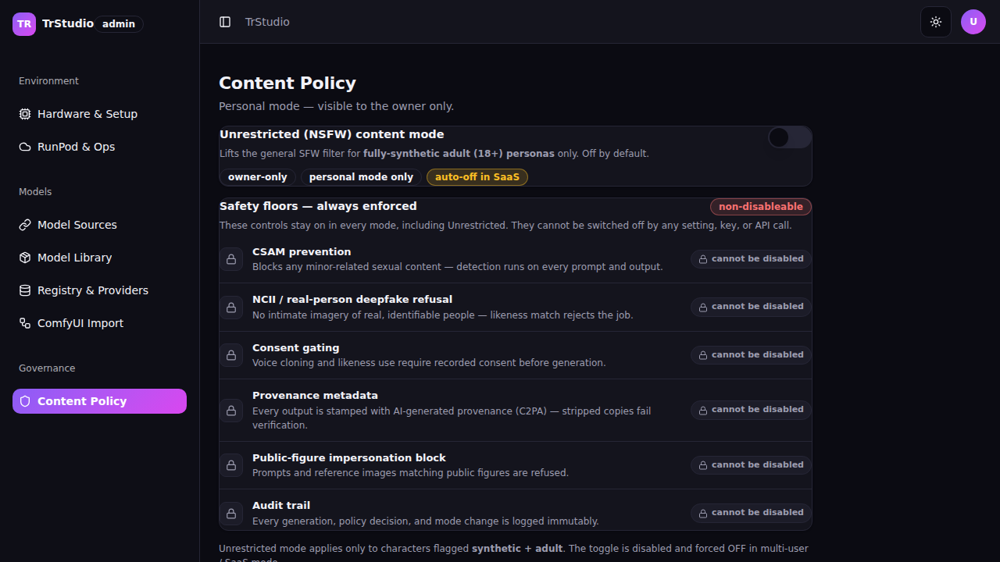

**Screen flowchart**
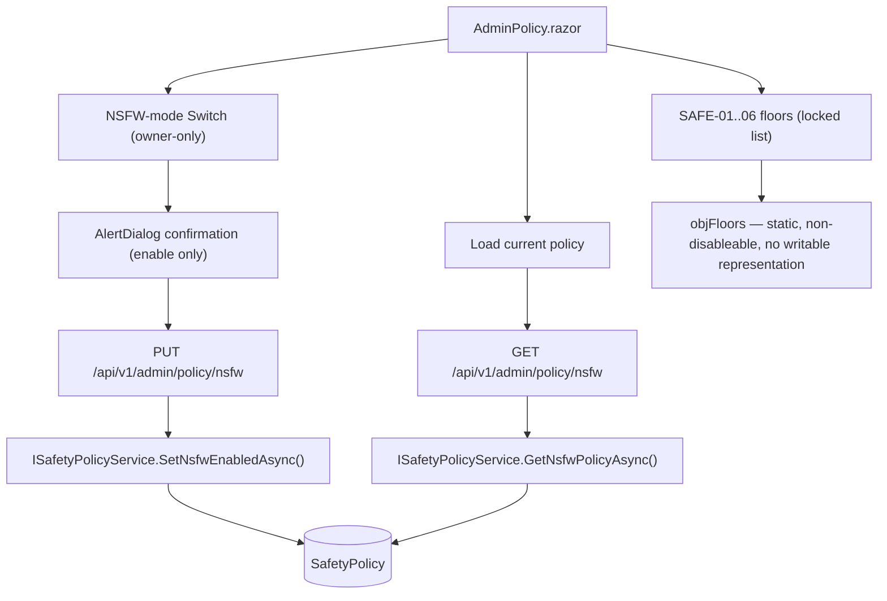

**Controls on this screen**
| Control | Type | Purpose | Populated / calculated by |
|---|---|---|---|
| NSFW-mode Switch | Switch (Large) | owner toggle of general SFW filter | `objNsfwEnabled`, disabled unless `objPersonalMode` |
| Confirmation AlertDialog | AlertDialog | gate ENABLE only | `OnToggleRequestedAsync` → `ConfirmEnableAsync` |
| Multi-user note | Alert | explains forced-OFF in SaaS | shown when `!objPersonalMode` |
| Safety floors list | locked rows | SAFE-01..06 always-enforced | `objFloors` static array (6 rows) |

**Data lineage**
| Control / Action | Razor (file:line) | Client/Service method (file) | API endpoint (file) | Engine service → repository (file) | Table / SQL query | Render status | Notes |
|---|---|---|---|---|---|---|---|
| Load policy | `AdminPolicy.razor:165-235` | `GetAsync(NsfwPolicyRoute)` (`:193`) | `GET /api/v1/admin/policy/nsfw` → `GetNsfwPolicyAsync` (`SafetyEndpoints.cs:43,95`) | `ISafetyPolicyService.GetNsfwPolicyAsync` (`Domain/Safety/`) → `SafetyPolicyRepository` | `FROM "SafetyPolicy"` | renders (live-or-safe-seed) | tolerant of `personalMode`/`multiUser` field spellings (`:212-235`) |
| Enable NSFW (confirm) | `AdminPolicy.razor:264-308,314-331` | `PutAsJsonAsync(NsfwPolicyRoute, {enabled})` (`:319`) | `PUT /api/v1/admin/policy/nsfw` → `SetNsfwPolicyAsync` (`SafetyEndpoints.cs:44,99`) | `ISafetyPolicyService.SetNsfwEnabledAsync` → `SafetyPolicyRepository` | `INTO "SafetyPolicy"` | renders (wired) | enable in multi-user → 409 (`SafetyEndpoints.cs:108-111`) |
| Disable NSFW | `AdminPolicy.razor:279-284` | `PutAsJsonAsync` (`:319`) | same PUT | same | `"SafetyPolicy"` | renders (wired) | disable applies immediately (no gate) |
| SAFE-01..06 floors | `AdminPolicy.razor:82-95,138-152` | none | — | enforced in generation pipeline, not here (`SafetyEndpoints.cs:14-16`) | — | renders (static, locked) | 6 floors: CSAM, NCII/deepfake, consent, provenance, public-figure, audit |

**Business rules / calculations**
- Enable-vs-disable asymmetry: enabling ON opens the confirmation gate WITHOUT applying; disabling OFF applies immediately (relaxing a restriction needs consent; re-tightening never does) (`:258-284`).
- `objSwitchNonce` `@key` re-mounts the Switch so its optimistic internal state can never diverge from the C# source of truth (`:50,133-136`).
- Multi-user guard: if `!objPersonalMode`, `objNsfwEnabled` is forced false regardless of any stored flag (`ApplyState`, `:230-234`); Switch disabled (`:51`).
- Floors have no client-writable representation and are never in the PUT payload (`:310-313`) — the payload is `{ enabled }` only.

**Known issues / gotchas**
- SAFE-01..06 are non-disableable by any setting/key/API — enforced in the generation pipeline, not this surface (`SafetyEndpoints.cs:14-16`). The UI renders them locked by design.
- NSFW enable is owner + personal-mode only; a SaaS/multi-user instance forces OFF (server 409 on enable) — correct behavior, NOT a defect.

## DEFECTS FOUND

1. **ComfyUI Import & Debug — route-constant mismatch with the backend.** `AdminComfy.razor:296-298` declares `ComfyStatusRoute="/api/v1/admin/comfy/status"`, `ComfyRunRoute=".../run"`, `ComfyInstallRoute=".../install"`, but `ComfyEndpoints.cs:36-57` maps `import`/`map`/`dependencies`/`debug`/`save-as-model`/`workflows`/`smoke`/`go-live` — there is **no `/status`, `/run`, or `/install` route**. Result: the "ComfyUI configured" probe always 404s (`objComfyConfigured` stuck false, `:338-339`), Run always falls to the representative local progression (`:486`), and Install-node never reaches the BE (`:536`). Only `ComfySaveRoute="/save-as-model"` (`:299`) matches. Fix = reconcile the FE consts to `/debug`, `/dependencies`, plus a real configured-probe (and `/smoke`,`/go-live` for the gate). Owning REQ: **REQ-UI-072**. (Confirms the PROJECT-STATUS note.)

2. **Registry & Providers — Save model / Save keys never persist.** `AdminRegistry.razor:346-356` (`SaveModelAsync`) and `:358-362` (`SaveKeysAsync`) only call `ToastService.Success` and set `objSheetOpen=false` — they make **no HTTP call**, even though `PUT /api/v1/admin/registry/{id}` (`RegistryEndpoints.cs:40,80`) and `PUT /api/v1/admin/providers/keys` (`RegistryEndpoints.cs:52,135`) exist and are admin-wired. Editing a registry row / params-schema or entering a provider key and clicking Save shows a false "saved" toast with zero persistence. Owning REQ: **REQ-UI-071**.

## Unresolved / TODO hops
- None. Every service/repository hop resolved to a real symbol and table: `ModelSource`, `ModelInstall`, `RegistryModel`, `ProviderKey`, `SpendRecord`, `GenerationLog`, `SafetyPolicy`, `ComfyWorkflow`/`ComfyWorkflowVersion`, `SetupState`. `ICapabilityDetector` and `IRunPodOps` are host/RunPod-API probes with no DB read (noted inline, not TODOs).
