# TrStudio — Developer Guide

| | |
|---|---|
| App | TrStudio |
| Kind | app |
| Size | Small |
| Verified on | 2026-11-15 |
| Date | 2026-11-15 |

> ✅ **Refreshed 2026-11-15 (`--update`).** The 22 studio, workspace, admin and auth screens whose code changed on 15 Nov 2026 (controls now carry their mockups' `data-testid` names; pages reshaped; newest run reopened on load; test-only seed endpoints `POST /test/seed/<mockup>` in `tests/TrStudio.TestHost/Program.cs`) were re-read at file and line. Each entry below carries its current **Call chain:** line and where-to-break table. All 22 screens rendered OK at 1280 and 390 in light and dark on the test host (`tests/TrStudio.TestHost`, http://localhost:5099) on 15 Nov 2026 (evidence `tests/.artifacts/verify/screens.json`); the screenshots in `docs/screenshots/TrStudio/` were replaced with that run's 1280 light shots. The full per-control data-lineage tables stay in the role files ([Creator](./TrStudio-DevGuide-Creator.md), [Operator](./TrStudio-DevGuide-Operator.md)); where their line numbers differ from the tables here, the tables here are current.
>
> ✅ **Runtime-verified 2026-07-05 (unified role-based app)** — after the 2026-07-05 consolidation (BRD-86 / ADR-012: the two apps became ONE role-gated `TrStudio` app; `TrStudioAdmin` retired), the app was re-exercised as Creator, Operator, and Owner via the `/dev/session` seam on the single app (:5099) and, for the new **MAUI desktop head** (`TrStudio.Desktop`, now `src/TrStudio`), via a FlaUI native-window smoke on **Windows** (Mac Catalyst builds but is unverified — no Mac in this env). Live evidence: Creator → studios only + `/admin/*` → in-app AccessDenied + admin API 403; Operator → 7 management screens render, API 200; Owner → both surfaces + in-app switch. Screenshots in `docs/screenshots/TrStudio/`. The 9 FE↔API route/visual defects noted below were caught + fixed on 2026-07-04 and remain fixed through the consolidation.
>
> ℹ️ **This is an `--update` realignment**: the per-screen control/data-lineage bodies are unchanged by the consolidation (same endpoints/services/repos); what changed is the **hosting** (management screens moved `TrStudioAdmin/Components/Pages/` → `src/TrStudioUI/Pages/Admin/`), the **role-gated shell**, and **landing**.
>
> ✅ **`*verify all` (2026-07-06) + `*fix-issues` (2026-07-07) — RESOLVED.** The verify pass found 4 screens that didn't reflow at 390px (clipped controls, dead space): Character library, Prompt/script library, Account & spend, Model sources. `*fix-issues` fixed all 4 with page-scoped `@media(≤430px)` single-column collapse + header wrapping + a **systemic shell fix** (the SidebarInset content column + `.table-scroll` now carry `min-width:0`, so wide content scrolls internally instead of inflating the layout). Re-smoked @390px: Character/Library `documentElement.scrollWidth==body==390`; Account/Sources controls all render & fit (`documentElement.scrollWidth==390`, no page scrollbar) with their wide DataTable scrolling internally (a minor DataTable inner-width trait logged as TrBlazeUI **TR-010**). All 4 back to `Verified`. Screenshots `test-results/verify-ui/refix-*.png`.

> **Purpose — the document a HUMAN developer uses to trace any screen, control, or number on the page down to the database, to find/fix a bug or verify AI-generated code.** The BRD says *what* the app does, the Architecture *how the system is shaped*; this guide says exactly which files produce each screen — Razor page → control → client service → API endpoint → engine service → repository → SQL/table — per user role. It documents the **as-built code**; regenerate with `*devguide TrStudio` after code changes.

This is a **split** guide (2 roles, 23 distinct screens → split per the devguide §3 threshold). The call chains and where-to-break tables are below; the per-control lineage is in the role files.

## Architecture cheat-sheet

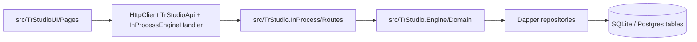

| Layer | Project / folder | What lives here |
|-------|------------------|-----------------|
| UI (Blazor) — shared RCL (ALL screens) | `src/TrStudioUI/` (RCL) | `Pages/` (creator screens) + `Pages/Admin/` (the 7 management screens), `Navigation/AppShellNavigation.cs`, `Layout/AppSidebar.razor`, `MainLayout.razor`, `Layout/AccessDenied.razor`, `Auth/` contracts — hosted by the desktop app `src/TrStudio` (and, for headless checks, `tests/TrStudio.TestHost`) |
| Hosts | `src/TrStudio` (desktop, MAUI, Mac first) · `tests/TrStudio.TestHost` (headless checks only) | Named HttpClient `TrStudioApi` with `InProcessEngineHandler` (`src/TrStudio/MauiProgram.cs:67`, `tests/TrStudio.TestHost/Program.cs:69-70`) |
| In-process routes | `src/TrStudio.InProcess/Routes/` | `/api/v1/*` handlers dispatched by `InProcessEngineHandler.SendAsync` (`InProcessEngineHandler.cs:33`), mapped by `RouteMap.MapAll` (`RouteMap.cs:13`, called at `EngineHost.cs:159`); `src/TrStudioApi/Endpoints/` keeps the API-era copies |
| App / domain services | `src/TrStudio.Engine/Domain/<Area>/` | Business logic per area |
| Data access | `src/TrStudio.Engine/Infrastructure/Data/` (+ per-area) | **Dapper repositories**, parameterized SQL. **No EF Core, no stored procs.** |
| Database | `src/TrStudioDb/Scripts/*.sql` | DbUp migrations (e.g. `0621_PromptChatTokens.sql`) |

#### Running the solution (start here)

`TrStudio.slnx` is a **7-project** solution in which `TrStudioAdmin` is **RETIRED** (merged into the unified `TrStudio` app on 2026-07-05, ADR-012; removed from the solution) and `TrStudio.Desktop` (a MAUI Blazor Hybrid desktop head, renamed `src/TrStudio` on 2026-11-14) is **NEW**. Running the **web** app means starting **`TrStudioApi` + `TrStudio` together** (API first), with the two Docker dependency containers already up; for the **desktop** app, start **`TrStudioApi` + `TrStudio.Desktop`** instead. The remaining projects are libraries — do **not** set them to start. Full step-by-step (Visual Studio multiple-startup config + CLI) is in **[docs/TrStudio-UsageGuide.md → "Which projects to run" / "How to run"](../TrStudio-UsageGuide.md#which-projects-to-run-this-is-a-multi-project-solution)**. Quick reference:

| Project | Start? | URL / role |
|---------|--------|------------|
| `src/TrStudioApi` | ✅ **Startup (first)** | http://localhost:5102 — Web API, DbUp migrations, Hangfire |
| `src/TrStudio` | ✅ **Startup** | http://localhost:5099 — the **ONE unified role-based** Blazor Web app (creator studios + role-gated management surface) |
| `src/TrStudio` | ✅ **Startup — the desktop app** (called `src/TrStudio.Desktop` until 2026-11-14) | MAUI Blazor Hybrid desktop app, Mac first (Windows later), with the engine inside from phase 3 |
| `src/TrStudioAdmin` | ❌ **RETIRED** | merged into `TrStudio` 2026-07-05 (ADR-012); removed from the solution, not a startup project (old :5098 host gone) |
| `src/TrStudio.Engine`, `src/TrStudio.Models`, `src/TrStudioUI`, `src/TrStudioDb` | ❌ libraries | — (`TrStudioUI` RCL now hosts **all** screens, incl. management under `Pages/Admin/`) |

- **Dependencies (Docker):** `docker start WinPgVectorDb appmanager-api` → `docker ps` (both **Up**) **before** launching. Postgres (`:5432`) and AppManager (`:5101`) both run as containers; a down container is the usual cause of "can't connect"/"Docker" errors at startup.
- **Visual Studio:** right-click solution → *Configure Startup Projects…* → *Multiple* → Start = **`TrStudioApi` + `TrStudio`** (API at the top), everything else = None → F5. Wait for the API console `Now listening on: http://localhost:5102`. (Phase 3, 2026-11-14: the desktop app `src/TrStudio` runs alone with the engine inside; see [phase 3 developer guide](../TrStudio-P3-DevGuide.md).)
- Phase 3 (2026-11-14): the old **web** head was deleted and the desktop project took its name, `src/TrStudio` (MAUI Blazor Hybrid, Mac first). The headless checks use `tests/TrStudio.TestHost` on http://localhost:5099. The July paragraphs above describe the API-era shape.
- Test-only seed data (2026-11-15): `POST /test/seed/<mockup>` endpoints in `tests/TrStudio.TestHost/Program.cs` (from line 120), driven by `tests/verify/seed/<mockup>.sh`. Test host only; never in the desktop app.

## Roles and menu map

| Role | Test user (see UsageGuide) | Authorization (as-built) | App / surface | Detail file |
|------|----------------------------|--------------------------|---------------|-------------|
| **Creator** (standard + Premium) | user 2 `creator@trstudio.test` / user 4 `premium@…` | AppManager JWT + per-handler `ResolveUserId` owner filter; endpoints use the app fallback auth policy (few declarative `.RequireAuthorization()`); client shell shows the Creator surface only (`/admin/*` → AccessDenied) | The ONE `TrStudio` app (`:5099`) — **Creator surface**; screens in the shared RCL `src/TrStudioUI/Pages/` | [TrStudio-DevGuide-Creator.md](./TrStudio-DevGuide-Creator.md) |
| **Operator / Admin** | user 3 `admin@trstudio.test` | client gate: `AppShellNavigation.IsRouteAllowed` → `AccessDenied` for non-management roles; server gate: `SpineModule.AdminOnlyPolicy` = role Owner/Operator (`SpineModule.cs:67-70`), enforced in-handler | The ONE `TrStudio` app (`:5099`) — **Management surface (role-gated)**; screens now in the shared RCL `src/TrStudioUI/Pages/Admin/` | [TrStudio-DevGuide-Operator.md](./TrStudio-DevGuide-Operator.md) |
| **Owner / Superadmin** | user 1 `admin@appmanager.local` | union of both (Creator + Operator) | The ONE `TrStudio` app — lands on the **Creator surface**, switches to the **Management surface** via the in-app sidebar-footer control | Creator + Operator files above |

**Landing-truth (read from code, not inferred — re-read 2026-07-05 after the consolidation):**
- **Creator** lands on `/avatar` after login (`Login.razor:153-166` → `ResolveLanding`, + setup-gate `IdentityEndpoints.cs:313-322`).
- **Operator** lands on `/admin/ops` — **now code-backed** in the unified app (the old two-app "not code-backed" note is superseded): `AppShellNavigation.ResolveDefaultSurface` selects the Management surface for an Operator (`AppShellNavigation.cs:98-106`), `TrStudioNavSets.ManagementLandingPath = "/admin/ops"` (`TrStudioNavSets.cs:14`), and the post-login redirect routes Operator→`/admin/ops` else `/avatar` (`Login.razor:165`; dev seam identical `DevSession.razor:117-118`). Confirmed live (`.smoke/results.json` Operator `landUrl …/admin/ops`).
- **Owner** lands on `/avatar` (Creator surface) and switches to Management in-app via the sidebar footer (`AppSidebar.razor:85-89` → `AppShellNavigation.cs:63-66`, target `/admin/ops`). The dev-session seam resolves the authoritative role via `GET /api/v1/auth/me` (`DevSession.razor`).

(The landing-truth line numbers above date from 2026-07-05; the Sign in entry below carries the current `Login.razor` lines.)

## Screen-by-screen code map

- **Creator (16 screens):** Login, Register, Forgot-password, Setup-required, Home, Avatar studio (flagship), Character library, Image studio, Voice studio, Video studio, **Prompt studio** (`/prompt-studio`), Gallery, Projects, Comparison, Library, Account — full lineage in the [Creator file](./TrStudio-DevGuide-Creator.md). Home was not changed on 15 Nov 2026 and keeps its Creator-file entry.
- **Operator / Management surface (7 screens, role-gated within the one app):** Hardware & Guided setup (dual route), Model sources, Model library, Registry & providers, RunPod & Ops, ComfyUI import & debug (dual route), Content policy / NSFW — full lineage in the [Operator file](./TrStudio-DevGuide-Operator.md).

### Sign in (`/login`)

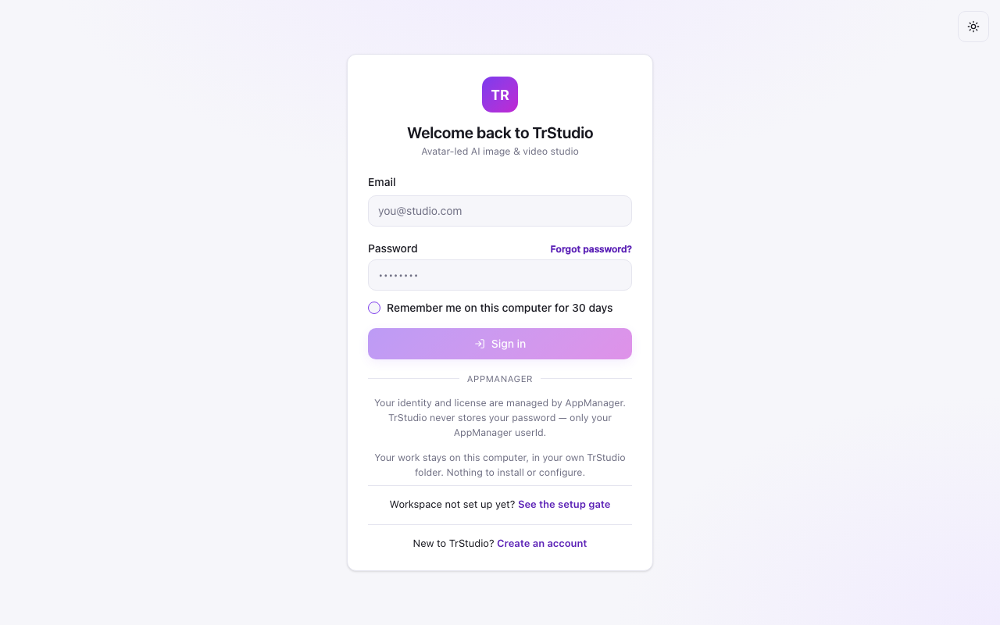

**Runtime:** renders — 1280 and 390, light and dark, test host, 2026-11-15 (`tests/.artifacts/verify/screens.json`).

**Call chain:** `Login.razor:HandleSignInAsync` → `IdentityEndpoints.LoginAsync` (`POST /api/v1/auth/login`) → `AppManagerClient.LoginAsync` (external AppManager `AuthSvc/login`) → `SetupGateService.EvaluateAsync` → `ModelSourceRepository.ListAsync` / `RegistryRepository.ListAsync` → `"ModelSource"`, `"RegistryModel"`

| File and line | Function | Watch | Expected value |
|---|---|---|---|
| `src/TrStudioUI/Pages/Auth/Login.razor:254` | `HandleSignInAsync` | `vRequest` | `Email`/`Password` typed in `field-email`/`field-pwd`, `RememberMe` from `remember-me` |
| `src/TrStudio.InProcess/Routes/IdentityEndpoints.cs:74` | `LoginAsync` | `vSession` | AppManager session with `Token`, `UserId`, `Role` (401 `INVALID_CREDENTIALS` on bad password) |
| `src/TrStudio.Engine/Infrastructure/Identity/AppManagerClient.cs:59` | `LoginAsync` | `vEnvelope` | AppManager auth envelope; password sent RSA-encrypted (line 55) |
| `src/TrStudio.InProcess/Routes/IdentityEndpoints.cs:428` | `ApplySetupGateAsync` | `vGate` | `SetupComplete` and `RedirectPath` (role landing) |
| `src/TrStudio.Engine/Domain/SetupGate/SetupGateService.cs:42` | `EvaluateAsync` | `vIsComplete` | true only with an enabled source AND a ready registry model |
| `src/TrStudio.Engine/Infrastructure/ModelSources/ModelSourceRepository.cs:52` | `ListAsync` | `vRows` | rows from `"ModelSource"` |

**Controls (data-testid):** `card-1`, `sign-in`, `field-email`, `field-pwd`, `remember-me-row`, `remember-me`, `link-forgot-password`, `signin-btn`, `login-error`, `alert-missing-sign-in-settings`, `alert-sign-in-unreachable`, `alert-kept-sign-in-ended`, `setup-required-link`, `link-create-an-account`, `note-local-data`

**Calculations on this screen:** `IsEmailValid` (has `@` with a `.` after it), `IsFormValid` (email valid and password not blank), `ResolveLanding` (picks the gate's `DefaultLandingPath`, else `/admin/ops` for Operator or `/avatar`). On first render, `OnAfterRenderAsync` posts `/api/v1/auth/resume` (`IdentityEndpoints.ResumeAsync`, line 181) to reopen a remembered sign-in.

### Create account (`/register`)

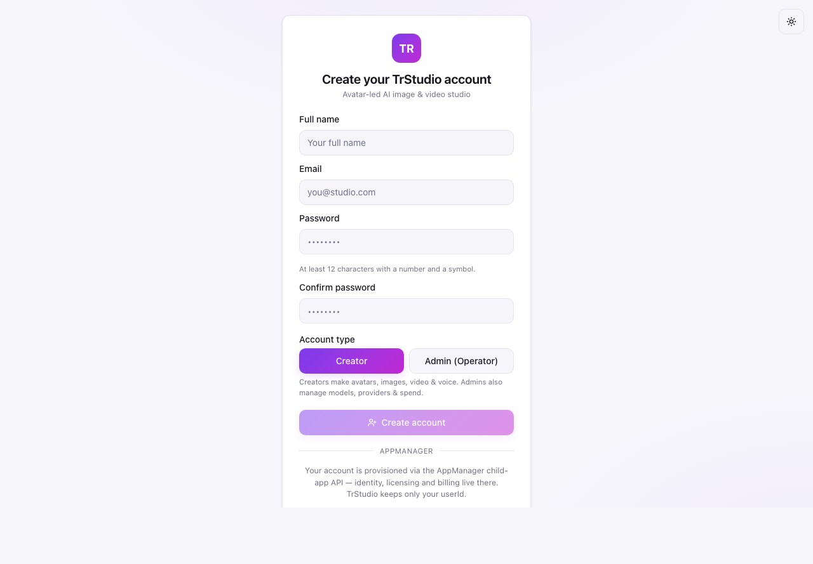

**Runtime:** renders — 1280 and 390, light and dark, test host, 2026-11-15 (`tests/.artifacts/verify/screens.json`).

**Call chain:** `Register.razor:HandleCreateAsync` → `IdentityEndpoints.RegisterAsync` (`POST /api/v1/auth/register`) → `AppManagerClient.RegisterAsync` (external AppManager `AuthSvc/register`) → `SetupGateService.EvaluateAsync` → `RegistryRepository.ListAsync` → `"RegistryModel"` (and `"ModelSource"`)

| File and line | Function | Watch | Expected value |
|---|---|---|---|
| `src/TrStudioUI/Pages/Auth/Register.razor:179` | `HandleCreateAsync` | `vRequest` | `Name`, `Email`, `Password` from the fields; `AccountType` `"AdminOperator"` or `"Creator"` |
| `src/TrStudio.InProcess/Routes/IdentityEndpoints.cs:129` | `RegisterAsync` | `vSession` | new AppManager session (Problem `EMAIL_EXISTS` for a duplicate email) |
| `src/TrStudio.Engine/Infrastructure/Identity/AppManagerClient.cs:84` | `RegisterAsync` | `vEnvelope` | AppManager auth envelope for the new user |
| `src/TrStudio.Engine/Domain/SetupGate/SetupGateService.cs:42` | `EvaluateAsync` | `vIsComplete` | false on a fresh install, so admins land on setup |
| `src/TrStudio.Engine/Infrastructure/Data/RegistryRepository.cs:88` | `ListAsync` | `vRows` | rows from `"RegistryModel"` |

**Controls (data-testid):** `card-1`, `field-name`, `field-email`, `field-pwd`, `field-pwd2`, `account-type`, `btn-creator`, `type-creator`, `btn-admin-operator`, `type-admin`, `btn-create-account`, `create-btn`, `register-error`, `link-sign-in`

**Calculations on this screen:** `IsPasswordValid` (12 or more characters, at least one digit and one symbol), `IsConfirmValid` (the two passwords match), `IsEmailValid`, `ResolveLanding` (the gate's path, else `/admin/setup/hardware` for admin or `/avatar`).

### Reset password (`/forgot-password`)

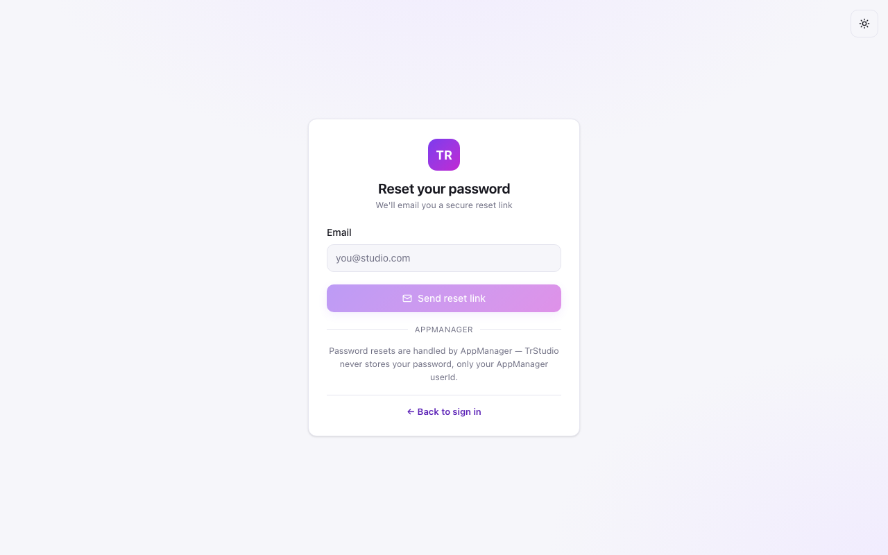

**Runtime:** renders — 1280 and 390, light and dark, test host, 2026-11-15 (`tests/.artifacts/verify/screens.json`).

**Call chain:** `ForgotPassword.razor:HandleSendAsync` → `IdentityEndpoints.ForgotPasswordAsync` (`POST /api/v1/auth/forgot-password`) → `AppManagerClient.RequestPasswordResetAsync` → external AppManager `AuthSvc/forgot-password` (no local table)

| File and line | Function | Watch | Expected value |
|---|---|---|---|
| `src/TrStudioUI/Pages/Auth/ForgotPassword.razor:98` | `HandleSendAsync` | `vRequest` | `Email` typed in `field-email` |
| `src/TrStudio.InProcess/Routes/IdentityEndpoints.cs:256` | `ForgotPasswordAsync` | `aRequest.Email` | the same email; reply is the generic "If the account exists..." message |
| `src/TrStudio.Engine/Infrastructure/Identity/AppManagerClient.cs:92` | `RequestPasswordResetAsync` | `vBody` | `{ email }` posted to AppManager |
| `src/TrStudioUI/Pages/Auth/ForgotPassword.razor:107` | `HandleSendAsync` (finally) | `objSent` | `true` whatever the outcome (does not reveal whether the account exists) |

**Controls (data-testid):** `card-1`, `field-email`, `btn-send-reset-link`, `alert-ok`, `link-back-to-sign-in`

**Calculations on this screen:** `IsEmailValid` (has `@` with a `.` after it); otherwise none.

### Setup required (`/setup-required`)

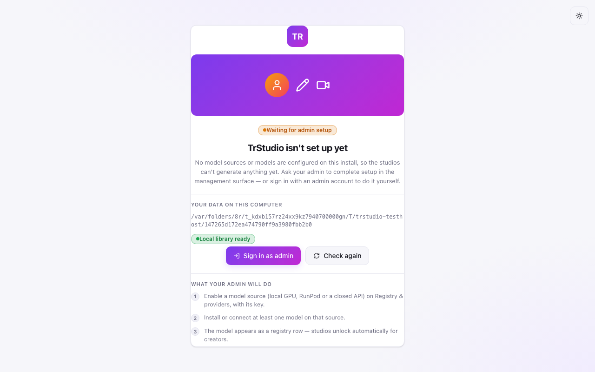

**Runtime:** renders — 1280 and 390, light and dark, test host, 2026-11-15 (`tests/.artifacts/verify/screens.json`).

**Call chain:** `SetupRequired.razor:CheckAgainAsync` → `IdentityEndpoints.GetSetupGateAsync` (`GET /api/v1/setup-gate`) → `SetupGateService.EvaluateAsync` → `ModelSourceRepository.ListAsync` / `RegistryRepository.ListAsync` → `"ModelSource"`, `"RegistryModel"`

| File and line | Function | Watch | Expected value |
|---|---|---|---|
| `src/TrStudioUI/Pages/Auth/SetupRequired.razor:109` | `OnInitializedAsync` | `objDataFolder` / `objStoreProblem` | data folder from `GET /api/v1/local-store` (`DesktopSessionEndpoints.cs:63`), or the 503 `LOCAL_STORE_UNAVAILABLE` detail (`InProcessEngineHandler.cs:47`) |
| `src/TrStudioUI/Pages/Auth/SetupRequired.razor:144` | `CheckAgainAsync` | `vGate` | `SetupComplete`, `RedirectPath` |
| `src/TrStudio.InProcess/Routes/IdentityEndpoints.cs:313` | `GetSetupGateAsync` | `vGate` | the gate for the caller's user id and role |
| `src/TrStudio.Engine/Domain/SetupGate/SetupGateService.cs:42` | `EvaluateAsync` | `vIsComplete` | `vHasEnabledSource && vHasReadyModel` |
| `src/TrStudio.Engine/Infrastructure/Data/RegistryRepository.cs:88` | `ListAsync` | `vRows` | rows from `"RegistryModel"`; any with `IsReady` |

**Controls (data-testid):** `gate-card`, `card-trstudio-isn-t-set-up-yet`, `badge-status`, `btn-check-again`, `check-again`, `link-sign-in-as-admin`, `signin-admin`, `card-local-data`, `data-store-status`, `badge-store-ready`, `data-folder`, `data-store-problem`

**Calculations on this screen:** `SetupGateService.EvaluateAsync` (setup is complete only with at least one enabled model source AND at least one ready registry model; `RoleLandingMap.GetLandingPath` picks the redirect).

### Account & spend (`/account`)

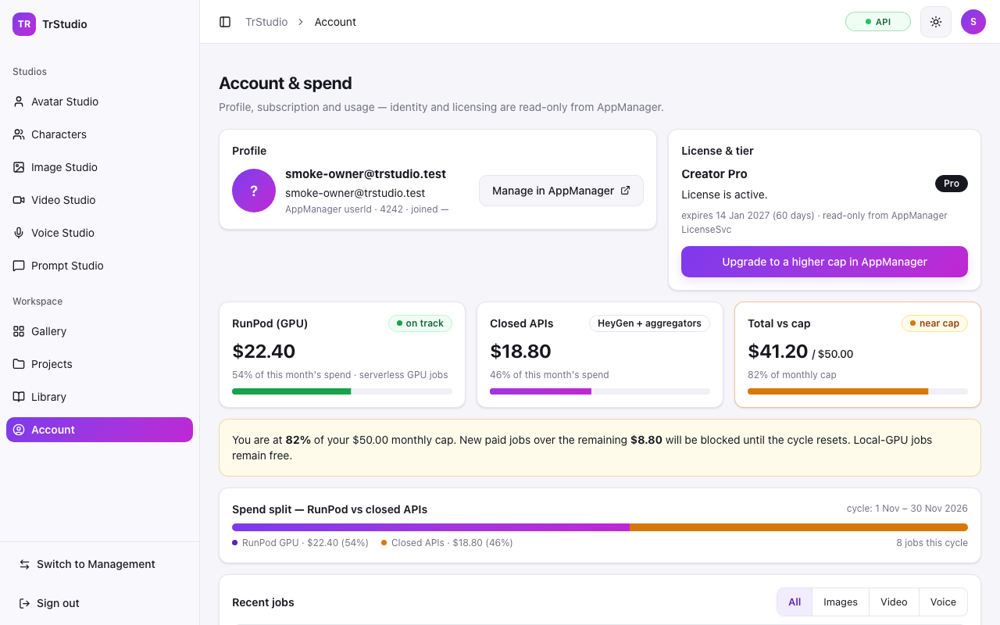

**Runtime:** renders — 1280 and 390, light and dark, test host, 2026-11-15 (`tests/.artifacts/verify/screens.json`).

**Call chain:** `Account.razor:TryLoadAccountAsync` → `Phase9Endpoints.GetAccountAsync` (`GET /api/v1/account`) → `AccountService.GetSummaryAsync` → `SpendRepository.GetTotalsByChannelForUserSinceAsync` → `"SpendRecord"` (license from external AppManager `LicenseSvc/validate`)

| File and line | Function | Watch | Expected value |
|---|---|---|---|
| `src/TrStudioUI/Pages/Account/Account.razor:336` | `TryLoadAccountAsync` | `vSummary` | the caller's month-to-date spend by channel plus license |
| `src/TrStudio.InProcess/Routes/Phase9Endpoints.cs:322` | `GetAccountAsync` | `vSummary` | summary for the signed-in user id |
| `src/TrStudio.Engine/Domain/Account/AccountService.cs:52` | `GetSummaryAsync` | `vSpend.MonthToDateUsd` | sum of all channel totals since the 1st of the month (UTC) |
| `src/TrStudio.Engine/Domain/Account/AccountService.cs:79` | `ReadLicenseAsync` | `vStatus` | AppManager license status (shows `license-unavailable` if unreachable) |
| `src/TrStudio.Engine/Infrastructure/Data/SpendRepository.cs:99` | `GetTotalsByChannelForUserSinceAsync` | `vRows` | `SUM("AmountUsd")` from `"SpendRecord"` grouped by `"Channel"` for this user |

**Controls (data-testid):** `card-profile`, `btn-manage-in-appmanager`, `card-license-tier`, `badge-pro`, `license-unavailable`, `btn-upgrade-to-studio-higher-cap`, `alert-warn`, `api-down-alert`, `card-total-vs-cap`, `progress`, `card-spend-split-runpod-vs-closed-api`, `card-runpod-gpu`, `progress-2`, `badge-status-2`, `card-closed-apis`, `progress-3`, `badge-status-3`, `badge-heygen-aggregators`, `card-recent-jobs`, `table-1` (plus one dynamic `data-testid="@($...)"` built in markup)

**Calculations on this screen:** `SpendView.FromResponse` (RunPod and ClosedApi totals, near-cap at 80% and over-cap), cap merge in `TryLoadAccountAsync` (lines 350-359: `RemainingUsd = cap - spent`), `Pct`/`PctValue` (whole-number % against the cap, clamped to 0-100), `SplitPct` (each channel's share of RunPod + ClosedApi), `CycleLabel` (the current calendar month), `UsageRow.FromLog` (job kind, duration and cost, `ActualCost` else `CostEstimate`).

### Avatar studio (`/avatar`)

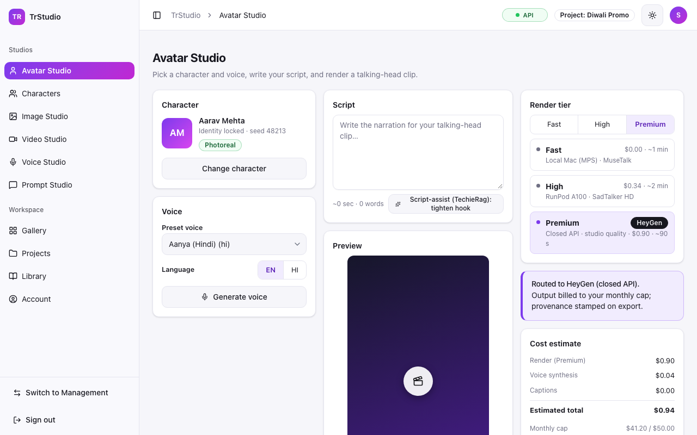

**Runtime:** renders — 1280 and 390, light and dark, test host, 2026-11-15 (`tests/.artifacts/verify/screens.json`).

**Call chain:** `AvatarStudio.razor:TrySubmitRenderAsync` → `SpineEndpoints.SubmitJobAsync` (`POST /api/v1/jobs`) → `JobOrchestrator.SubmitAsync` → `JobRepository.InsertAsync` → `"GenerationJob"`

| File and line | Function | Watch | Expected value |
|---|---|---|---|
| `src/TrStudioUI/Pages/Avatar/AvatarStudio.razor:676` | `TrySubmitRenderAsync` | `vRequest` | `ModelId` `heygen-avatar` or `musetalk-local`, `Task` LipSync, `ParamsJson` with characterId, voiceId, language, script |
| `src/TrStudio.InProcess/Routes/SpineEndpoints.cs:67` | `SubmitJobAsync` | `vUserId` | the signed-in creator's id (null gives 401) |
| `src/TrStudio.Engine/Domain/Jobs/JobOrchestrator.cs:182` | `SubmitAsync` | `vJob.CostEstimate` | the estimate checked against the spend cap before the insert |
| `src/TrStudio.Engine/Infrastructure/Data/JobRepository.cs:36` | `InsertAsync` | `vSql` | one `"GenerationJob"` row, then Queued at `JobOrchestrator.cs:184` |
| `src/TrStudioUI/Pages/Avatar/AvatarStudio.razor:428` | `OnAfterRenderAsync` | `vHasSession` | loads characters, voices, projects and spend; {unresolved — this page does not reopen the newest run on load} |

**Controls (data-testid):** `btn-render`, `field-preset-voice`, `field-aspect-ratio`, `field-2`, `switch`, `script-assist`, `link-generate-voice`, `link-change-character`, `link-create-a-character`, `new-character-cta`, `btn-export-mp4`, `btn-en`/`btn-hi` (language), `btn-<tier key>` (render tier), `card-character`, `card-script`, `card-voice`, `card-render-tier`, `card-cost-estimate`, `card-preview`, `card-captions-export`, `progress`, `safety-alert`, `api-down-alert`

**Calculations on this screen:** `WordCount` (line 383, words in the script); `EstimatedSeconds` (line 387, words ÷ 2.7, rounded up); `EstimatedTotal` (line 390, tier cost + $0.04 voice); `Headroom` (line 393, cap limit − used); `OverCap`/`NearCap` (lines 396/399, total over headroom, or less than $10 left).

### Character library (`/avatar/characters`)

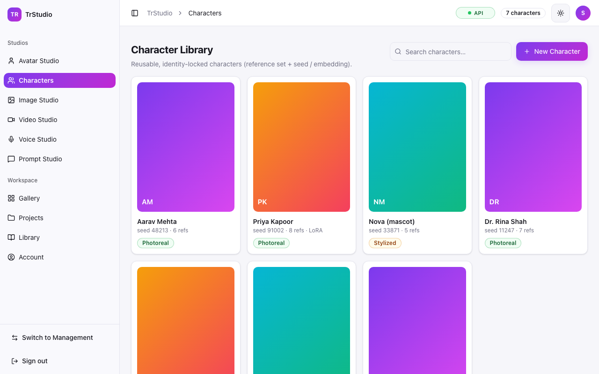

**Runtime:** renders — 1280 and 390, light and dark, test host, 2026-11-15 (`tests/.artifacts/verify/screens.json`).

**Call chain:** `CharacterLibrary.razor:SaveCharacterAsync` → `CharacterEndpoints.CreateCharacterAsync` (`POST /api/v1/characters`) → `CharacterService.CreateAsync` → `CharacterRepository.InsertAsync` → `"Character"`

| File and line | Function | Watch | Expected value |
|---|---|---|---|
| `src/TrStudioUI/Pages/Avatar/CharacterLibrary.razor:437` | `SaveCharacterAsync` | `vSeed` | the seed typed in `field-seed-lock`, else a random 10000–99999 |
| `src/TrStudio.InProcess/Routes/CharacterEndpoints.cs:56` | `CreateCharacterAsync` | `vResponse` | the new character; 201 Created, 400 on a bad request |
| `src/TrStudio.Engine/Domain/Characters/CharacterService.cs:64` | `CreateAsync` | `vCharacter` | name, description, realism (0 photoreal / 1 stylized), seed, loraRef |
| `src/TrStudio.Engine/Infrastructure/Data/CharacterRepository.cs:62` | `InsertAsync` | `InsertSql` (line 32) | one `"Character"` row (`src/TrStudioDb/Scripts/1100_Characters.sql`) |
| `src/TrStudioUI/Pages/Avatar/CharacterLibrary.razor:328` | `TryLoadCharactersAsync` | `vCharacters` | the creator's characters (`GET /api/v1/characters`); no run to reopen here |

**Controls (data-testid):** `btn-new-character`, `btn-create-a-character`, `btn-create-character`, `btn-cancel`, `field-image-gen-prompt`, `field-seed-lock`, `field-lora`, `field-search-characters`, `btn-action`, `btn-action-2`, `card-new-character`, `card-reference-embeddings`, `card-<n>` (character cards), `badge-<n>-characters`, `api-down-alert`

**Calculations on this screen:** `FilteredCharacters` (line 290, name contains the search text); `CountLabel` (line 477, "N characters"); `DeriveName` (from the opening words of the prompt).

### Image studio (`/image`)

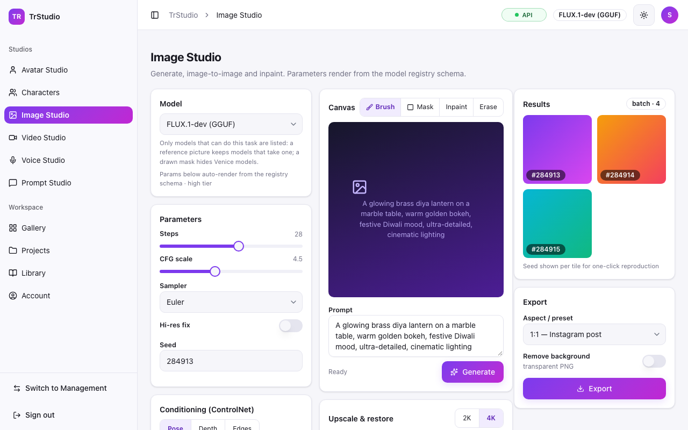

**Runtime:** renders — 1280 and 390, light and dark, test host, 2026-11-15 (`tests/.artifacts/verify/screens.json`).

**Call chain:** `ImageStudio.razor:TrySubmitJobAsync` → `SpineEndpoints.SubmitJobAsync` (`POST /api/v1/jobs`) → `JobOrchestrator.SubmitAsync` → `JobRepository.InsertAsync` → `"GenerationJob"`; results via `SpineEndpoints.GetJobResultAsync` → `AssetRepository.ListByJobAsync` → `"GeneratedAsset"`

| File and line | Function | Watch | Expected value |
|---|---|---|---|
| `src/TrStudioUI/Pages/Image/ImageStudio.razor:702` | `TrySubmitJobAsync` | `vRequest` | selected model, `ParamsJson` from `BuildParamsJson` (prompt from `field-prompt`), seed from `field-seed` |
| `src/TrStudio.InProcess/Routes/SpineEndpoints.cs:67` | `SubmitJobAsync` | `vResponse` | `JobSubmitResponse` with the new JobId |
| `src/TrStudio.Engine/Domain/Jobs/JobOrchestrator.cs:182` | `SubmitAsync` | `vJob` | one queued job after the safety and spend-cap checks |
| `src/TrStudio.Engine/Infrastructure/Data/JobRepository.cs:36` | `InsertAsync` | `vSql` | one `"GenerationJob"` row |
| `src/TrStudio.InProcess/Routes/SpineEndpoints.cs:175` | `GetJobResultAsync` | `vResponses` | assets with run details (ProviderKind, ActualCost) from `WorkspaceEndpoints.WithRunInfoAsync` |
| `src/TrStudioUI/Pages/Image/ImageStudio.razor:459` | `TryReopenLastRunAsync` | `vNewest` | newest image asset; its model, `ParamsJson` (line 468) and the job's tiles come back |

**Controls (data-testid):** `field-prompt`, `field-seed`, `btn-generate`, `btn-upscaling-face-restore`, `btn-export`, `field-aspect-preset`, `field-upscale-model`, `controlnet-upload`, `btn-pose`/`btn-depth`/`btn-edges`, `btn-brush`/`btn-mask`/`btn-inpaint`/`btn-erase`, `btn-2k`/`btn-4k`, `canvas`, `results-strip`, `result-tile`, `result-picture`, `progress`, `alert-over-cap`, `alert-sent-to-venice`, `alert-venice-failed`, `badge-cloud-venice`, `model-filter-note`, `field-<param>`/`switch-<n>` (from the model's params schema)

**Calculations on this screen:** `BuildParamsJson` (line 764, the job's parameters); `ImageModelFilter.Filter` (`ImageModelFilter.cs:46`, which models the picker shows); `ImageModelFilter.ScaleOf` (line 77, 2K→2, 4K→4); `FormatNumber` (line 877).

### Voice studio (`/voice`)

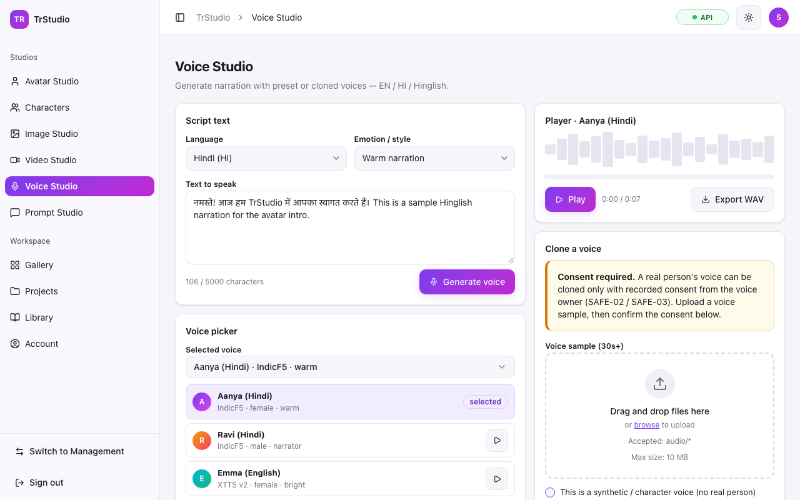

**Runtime:** renders — 1280 and 390, light and dark, test host, 2026-11-15 (`tests/.artifacts/verify/screens.json`).

**Call chain:** `VoiceStudio.razor:TrySynthesizeAsync` → `VoiceEndpoints.SynthesizeAsync` (`POST /api/v1/voice/synthesize`) → `VoiceSynthesizer.SynthesizeAsync` → `AssetRepository.InsertAsync` → `"GeneratedAsset"`

| File and line | Function | Watch | Expected value |
|---|---|---|---|
| `src/TrStudioUI/Pages/Voice/VoiceStudio.razor:695` | `TrySynthesizeAsync` | `vRequest` | Text from the script box, VoiceId of the picked voice, language, emotion, speed |
| `src/TrStudio.InProcess/Routes/VoiceEndpoints.cs:97` | `SynthesizeAsync` | `vResponse` | 400 when Text or VoiceId is empty; else the synthesis result |
| `src/TrStudio.Engine/Domain/Voice/VoiceSynthesizer.cs:101` | `SynthesizeAsync` | `vDuration` | estimated length; `Degraded` with "model-not-installed" when synthetic fallback is off |
| `src/TrStudio.Engine/Infrastructure/Data/AssetRepository.cs:35` | `InsertAsync` | SQL | one `"GeneratedAsset"` row (audio), called from `VoiceSynthesizer.cs:204` |
| `src/TrStudio.InProcess/Routes/VoiceEndpoints.cs:65` | `ListClonesAsync` (new) | `vClones` | the creator's clones, loaded by the page at `VoiceStudio.razor:409` |
| `src/TrStudioUI/Pages/Voice/VoiceStudio.razor:427` | `TryReopenLastClipAsync` | `vNewest` | newest narration audio; voice, language, emotion, speed and text restored, clip loaded at line 484 |

**Controls (data-testid):** `btn-generate-voice`, `voice-combobox`, `voice-list`, `field-1`..`field-4`, `field-this-is-a-synthetic-char`, `icon-btn-play-sample[-n]`, `badge-gated[-n]`, `badge-selected`, `btn-pause`, `btn-export-wav`, `voice-clone-upload`, `btn-create-clone-blocked-until-c`, `voice-waveform`, `voice-progress`, `progress`, `voice-catalog-empty`, `api-down-alert`, `alert-warn`

**Calculations on this screen:** `SyntheticAudio.EstimateDurationSeconds` (`SyntheticAudio.cs:22`, characters ÷ 14 ÷ speed clamped 0.5–2.0); `PlayPercent` (line 338, position ÷ duration × 100); `Clock` (line 562, m:ss).

### Video studio (`/video`)

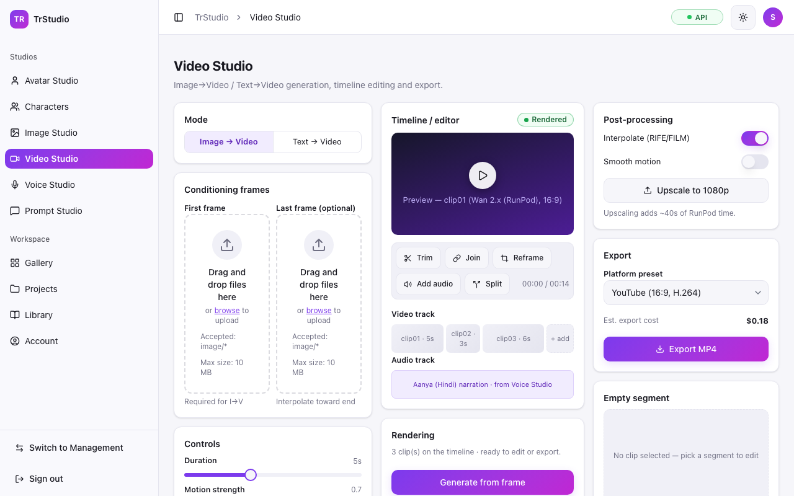

**Runtime:** renders — 1280 and 390, light and dark, test host, 2026-11-15 (`tests/.artifacts/verify/screens.json`).

**Call chain:** `VideoStudio.razor:TrySubmitJobAsync` → `SpineEndpoints.SubmitJobAsync` (`POST /api/v1/jobs`) → `JobOrchestrator.SubmitAsync` → `JobRepository.InsertAsync` → `"GenerationJob"`

| File and line | Function | Watch | Expected value |
|---|---|---|---|
| `src/TrStudioUI/Pages/Video/VideoStudio.razor:782` | `TrySubmitJobAsync` | `vRequest` | picked model (or tier default `svd-local`/`wan-video`/`heygen-video`), TextToVideo or ImageToVideo, `ParamsJson` with prompt from `t2v-prompt`, durationSeconds, aspectRatio |
| `src/TrStudio.InProcess/Routes/SpineEndpoints.cs:67` | `SubmitJobAsync` | `vResponse` | JobId; 402 when over the spend cap |
| `src/TrStudio.Engine/Domain/Jobs/JobOrchestrator.cs:182` | `SubmitAsync` | `vJob.CostEstimate` | Venice price or the registry estimate |
| `src/TrStudio.Engine/Infrastructure/Data/JobRepository.cs:36` | `InsertAsync` | `vSql` | one `"GenerationJob"` row |
| `src/TrStudioUI/Pages/Video/VideoStudio.razor:811` | `TrySubmitJobAsync` (poll) | `objEta`, `objVenicePrice` | Venice progress, ETA and ActualCost/CostEstimate |
| `src/TrStudioUI/Pages/Video/VideoStudio.razor:570` | `LoadTimelineAsync` | `vAssets` | past video assets (not lip-sync) rebuilt as timeline clips; newest narration found at line 604 |

**Controls (data-testid):** `generate-btn`, `t2v-prompt`, `mode-tabs`, `btn-text-video`, `btn-image-video`, `first-frame-upload`, `last-frame-upload`, `video-model-picker`, `field-video-model`, `field-character`, `duration-select`, `duration-slider`, `resolution-select`, `motion-slider`, `tier-group`, `switch`, `switch-2`, `btn-upscale-to-1080p`, `btn-export-mp4`, `timeline-toolbar`, `timeline-preview`, `timeline-empty`, `render-progress`, `venice-progress`, `alert-sent-to-venice`, `alert-venice-failed`, `badge-cloud-venice`

**Calculations on this screen:** `DurationSeconds` (line 446, the model's stated duration via `VideoModelFilter.Seconds`, else the slider); timeline total (line 479, sum of clip seconds); `FormatCost` (line 951); `VideoModelFilter.Allowed`/`KeepOrFirst` (allowed values per model).

### Prompt studio (`/prompt-studio`)

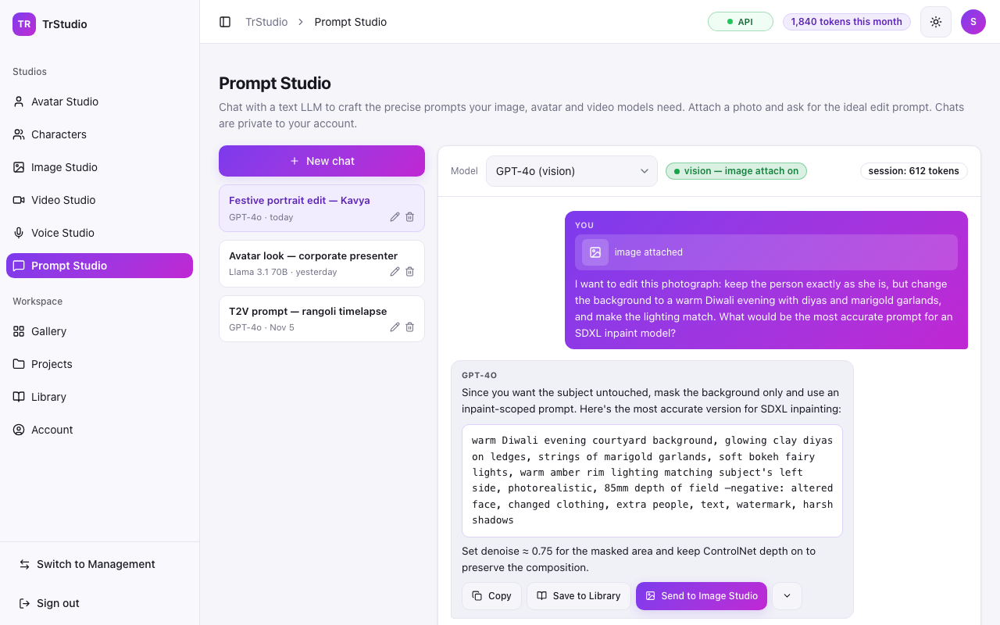

**Runtime:** renders — 1280 and 390, light and dark, test host, 2026-11-15 (`tests/.artifacts/verify/screens.json`).

**Call chain:** `PromptStudio.razor:SendMessageAsync` → `PromptChatEndpoints.PostMessageAsync` (`POST /api/v1/prompt-chat/sessions/{id}/messages`) → `PromptChatService.CompleteAsync` → `LlmTokenTracker.RecordUsageAsync` + `PromptChatRepository.TouchSessionAsync` → `"PromptChatSession"."Tokens"` (`src/TrStudioDb/Scripts/0621_PromptChatTokens.sql:6`)

| File and line | Function | Watch | Expected value |
|---|---|---|---|
| `src/TrStudioUI/Pages/PromptStudio/PromptStudio.razor:825` | `SendMessageAsync` | `vPost` | 200 with user and assistant turns; `vActive.Tokens` set from `SessionTokens` (line 856) |
| `src/TrStudio.InProcess/Routes/PromptChatEndpoints.cs:236` | `PostMessageAsync` | `vResult` | the completion, not `Rejected` |
| `src/TrStudio.InProcess/Routes/PromptChatEndpoints.cs:269` | `PostMessageAsync` | `vTurnTokens` | input + output tokens for this turn, 0 or more |
| `src/TrStudio.Engine/Domain/PromptChat/PromptChatService.cs:152` | `CompleteAsync` | `vInput`, `vOutput` | the provider's usage figures (estimated at length/4 when the model is not set up, line 338) |
| `src/TrStudio.Engine/Domain/Rag/LlmTokenTracker.cs:41` | `RecordUsageAsync` | `vUsage.InputTokens` | this month's total for the user (in memory; spend ledger is written only if cost > 0) |
| `src/TrStudio.Engine/Infrastructure/Data/PromptChatRepository.cs:157` | `TouchSessionAsync` | `aTokens` | `UPDATE "PromptChatSession" SET "Tokens" = "Tokens" + @aTokens` (SQL at line 61) |

**Controls (data-testid):** `prompt-studio`, `session-rail`, `btn-new-chat`, `btn-action` / `btn-action-N` (delete), `field-llmsel`, `badge-status`, `badge-{usage}`, `badge-{session tokens}`, `chat-thread`, `typing`, `prompt-block`, `card-1`, `btn-copy{n}`, `btn-save-to-library{n}`, `btn-send-to-image-studio{n}`, `field-describe-what-you-want-t`, `icon-btn-attach-image`, `btn-send`, `api-alert`, `rename-title`, `rename-confirm`, `save-name`, `save-preset-confirm`.

**Calculations on this screen:** `PromptChatEndpoints.PostMessageAsync` adds the turn's tokens (input + output) to the running total, so `SessionTokens` = stored total + this turn. `PromptChatService.EstimateUsage` (`:330`) estimates tokens as length/4 and cost as tokens/1000 × the synthetic rate. `UsageLabel` (`PromptStudio.razor:630`) formats this month's total from `GET /api/v1/rag/usage`. `SplitReply` (`:1158`) splits a reply into prompt blocks and prose.

### Gallery (`/gallery`)

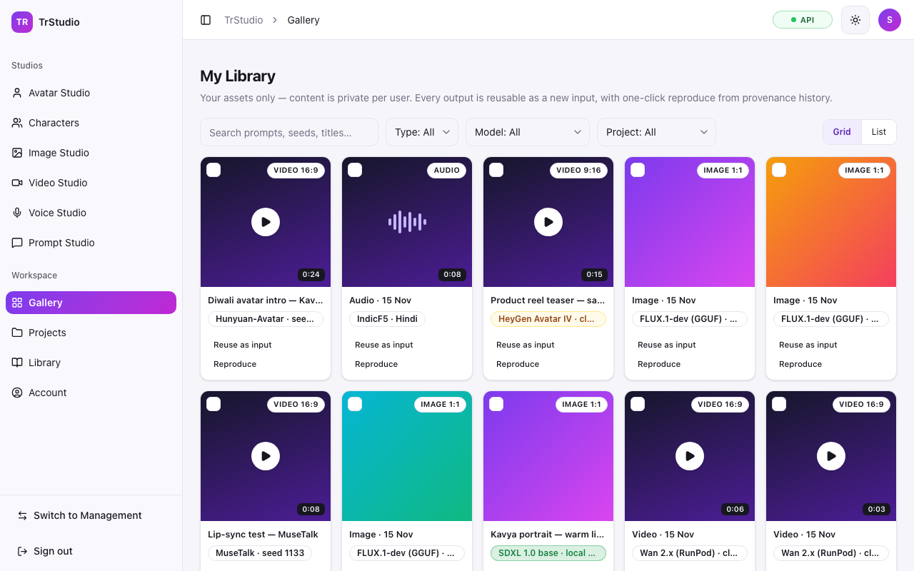

**Runtime:** renders — 1280 and 390, light and dark, test host, 2026-11-15 (`tests/.artifacts/verify/screens.json`).

**Call chain:** `Gallery.razor:TryLoadAssetsAsync` → `WorkspaceEndpoints.ListAssetsAsync` (`GET /api/v1/assets?aPageSize=100`) → no service (the route calls repositories directly) → `AssetRepository.ListAsync` + `GenerationLogRepository.ListByJobsAsync` → `"GeneratedAsset"`, `"GenerationLog"`

| File and line | Function | Watch | Expected value |
|---|---|---|---|
| `src/TrStudioUI/Pages/Gallery/Gallery.razor:355` | `TryLoadAssetsAsync` | `vPage` | the signed-in user's assets, newest first |
| `src/TrStudio.InProcess/Routes/WorkspaceEndpoints.cs:80` | `ListAssetsAsync` | `vPage` | assets filtered to the owner |
| `src/TrStudio.InProcess/Routes/WorkspaceEndpoints.cs:343` | `ToAssetResponse` | `ParamsJson`, `ProvenanceSigned` | the stored params; true only for a signed C2PA manifest |
| `src/TrStudio.InProcess/Routes/WorkspaceEndpoints.cs:310` | `WithRunInfoAsync` | `vEntries` | the latest log row for each job (provider, cost, failure) |
| `src/TrStudio.Engine/Infrastructure/Data/AssetRepository.cs:99` | `ListAsync` | `vSql` | `SELECT … FROM "GeneratedAsset" WHERE "UserId" = @aUserId … ORDER BY "CreatedUtc" DESC` |

**Controls (data-testid):** `field-search-prompts-seeds-tit`, `field-2`, `field-3`, `field-4` (NativeSelect filters), `btn-grid`, `btn-list` (segmented), `btn-clear-all`, `badge-{chip}`, `card-{n}`, `btn-reproduce`, `btn-reproduce-{n}`, `btn-export-selected`, `link-compare`, `card-asset-details`, `badge-provider-venice`, `venice-asset-details`, `venice-price`, `btn-go-to-image-studio`, `api-down-alert`.

**Calculations on this screen:** `Matches` (`Gallery.razor:372`) filters by type, model and project, and does a case-insensitive text search. `GalleryAsset.Aspect` (`:587`) reduces width:height by their GCD to get the aspect ratio. `FromResponse` (`:509`) picks the "where it ran" label from the provider kind. `BadgeTestIds` (`:406`) builds the badge test names.

### Projects (`/projects`)

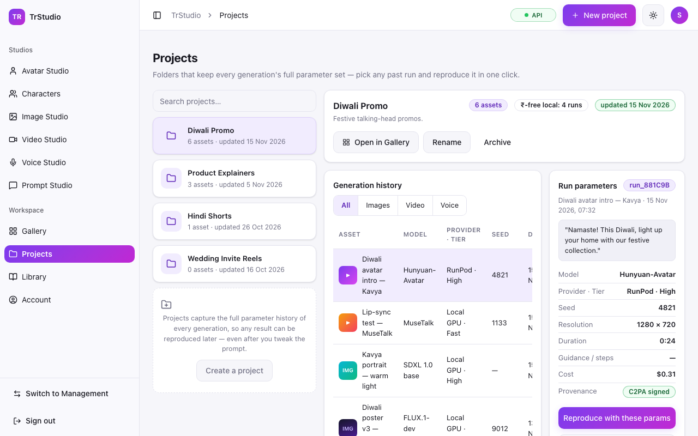

**Runtime:** renders — 1280 and 390, light and dark, test host, 2026-11-15 (`tests/.artifacts/verify/screens.json`).

**Call chain:** `Projects.razor:TryLoadProjectsAsync` / `LoadHistoryAsync` → `WorkspaceEndpoints.ListProjectsAsync` (`GET /api/v1/projects`) and `GetProjectHistoryAsync` (`GET /api/v1/projects/{id}/history`) → no service (repositories called directly) → `ProjectRepository.ListAsync` / `AssetRepository.ListAsync` → `"Project"`, `"GeneratedAsset"`

| File and line | Function | Watch | Expected value |
|---|---|---|---|
| `src/TrStudioUI/Pages/Projects/Projects.razor:363` | `TryLoadProjectsAsync` | `vProjects` | the user's projects, not archived |
| `src/TrStudioUI/Pages/Projects/Projects.razor:422` | `LoadHistoryAsync` | `vPage` | the selected project's runs and their `TotalCount` |
| `src/TrStudio.InProcess/Routes/WorkspaceEndpoints.cs:154` | `ListProjectsAsync` | `vProjects` | owner-scoped project rows |
| `src/TrStudio.InProcess/Routes/WorkspaceEndpoints.cs:289` | `GetProjectHistoryAsync` | `vHistory` | the project's assets (404 if the project belongs to someone else, line 280) |
| `src/TrStudio.Engine/Infrastructure/Data/ProjectRepository.cs:81` | `ListAsync` | `ListSql` | `SELECT … FROM "Project" WHERE "UserId" = @aUserId` |
| `src/TrStudio.Engine/Infrastructure/Data/AssetRepository.cs:99` | `ListAsync` | `vSql` | adds `AND "ProjectId" = @aProjectId` |

**Controls (data-testid):** `btn-new-project`, `btn-create-a-project`, `field-search-projects`, `card-5`, `card-6`, `card-9`, `badge-18-assets`, `btn-rename`, `btn-archive`, `btn-open-in-gallery`, `btn-{tab}` (segmented), `card-generation-history`, `table-1`, `badge-free-local-9-runs`, `btn-reproduce` / `btn-reproduce-{n}`, `card-run-parameters`, `badge-run-01jzk4`, `badge-c2pa-signed`, `badge-status`, `btn-copy-params-as-json`, `btn-reproduce-with-these-params`, `badge-provider-venice`, `venice-run-details`, `venice-price`, `venice-failure-reason`, `api-down-alert`.

**Calculations on this screen:** `FreeLocalRuns` (`Projects.razor:294`) counts runs where `IsFreeLocal` is true (local provider, cost null or 0; `:596`). `HistoryHint` gives "Showing n of m". `AssetCountLabel` (`:303`) uses `TotalCount` from `?aPageSize=1`. `VeniceRunDetailsFormat.PriceLabel` (`VeniceRunDetailsFormat.cs:24`) formats the price.

### Comparison (`/compare`)

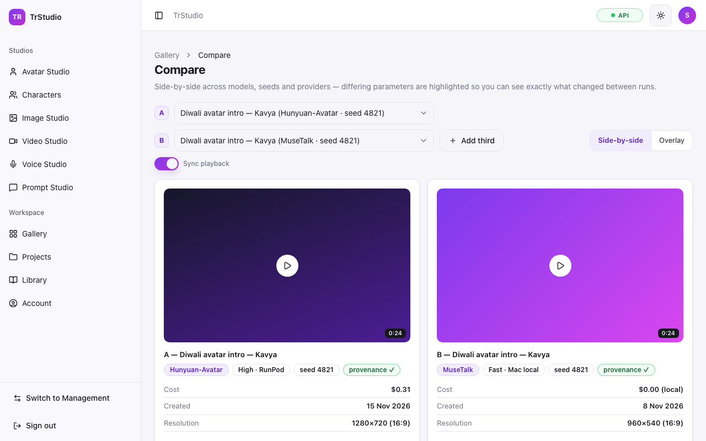

**Runtime:** renders — 1280 and 390, light and dark, test host, 2026-11-15 (`tests/.artifacts/verify/screens.json`).

**Call chain:** `Compare.razor:RefreshComparedParamsAsync` → `Phase9Endpoints.CompareAssetsAsync` (`GET /api/v1/compare?assetIds=`) → `AssetRepository.GetAsync` once per id (`"GeneratedAsset"`), then `AssetComparer.Compare` (no database access)

| File and line | Function | Watch | Expected value |
|---|---|---|---|
| `src/TrStudioUI/Pages/Compare/Compare.razor:311` | `TryLoadCompareAsync` | `vPage` | the user's assets that can fill a slot (`GET /api/v1/assets`) |
| `src/TrStudioUI/Pages/Compare/Compare.razor:352` | `RefreshComparedParamsAsync` | `vResponse` | one param dictionary per picked asset, keyed into `objParamsByAsset` |
| `src/TrStudio.InProcess/Routes/Phase9Endpoints.cs:105` | `CompareAssetsAsync` | `vAsset` | each owned asset (ids you don't own are skipped; fewer than 2 gives 400) |
| `src/TrStudio.InProcess/Routes/Phase9Endpoints.cs:117` | `CompareAssetsAsync` | `AssetComparer.Compare(vInputs)` | a `CompareResponse` |
| `src/TrStudio.Engine/Domain/Compare/AssetComparer.cs:20` | `Compare` | `aAssets` | the parsed `ParamsJson` for each asset |
| `src/TrStudio.Engine/Infrastructure/Data/AssetRepository.cs:64` | `GetAsync` | `vSql` | `SELECT … FROM "GeneratedAsset" WHERE "GeneratedAssetId" = @aAssetId AND "UserId" = @aUserId` |

**Controls (data-testid):** `compare-slotbar`, `field-{n}`, `btn-add-third`, `btn-side-by-side`, `btn-overlay`, `switch`, `switch-2`, `compare-panes`, `card-{n}`, `btn-reproduce{n}`, `btn-export{n}`, `link-open-in-gallery{n}`, `compare-diff`, `card-parameters-{N}-differ`, `table-1`, `alert-info`, `card-nothing-to-compare-yet`, `link-gallery`, `link-go-to-gallery`, `api-down-alert`.

**Calculations on this screen:** `BuildDiff` (`Compare.razor:495`) combines the model, provider, resolution, cost and seed rows with every param key from either asset; `DiffRow.Of` (`:669`) sets `Differs`. `DiffCount` (`:232`) counts the rows that differ. `CompareAsset.AspectOf` (`:652`) uses the GCD for the aspect ratio. `Humanize` (`:520`) turns key names into labels.

### Library (`/library`)

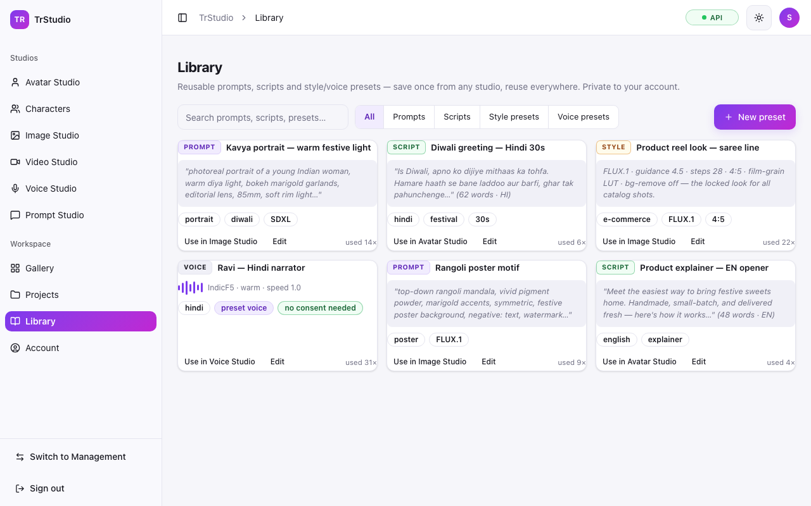

**Runtime:** renders — 1280 and 390, light and dark, test host, 2026-11-15 (`tests/.artifacts/verify/screens.json`).

**Call chain:** `Library.razor:TryLoadPresetsAsync` → `Phase9Endpoints.ListPresetsAsync` (`GET /api/v1/presets`) → no service (repository called directly) → `PresetRepository.ListAsync` → `"Preset"`

| File and line | Function | Watch | Expected value |
|---|---|---|---|
| `src/TrStudioUI/Pages/Library/Library.razor:326` | `TryLoadPresetsAsync` | `vPresets` | the user's presets |
| `src/TrStudioUI/Pages/Library/Library.razor:413` | `SavePresetAsync` | `vResponse` | POST (new) or PUT `/api/v1/presets/{id}` (edit), 2xx |
| `src/TrStudio.InProcess/Routes/Phase9Endpoints.cs:134` | `ListPresetsAsync` | `vPresets` | owner-filtered presets, optional type filter |
| `src/TrStudio.Engine/Infrastructure/Data/PresetRepository.cs:90` | `ListAsync` | `ListSql` | `SELECT … FROM "Preset" WHERE "UserId" = @aUserId …` (SQL at line 31) |

**Controls (data-testid):** `library-toolbar`, `field-search-prompts-scripts-p`, `btn-{tab}` (segmented: all/prompts/scripts/styles/voices), `btn-new-preset`, `preset-grid`, per-card names from `ControlNames`, `card-no-presets-yet`, `link-go-to-image-studio`, `preset-editor`, `save-preset-btn`, `api-down-alert`.

**Calculations on this screen:** `Matches` (`Library.razor:353`) filters by type tab and does a text search over name, snippet and tags. `ToApiType` / `FromApiType` (`:448`, `:457`) map style↔style-preset and voice↔voice-preset. `ControlNames` (`:472`) cuts test names at 30 characters and adds suffixes to repeats.

### Hardware & setup (`/admin/setup/hardware`)

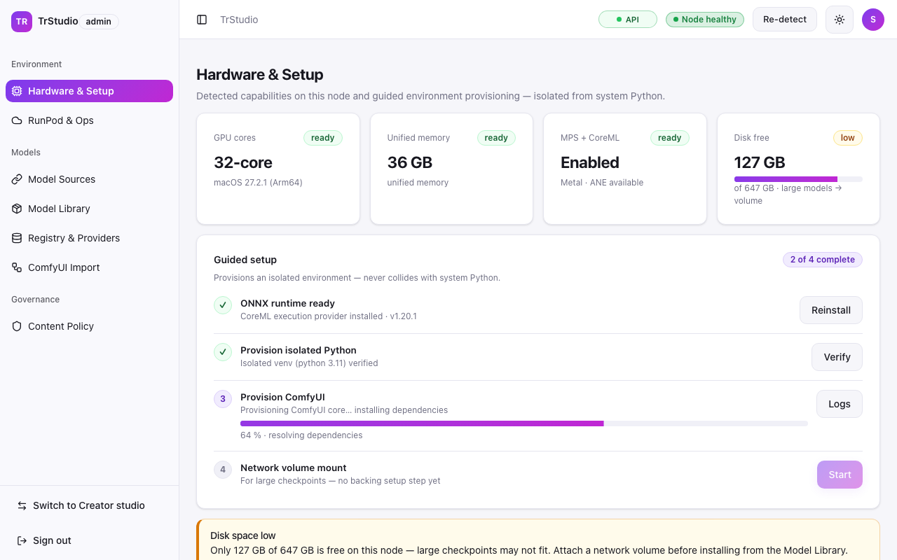

**Runtime:** renders — 1280 and 390, light and dark, test host, 2026-11-15 (`tests/.artifacts/verify/screens.json`).

**Call chain:** `AdminHardware.razor:TryLoadSetupAsync` → `SetupEndpoints.GetSetupStatusAsync` (`GET /api/v1/admin/setup`) → `SetupService.GetStatusAsync` → `SetupStateRepository.ListAsync` → `"SetupState"` (hardware cards: `GET /api/v1/admin/capabilities` → `CapabilityDetector.DetectAsync`, a host probe with no table)

| File and line | Function | Watch | Expected value |
|---|---|---|---|
| `src/TrStudioUI/Pages/Admin/AdminHardware.razor:337` | `TryLoadSetupAsync` | `vResponse` / `objSteps` | 200 with the live setup steps; the volume row stays last |
| `src/TrStudio.InProcess/InProcessEngineHandler.cs:78` | `SendAsync` (policy loop) | `vResult.Succeeded` | true for an admin (`AdminOnly`, set at `SetupEndpoints.cs:44`) |
| `src/TrStudio.InProcess/Routes/SetupEndpoints.cs:87` | `GetSetupStatusAsync` | `vStatus` | `SetupStatus` with `Steps` filled |
| `src/TrStudio.Engine/Infrastructure/Setup/SetupService.cs:43` | `GetStatusAsync` | `vSteps` | one row per setup step |
| `src/TrStudio.Engine/Infrastructure/Setup/SetupStateRepository.cs:36` | `ListAsync` | `vRows` | rows from `"SetupState"` |
| `src/TrStudio.Engine/Infrastructure/Capability/CapabilityDetector.cs:158` | `ApplyReadinessVerdict` | `IsReadyForLocalInference` | true only if CPU, RAM and free disk all meet the minimums |

**Controls (data-testid):** `btn-re-detect`, `card-guided-setup`, `badge-2-of-4-complete`, `badge-status`, `progress`, `progress-2`, `alert-warn`, `api-down-alert`, `capabilities-unavailable`, `link-configure-volume`, `link-model-library`, plus per-card/step ids built at runtime (`@vCardTestId`, `@vBadgeTestId`, `@vButtonId`).

**Calculations on this screen:** `ApplyReport` (`AdminHardware.razor:282`) works out disk-used % and the low-disk flag (free < 25% of total); `objCompletedSteps` (`:196`) counts the steps marked done; `CapabilityDetector.ApplyReadinessVerdict` (`:146`) sets the local-inference verdict.

### Model sources (`/admin/sources`)

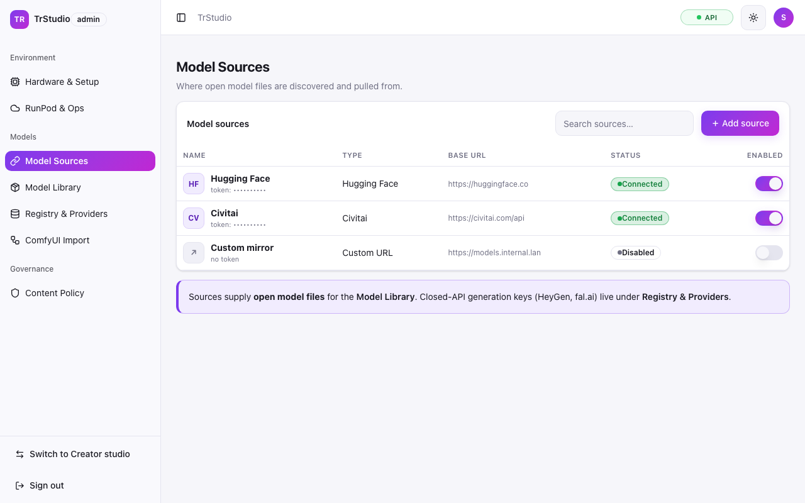

**Runtime:** renders — 1280 and 390, light and dark, test host, 2026-11-15 (`tests/.artifacts/verify/screens.json`).

**Call chain:** `AdminSources.razor:LoadSourcesAsync` → `SetupEndpoints.ListSourcesAsync` (`GET /api/v1/admin/sources`) → `ModelSourceRepository.ListAsync` → `"ModelSource"` (save: `Phase3Endpoints.CreateSourceAsync` / `UpdateSourceAsync` → `ModelSourceRepository.UpsertAsync`)

| File and line | Function | Watch | Expected value |
|---|---|---|---|
| `src/TrStudioUI/Pages/Admin/AdminSources.razor:354` | `LoadSourcesAsync` | `objRows` | the configured sources, mapped to rows |
| `src/TrStudio.InProcess/InProcessEngineHandler.cs:78` | `SendAsync` (policy loop) | `vResult.Succeeded` | true for an admin (`AdminOnly` at `SetupEndpoints.cs:60`, `Phase3Endpoints.cs:38`) |
| `src/TrStudio.InProcess/Routes/SetupEndpoints.cs:261` | `ListSourcesAsync` | `vSources` | the list (no service layer, the route calls the repo directly) |
| `src/TrStudio.Engine/Infrastructure/ModelSources/ModelSourceRepository.cs:52` | `ListAsync` | `vRows` | `"ModelSource"` rows ordered by `CreatedUtc`; tokens never returned |
| `src/TrStudioUI/Pages/Admin/AdminSources.razor:416` | `SaveSourceAsync` | `vResponse` | POST when new, PUT `/{id}` when editing; 2xx |
| `src/TrStudio.InProcess/Routes/Phase3Endpoints.cs:102` | `CreateSourceAsync` | `vSource` | upserted (`INSERT ... ON CONFLICT` at `ModelSourceRepository.cs:61`), returned with 201 |

**Controls (data-testid):** `btn-add-source`, `field-search-sources`, `card-model-sources`, `table-1`, `card-add-edit-source`, `badge-new`, `field-name`, `field-type`, `field-base-url`, `field-api-token`, `switch-4`, `btn-test-connection`, `test-ok`, `test-fail`, `btn-save`, `btn-cancel`, `alert-info`, `link-model-library`, `link-registry-providers`, plus per-row ids built at runtime.

**Calculations on this screen:** none.

### Model library (`/admin/models`)

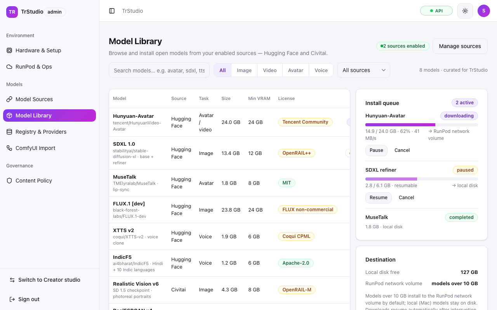

**Runtime:** renders — 1280 and 390, light and dark, test host, 2026-11-15 (`tests/.artifacts/verify/screens.json`).

**Call chain:** `AdminModels.razor:InstallAsync` → `SetupEndpoints.StartInstallAsync` (`POST /api/v1/admin/installs`) → `ModelInstallService.StartInstallAsync` → `ModelInstallRepository.InsertAsync` → `"ModelInstall"` (the queue reloads through `LoadQueueAsync` → `GET /api/v1/admin/installs` → `ModelInstallService.ListAsync`)

| File and line | Function | Watch | Expected value |
|---|---|---|---|
| `src/TrStudioUI/Pages/Admin/AdminModels.razor:517` | `InstallAsync` | `vRequest` | `ModelName` + `SourceId` of an enabled source; 2xx, then the queue reloads |
| `src/TrStudio.InProcess/InProcessEngineHandler.cs:78` | `SendAsync` (policy loop) | `vResult.Succeeded` | true for an admin (`AdminOnly` at `SetupEndpoints.cs:52`) |
| `src/TrStudio.InProcess/Routes/SetupEndpoints.cs:180` | `StartInstallAsync` | `vItem` | new install item; 400 if no model name, 404 if the source is unknown |
| `src/TrStudio.Engine/Infrastructure/Install/ModelInstallService.cs:85` | `StartInstallAsync` | `vItem` | queued install handed to the repo |
| `src/TrStudio.Engine/Infrastructure/Install/ModelInstallRepository.cs:36` | `InsertAsync` | SQL | `INSERT INTO "ModelInstall"` |
| `src/TrStudioUI/Pages/Admin/AdminModels.razor:419` | `LoadQueueAsync` | `objQueue` | cancelled items hidden; active first, then newest |

**Controls (data-testid):** `btn-all`, `btn-image`, `btn-video`, `btn-voice`, `btn-avatar` (segmented task filter), `field-search-models-e-g-avatar`, `field-2`, `table-1`, `btn-prev`, `btn-next`, `card-install-queue`, `badge-2-active`, `card-destination`, `card-1`, `badge-amber`, `badge-status`, `alert-info`, `alert-warn`, `no-sources-empty`, `link-hardware-setup`, `link-manage-sources`, `link-registry-providers`, plus row/action/state/license ids built at runtime.

**Calculations on this screen:** `FilteredCatalog` (`AdminModels.razor:305`) filters the hand-picked catalog by enabled source, search text, task and source; `TotalPages` (`:317`) is the page count; the destination rule (`:493`) sends models over `NetworkVolumeThresholdGb` (10 GB, `:298`) to the RunPod volume.

### Registry & providers (`/admin/registry`)

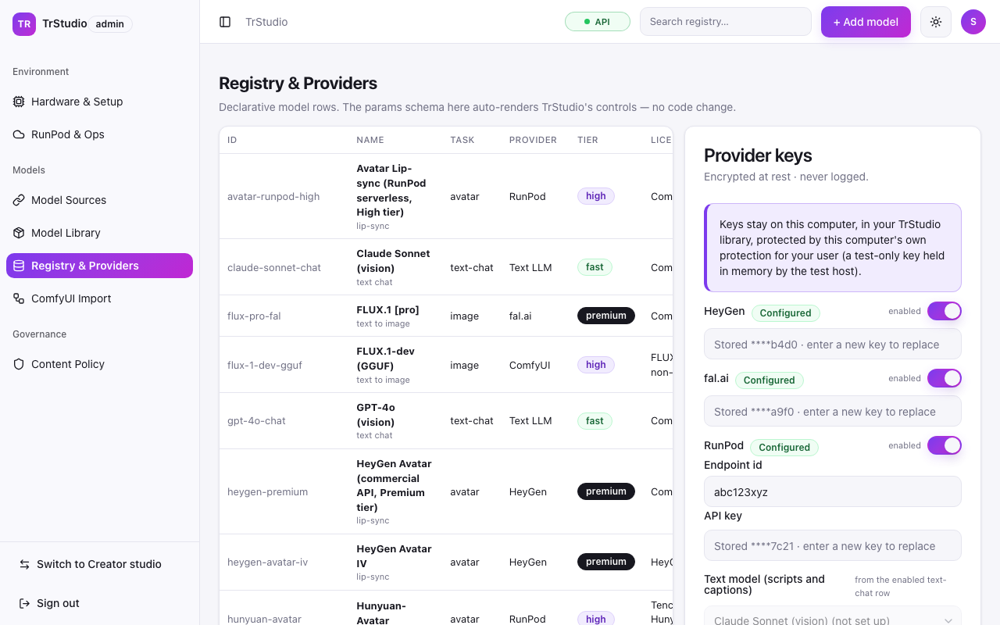

**Runtime:** renders — 1280 and 390, light and dark, test host, 2026-11-15 (`tests/.artifacts/verify/screens.json`).

**Call chain:** `AdminRegistry.razor:TryLoadRegistryAsync` → `RegistryEndpoints.ListRegistryAsync` (`GET /api/v1/admin/registry`) → `RegistryRepository.ListAsync` → `"RegistryModel"`; keys: `RegistryEndpoints.ListProviderKeysAsync` (`GET /api/v1/admin/providers/keys`) → `AesGcmKeyStore.ListMaskedAsync` → `ProviderKeyRepository.ListAsync` → `"ProviderKey"`

| File and line | Function | Watch | Expected value |
|---|---|---|---|
| `src/TrStudioUI/Pages/Admin/AdminRegistry.razor:539` | `TryLoadRegistryAsync` | `objRows` / `objModelsById` | every registry model (enabled and disabled) |
| `src/TrStudio.InProcess/InProcessEngineHandler.cs:78` | `SendAsync` (policy loop) | `vResult.Succeeded` | true for an admin (`AdminOnly` at `RegistryEndpoints.cs:45` and `:58`) |
| `src/TrStudio.InProcess/Routes/RegistryEndpoints.cs:88` | `ListRegistryAsync` | `vModels` | `ListAsync(false, ...)`, so disabled rows are included |
| `src/TrStudio.Engine/Infrastructure/Data/RegistryRepository.cs:83` | `ListAsync` | `vSql` | `SELECT ... FROM "RegistryModel"` |
| `src/TrStudio.InProcess/Routes/RegistryEndpoints.cs:149` | `ListProviderKeysAsync` | `vKeys` | masked keys, never plaintext (`AesGcmKeyStore.cs:68`) |
| `src/TrStudio.InProcess/Routes/RegistryEndpoints.cs:114` | `UpsertRegistryModelAsync` | `aRequest.Model` | saved by `SaveModelAsync` (`AdminRegistry.razor:889`); route id must match body id |

**Controls (data-testid):** `field-search-registry`, `btn-add-model`, `table-1`, `btn-row`, `card-edit-model`, `field-display-name`, `field-task`, `field-tier`, `field-provider`, `field-provider-model-id`, `btn-fill-from-venice`, `venice-model-fields`, `venice-fill-error`, `model-abilities`, `field-takes-reference-picture`, `field-keeps-fixed-character`, `param-values`, `field-error`, `btn-save`, `btn-cancel`, `card-provider-keys`, `key-protection-note`, `field-runpod-endpoint`, `provider-text-model`, `field-text-model`, `textchat-endpoint`, `textchat-key`, `textchat-model`, `textchat-vision`, `provider-venice`, `badge-cloud-venice`, `switch-venice`, `field-venice-address`, `field-venice-key`, `btn-test-connection`, `badge-connected`, `venice-error`, `alert-info`, `card-1`, plus tier/safety/provider/switch ids built at runtime.

**Calculations on this screen:** none.

### RunPod & ops (`/admin/ops`)

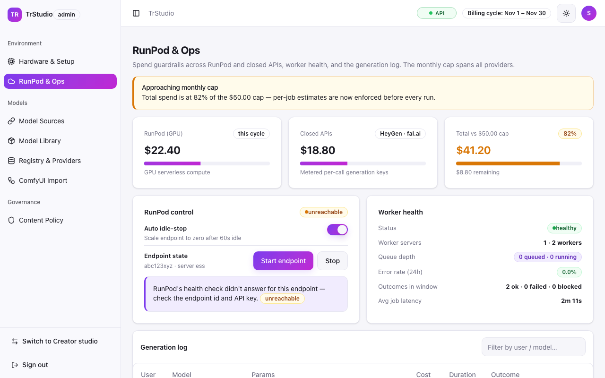

**Runtime:** renders — 1280 and 390, light and dark, test host, 2026-11-15 (`tests/.artifacts/verify/screens.json`).

**Call chain:** `AdminOps.razor:LoadAsync` → `Phase9Endpoints.GetOpsDashboardAsync` (`GET /api/v1/admin/ops`) → `OpsDashboardService.GetDashboardAsync` → `GenerationLogRepository.GetOutcomeCountsSinceAsync` → `"GenerationLog"` (plus `SpendLedger.GetSummaryAsync` → `"SpendRecord"`)

| File and line | Function | Watch | Expected value |
|---|---|---|---|
| `src/TrStudioUI/Pages/Admin/AdminOps.razor:352` | `LoadAsync` | `objOps` / `objSpend` | live dashboard; a failure sets `objApiDown` |
| `src/TrStudio.InProcess/InProcessEngineHandler.cs:78` | `SendAsync` (policy loop) | `vResult.Succeeded` | true for an admin (`AdminOnly` at `Phase9Endpoints.cs:40`) |
| `src/TrStudio.InProcess/Routes/Phase9Endpoints.cs:78` | `GetOpsDashboardAsync` | result | `OpsDashboardResponse` |
| `src/TrStudio.Engine/Domain/Ops/OpsDashboardService.cs:46` | `GetDashboardAsync` | `vOutcomes`, `vSpend`, `vHealthy` | outcome counts for the rolling window; healthy if a heartbeat is recent |
| `src/TrStudio.Engine/Infrastructure/Data/GenerationLogRepository.cs:124` | `GetOutcomeCountsSinceAsync` | SQL | `COUNT(*) ... FROM "GenerationLog" ... GROUP BY "Outcome"` |
| `src/TrStudio.Engine/Domain/Cost/SpendLedger.cs:64` | `GetSummaryAsync` | `vByChannel` | month-to-date totals by channel |

**Controls (data-testid):** `card-runpod-control`, `btn-start-endpoint`, `btn-stop`, `switch`, `runpod-unconfigured`, `badge-starting`, `card-worker-health`, `card-generation-log`, `field-filter-by-user-model`, `table-1`, `card-1`, `card-2`, `card-3`, `progress`, `progress-2`, `progress-3`, `badge-status`, `badge-status-2`, `badge-0-8`, `badge-2-jobs`, `badge-88`, `badge-billing-cycle-jun-1-jun`, `badge-heygen-fal-ai`, `badge-this-cycle`, `alert-info`, `alert-warn`, `api-down-alert`, plus per-row `@objRow.OutcomeTestId` / `@objRow.ReproduceTestId`.

**Calculations on this screen:** `OpsDashboardService.BuildErrorRate` (`:81`) gives the error rate as (failed + blocked) / total over the window; `GetDashboardAsync` adds up the enqueued and processing counts (`:66-67`); `AdminOps.MapSpend` (`AdminOps.razor:420`) splits spend into RunPod and closed-API channel totals against the monthly cap.

### ComfyUI import & debug (`/admin/comfy/import`)

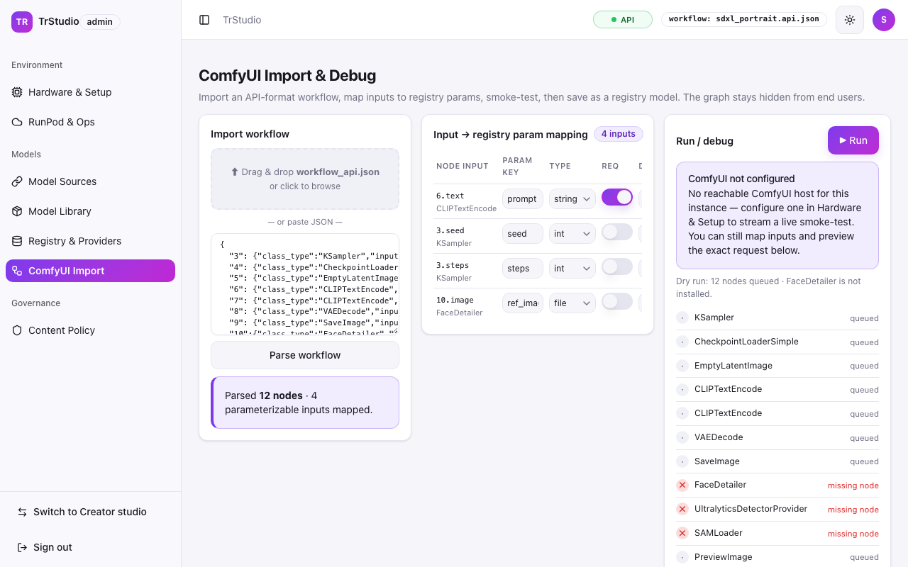

**Runtime:** renders — 1280 and 390, light and dark, test host, 2026-11-15 (`tests/.artifacts/verify/screens.json`).

**Call chain:** `AdminComfy.razor:SaveAsModelAsync` → `ComfyEndpoints.SaveAsModelAsync` (`POST /api/v1/admin/comfy/save-as-model`, body `ComfySaveAsModelRequest`) → `ComfyPipelineService.SaveAsModelAsync` → `ComfyWorkflowRepository.InsertWorkflowAsync` / `InsertVersionAsync` + `RegistryRepository.UpsertAsync` → `"ComfyWorkflow"`, `"ComfyWorkflowVersion"`, `"RegistryModel"`

| File and line | Function | Watch | Expected value |
|---|---|---|---|
| `src/TrStudioUI/Pages/Admin/AdminComfy.razor:772` | `SaveAsModelAsync` | `vRequest` | `ModelId` slug (`:753`), name, workflow JSON, mappings; a non-2xx shows the error body |
| `src/TrStudio.InProcess/InProcessEngineHandler.cs:78` | `SendAsync` (policy loop) | `vResult.Succeeded` | true for an admin (`AdminOnly` at `ComfyEndpoints.cs:36`) |
| `src/TrStudio.InProcess/Routes/ComfyEndpoints.cs:126` | `SaveAsModelAsync` | `vModel` | registered model; 401 if there is no user, 400 `COMFY_SAVE_ERROR` on an `ArgumentException` |
| `src/TrStudio.Engine/Domain/Comfy/ComfyPipelineService.cs:133` | `SaveAsModelAsync` | `vWorkflow`, `vVersion` | workflow inserted, then version (`:145`) |
| `src/TrStudio.Engine/Domain/Comfy/ComfyPipelineService.cs:164` | `SaveAsModelAsync` | `vModel` | registry row upserted |
| `src/TrStudio.Engine/Infrastructure/Data/ComfyWorkflowRepository.cs:36` | `InsertWorkflowAsync` | SQL | `INSERT INTO "ComfyWorkflow"` (version at `:77`) |

**Controls (data-testid):** `card-import-workflow`, `btn-parse-workflow`, `card-input-registry-param-mapping`, `table-1`, `badge-4-inputs`, `card-run-debug`, `btn-run`, `progress`, `card-exact-json-sent`, `btn-install-node`, `card-save-version`, `field-model-name-e-g-sdxl-port`, `btn-save-as-model`, `badge-known-good`, `badge-workflow-sdxl-portrait-a`, `field-1`, `field-15`, `field-error`, `alert-info`, `alert-warn`, plus mapping-row ids built at runtime.

**Calculations on this screen:** `ApplyDebug` (`AdminComfy.razor:642`) gives run progress as the share of nodes in state ok; `ApplyLocalProgression` (`:679`) gives progress up to the first missing dependency; `CanSave` (`:296`) needs a known-good run, no missing dependency and a model name.

### Content policy (`/admin/policy`)

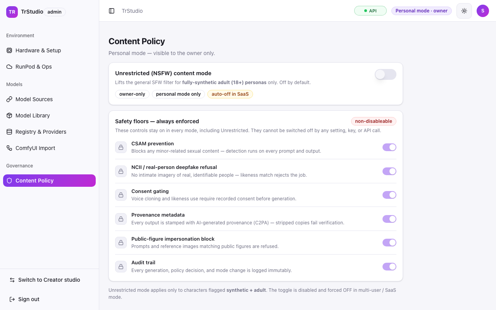

**Runtime:** renders — 1280 and 390, light and dark, test host, 2026-11-15 (`tests/.artifacts/verify/screens.json`).

**Call chain:** `AdminPolicy.razor:TryLoadPolicyAsync` → `SafetyEndpoints.GetNsfwPolicyAsync` (`GET /api/v1/admin/policy/nsfw`) → `SafetyPolicyService.GetNsfwPolicyAsync` → `SafetyPolicyRepository.GetAsync` → `"SafetyPolicy"` (save: `PersistAsync` → `PUT` → `SetNsfwEnabledAsync` → `UpsertAsync`)

| File and line | Function | Watch | Expected value |
|---|---|---|---|
| `src/TrStudioUI/Pages/Admin/AdminPolicy.razor:201` | `TryLoadPolicyAsync` | `objNsfwEnabled` (`:227`) | the effective NSFW flag; off by default |
| `src/TrStudio.InProcess/InProcessEngineHandler.cs:78` | `SendAsync` (policy loop) | `vResult.Succeeded` | true for an admin (`AdminOnly` at `SafetyEndpoints.cs:45`) |
| `src/TrStudio.InProcess/Routes/SafetyEndpoints.cs:100` | `GetNsfwPolicyAsync` | result | `NsfwPolicyResponse` |
| `src/TrStudio.Engine/Domain/Safety/SafetyPolicyService.cs:40` | `GetNsfwPolicyAsync` | `vStored` | stored flag, false if there is no row |
| `src/TrStudio.Engine/Infrastructure/Data/SafetyPolicyRepository.cs:30` | `GetAsync` | SQL | `FROM "SafetyPolicy" WHERE "PolicyKey" = 'default'` |
| `src/TrStudio.InProcess/Routes/SafetyEndpoints.cs:108` | `SetNsfwPolicyAsync` | `vResponse` | 409 when an enable is refused in multi-user mode, else 200 |

**Controls (data-testid):** `nsfw-switch`, `nsfw-confirm`, `nsfw-confirm-action`, `multiuser-note`, `card-1`, `card-safety-floors-always-enforced`, `badge-auto-off-in-saas`, `badge-non-disableable`, `badge-owner-only`, `badge-personal-mode-only`, `badge-personal-mode-owner`, plus per-floor `@vLockTestId`.

**Calculations on this screen:** `SafetyPolicyService.BuildResponse` (`:71`) sets effective NSFW = stored AND personal mode; `SetNsfwEnabledAsync` (`:49`) forces it off and saves false in multi-user mode.

## Cross-cutting flows

### Sign-in
**Call chain:** see the Sign in (`/login`) entry above; the session is stored through `IAuthSession` (desktop `MauiAuthSession`; the test host keeps the July web auth pieces) before navigation.

### Configuration, logging, errors
- Configuration: the named HttpClient `TrStudioApi` routes every page call in process (`src/TrStudio/MauiProgram.cs:67`; test host `tests/TrStudio.TestHost/Program.cs:69-70`); handler base address `http://trstudio.local/` (`src/TrStudio.InProcess/InProcessEngineHandler.cs:22`).
- Logging: Serilog (`src/TrStudio/MauiProgram.cs:50`, file logging `MauiProgram.cs:105-112`).
- Errors: pages catch the HTTP failure and show an inline `Alert`; see each entry's page handler row.

### How to fix a bug with this guide

1. Reproduce; note the **screen** and **control** (its `data-testid`).
2. Find the screen below or in its role file; set breakpoints at the rows of its where-to-break table.
3. Walk the chain top-down: Razor → in-process route → engine service → repository → SQL. The bug is in one of those hops.
4. If a value is *calculated*, the entry names the calculator method.
5. After fixing, re-run the screen's walkthrough in `docs/TrStudio-UsageGuide.md`, then re-run `*devguide TrStudio --update`.

## Known issues

The DevGuide's static map + runtime OBSERVE caught a cluster of **FE↔API wiring defects** — client calls a route the API doesn't expose, or a save handler that's toast-only, swallowed by try/catch so the screen still demos on seed data (which is why they passed visual verification). **✅ ALL 9 FIXED + RE-VERIFIED LIVE 2026-07-04** (`*fix-issues`) — each row is back to `Verified`; the table below is the record of what was caught and closed:

| # | REQ | Defect (file:line) |
|---|-----|--------------------|
| 1 | UI-071 | `SaveModelAsync`/`SaveKeysAsync` toast-only — zero persistence (`AdminRegistry.razor:346-362`) |
| 2 | UI-072 | ComfyUI FE routes `/status,/run,/install` ≠ BE `/debug,/dependencies,/smoke,/go-live` (`AdminComfy.razor:296-298`) |
| 3 | UI-070 | Guided-setup stepper `RunStepAsync` toast-only — doesn't call `POST /admin/setup/steps/{key}/run` |
| 4 | UI-010 | Avatar voice-preview → `/api/v1/voice` root (misses `/synthesize`); script-assist → non-existent `/rag/script-assist` |
| 5 | UI-040 | Video timeline Edit → `/api/v1/avatar/edit` instead of `/api/v1/video/edit` (`VideoStudio.razor:535`) |
| 6 | UI-030 | Voice `VoiceApiRoute="/api/v1/voice"` → `/presets` & root-POST miss `/preset-voices` & `/synthesize` |
| 7 | UI-053 | Library preset-type `style`/`voice` ≠ API `style-preset`/`voice-preset` → 400 (remark) |
| 8 | UI-011 | Character-bible Sheet renders static copy — never calls `GET /characters/{id}/bible` (remark) |
| 9 | UI-073 | **Runtime (OBSERVE):** `/admin/ops` doesn't reflow at 390px — 823px horizontal overflow, text clipped (`⚠ visual:`) |

**9 defects caught (8 static FE↔API wiring + 1 runtime visual), all FIXED + re-verified live 2026-07-04** — each fixed call now lands on the API request log (200/201; registry edit persists on reload; comfy `/status` probe removed; admin-ops `scrollWidth==390`). Only residual: `/video/edit` returns a clean 404 until a real source clip exists (placeholder-timeline limitation — the route is now correct). Core flows (job spine, tier routing, safety floors, per-user isolation, image ops, provenance, consent gate) were never affected. All nine `REQ-UI-*` rows are `Verified` in `docs/TrStudio-Checklist.md`. (The file:line references in this table are the July lines at the time of the fix.)

**Found while refreshing on 2026-11-15 (documented here only; not yet logged to the checklist):**
- Avatar studio does not reopen the newest run on load: `OnAfterRenderAsync` loads characters, voices, projects and spend only (see its entry's `{unresolved}` row).
- `SpineEndpoints.GetJobResultAsync` (`src/TrStudio.InProcess/Routes/SpineEndpoints.cs`) builds `AssetResponse` without `ParamsJson`, so `/jobs/{id}/result` returns it empty; the assets list route (`WorkspaceEndpoints.ToAssetResponse`) sets it, and the reopen-on-load code uses that route.
- Video studio's reopen is partial: it rebuilds the timeline and the newest narration (`VideoStudio.razor:570`, `:604`) but does not restore the last run's settings as Image and Voice do.

---
_Generated by `*devguide TrStudio` · reflects code as built · realigned 2026-07-05 for the one-app role-based consolidation (BRD-86 / ADR-012) + MAUI desktop head · 22 screen entries refreshed 2026-11-15 (`--update`). Regenerate after code changes._
